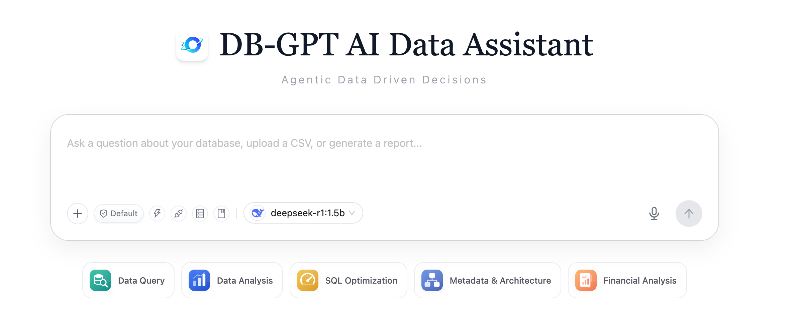
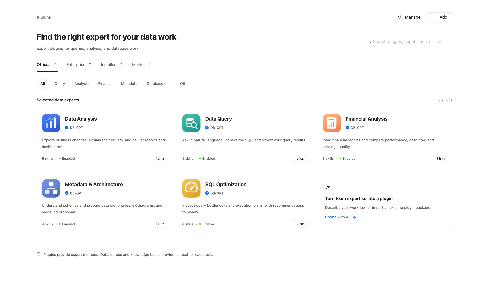
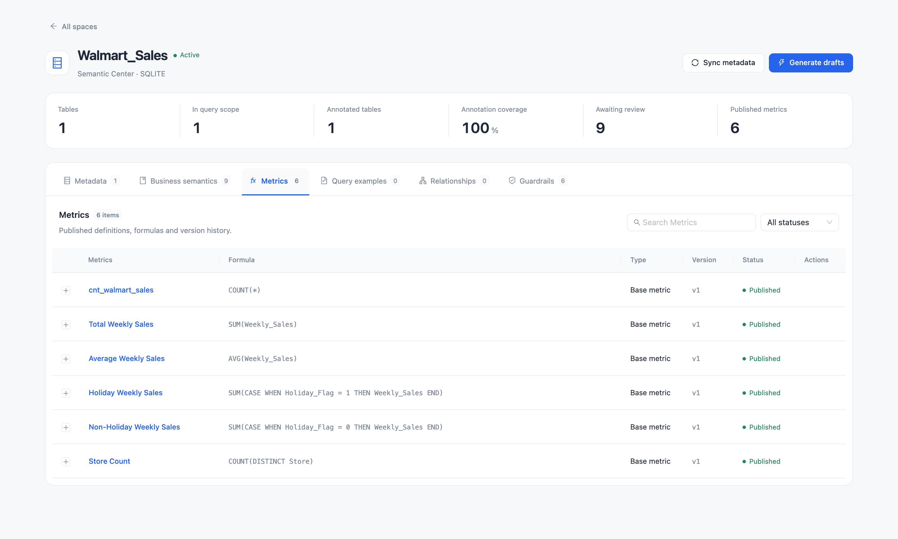
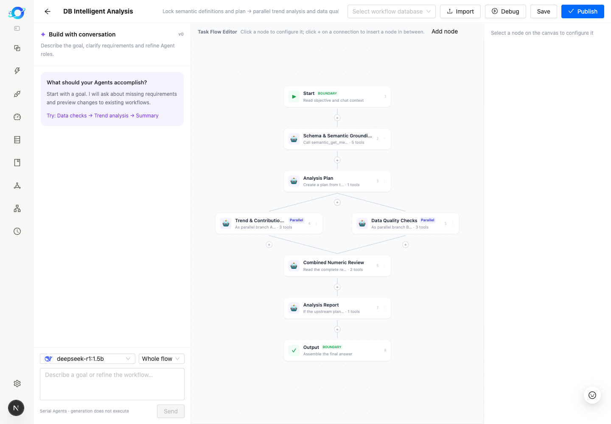

<p align="center">
  
</p>

<h1 align="center">DB-GPT: नियंत्रित डेटा एजेंटों के लिए ओपन-सोर्स उत्पाद</h1>

<p align="center">
  डेटा से जुड़े प्रश्न से सत्यापन योग्य क्वेरी, विश्लेषण रिपोर्ट और पुनः उपयोग योग्य डैशबोर्ड तक।
</p>

<p align="center">
  <a href="https://github.com/eosphoros-ai/DB-GPT/stargazers"></a>
  <a href="https://github.com/eosphoros-ai/DB-GPT/releases"></a>
  <a href="LICENSE"></a>
</p>

<p align="center">
  <a href="README.md">English</a> · <a href="README.zh.md">简体中文</a> · <a href="README.ja.md">日本語</a> · <a href="README.hi.md">हिन्दी</a> · <a href="README.ma.md">മലയാളം</a> · <a href="README.ta.md">தமிழ்</a>
</p>

<p align="center">
  <a href="http://docs.dbgpt.cn/docs/overview/">दस्तावेज़</a> · <a href="https://github.com/eosphoros-ai/DB-GPT/releases">रिलीज़</a> · <a href="https://github.com/orgs/eosphoros-ai/discussions">समुदाय</a> · <a href="#quick-start">त्वरित शुरुआत</a>
</p>

> **अपने डेटा को जोड़ें, व्यावसायिक परिभाषाएँ तय करें, विशेषज्ञ विधियाँ चुनें और कॉन्फ़िगर किए गए टूल तथा रनटाइम की सीमाओं में काम करें। परिणामों की जाँच करें, उन्हें संपादित करें और दोबारा उपयोग करें।**

DB-GPT केवल प्राकृतिक भाषा को SQL में नहीं बदलता। यह **डेटा कनेक्शन, व्यावसायिक अर्थ, विशेषज्ञ कौशल, कार्य समन्वय और विश्लेषण से बनी सामग्री** को एक कार्यप्रवाह में जोड़ता है। यह उपयोगकर्ताओं के लिए व्यावहारिक सहायक और डेवलपरों के लिए AI-आधारित डेटा अनुप्रयोग बनाने का विस्तार योग्य आधार है।

[उत्पाद डेमो](#product-demo) · [DB-GPT क्यों चुनें](#why-db-gpt) · [उत्पाद मॉड्यूल](#product-modules) · [सुरक्षा और निष्पादन सीमाएँ](#safety-and-execution-boundaries) · [त्वरित शुरुआत](#quick-start) · [समुदाय](#community)

<a id="product-demo"></a>

## उत्पाद डेमो

https://github.com/user-attachments/assets/36ddad2c-1021-4181-b31a-8fb216c93f81

<a id="why-db-gpt"></a>

## DB-GPT क्यों चुनें

### क्वेरी से पहले व्यावसायिक संदर्भ

‘राजस्व’ का अर्थ तारीख के निर्धारण, रिफ़ंड के व्यवहार और गणना के दायरे के अनुसार बदल सकता है। सेमांटिक सेंटर स्कीमा मेटाडेटा, व्यावसायिक अर्थ, मीट्रिक सूत्र और प्रकाशित संस्करण व्यवस्थित करता है, ताकि एजेंट हर प्रश्न पर अनुमान लगाने के बजाय स्पष्ट परिभाषाओं से काम करे।

### केवल उत्तर नहीं, विशेषज्ञ विधियाँ

क्वेरी, विश्लेषण, SQL अनुकूलन, मेटाडेटा और आर्किटेक्चर तथा वित्तीय विश्लेषण के लिए विशेष प्लगइन चुनें। Skills दोबारा उपयोग योग्य निर्देश और स्क्रिप्ट देते हैं; कार्यप्रवाह चरणों, निर्भरताओं और टूल कॉन्फ़िगरेशन को स्पष्ट करते हैं।

### पुनः उपयोग योग्य परिणाम

केवल चैट संदेशों के बजाय क्वेरी तालिकाएँ, चार्ट, विश्लेषण रिपोर्ट और संपादन योग्य डैशबोर्ड बनाएँ। निष्पादन और परिणाम की समीक्षा करें, बदलाव माँगें और अगली गतिविधि के लिए सामग्री सहेजें।

### महत्वपूर्ण कार्रवाइयों पर मानवीय नियंत्रण

मॉडल, टूल, डेटा स्रोत और रनटाइम का उपयोग परिनियोजन तथा कार्य कॉन्फ़िगरेशन पर निर्भर करता है। डैशबोर्ड योजना और प्रस्तावित बदलाव लागू करने से पहले जाँचे जा सकते हैं। **नियंत्रित निष्पादन पूर्ण सुरक्षा की गारंटी नहीं है**: न्यूनतम अधिकार वाले क्रेडेंशियल, उचित अलगाव और स्वतंत्र समीक्षा अपनाएँ।

<a id="product-modules"></a>

## उत्पाद मॉड्यूल

### कार्य शुरू करने का साझा स्थान



प्रश्न, फ़ाइल या डेटाबेस से शुरू करें। मॉडल और उपयुक्त विशेषज्ञ चुनें, उद्देश्य स्पष्ट करें और क्वेरी, विश्लेषण या डैशबोर्ड कार्य में आगे बढ़ें।

### 1. डैशबोर्ड: योजना से बोर्ड दृश्य तक

योजना या टेम्पलेट से शुरू करें, ड्राफ़्ट बनाएँ, विजेट और क्वेरी संपादित करें तथा पूरा बोर्ड दिखाने के लिए Preview खोलें।


*यह उत्पाद डेमो के दौरान वास्तव में बनाया और सहेजा गया Walmart डैशबोर्ड है, जिसे Preview बोर्ड दृश्य में दिखाया गया है। इसके चार विजेट बिक्री और स्टोर के KPI, साप्ताहिक रुझान और शीर्ष 10 की रैंकिंग दिखाते हैं। यह सहेजा हुआ ड्राफ़्ट है, सार्वजनिक रूप से प्रकाशित बोर्ड नहीं।*

- बनाने से पहले मीट्रिक, चार्ट और फ़िल्टर तय करें।
- विजेट, लेआउट, क्वेरी कॉन्फ़िगरेशन और फ़िल्टर समायोजित करें।
- AI सहायक के साथ बदलावों पर चर्चा करें और लागू करने से पहले प्रस्तावों की समीक्षा करें।
- ड्राफ़्ट सहेजें; परिणाम और पहुँच का दायरा तैयार होने पर ही प्रकाशित या साझा करें।

Walmart बोर्ड में उदाहरण डेटासेट का उपयोग किया गया है। इसकी संख्याएँ इस मामले को समझाती हैं, कंपनी के वर्तमान प्रदर्शन को नहीं।

### 2. प्लगइन और Skills: विशेषज्ञता का पुनः उपयोग

कार्य के लिए विशेषज्ञ प्लगइन चुनें और उसके डेटा, ज्ञान संदर्भ तथा अनुमत टूल जोड़ें। Skills में विषय-विशिष्ट निर्देश, विधियाँ और स्क्रिप्ट शामिल होते हैं।



| विशेषज्ञता | सामान्य कार्य |
| --- | --- |
| डेटा क्वेरी | प्रश्न और मीट्रिक स्पष्ट करना, SQL जाँचना व चलाना और परिणाम निर्यात करना |
| डेटा विश्लेषण | डेटा जाँचना, रुझान व संरचना का विश्लेषण और रिपोर्ट व डैशबोर्ड बनाना |
| SQL अनुकूलन | SQL और निष्पादन योजना जाँचना और समीक्षा के लिए सुधार सुझाना |
| मेटाडेटा और आर्किटेक्चर | डेटा शब्दकोश, संबंध और मॉडलिंग सुझाव व्यवस्थित करना |
| वित्तीय विश्लेषण | आवश्यक कॉन्फ़िगरेशन व डेटा उपलब्ध होने पर वित्तीय सामग्री पढ़ना और तुलनाएँ व्यवस्थित करना |

प्लगइन विधियाँ देते हैं, डेटा अनुमति नहीं। इंस्टॉल करने से पहले तीसरे पक्ष के निर्देश, स्क्रिप्ट, निर्भरताएँ और टूल पहुँच की समीक्षा करें।

### 3. डेटा स्रोत: विश्वसनीय कनेक्शन

डेटाबेस कनेक्शन प्रबंधित करें और हर कार्य के लिए स्रोत चुनें। क्वेरी, विश्लेषण और डैशबोर्ड समान कनेक्शन सूची तथा मेटाडेटा संदर्भ का उपयोग कर सकते हैं।


MySQL, PostgreSQL, SQLite, DuckDB, ClickHouse, Apache Doris, StarRocks, Oracle, MSSQL, Neo4j और TuGraph सहित विभिन्न डेटा स्रोत समर्थित हैं।

- डेटाबेस कनेक्शन कॉन्फ़िगर करें और जाँचें।
- कार्य को सही स्रोत से जोड़ें और उसका दायरा सुनिश्चित करें।
- कैटलॉग प्रविष्टि या कनेक्शन टेम्पलेट कार्यरत कनेक्शन का प्रमाण नहीं है। ड्राइवर, नेटवर्क पहुँच और क्रेडेंशियल उपलब्ध होने चाहिए।

### 4. सेमांटिक सेंटर: मीट्रिक परिभाषाओं का रखरखाव

स्रोत के आसपास मेटाडेटा, व्यावसायिक परिभाषाएँ, मीट्रिक, क्वेरी उदाहरण, संबंध और नियम व्यवस्थित करें। प्रकाशित परिभाषाओं के संस्करण सुरक्षित रहते हैं और क्वेरी परिणाम से जोड़े जा सकते हैं।



- तालिका व कॉलम के अर्थ, टिप्पणियाँ और पर्यायवाची बनाए रखें।
- मूल और व्युत्पन्न मीट्रिक, सूत्र और निर्भरताएँ परिभाषित करें।
- परिभाषाओं की समीक्षा करके प्रकाशित करें; केवल प्रकाशित परिभाषाएँ पढ़ते समय अप्रकाशित ड्राफ़्ट को प्रामाणिक न मानें।

### 5. कार्यप्रवाह: स्पष्ट चरण और सहयोग

विज़ुअल एडिटर से Agent नोड, इनपुट, आउटपुट, क्रमिक चरण और समानांतर शाखाएँ व्यवस्थित करें। दोहराए जाने वाले कार्यों के लिए स्पष्ट कार्यप्रवाह अपनाएँ।



यह टेम्पलेट संपादन दृश्य है, कार्यप्रवाह के डिबग या प्रकाशित होने का प्रमाण नहीं। चलाने से पहले डेटा स्रोत, मॉडल और टूल कॉन्फ़िगर करें।

### 6. ज्ञान, कनेक्टर और रनटाइम प्रबंधन

- **ज्ञान भंडार** खोज के लिए दस्तावेज़ संदर्भ देते हैं। पार्सिंग, विभाजन, इंडेक्सिंग और खोज कॉन्फ़िगरेशन उपलब्धता व गुणवत्ता को प्रभावित करते हैं।
- **कनेक्टर** कॉन्फ़िगर किए गए MCP सेवाओं से बाहरी टूल जोड़ते हैं। टेम्पलेट इस्तेमाल करने से पहले सक्रिय करना और अनुमति देना आवश्यक है।
- **मॉडल और रनटाइम** निर्भरताएँ व टूल पहुँच कॉन्फ़िगर करके प्रदाता और स्थानीय या कंटेनर निष्पादन चुनने देते हैं।
- **निर्धारित कार्य** काम दोहराते या सामग्री ताज़ा करते हैं। शेड्यूलर, मॉडल, फ़ाइल और स्रोत उपलब्ध रहने चाहिए।

## प्रश्न से परिणाम तक

**कनेक्ट करें → संदर्भ तय करें → योजना बनाएँ → निष्पादित करें → समीक्षा करें → पुनः उपयोग करें**

1. स्रोत चुनें और उद्देश्य, समय सीमा तथा मीट्रिक दायरा स्पष्ट करें।
2. फ़ील्ड, डेटा गुणवत्ता, व्यावसायिक परिभाषाएँ और मीट्रिक संस्करण जाँचें।
3. विशेषज्ञ और Skills चुनें; दोहराने योग्य कार्यों के लिए कार्यप्रवाह कॉन्फ़िगर करें।
4. अनुमत टूल और रनटाइम में SQL, कोड या खोज चलाएँ।
5. योजना, गणना, स्रोत, सामग्री और प्रस्तावित बदलावों की समीक्षा करें।
6. रिपोर्ट या डैशबोर्ड सहेजें; आवश्यक संचालन समर्थन होने पर ही शेड्यूलिंग कॉन्फ़िगर करें।

<a id="safety-and-execution-boundaries"></a>

## सुरक्षा और निष्पादन सीमाएँ

DB-GPT कॉन्फ़िगर किए जा सकने वाले निष्पादन और समीक्षा तंत्र देता है। प्रभावी सुरक्षा परिनियोजन पर निर्भर करती है:

- **डेटा पहुँच:** केवल पढ़ने और न्यूनतम अधिकार वाले क्रेडेंशियल चुनें। कैटलॉग के विवरणात्मक फ़्लैग पंक्ति या कॉलम स्तर का अधिकार नियंत्रण नहीं हैं।
- **अलगाव:** स्थानीय निष्पादन कंटेनर अलगाव नहीं है। फ़ाइल पहुँच, संसाधन सीमाएँ और नेटवर्क सीमाएँ कॉन्फ़िगर करें।
- **गोपनीय जानकारी:** API कुंजियाँ, डेटाबेस पासवर्ड और संवेदनशील डेटा कमिट, स्क्रीनशॉट या साझा सामग्री में न रखें।
- **समीक्षा:** महत्वपूर्ण मीट्रिक, गणना, SQL और बाहरी परिणामों का स्वतंत्र सत्यापन करें। मॉडल के परिणाम पेशेवर समीक्षा का विकल्प नहीं हैं।
- **प्रकाशन और शेड्यूलिंग:** ड्राफ़्ट, प्रकाशित स्नैपशॉट, साझा करना और निरंतर संचालन अलग अवस्थाएँ हैं। परिनियोजन से पहले पहुँच और उपलब्धता सुनिश्चित करें।

> क्षमताएँ रिलीज़, कॉन्फ़िगरेशन, स्कीमा माइग्रेशन और मॉडल व्यवहार पर निर्भर हैं। अपने संस्करण के कोड और दस्तावेज़ देखें; UI में विकल्प या पुराना डेमो उत्पादन-तत्परता की गारंटी नहीं है।

<a id="quick-start"></a>

## त्वरित शुरुआत

### विकल्प 1: macOS और Linux के लिए इंस्टॉलर

चलाने से पहले स्क्रिप्ट डाउनलोड करके उसकी समीक्षा करें:

```bash
curl -fsSL https://raw.githubusercontent.com/eosphoros-ai/DB-GPT/main/scripts/install/install.sh -o install.sh
less install.sh
bash install.sh
```

विज़ार्ड से प्रोफ़ाइल चुनें और मॉडल प्रदाता कॉन्फ़िगर करें। फिर इंस्टॉलर द्वारा बताए गए स्थान और स्टार्टअप कमांड का उपयोग करें:

```bash
cd ~/.dbgpt/DB-GPT
uv run dbgpt start webserver --profile <profile>
```

`<profile>` को कॉन्फ़िगर की गई प्रोफ़ाइल से बदलें और [http://localhost:5670](http://localhost:5670) खोलें।

<details>
<summary>मौजूदा सोर्स चेकआउट: वर्तमान ब्रांच बनाए रखें</summary>

रिपॉज़िटरी के मूल फ़ोल्डर से:

```bash
bash scripts/install/install.sh --profile openai --repo-dir "$(pwd)"
uv run dbgpt start webserver --profile openai
```

`--repo-dir` क्लोन या ब्रांच बदले बिना मौजूदा चेकआउट का उपयोग करता है। प्रदाता क्रेडेंशियल और आवश्यक सेवाएँ फिर भी कॉन्फ़िगर करनी होंगी।

निर्भरताएँ इंस्टॉल होने और उपयुक्त TOML कॉन्फ़िगरेशन उपलब्ध होने पर बैकएंड सीधे भी शुरू किया जा सकता है:

```bash
.venv/bin/python packages/dbgpt-app/src/dbgpt_app/dbgpt_server.py -c configs/dbgpt-proxy-openai.toml
```

फ़्रंटएंड विकास के लिए `web/` में `npm run dev -- --hostname 127.0.0.1 --port 3000` चलाएँ। UI चलना मॉडल अनुमान या डेटा पहुँच तैयार होने का प्रमाण नहीं है।

</details>

### विकल्प 2: PyPI

Python 3.10 या नया संस्करण उपयोग करें:

```bash
pip install dbgpt-app
dbgpt start
```

इंटरफ़ेस इस्तेमाल करने से पहले प्रदाता सेटअप पूरा करें। PyPI रिलीज़, `main` और फ़ीचर ब्रांच अलग हो सकते हैं; ब्रांच-विशिष्ट सुविधाएँ जाँचने के लिए संबंधित सोर्स चेकआउट उपयोग करें।

अन्य इंस्टॉलेशन और कॉन्फ़िगरेशन विकल्पों के लिए [दस्तावेज़](http://docs.dbgpt.cn/docs/overview/) देखें।

## डेवलपर इकोसिस्टम

- **DB-GPT:** डेटा एजेंट, टूल, निष्पादन और विश्लेषण अनुप्रयोगों का आधार।
- **[DB-GPT-Hub](https://github.com/eosphoros-ai/DB-GPT-Hub):** Text-to-SQL प्रशिक्षण और मूल्यांकन संसाधन।
- **[dbgpts](https://github.com/eosphoros-ai/dbgpts):** अनुप्रयोग, एजेंट और कार्यप्रवाह इकोसिस्टम।
- **[योगदान](CONTRIBUTING.md):** विकास, परीक्षण और योगदान संबंधी दिशानिर्देश।

प्रदाता समर्थन, ड्राइवर और निर्भरताओं के लिए वर्तमान दस्तावेज़ देखें; पुराने मॉडल की सूचियों को संगतता की गारंटी न मानें।

## दृष्टि और विकास

विश्वसनीय डेटा कार्य को खुला और संयोजनीय बनाएँ: उपयोगकर्ताओं को विश्लेषण पूरा करने में मदद दें और टीमों को व्यावसायिक संदर्भ, पुनः उपयोग योग्य विधियाँ तथा विश्लेषण सामग्री सहेजने दें।

विकास की दिशाओं में अर्थ की संगति, कार्य मूल्यांकन, निष्पादन निदान, पोर्टेबल Skills और कार्यप्रवाह तथा निगरानी योग्य आवर्ती कार्य शामिल हैं। प्रस्ताव और प्राथमिकताएँ [Issues](https://github.com/eosphoros-ai/DB-GPT/issues) और [Discussions](https://github.com/orgs/eosphoros-ai/discussions) में देखें; अपुष्ट रिलीज़ तारीखें न मानें।

<a id="community"></a>

## समुदाय

- [समस्या बताएँ या सुविधा सुझाएँ](https://github.com/eosphoros-ai/DB-GPT/issues)
- [उपयोग और डिज़ाइन पर चर्चा करें](https://github.com/orgs/eosphoros-ai/discussions)
- [सामुदायिक परियोजनाएँ देखें](https://github.com/eosphoros-ai/community)
- [X (Twitter) पर DB-GPT को फ़ॉलो करें](https://x.com/DBGPT_AI)
- [Discord से जुड़ें](https://discord.gg/7uQnPuveTY)
- [Slack से जुड़ें](https://join.slack.com/t/slack-inu2564/shared_invite/zt-29rcnyw2b-N~ubOD9kFc7b7MDOAM1otA)
- [योगदानकर्ताओं को देखें](https://github.com/eosphoros-ai/DB-GPT/graphs/contributors)

पुनरुत्पादित किए जा सकने वाले उदाहरण, सुधार, दस्तावेज़, Skills और कार्यप्रवाह में योगदान दें। समस्या बताते समय संस्करण, कॉन्फ़िगरेशन विधि और न्यूनतम पुनरुत्पादन चरण दें; लॉग से गोपनीय और संवेदनशील डेटा हटाएँ।

## योगदान

विस्तृत दिशानिर्देशों के लिए [योगदान कैसे करें](https://github.com/eosphoros-ai/DB-GPT/blob/main/CONTRIBUTING.md) देखें। कोड, दस्तावेज़, Skills, कार्यप्रवाह और पुनरुत्पादित उदाहरणों में योगदान का स्वागत है।

### योगदानकर्ता सूची

<a href="https://github.com/eosphoros-ai/DB-GPT/graphs/contributors">
  
</a>

## लाइसेंस और अस्वीकरण

DB-GPT [MIT लाइसेंस](LICENSE) के अंतर्गत वितरित है। [अस्वीकरण](DISCKAIMER.md) भी पढ़ें।

## अकादमिक उद्धरण

निम्न शोधपत्र परियोजना और संबंधित शोध का परिचय देते हैं। ये हर वर्तमान UI सुविधा की संगतता का विवरण नहीं हैं।

<details>
<summary>BibTeX संदर्भ</summary>

```bibtex
@article{xue2023dbgpt,
      title={DB-GPT: Empowering Database Interactions with Private Large Language Models},
      author={Siqiao Xue and Caigao Jiang and Wenhui Shi and Fangyin Cheng and Keting Chen and Hongjun Yang and Zhiping Zhang and Jianshan He and Hongyang Zhang and Ganglin Wei and Wang Zhao and Fan Zhou and Danrui Qi and Hong Yi and Shaodong Liu and Faqiang Chen},
      year={2023},
      journal={arXiv preprint arXiv:2312.17449},
      url={https://arxiv.org/abs/2312.17449}
}
@misc{huang2024romasrolebasedmultiagentdatabase,
      title={ROMAS: A Role-Based Multi-Agent System for Database monitoring and Planning},
      author={Yi Huang and Fangyin Cheng and Fan Zhou and Jiahui Li and Jian Gong and Hongjun Yang and Zhidong Fan and Caigao Jiang and Siqiao Xue and Faqiang Chen},
      year={2024},
      eprint={2412.13520},
      archivePrefix={arXiv},
      primaryClass={cs.AI},
      url={https://arxiv.org/abs/2412.13520}
}
@inproceedings{xue2024demonstration,
      title={Demonstration of DB-GPT: Next Generation Data Interaction System Empowered by Large Language Models},
      author={Siqiao Xue and Danrui Qi and Caigao Jiang and Wenhui Shi and Fangyin Cheng and Keting Chen and Hongjun Yang and Zhiping Zhang and Jianshan He and Hongyang Zhang and Ganglin Wei and Wang Zhao and Fan Zhou and Hong Yi and Shaodong Liu and Hongjun Yang and Faqiang Chen},
      year={2024},
      booktitle={Proceedings of the VLDB Endowment},
      url={https://arxiv.org/abs/2404.10209}
}
```

</details>

## Star वृद्धि का इतिहास

[](https://star-history.com/#csunny/DB-GPT)
