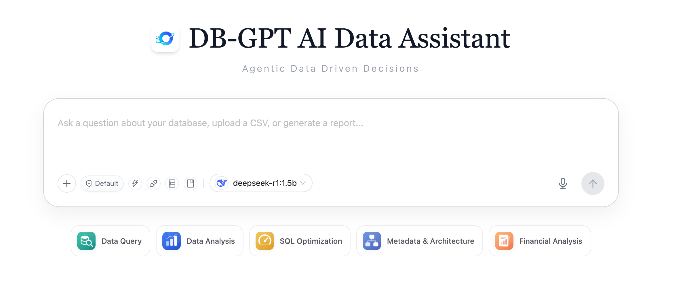
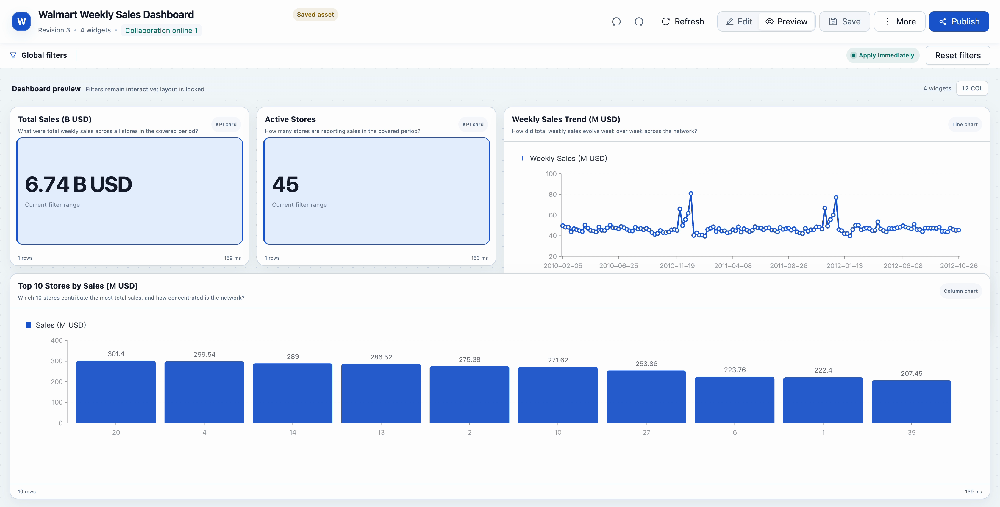
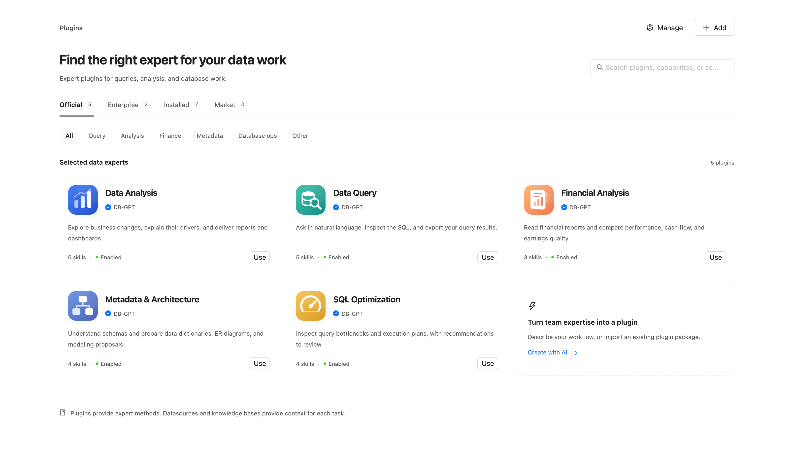
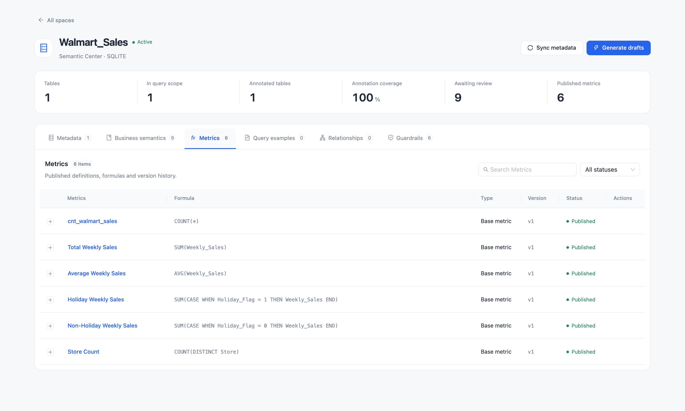
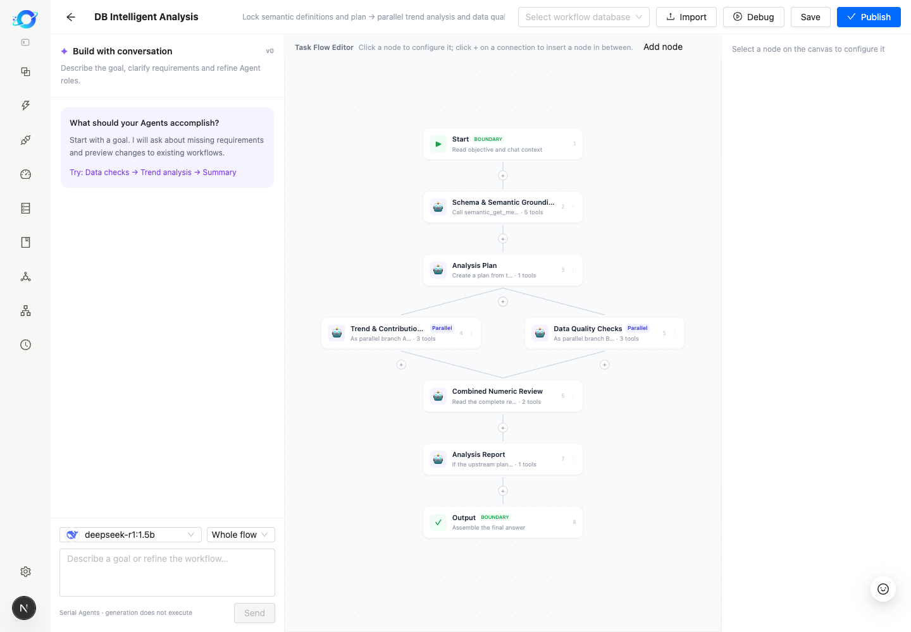

<p align="center">
  
</p>

<h1 align="center">DB-GPT：制御可能なデータエージェントのオープンソース製品</h1>

<p align="center">
  データに関する問いから、検証可能なクエリ、分析レポート、再利用可能なダッシュボードへ。
</p>

<p align="center">
  <a href="https://github.com/eosphoros-ai/DB-GPT/stargazers"></a>
  <a href="https://github.com/eosphoros-ai/DB-GPT/releases"></a>
  <a href="LICENSE"></a>
  <a href="https://x.com/DBGPT_AI"></a>
  <a href="https://discord.gg/7uQnPuveTY"></a>
</p>

<p align="center">
  <a href="README.md">English</a> · <a href="README.zh.md">简体中文</a> · <a href="README.ja.md">日本語</a> · <a href="README.hi.md">हिन्दी</a> · <a href="README.ma.md">മലയാളം</a> · <a href="README.ta.md">தமிழ்</a>
</p>

<p align="center">
  <a href="http://docs.dbgpt.cn/docs/overview/">ドキュメント</a> · <a href="https://github.com/eosphoros-ai/DB-GPT/releases">リリース</a> · <a href="https://github.com/orgs/eosphoros-ai/discussions">コミュニティ</a> · <a href="#quick-start">クイックスタート</a>
</p>

> **データを接続し、業務定義を整え、専門的な手法を選択し、設定済みのツールと実行環境の範囲内で処理を行います。結果は確認・編集・再利用できます。**

DB-GPT は自然言語を SQL に変換するだけではありません。**データ接続、業務セマンティクス、専門スキル、タスクのオーケストレーション、分析成果物**を一つのワークフローにまとめ、ユーザーには実用的なアシスタントを、開発者には AI ネイティブなデータアプリケーションを構築するための拡張可能な基盤を提供します。

[製品デモ](#product-demo) · [DB-GPT を選ぶ理由](#why-db-gpt) · [製品モジュール](#product-modules) · [安全性と実行の境界](#safety-and-execution-boundaries) · [クイックスタート](#quick-start) · [コミュニティ](#community)

<a id="product-demo"></a>

## 製品デモ

https://github.com/user-attachments/assets/36ddad2c-1021-4181-b31a-8fb216c93f81

<a id="why-db-gpt"></a>

## DB-GPT を選ぶ理由

### クエリの前に業務の文脈を理解する

「収益」は、日付の帰属、返金の扱い、集計範囲によって意味が異なります。セマンティックセンターは、スキーマのメタデータ、業務上の意味、指標の計算式、公開済みバージョンを整理し、エージェントが毎回推測するのではなく明確な定義に基づいて処理できるようにします。

### 回答だけでなく専門的な手法を提供する

クエリ、分析、SQL 最適化、メタデータとアーキテクチャ、財務分析には専用プラグインを利用できます。Skills は再利用可能な指示とスクリプトをまとめ、ワークフローは手順、依存関係、ツール設定を明示します。

### 再利用可能な成果物

チャットの回答だけでなく、クエリ結果の表、グラフ、分析レポート、編集可能なダッシュボードを生成します。実行内容と結果を確認し、変更を依頼して、次のタスクのために成果物を保存できます。

### 重要な操作を人が制御する

モデル、ツール、データソース、実行環境へのアクセスは、デプロイとタスク設定に依存します。ダッシュボードの計画や変更案は、適用前に確認できます。**制御された実行は絶対的な安全性を保証するものではありません**。最小権限の認証情報、適切な分離、独立した検証を使用してください。

<a id="product-modules"></a>

## 製品モジュール

### 共通のタスク入口



質問、ファイル、データベースから始めます。モデルと適切な専門エージェントを選び、目的を明確にして、クエリ、分析、ダッシュボードのタスクに進みます。

### 1. ダッシュボード：計画からボード表示へ

計画またはテンプレートから草稿を生成し、ウィジェットとクエリを編集します。Preview に切り替えてボード全体を表示します。



*これは製品デモで実際に生成・保存した Walmart ダッシュボードの Preview 表示です。4 つのウィジェットは売上と店舗数の KPI、週次推移、上位 10 店舗のランキングを示します。保存済みの草稿であり、一般公開されたボードではありません。*

- 生成前に指標、グラフ、フィルターを定義します。
- ウィジェット、レイアウト、クエリ設定、フィルターを調整します。
- AI アシスタントと変更を相談し、適用前に提案を確認します。
- 草稿を保存し、結果とアクセス範囲を確認してから公開・共有します。

この Walmart ボードにはサンプルデータを使用しています。数値はこの事例を説明するもので、現在の企業業績を示すものではありません。

### 2. プラグインと Skills：専門知識を再利用する

タスクに応じた専門プラグインを選び、データ、知識の文脈、許可されたツールを紐付けます。Skills は分野別の指示、手法、スクリプトをまとめます。



| 専門分野 | 主な作業 |
| --- | --- |
| データクエリ | 質問と指標を明確化し、SQL を確認・実行して結果を出力 |
| データ分析 | データを確認し、傾向と構成を分析してレポートやダッシュボードを作成 |
| SQL 最適化 | SQL と実行計画を確認し、レビュー可能な改善案を提示 |
| メタデータとアーキテクチャ | データ辞書、関係、モデリングの提案を整理 |
| 財務分析 | 設定とデータの前提を満たしたうえで財務資料を読み、比較を構造化 |

プラグインが提供するのは手法であり、データへのアクセス権限ではありません。導入前に第三者の指示、スクリプト、依存関係、ツールへのアクセス範囲を確認してください。

### 3. データソース：信頼できる接続

データベース接続を管理し、タスクごとに使用するソースを選択します。クエリ、分析、ダッシュボードは共通の接続一覧とメタデータの文脈を利用できます。


MySQL、PostgreSQL、SQLite、DuckDB、ClickHouse、Apache Doris、StarRocks、Oracle、MSSQL、Neo4j、TuGraph などのデータソースに対応しています。

- データベース接続を設定・確認します。
- タスクを適切なソースに紐付け、対象範囲を確認します。
- カタログ項目や接続テンプレートがあるだけでは接続成功の証明にはなりません。ドライバー、ネットワーク、認証情報が必要です。

### 4. セマンティックセンター：指標定義を維持する

ソースごとにメタデータ、業務定義、指標、クエリ例、関係、ルールを整理します。公開済み定義にはバージョンが保存され、クエリ結果と関連付けられます。



- 表と列の意味、注釈、同義語を維持します。
- 基本指標、派生指標、計算式、依存関係を定義します。
- 定義を確認・公開します。公開済み定義のみを読み取る場合、未公開の草稿を正式な定義として扱わないでください。

### 5. ワークフロー：手順と連携を明示する

ビジュアルエディターで Agent ノード、入出力、直列処理、並列分岐を構成します。繰り返し実行するタスクには明示的なワークフローが適しています。



これはテンプレート編集画面であり、ワークフローのデバッグや公開が完了した証拠ではありません。実行前にデータソース、モデル、ツールを設定してください。

### 6. ナレッジ、コネクター、実行環境の管理

- **ナレッジベース**は検索のための文書の文脈を提供します。解析、分割、インデックス、検索設定が利用可能性と品質に影響します。
- **コネクター**は設定済みの MCP サービスを通じて外部ツールを統合します。テンプレートは使用前に有効化と認可が必要です。
- **モデルと実行環境**では、依存関係とツールアクセスを設定し、プロバイダーやローカル・コンテナ実行を選択できます。
- **スケジュールタスク**は処理を再実行したり成果物を更新したりします。スケジューラー、モデル、ファイル、データソースが継続して利用できる必要があります。

## 質問から結果まで

**接続 → 文脈の確認 → 計画 → 実行 → レビュー → 再利用**

1. ソースを選び、目的、期間、指標の範囲を明確にします。
2. フィールド、データ品質、業務定義、指標バージョンを確認します。
3. 専門エージェントと Skills を選び、繰り返し処理にはワークフローを設定します。
4. 許可されたツールと実行環境で SQL、コード、検索を実行します。
5. 計画、計算、出典、成果物、変更案を確認します。
6. レポートやダッシュボードを保存します。必要な運用支援がある場合にのみスケジュールを設定します。

<a id="safety-and-execution-boundaries"></a>

## 安全性と実行の境界

DB-GPT は設定可能な実行・レビュー機構を提供します。実際の安全性はデプロイに依存します。

- **データアクセス：** 読み取り専用かつ最小権限の認証情報を推奨します。カタログの説明用フラグは行・列単位の権限制御ではありません。
- **分離：** ローカル実行はコンテナ分離とは異なります。ファイルアクセス、リソース制限、ネットワーク境界を設定してください。
- **秘密情報：** API キー、データベースパスワード、機密データをコミット、スクリーンショット、共有成果物に含めないでください。
- **レビュー：** 重要な指標、計算、SQL、外部出力を独立して検証してください。モデルの結果は専門的なレビューに代わるものではありません。
- **公開とスケジュール：** 草稿、公開スナップショット、共有、継続運用は異なる状態です。デプロイ前にアクセスと利用可能性を確認してください。

> 機能はリリース、設定、スキーマ移行、モデルの動作に依存します。使用中のバージョンのコードとドキュメントを参照してください。画面の入口や過去のデモは本番利用の準備完了を保証しません。

<a id="quick-start"></a>

## クイックスタート

### 方法 1：macOS・Linux 用インストーラー

実行前にスクリプトをダウンロードし、内容を確認してください。

```bash
curl -fsSL https://raw.githubusercontent.com/eosphoros-ai/DB-GPT/main/scripts/install/install.sh -o install.sh
less install.sh
bash install.sh
```

ウィザードに従ってプロファイルを選び、モデルプロバイダーを設定します。その後、インストーラーが表示するディレクトリと起動コマンドを使用してください。

```bash
cd ~/.dbgpt/DB-GPT
uv run dbgpt start webserver --profile <profile>
```

`<profile>` を設定済みプロファイルに置き換え、[http://localhost:5670](http://localhost:5670) を開きます。

<details>
<summary>既存のソースチェックアウト：現在のブランチを維持する</summary>

リポジトリのルートから実行します。

```bash
bash scripts/install/install.sh --profile openai --repo-dir "$(pwd)"
uv run dbgpt start webserver --profile openai
```

`--repo-dir` はクローンやブランチ切り替えを行わず、現在のチェックアウトを再利用します。プロバイダーの認証情報と必要なサービスの設定は別途必要です。

依存関係をインストールし、適切な TOML 設定を用意すれば、バックエンドを直接起動することもできます。

```bash
.venv/bin/python packages/dbgpt-app/src/dbgpt_app/dbgpt_server.py -c configs/dbgpt-proxy-openai.toml
```

フロントエンド開発では `web/` 内で `npm run dev -- --hostname 127.0.0.1 --port 3000` を実行します。UI が起動しても、モデル推論やデータアクセスの準備ができているとは限りません。

</details>

### 方法 2：PyPI

Python 3.10 以降を使用してください。

```bash
pip install dbgpt-app
dbgpt start
```

画面を使用する前にプロバイダーを設定してください。PyPI リリース、`main`、機能ブランチは異なる場合があります。ブランチ固有の機能を試す際は、対応するソースを使用してください。

その他のインストール・設定方法は[ドキュメント](http://docs.dbgpt.cn/docs/overview/)を参照してください。

## 開発者エコシステム

- **DB-GPT：** データエージェント、ツール、実行、分析アプリケーションの基盤。
- **[DB-GPT-Hub](https://github.com/eosphoros-ai/DB-GPT-Hub)：** Text-to-SQL の学習・評価用リソース。
- **[dbgpts](https://github.com/eosphoros-ai/dbgpts)：** アプリケーション、エージェント、ワークフローのエコシステム。
- **[貢献ガイド](CONTRIBUTING.md)：** 開発、テスト、貢献の指針。

プロバイダー、ドライバー、依存関係の対応状況は最新のドキュメントを参照し、過去のモデル一覧を互換性の保証として扱わないでください。

## ビジョンと進化

信頼できるデータ作業をオープンで組み合わせ可能にします。ユーザーの分析を支援し、チームが業務の文脈、再利用可能な手法、分析成果物を蓄積できるようにします。

開発では、セマンティクスの一貫性、タスク評価、実行診断、移植可能な Skills とワークフロー、監督可能な継続タスクに注力します。[Issues](https://github.com/eosphoros-ai/DB-GPT/issues) と [Discussions](https://github.com/orgs/eosphoros-ai/discussions) で提案と優先順位を確認してください。未確定のリリース日程は前提にしません。

<a id="community"></a>

## コミュニティ

- [問題の報告・機能提案](https://github.com/eosphoros-ai/DB-GPT/issues)
- [使い方と設計の議論](https://github.com/orgs/eosphoros-ai/discussions)
- [コミュニティのプロジェクト](https://github.com/eosphoros-ai/community)
- [X（Twitter）で DB-GPT をフォロー](https://x.com/DBGPT_AI)
- [Discord に参加](https://discord.gg/7uQnPuveTY)
- [Slack に参加](https://join.slack.com/t/slack-inu2564/shared_invite/zt-29rcnyw2b-N~ubOD9kFc7b7MDOAM1otA)
- [貢献者を見る](https://github.com/eosphoros-ai/DB-GPT/graphs/contributors)

再現可能な事例、修正、ドキュメント、Skills、ワークフローを歓迎します。問題を報告する際はバージョン、設定方法、最小限の再現手順を記載し、ログから秘密情報と機密データを除去してください。

## 貢献

詳しくは[貢献方法](https://github.com/eosphoros-ai/DB-GPT/blob/main/CONTRIBUTING.md)を参照してください。コード、ドキュメント、Skills、ワークフロー、再現可能な事例への貢献を歓迎します。

### 貢献者一覧

<a href="https://github.com/eosphoros-ai/DB-GPT/graphs/contributors">
  
</a>

## ライセンスと免責事項

DB-GPT は [MIT ライセンス](LICENSE)で配布されています。[免責事項](DISCKAIMER.md)もお読みください。

## 学術引用

以下の論文はプロジェクトと関連研究を紹介しています。現在のすべての UI 機能の互換性を説明するものではありません。

<details>
<summary>BibTeX 引用情報</summary>

```bibtex
@article{xue2023dbgpt,
      title={DB-GPT: Empowering Database Interactions with Private Large Language Models},
      author={Siqiao Xue and Caigao Jiang and Wenhui Shi and Fangyin Cheng and Keting Chen and Hongjun Yang and Zhiping Zhang and Jianshan He and Hongyang Zhang and Ganglin Wei and Wang Zhao and Fan Zhou and Danrui Qi and Hong Yi and Shaodong Liu and Faqiang Chen},
      year={2023},
      journal={arXiv preprint arXiv:2312.17449},
      url={https://arxiv.org/abs/2312.17449}
}
@misc{huang2024romasrolebasedmultiagentdatabase,
      title={ROMAS: A Role-Based Multi-Agent System for Database monitoring and Planning},
      author={Yi Huang and Fangyin Cheng and Fan Zhou and Jiahui Li and Jian Gong and Hongjun Yang and Zhidong Fan and Caigao Jiang and Siqiao Xue and Faqiang Chen},
      year={2024},
      eprint={2412.13520},
      archivePrefix={arXiv},
      primaryClass={cs.AI},
      url={https://arxiv.org/abs/2412.13520}
}
@inproceedings{xue2024demonstration,
      title={Demonstration of DB-GPT: Next Generation Data Interaction System Empowered by Large Language Models},
      author={Siqiao Xue and Danrui Qi and Caigao Jiang and Wenhui Shi and Fangyin Cheng and Keting Chen and Hongjun Yang and Zhiping Zhang and Jianshan He and Hongyang Zhang and Ganglin Wei and Wang Zhao and Fan Zhou and Hong Yi and Shaodong Liu and Hongjun Yang and Faqiang Chen},
      year={2024},
      booktitle={Proceedings of the VLDB Endowment},
      url={https://arxiv.org/abs/2404.10209}
}
```

</details>

## Star の推移

[](https://star-history.com/#csunny/DB-GPT)
