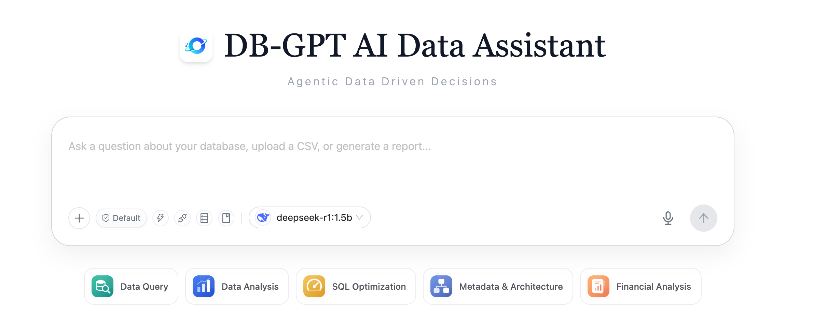
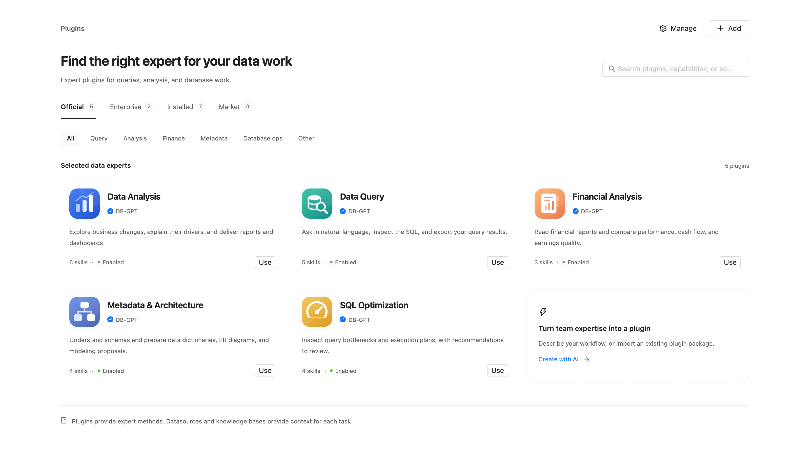
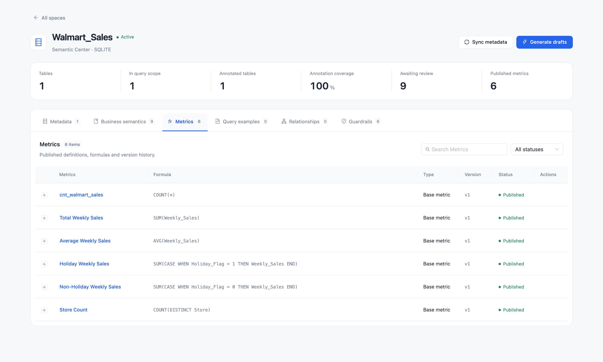
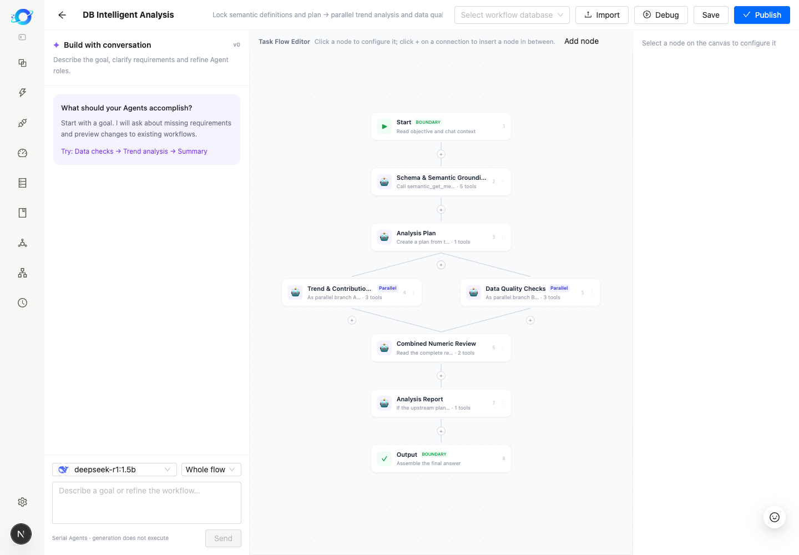

<p align="center">
  
</p>

<h1 align="center">DB-GPT: നിയന്ത്രിത ഡാറ്റാ ഏജന്റുകൾക്കായുള്ള ഓപ്പൺ സോഴ്‌സ് ഉൽപ്പന്നം</h1>

<p align="center">
  ഡാറ്റയെക്കുറിച്ചുള്ള ഒരു ചോദ്യത്തിൽ നിന്ന് പരിശോധിക്കാവുന്ന ക്വറികൾ, വിശകലന റിപ്പോർട്ടുകൾ, വീണ്ടും ഉപയോഗിക്കാവുന്ന ഡാഷ്ബോർഡുകൾ എന്നിവയിലേക്ക്.
</p>

<p align="center">
  <a href="https://github.com/eosphoros-ai/DB-GPT/stargazers"></a>
  <a href="https://github.com/eosphoros-ai/DB-GPT/releases"></a>
  <a href="LICENSE"></a>
  <a href="https://x.com/DBGPT_AI"></a>
  <a href="https://discord.gg/7uQnPuveTY"></a>
</p>

<p align="center">
  <a href="README.md">English</a> · <a href="README.zh.md">简体中文</a> · <a href="README.ja.md">日本語</a> · <a href="README.hi.md">हिन्दी</a> · <a href="README.ma.md">മലയാളം</a> · <a href="README.ta.md">தமிழ்</a>
</p>

<p align="center">
  <a href="http://docs.dbgpt.cn/docs/overview/">ഡോക്യുമെന്റേഷൻ</a> · <a href="https://github.com/eosphoros-ai/DB-GPT/releases">റിലീസുകൾ</a> · <a href="https://github.com/orgs/eosphoros-ai/discussions">കമ്മ്യൂണിറ്റി</a> · <a href="#quick-start">വേഗത്തിൽ ആരംഭിക്കുക</a>
</p>

> **നിങ്ങളുടെ ഡാറ്റ ബന്ധിപ്പിക്കുക, ബിസിനസ് നിർവചനങ്ങൾ സ്ഥാപിക്കുക, വിദഗ്ധ രീതികൾ തിരഞ്ഞെടുക്കുക, ക്രമീകരിച്ച ടൂളുകളുടെയും റൺടൈമുകളുടെയും പരിധിക്കുള്ളിൽ പ്രവർത്തിക്കുക. ഫലങ്ങൾ പരിശോധിക്കാനും തിരുത്താനും വീണ്ടും ഉപയോഗിക്കാനും കഴിയും.**

DB-GPT സ്വാഭാവിക ഭാഷയെ SQL ആക്കി മാറ്റുന്നതിൽ ഒതുങ്ങുന്നില്ല. **ഡാറ്റാ കണക്ഷനുകൾ, ബിസിനസ് അർത്ഥങ്ങൾ, വിദഗ്ധ നൈപുണ്യങ്ങൾ, ടാസ്‌ക് ഏകോപനം, വിശകലന ഫലങ്ങൾ** എന്നിവയെ ഒരേ വർക്ക്‌ഫ്ലോയിൽ കൂട്ടിച്ചേർക്കുന്നു. ഉപയോക്താക്കൾക്ക് പ്രായോഗിക സഹായിയും AI-അധിഷ്ഠിത ഡാറ്റാ ആപ്ലിക്കേഷനുകൾ നിർമ്മിക്കുന്ന ഡെവലപ്പർമാർക്ക് വികസിപ്പിക്കാവുന്ന അടിത്തറയുമാണ് ഇത്.

[ഉൽപ്പന്ന ഡെമോ](#product-demo) · [DB-GPT തിരഞ്ഞെടുക്കാനുള്ള കാരണങ്ങൾ](#why-db-gpt) · [ഉൽപ്പന്ന മൊഡ്യൂളുകൾ](#product-modules) · [സുരക്ഷയും നിർവഹണ പരിധികളും](#safety-and-execution-boundaries) · [വേഗത്തിൽ ആരംഭിക്കുക](#quick-start) · [കമ്മ്യൂണിറ്റി](#community)

<a id="product-demo"></a>

## ഉൽപ്പന്ന ഡെമോ

https://github.com/user-attachments/assets/36ddad2c-1021-4181-b31a-8fb216c93f81

<a id="why-db-gpt"></a>

## DB-GPT തിരഞ്ഞെടുക്കാനുള്ള കാരണങ്ങൾ

### ക്വറിക്ക് മുമ്പ് ബിസിനസ് സന്ദർഭം

‘വരുമാനം’ എന്നത് തീയതി കണക്കാക്കുന്ന രീതി, റീഫണ്ട് പരിഗണന, കണക്കിന്റെ പരിധി എന്നിവ അനുസരിച്ച് വ്യത്യാസപ്പെടാം. സെമാന്റിക് സെന്റർ സ്കീമ മെറ്റാഡാറ്റ, ബിസിനസ് അർത്ഥങ്ങൾ, മെട്രിക് സൂത്രവാക്യങ്ങൾ, പ്രസിദ്ധീകരിച്ച പതിപ്പുകൾ എന്നിവ ക്രമീകരിക്കുന്നു. അതുവഴി ഏജന്റ് ഓരോ ചോദ്യത്തിനും ഊഹിക്കുന്നതിന് പകരം വ്യക്തമായ നിർവചനങ്ങൾ അടിസ്ഥാനമാക്കി പ്രവർത്തിക്കുന്നു.

### ഉത്തരങ്ങൾ മാത്രമല്ല, വിദഗ്ധ രീതികളും

ക്വറികൾ, വിശകലനം, SQL ഒപ്റ്റിമൈസേഷൻ, മെറ്റാഡാറ്റയും ആർക്കിടെക്ചറും, സാമ്പത്തിക വിശകലനം എന്നിവയ്ക്കായി പ്രത്യേക പ്ലഗിനുകൾ ഉപയോഗിക്കുക. Skills വീണ്ടും ഉപയോഗിക്കാവുന്ന നിർദ്ദേശങ്ങളും സ്ക്രിപ്റ്റുകളും ഉൾക്കൊള്ളുന്നു; വർക്ക്‌ഫ്ലോകൾ ഘട്ടങ്ങൾ, ആശ്രിതത്വങ്ങൾ, ടൂൾ ക്രമീകരണങ്ങൾ എന്നിവ വ്യക്തമാക്കുന്നു.

### വീണ്ടും ഉപയോഗിക്കാവുന്ന ഫലങ്ങൾ

ചാറ്റ് സന്ദേശങ്ങൾ മാത്രമല്ല, ക്വറി പട്ടികകൾ, ചാർട്ടുകൾ, വിശകലന റിപ്പോർട്ടുകൾ, തിരുത്താവുന്ന ഡാഷ്ബോർഡുകൾ എന്നിവ സൃഷ്ടിക്കുക. നിർവഹണവും ഫലവും പരിശോധിച്ച് മാറ്റങ്ങൾ ആവശ്യപ്പെടാം; അടുത്ത ജോലിക്കായി ഫലം സൂക്ഷിക്കാം.

### പ്രധാന പ്രവർത്തനങ്ങളിൽ മനുഷ്യന്റെ നിയന്ത്രണം

മോഡലുകൾ, ടൂളുകൾ, ഡാറ്റാ സ്രോതസ്സുകൾ, റൺടൈം പ്രവേശനം എന്നിവ വിന്യാസത്തെയും ടാസ്‌ക് ക്രമീകരണത്തെയും ആശ്രയിച്ചിരിക്കുന്നു. ഡാഷ്ബോർഡ് പദ്ധതികളും നിർദ്ദേശിച്ച മാറ്റങ്ങളും പ്രയോഗിക്കുന്നതിന് മുമ്പ് പരിശോധിക്കാം. **നിയന്ത്രിത നിർവഹണം പൂർണ്ണ സുരക്ഷയുടെ ഉറപ്പല്ല**: കുറഞ്ഞ അനുമതിയുള്ള ക്രെഡൻഷ്യലുകൾ, യോജിച്ച വേർതിരിക്കൽ, സ്വതന്ത്ര പരിശോധന എന്നിവ ഉപയോഗിക്കുക.

<a id="product-modules"></a>

## ഉൽപ്പന്ന മൊഡ്യൂളുകൾ

### ജോലികൾ ആരംഭിക്കാനുള്ള പൊതുവായ ഇടം



ചോദ്യം, ഫയൽ അല്ലെങ്കിൽ ഡാറ്റാബേസ് ഉപയോഗിച്ച് ആരംഭിക്കുക. മോഡലും അനുയോജ്യമായ വിദഗ്ധനും തിരഞ്ഞെടുക്കുക, ലക്ഷ്യം വ്യക്തമാക്കുക, തുടർന്ന് ക്വറി, വിശകലനം അല്ലെങ്കിൽ ഡാഷ്ബോർഡ് ടാസ്‌കിലേക്ക് നീങ്ങുക.

### 1. ഡാഷ്ബോർഡുകൾ: പദ്ധതിയിൽ നിന്ന് ബോർഡ് കാഴ്ചയിലേക്ക്

പദ്ധതി അല്ലെങ്കിൽ ടെംപ്ലേറ്റ് ഉപയോഗിച്ച് കരട് സൃഷ്ടിക്കുക, വിഡ്ജറ്റുകളും ക്വറികളും തിരുത്തുക, മുഴുവൻ ബോർഡും കാണിക്കാൻ Preview തുറക്കുക.


*ഉൽപ്പന്ന ഡെമോയിൽ യഥാർത്ഥത്തിൽ സൃഷ്ടിച്ച് സൂക്ഷിച്ച Walmart ഡാഷ്ബോർഡിന്റെ Preview കാഴ്ചയാണിത്. നാല് വിഡ്ജറ്റുകൾ വിൽപ്പനയും സ്റ്റോർ എണ്ണവും സംബന്ധിച്ച KPI-കൾ, പ്രതിവാര പ്രവണത, മുൻനിര 10 റാങ്കിംഗ് എന്നിവ കാണിക്കുന്നു. ഇത് സൂക്ഷിച്ച കരടാണ്, പൊതുവായി പ്രസിദ്ധീകരിച്ച ബോർഡല്ല.*

- സൃഷ്ടിക്കുന്നതിന് മുമ്പ് മെട്രിക്കുകൾ, ചാർട്ടുകൾ, ഫിൽട്ടറുകൾ എന്നിവ നിർവചിക്കുക.
- വിഡ്ജറ്റുകൾ, ലേഔട്ട്, ക്വറി ക്രമീകരണം, ഫിൽട്ടറുകൾ എന്നിവ മാറ്റുക.
- AI സഹായിയുമായി മാറ്റങ്ങൾ ചർച്ച ചെയ്ത് പ്രയോഗിക്കുന്നതിന് മുമ്പ് നിർദ്ദേശങ്ങൾ പരിശോധിക്കുക.
- കരടുകൾ സൂക്ഷിക്കുക; ഫലവും പ്രവേശനപരിധിയും തയ്യാറായ ശേഷം മാത്രം പ്രസിദ്ധീകരിക്കുകയോ പങ്കിടുകയോ ചെയ്യുക.

ഈ Walmart ബോർഡിൽ ഉദാഹരണ ഡാറ്റാസെറ്റ് ഉപയോഗിക്കുന്നു. സംഖ്യകൾ ഈ കേസ് വിശദീകരിക്കുന്നതാണ്, കമ്പനിയുടെ നിലവിലെ പ്രകടനമല്ല.

### 2. പ്ലഗിനുകളും Skills-ഉം: വിദഗ്ധ അറിവിന്റെ പുനരുപയോഗം

ടാസ്‌കിനായി വിദഗ്ധ പ്ലഗിൻ തിരഞ്ഞെടുക്കുക; ഡാറ്റ, അറിവിന്റെ സന്ദർഭം, അനുവദിച്ച ടൂളുകൾ എന്നിവ ബന്ധിപ്പിക്കുക. Skills വിഷയാധിഷ്ഠിത നിർദ്ദേശങ്ങൾ, രീതികൾ, സ്ക്രിപ്റ്റുകൾ എന്നിവ ഉൾക്കൊള്ളുന്നു.



| വിദഗ്ധ മേഖല | സാധാരണ ജോലികൾ |
| --- | --- |
| ഡാറ്റാ ക്വറി | ചോദ്യവും മെട്രിക്കും വ്യക്തമാക്കുക, SQL പരിശോധിച്ച് പ്രവർത്തിപ്പിക്കുക, ഫലങ്ങൾ എക്സ്പോർട്ട് ചെയ്യുക |
| ഡാറ്റാ വിശകലനം | ഡാറ്റ പരിശോധിക്കുക, പ്രവണതയും ഘടനയും വിശകലനം ചെയ്യുക, റിപ്പോർട്ടുകളും ഡാഷ്ബോർഡുകളും തയ്യാറാക്കുക |
| SQL ഒപ്റ്റിമൈസേഷൻ | SQL-ഉം നിർവഹണ പദ്ധതിയും പരിശോധിച്ച് അവലോകനത്തിനായി മാറ്റങ്ങൾ നിർദ്ദേശിക്കുക |
| മെറ്റാഡാറ്റയും ആർക്കിടെക്ചറും | ഡാറ്റാ നിഘണ്ടു, ബന്ധങ്ങൾ, മോഡലിംഗ് നിർദ്ദേശങ്ങൾ എന്നിവ ക്രമീകരിക്കുക |
| സാമ്പത്തിക വിശകലനം | ക്രമീകരണവും ഡാറ്റാ മുൻവ്യവസ്ഥകളും പാലിച്ച് സാമ്പത്തിക രേഖകൾ വായിച്ച് താരതമ്യങ്ങൾ തയ്യാറാക്കുക |

പ്ലഗിനുകൾ രീതികളാണ് നൽകുന്നത്, ഡാറ്റാ അനുമതികളല്ല. ഇൻസ്റ്റാൾ ചെയ്യുന്നതിന് മുമ്പ് മൂന്നാം കക്ഷിയുടെ നിർദ്ദേശങ്ങൾ, സ്ക്രിപ്റ്റുകൾ, ആശ്രിതത്വങ്ങൾ, ടൂൾ പ്രവേശനം എന്നിവ പരിശോധിക്കുക.

### 3. ഡാറ്റാ സ്രോതസ്സുകൾ: വിശ്വസനീയമായ കണക്ഷനുകൾ

ഡാറ്റാബേസ് കണക്ഷനുകൾ നിയന്ത്രിക്കുകയും ഓരോ ടാസ്‌കിനും സ്രോതസ്സ് തിരഞ്ഞെടുക്കുകയും ചെയ്യുക. ക്വറികൾ, വിശകലനം, ഡാഷ്ബോർഡുകൾ എന്നിവയ്ക്ക് ഒരേ കണക്ഷൻ പട്ടികയും മെറ്റാഡാറ്റാ സന്ദർഭവും ഉപയോഗിക്കാം.


MySQL, PostgreSQL, SQLite, DuckDB, ClickHouse, Apache Doris, StarRocks, Oracle, MSSQL, Neo4j, TuGraph തുടങ്ങിയ ഡാറ്റാ സ്രോതസ്സുകളെ പിന്തുണയ്ക്കുന്നു.

- ഡാറ്റാബേസ് കണക്ഷനുകൾ ക്രമീകരിച്ച് പരിശോധിക്കുക.
- ടാസ്‌ക് അനുയോജ്യമായ സ്രോതസ്സുമായി ബന്ധിപ്പിച്ച് പരിധി ഉറപ്പാക്കുക.
- കാറ്റലോഗ് എൻട്രിയോ കണക്ഷൻ ടെംപ്ലേറ്റോ പ്രവർത്തിക്കുന്ന കണക്ഷന്റെ തെളിവല്ല. ഡ്രൈവറുകൾ, നെറ്റ്‌വർക്ക് പ്രവേശനം, ക്രെഡൻഷ്യലുകൾ എന്നിവ ആവശ്യമാണ്.

### 4. സെമാന്റിക് സെന്റർ: മെട്രിക് നിർവചനങ്ങളുടെ പരിപാലനം

ഒരു സ്രോതസ്സുമായി ബന്ധപ്പെട്ട മെറ്റാഡാറ്റ, ബിസിനസ് നിർവചനങ്ങൾ, മെട്രിക്കുകൾ, ക്വറി ഉദാഹരണങ്ങൾ, ബന്ധങ്ങൾ, നിയമങ്ങൾ എന്നിവ ക്രമീകരിക്കുക. പ്രസിദ്ധീകരിച്ച നിർവചനങ്ങളുടെ പതിപ്പുകൾ സൂക്ഷിക്കുകയും ക്വറി ഫലവുമായി ബന്ധിപ്പിക്കുകയും ചെയ്യാം.



- പട്ടികയുടെയും കോളത്തിന്റെയും അർത്ഥങ്ങൾ, കുറിപ്പുകൾ, സമാനപദങ്ങൾ എന്നിവ പരിപാലിക്കുക.
- അടിസ്ഥാനവും വ്യുത്പന്നവുമായ മെട്രിക്കുകൾ, സൂത്രവാക്യങ്ങൾ, ആശ്രിതത്വങ്ങൾ എന്നിവ നിർവചിക്കുക.
- നിർവചനങ്ങൾ പരിശോധിച്ച് പ്രസിദ്ധീകരിക്കുക; പ്രസിദ്ധീകരിച്ചവ മാത്രം വായിക്കുമ്പോൾ പ്രസിദ്ധീകരിക്കാത്ത കരടിനെ ആധികാരികമായി കാണരുത്.

### 5. വർക്ക്‌ഫ്ലോ: വ്യക്തമായ ഘട്ടങ്ങളും സഹകരണവും

വിഷ്വൽ എഡിറ്റർ ഉപയോഗിച്ച് Agent നോഡുകൾ, ഇൻപുട്ടുകൾ, ഔട്ട്പുട്ടുകൾ, ക്രമാനുസൃത ഘട്ടങ്ങൾ, സമാന്തര ശാഖകൾ എന്നിവ ക്രമീകരിക്കുക. ആവർത്തിക്കുന്ന ജോലികൾക്ക് വ്യക്തമായ വർക്ക്‌ഫ്ലോകൾ ഉപയോഗിക്കുക.



ഇത് ടെംപ്ലേറ്റ് തിരുത്തൽ കാഴ്ചയാണ്; വർക്ക്‌ഫ്ലോ ഡീബഗ് ചെയ്തതിന്റെയോ പ്രസിദ്ധീകരിച്ചതിന്റെയോ തെളിവല്ല. പ്രവർത്തിപ്പിക്കുന്നതിന് മുമ്പ് ഡാറ്റാ സ്രോതസ്സ്, മോഡൽ, ടൂളുകൾ എന്നിവ ക്രമീകരിക്കുക.

### 6. അറിവ്, കണക്ടറുകൾ, റൺടൈം നിയന്ത്രണം

- **അറിവ് ശേഖരങ്ങൾ** തിരച്ചിലിന് രേഖകളുടെ സന്ദർഭം നൽകുന്നു. പാർസിംഗ്, വിഭജനം, ഇൻഡെക്സിംഗ്, തിരച്ചിൽ ക്രമീകരണം എന്നിവ ലഭ്യതയെയും ഗുണനിലവാരത്തെയും ബാധിക്കുന്നു.
- **കണക്ടറുകൾ** ക്രമീകരിച്ച MCP സേവനങ്ങളിലൂടെ ബാഹ്യ ടൂളുകളെ ബന്ധിപ്പിക്കുന്നു. ടെംപ്ലേറ്റുകൾ ഉപയോഗിക്കുന്നതിന് മുമ്പ് സജീവമാക്കലും അനുമതിയും ആവശ്യമാണ്.
- **മോഡലുകളും റൺടൈമുകളും** ആശ്രിതത്വങ്ങളും ടൂൾ പ്രവേശനവും ക്രമീകരിച്ച് സേവനദാതാക്കളെയും ലോക്കൽ അല്ലെങ്കിൽ കണ്ടെയ്‌നർ നിർവഹണത്തെയും തിരഞ്ഞെടുക്കാൻ അനുവദിക്കുന്നു.
- **ഷെഡ്യൂൾ ചെയ്ത ടാസ്‌കുകൾ** ജോലികൾ ആവർത്തിക്കുകയോ ഫലങ്ങൾ പുതുക്കുകയോ ചെയ്യുന്നു. ഷെഡ്യൂളർ, മോഡലുകൾ, ഫയലുകൾ, സ്രോതസ്സുകൾ എന്നിവ ലഭ്യമായിരിക്കണം.

## ചോദ്യത്തിൽ നിന്ന് ഫലത്തിലേക്ക്

**ബന്ധിപ്പിക്കുക → സന്ദർഭം ഉറപ്പാക്കുക → പദ്ധതിയിടുക → നിർവഹിക്കുക → പരിശോധിക്കുക → വീണ്ടും ഉപയോഗിക്കുക**

1. സ്രോതസ്സ് തിരഞ്ഞെടുത്ത് ലക്ഷ്യം, കാലയളവ്, മെട്രിക് പരിധി എന്നിവ വ്യക്തമാക്കുക.
2. ഫീൽഡുകൾ, ഡാറ്റാ ഗുണനിലവാരം, ബിസിനസ് നിർവചനങ്ങൾ, മെട്രിക് പതിപ്പുകൾ എന്നിവ പരിശോധിക്കുക.
3. വിദഗ്ധനെയും Skills-ഉം തിരഞ്ഞെടുക്കുക; ആവർത്തിക്കുന്ന ജോലികൾക്കായി വർക്ക്‌ഫ്ലോ ക്രമീകരിക്കുക.
4. അനുവദിച്ച ടൂളുകളിലും റൺടൈമുകളിലും SQL, കോഡ് അല്ലെങ്കിൽ തിരച്ചിൽ നിർവഹിക്കുക.
5. പദ്ധതി, കണക്കുകൾ, സ്രോതസ്സുകൾ, ഫലങ്ങൾ, നിർദ്ദേശിച്ച മാറ്റങ്ങൾ എന്നിവ പരിശോധിക്കുക.
6. റിപ്പോർട്ടോ ഡാഷ്ബോർഡോ സൂക്ഷിക്കുക; ആവശ്യമായ പ്രവർത്തന പിന്തുണ ലഭ്യമായാൽ മാത്രം ഷെഡ്യൂളിംഗ് ക്രമീകരിക്കുക.

<a id="safety-and-execution-boundaries"></a>

## സുരക്ഷയും നിർവഹണ പരിധികളും

DB-GPT ക്രമീകരിക്കാവുന്ന നിർവഹണ-പരിശോധന സംവിധാനങ്ങൾ നൽകുന്നു. ഫലപ്രദമായ സുരക്ഷ വിന്യാസത്തെ ആശ്രയിച്ചിരിക്കുന്നു:

- **ഡാറ്റാ പ്രവേശനം:** വായിക്കാൻ മാത്രമുള്ള, കുറഞ്ഞ അനുമതിയുള്ള ക്രെഡൻഷ്യലുകൾ ഉപയോഗിക്കുക. കാറ്റലോഗിലെ വിവരണാത്മക ഫ്ലാഗുകൾ വരി-കോളം അനുമതി നിയന്ത്രണമല്ല.
- **വേർതിരിക്കൽ:** ലോക്കൽ നിർവഹണം കണ്ടെയ്‌നർ വേർതിരിക്കൽ അല്ല. ഫയൽ പ്രവേശനം, വിഭവപരിധികൾ, നെറ്റ്‌വർക്ക് പരിധികൾ എന്നിവ ക്രമീകരിക്കുക.
- **രഹസ്യങ്ങൾ:** API കീകൾ, ഡാറ്റാബേസ് പാസ്‌വേഡുകൾ, സംവേദനക്ഷമമായ ഡാറ്റ എന്നിവ കമ്മിറ്റുകൾ, സ്ക്രീൻഷോട്ടുകൾ, പങ്കിടുന്ന ഫലങ്ങൾ എന്നിവയിൽ ഉൾപ്പെടുത്തരുത്.
- **പരിശോധന:** പ്രധാന മെട്രിക്കുകൾ, കണക്കുകൾ, SQL, ബാഹ്യ ഫലങ്ങൾ എന്നിവ സ്വതന്ത്രമായി പരിശോധിക്കുക. മോഡൽ ഫലങ്ങൾ പ്രൊഫഷണൽ പരിശോധനയ്ക്ക് പകരമല്ല.
- **പ്രസിദ്ധീകരണവും ഷെഡ്യൂളിംഗും:** കരടുകൾ, പ്രസിദ്ധീകരിച്ച സ്നാപ്പ്ഷോട്ടുകൾ, പങ്കിടൽ, തുടർച്ചയായ പ്രവർത്തനം എന്നിവ വ്യത്യസ്ത നിലകളാണ്. വിന്യാസത്തിന് മുമ്പ് പ്രവേശനവും ലഭ്യതയും ഉറപ്പാക്കുക.

> കഴിവുകൾ റിലീസ്, ക്രമീകരണം, സ്കീമ മൈഗ്രേഷൻ, മോഡൽ പെരുമാറ്റം എന്നിവയെ ആശ്രയിക്കുന്നു. നിങ്ങളുടെ പതിപ്പിന്റെ കോഡും ഡോക്യുമെന്റേഷനും ഉപയോഗിക്കുക; UI എൻട്രിയോ പഴയ ഡെമോയോ ഉൽപ്പാദന ഉപയോഗത്തിന് തയ്യാറാണെന്ന ഉറപ്പല്ല.

<a id="quick-start"></a>

## വേഗത്തിൽ ആരംഭിക്കുക

### മാർഗം 1: macOS, Linux ഇൻസ്റ്റാളർ

പ്രവർത്തിപ്പിക്കുന്നതിന് മുമ്പ് സ്ക്രിപ്റ്റ് ഡൗൺലോഡ് ചെയ്ത് പരിശോധിക്കുക:

```bash
curl -fsSL https://raw.githubusercontent.com/eosphoros-ai/DB-GPT/main/scripts/install/install.sh -o install.sh
less install.sh
bash install.sh
```

വിഷാർഡ് ഉപയോഗിച്ച് പ്രൊഫൈൽ തിരഞ്ഞെടുത്ത് മോഡൽ സേവനദാതാവിനെ ക്രമീകരിക്കുക. തുടർന്ന് ഇൻസ്റ്റാളർ കാണിക്കുന്ന ഡയറക്ടറിയും സ്റ്റാർട്ടപ്പ് കമാൻഡും ഉപയോഗിക്കുക:

```bash
cd ~/.dbgpt/DB-GPT
uv run dbgpt start webserver --profile <profile>
```

`<profile>`-ന് പകരം ക്രമീകരിച്ച പ്രൊഫൈൽ നൽകി [http://localhost:5670](http://localhost:5670) തുറക്കുക.

<details>
<summary>നിലവിലുള്ള സോഴ്‌സ് ചെക്കൗട്ട്: ഇപ്പോഴത്തെ ബ്രാഞ്ച് നിലനിർത്തുക</summary>

റിപ്പോസിറ്ററിയുടെ റൂട്ടിൽ നിന്ന്:

```bash
bash scripts/install/install.sh --profile openai --repo-dir "$(pwd)"
uv run dbgpt start webserver --profile openai
```

`--repo-dir` ക്ലോൺ ചെയ്യാതെയോ ബ്രാഞ്ച് മാറ്റാതെയോ നിലവിലുള്ള ചെക്കൗട്ട് ഉപയോഗിക്കുന്നു. സേവനദാതാവിന്റെ ക്രെഡൻഷ്യലുകളും ആവശ്യമായ സേവനങ്ങളും ക്രമീകരിക്കേണ്ടതുണ്ട്.

ആശ്രിതത്വങ്ങൾ ഇൻസ്റ്റാൾ ചെയ്ത് അനുയോജ്യമായ TOML ക്രമീകരണം നൽകിയാൽ ബാക്കെൻഡ് നേരിട്ടും തുടങ്ങാം:

```bash
.venv/bin/python packages/dbgpt-app/src/dbgpt_app/dbgpt_server.py -c configs/dbgpt-proxy-openai.toml
```

ഫ്രണ്ടെൻഡ് വികസനത്തിനായി `web/`-ൽ `npm run dev -- --hostname 127.0.0.1 --port 3000` പ്രവർത്തിപ്പിക്കുക. UI പ്രവർത്തിക്കുന്നത് മോഡൽ ഇൻഫറൻസോ ഡാറ്റാ പ്രവേശനമോ തയ്യാറായതിന്റെ തെളിവല്ല.

</details>

### മാർഗം 2: PyPI

Python 3.10 അല്ലെങ്കിൽ പുതിയ പതിപ്പ് ഉപയോഗിക്കുക:

```bash
pip install dbgpt-app
dbgpt start
```

ഇന്റർഫേസ് ഉപയോഗിക്കുന്നതിന് മുമ്പ് സേവനദാതാവിന്റെ സജ്ജീകരണം പൂർത്തിയാക്കുക. PyPI റിലീസുകൾ, `main`, ഫീച്ചർ ബ്രാഞ്ചുകൾ എന്നിവ വ്യത്യാസപ്പെട്ടേക്കാം; ബ്രാഞ്ച്-വിശേഷ കഴിവുകൾ പരിശോധിക്കാൻ അനുയോജ്യമായ സോഴ്‌സ് ചെക്കൗട്ട് ഉപയോഗിക്കുക.

കൂടുതൽ ഇൻസ്റ്റാളേഷൻ, ക്രമീകരണ മാർഗങ്ങൾക്കായി [ഡോക്യുമെന്റേഷൻ](http://docs.dbgpt.cn/docs/overview/) കാണുക.

## ഡെവലപ്പർ ഇക്കോസിസ്റ്റം

- **DB-GPT:** ഡാറ്റാ ഏജന്റുകൾ, ടൂളുകൾ, നിർവഹണം, വിശകലന ആപ്ലിക്കേഷനുകൾ എന്നിവയുടെ അടിത്തറ.
- **[DB-GPT-Hub](https://github.com/eosphoros-ai/DB-GPT-Hub):** Text-to-SQL പരിശീലനവും വിലയിരുത്തലും സംബന്ധിച്ച വിഭവങ്ങൾ.
- **[dbgpts](https://github.com/eosphoros-ai/dbgpts):** ആപ്ലിക്കേഷനുകൾ, ഏജന്റുകൾ, വർക്ക്‌ഫ്ലോകൾ എന്നിവയുടെ ഇക്കോസിസ്റ്റം.
- **[സംഭാവനാ മാർഗനിർദ്ദേശങ്ങൾ](CONTRIBUTING.md):** വികസനം, പരിശോധന, സംഭാവന എന്നിവയുടെ മാർഗനിർദ്ദേശങ്ങൾ.

സേവനദാതാക്കളുടെ പിന്തുണ, ഡ്രൈവറുകൾ, ആശ്രിതത്വങ്ങൾ എന്നിവയ്ക്ക് നിലവിലെ ഡോക്യുമെന്റേഷൻ പരിശോധിക്കുക; പഴയ മോഡൽ പട്ടികകളെ അനുയോജ്യതയുടെ ഉറപ്പായി കാണരുത്.

## കാഴ്ചപ്പാടും വളർച്ചയും

വിശ്വസനീയമായ ഡാറ്റാ പ്രവർത്തനം തുറന്നതും കൂട്ടിച്ചേർക്കാവുന്നതുമാക്കുക: ഉപയോക്താക്കൾക്ക് വിശകലനം പൂർത്തിയാക്കാനും ടീമുകൾക്ക് ബിസിനസ് സന്ദർഭം, പുനരുപയോഗ രീതികൾ, വിശകലന ഫലങ്ങൾ എന്നിവ സൂക്ഷിക്കാനും സഹായിക്കുക.

സെമാന്റിക് സ്ഥിരത, ടാസ്‌ക് വിലയിരുത്തൽ, നിർവഹണ നിർണയം, കൈമാറ്റം ചെയ്യാവുന്ന Skills-ഉം വർക്ക്‌ഫ്ലോകളും, മേൽനോട്ടമുള്ള ആവർത്തന ടാസ്‌കുകളും വികസന ലക്ഷ്യങ്ങളാണ്. [Issues](https://github.com/eosphoros-ai/DB-GPT/issues), [Discussions](https://github.com/orgs/eosphoros-ai/discussions) എന്നിവയിലൂടെ നിർദ്ദേശങ്ങളും മുൻഗണനകളും പിന്തുടരുക; സ്ഥിരീകരിക്കാത്ത റിലീസ് തീയതികൾ മുൻകൂട്ടി കരുതരുത്.

<a id="community"></a>

## കമ്മ്യൂണിറ്റി

- [പ്രശ്നം റിപ്പോർട്ട് ചെയ്യുക അല്ലെങ്കിൽ കഴിവ് നിർദ്ദേശിക്കുക](https://github.com/eosphoros-ai/DB-GPT/issues)
- [ഉപയോഗവും രൂപകൽപ്പനയും ചർച്ച ചെയ്യുക](https://github.com/orgs/eosphoros-ai/discussions)
- [കമ്മ്യൂണിറ്റി പദ്ധതികൾ കാണുക](https://github.com/eosphoros-ai/community)
- [X (Twitter)-ൽ DB-GPT പിന്തുടരുക](https://x.com/DBGPT_AI)
- [Discord-ൽ ചേരുക](https://discord.gg/7uQnPuveTY)
- [Slack-ൽ ചേരുക](https://join.slack.com/t/slack-inu2564/shared_invite/zt-29rcnyw2b-N~ubOD9kFc7b7MDOAM1otA)
- [സംഭാവകരെ കാണുക](https://github.com/eosphoros-ai/DB-GPT/graphs/contributors)

വീണ്ടും സൃഷ്ടിക്കാവുന്ന കേസുകൾ, പരിഹാരങ്ങൾ, ഡോക്യുമെന്റേഷൻ, Skills, വർക്ക്‌ഫ്ലോകൾ എന്നിവ സംഭാവന ചെയ്യുക. പ്രശ്നം റിപ്പോർട്ട് ചെയ്യുമ്പോൾ പതിപ്പ്, ക്രമീകരണ മാർഗം, കുറഞ്ഞ പുനരാവർത്തന ഘട്ടങ്ങൾ എന്നിവ നൽകുക; ലോഗുകളിൽ നിന്ന് രഹസ്യങ്ങളും സംവേദനക്ഷമമായ ഡാറ്റയും നീക്കുക.

## സംഭാവന

വിശദമായ നിർദ്ദേശങ്ങൾക്ക് [എങ്ങനെ സംഭാവന ചെയ്യാം](https://github.com/eosphoros-ai/DB-GPT/blob/main/CONTRIBUTING.md) കാണുക. കോഡ്, ഡോക്യുമെന്റേഷൻ, Skills, വർക്ക്‌ഫ്ലോകൾ, വീണ്ടും സൃഷ്ടിക്കാവുന്ന ഉദാഹരണങ്ങൾ എന്നിവയിലെ സംഭാവനകൾ സ്വാഗതം ചെയ്യുന്നു.

### സംഭാവകരുടെ പട്ടിക

<a href="https://github.com/eosphoros-ai/DB-GPT/graphs/contributors">
  
</a>

## ലൈസൻസും ബാധ്യതാ നിരാകരണവും

DB-GPT [MIT ലൈസൻസ്](LICENSE) പ്രകാരം വിതരണം ചെയ്യുന്നു. [ബാധ്യതാ നിരാകരണം](DISCKAIMER.md) വായിക്കുക.

## അക്കാദമിക് അവലംബങ്ങൾ

താഴെയുള്ള ഗവേഷണ പ്രബന്ധങ്ങൾ പദ്ധതിയെയും ബന്ധപ്പെട്ട ഗവേഷണത്തെയും പരിചയപ്പെടുത്തുന്നു. നിലവിലെ എല്ലാ UI കഴിവുകളുടെയും അനുയോജ്യത അവ വിശദീകരിക്കുന്നില്ല.

<details>
<summary>BibTeX അവലംബങ്ങൾ</summary>

```bibtex
@article{xue2023dbgpt,
      title={DB-GPT: Empowering Database Interactions with Private Large Language Models},
      author={Siqiao Xue and Caigao Jiang and Wenhui Shi and Fangyin Cheng and Keting Chen and Hongjun Yang and Zhiping Zhang and Jianshan He and Hongyang Zhang and Ganglin Wei and Wang Zhao and Fan Zhou and Danrui Qi and Hong Yi and Shaodong Liu and Faqiang Chen},
      year={2023},
      journal={arXiv preprint arXiv:2312.17449},
      url={https://arxiv.org/abs/2312.17449}
}
@misc{huang2024romasrolebasedmultiagentdatabase,
      title={ROMAS: A Role-Based Multi-Agent System for Database monitoring and Planning},
      author={Yi Huang and Fangyin Cheng and Fan Zhou and Jiahui Li and Jian Gong and Hongjun Yang and Zhidong Fan and Caigao Jiang and Siqiao Xue and Faqiang Chen},
      year={2024},
      eprint={2412.13520},
      archivePrefix={arXiv},
      primaryClass={cs.AI},
      url={https://arxiv.org/abs/2412.13520}
}
@inproceedings{xue2024demonstration,
      title={Demonstration of DB-GPT: Next Generation Data Interaction System Empowered by Large Language Models},
      author={Siqiao Xue and Danrui Qi and Caigao Jiang and Wenhui Shi and Fangyin Cheng and Keting Chen and Hongjun Yang and Zhiping Zhang and Jianshan He and Hongyang Zhang and Ganglin Wei and Wang Zhao and Fan Zhou and Hong Yi and Shaodong Liu and Hongjun Yang and Faqiang Chen},
      year={2024},
      booktitle={Proceedings of the VLDB Endowment},
      url={https://arxiv.org/abs/2404.10209}
}
```

</details>

## Star വളർച്ചയുടെ ചരിത്രം

[](https://star-history.com/#csunny/DB-GPT)
