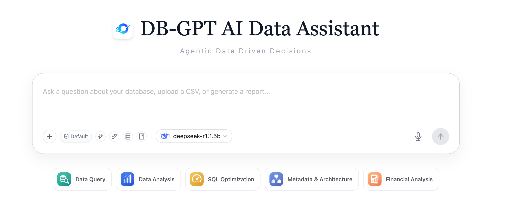

<p align="center">
  
</p>

<h1 align="center">DB-GPT: Open-Source Product for Controlled Data Agents</h1>

<p align="center">
  From a data question to verifiable queries, analytical reports, and reusable dashboards.
</p>

<p align="center">
  <a href="https://github.com/eosphoros-ai/DB-GPT/stargazers"></a>
  <a href="https://github.com/eosphoros-ai/DB-GPT/releases"></a>
  <a href="LICENSE"></a>
  <a href="https://x.com/DBGPT_AI"></a>
  <a href="https://discord.gg/7uQnPuveTY"></a>
</p>

<p align="center">
  <a href="README.md">English</a> · <a href="README.zh.md">简体中文</a> · <a href="README.ja.md">日本語</a> · <a href="README.hi.md">हिन्दी</a> · <a href="README.ma.md">മലയാളം</a> · <a href="README.ta.md">தமிழ்</a>
</p>

<p align="center">
  <a href="http://docs.dbgpt.cn/docs/overview/">Documentation</a> · <a href="https://github.com/eosphoros-ai/DB-GPT/releases">Releases</a> · <a href="https://github.com/orgs/eosphoros-ai/discussions">Community</a> · <a href="#quick-start">Quick start</a>
</p>

> **Connect your data, establish business definitions, choose expert methods, execute within configured tool and runtime boundaries, and deliver results you can inspect, edit, and reuse.**

DB-GPT goes beyond translating natural language into SQL. It brings **data connections, business semantics, expert skills, task orchestration, and analytical artifacts** into one workflow: a practical assistant for users and an extensible foundation for developers building AI-native data applications.

[Product demo](#product-demo) · [Why DB-GPT?](#why-db-gpt) · [Product modules](#product-modules) · [Safety and execution boundaries](#safety-and-execution-boundaries) · [Quick start](#quick-start) · [Community](#community)

## Product demo

https://github.com/user-attachments/assets/36ddad2c-1021-4181-b31a-8fb216c93f81

## Why DB-GPT?

### Business context before queries

“Revenue” can mean different date attribution, refund treatment, and scope. The Semantic Center organizes schema metadata, business meanings, metric formulas, and published versions so an agent can work from explicit definitions rather than guess them again for each question.

### Expert methods, not just answers

Use specialized plugins for queries, analysis, SQL optimization, metadata and architecture, or financial analysis. Skills package reusable instructions and scripts; workflows make steps, dependencies, and tool configuration explicit.

### Reusable results

Deliver query tables, charts, analytical reports, and editable dashboards—not only chat messages. Inspect the execution, review the result, request changes, and retain the artifact for the next task.

### Human control over consequential actions

Models, tools, data sources, and runtime access depend on deployment and task configuration. Dashboard plans and proposed edits can be reviewed before application. **Controlled execution is not a guarantee of absolute safety**: use least-privilege credentials, appropriate isolation, and independent review.

## Product modules

### A shared starting point



Start with a question, a file, or a database. Choose a model and the relevant expert, clarify the objective, and move into a query, analysis, or dashboard task.

### 1. Dashboards: from plan to board view

Start with a plan or template, generate a draft, edit widgets and queries, and enter Preview to present the full board.


*This is the actual Walmart dashboard generated and saved during the product demo, shown in Preview board view. Its four widgets include sales and store KPIs, a weekly trend, and a Top 10 ranking. It is a saved draft, not a publicly published board.*

- Define metrics, charts, and filters before generation.
- Adjust widgets, layout, query configuration, and filtering.
- Discuss changes with the AI assistant and review proposals before applying them.
- Save drafts; publish or share only when the result and access scope are ready.

The featured Walmart board uses an example dataset. Its values illustrate this case, not current company performance.

### 2. Plugins and Skills: reusable expertise

Select an expert plugin for the task and bind its data, knowledge context, and permitted tools. Skills package domain instructions, methods, and scripts.


| Expert | Typical work |
| --- | --- |
| Data Query | Clarify the question and metric, inspect and execute SQL, export results |
| Data Analysis | Inspect data, analyze trends and composition, prepare reports and dashboards |
| SQL Optimization | Inspect SQL and execution plans, propose changes for review |
| Metadata & Architecture | Organize data dictionaries, relationships, and modeling recommendations |
| Financial Analysis | Read financial materials and structure comparisons, subject to configuration and data prerequisites |

Plugins provide methods, not data permissions. Review third-party instructions, scripts, dependencies, and tool access before installing them.

### 3. Data sources: reliable connections

Manage database connections and select the source for each task. Queries, analysis, and dashboards can work from the same connection inventory and metadata context.


Supports data sources including MySQL, PostgreSQL, SQLite, DuckDB, ClickHouse, Apache Doris, StarRocks, Oracle, MSSQL, Neo4j, and TuGraph.

- Configure and inspect database connections.
- Bind a task to the relevant source and confirm its scope.
- A database catalog entry or connection template is not proof of a working connection. Drivers, network access, and credentials must be available.

### 4. Semantic Center: maintained metric definitions

Organize metadata, business definitions, metrics, query examples, relationships, and rules around a source. Published definitions preserve versions that can be associated with a query result.


- Maintain table and column meanings, annotations, and synonyms.
- Define base and derived metrics, formulas, and dependencies.
- Review and publish definitions; a published-only read must not treat an unpublished draft as authoritative.

### 5. Workflow: explicit steps and collaboration

Use the visual editor to organize Agent nodes, inputs, outputs, serial steps, and parallel branches. Prefer explicit workflows when a task should be repeatable.


This is a template editing view, not evidence that the workflow has been debugged or published. Configure its data source, model, and tools before running it.

### 6. Knowledge, connectors, and runtime management

- **Knowledge bases** provide document context for retrieval. Parsing, chunking, indexing, and retrieval configuration affect availability and quality.
- **Connectors** integrate external tools through configured MCP services. Templates need activation and authorization before use.
- **Models and runtimes** let you select providers and local or container execution, with configured dependencies and tool access.
- **Scheduled tasks** replay work or refresh artifacts. The scheduler, models, files, and sources must remain available.

## From question to result

**Connect → Ground → Plan → Execute → Review → Reuse**

1. Select the source and clarify the objective, time range, and metric scope.
2. Inspect fields, data quality, business definitions, and metric versions.
3. Select an expert and Skills; configure a workflow for repeatable tasks.
4. Execute SQL, code, or retrieval within permitted tools and runtimes.
5. Review the plan, calculations, sources, artifacts, and proposed changes.
6. Retain the report or dashboard; configure scheduling only with the required operational support.

## Safety and execution boundaries

DB-GPT provides configurable execution and review mechanisms. Effective safety depends on deployment:

- **Data access:** prefer read-only, least-privilege credentials. Descriptive catalog flags are not row- or column-level authorization enforcement.
- **Isolation:** local execution is not container isolation. Configure file access, resource limits, and network boundaries.
- **Secrets:** keep API keys, database passwords, and sensitive data out of commits, screenshots, and shared artifacts.
- **Review:** independently verify important metrics, calculations, SQL, and external outputs. Model results do not replace professional review.
- **Publication and scheduling:** drafts, published snapshots, sharing, and continuous operation are different states. Confirm access and availability before deployment.

> Capabilities depend on the release, configuration, schema migrations, and model behavior. Use the code and documentation for your version; a UI entry or historical demo is not a production-readiness guarantee.

## Quick start

### Option 1: installer for macOS and Linux

Download and review the script before running it:

```bash
curl -fsSL https://raw.githubusercontent.com/eosphoros-ai/DB-GPT/main/scripts/install/install.sh -o install.sh
less install.sh
bash install.sh
```

Follow the wizard to choose a profile and configure a model provider. Then use the directory and startup command printed by the installer:

```bash
cd ~/.dbgpt/DB-GPT
uv run dbgpt start webserver --profile <profile>
```

Replace `<profile>` with your configured profile and open [http://localhost:5670](http://localhost:5670).

<details>
<summary>Existing source checkout: keep your current branch</summary>

From the repository root:

```bash
bash scripts/install/install.sh --profile openai --repo-dir "$(pwd)"
uv run dbgpt start webserver --profile openai
```

`--repo-dir` reuses the current checkout instead of cloning or switching branches. Provider credentials and required services still need configuration.

With dependencies installed and an appropriate TOML configuration, the backend can also be started directly:

```bash
.venv/bin/python packages/dbgpt-app/src/dbgpt_app/dbgpt_server.py -c configs/dbgpt-proxy-openai.toml
```

For frontend development, run `npm run dev -- --hostname 127.0.0.1 --port 3000` inside `web/`. A running UI does not prove model inference or data access is ready.

</details>

### Option 2: PyPI

Use Python 3.10 or newer:

```bash
pip install dbgpt-app
dbgpt start
```

Complete provider setup before using the interface. PyPI releases, `main`, and feature branches may differ; use the corresponding source checkout to test branch-specific features.

See the [documentation](http://docs.dbgpt.cn/docs/overview/) for additional installation and configuration options.

## Developer ecosystem

- **DB-GPT:** the platform for data agents, tools, execution, and analytical applications.
- **[DB-GPT-Hub](https://github.com/eosphoros-ai/DB-GPT-Hub):** Text-to-SQL training and evaluation resources.
- **[dbgpts](https://github.com/eosphoros-ai/dbgpts):** applications, agents, and workflow ecosystem.
- **[Contributing](CONTRIBUTING.md):** development, testing, and contribution guidelines.

Consult current documentation for provider support, drivers, and dependencies instead of treating historical model lists as compatibility guarantees.

## Vision and evolution

Make trustworthy data work open and composable: help users complete an analysis while enabling teams to retain business context, reusable methods, and analytical artifacts.

Development directions include semantic consistency, task evaluation, execution diagnostics, portable Skills and workflows, and supervised recurring tasks. Track proposals and priorities through [Issues](https://github.com/eosphoros-ai/DB-GPT/issues) and [Discussions](https://github.com/orgs/eosphoros-ai/discussions), without assuming unconfirmed release dates.

## Community

- [Report an issue or suggest a feature](https://github.com/eosphoros-ai/DB-GPT/issues)
- [Discuss usage and design](https://github.com/orgs/eosphoros-ai/discussions)
- [Explore community projects](https://github.com/eosphoros-ai/community)
- [Follow DB-GPT on X (Twitter)](https://x.com/DBGPT_AI)
- [Join Discord](https://discord.gg/7uQnPuveTY)
- [Join Slack](https://join.slack.com/t/slack-inu2564/shared_invite/zt-29rcnyw2b-N~ubOD9kFc7b7MDOAM1otA)
- [Meet the contributors](https://github.com/eosphoros-ai/DB-GPT/graphs/contributors)

Contribute reproducible cases, fixes, documentation, Skills, and workflows. Include the version, configuration method, and a minimal reproduction when reporting a problem; remove secrets and sensitive data from logs.

## Contribution

For detailed guidelines, see [how to contribute](https://github.com/eosphoros-ai/DB-GPT/blob/main/CONTRIBUTING.md). Contributions to code, documentation, Skills, workflows, and reproducible examples are welcome.

### Contributors Wall

<a href="https://github.com/eosphoros-ai/DB-GPT/graphs/contributors">
  
</a>

## License and disclaimer

DB-GPT is distributed under the [MIT License](LICENSE). Read the [disclaimer](DISCKAIMER.md).

## Academic citations

The following papers introduce the project and related research. They do not describe the compatibility of every current UI feature.

<details>
<summary>BibTeX references</summary>

```bibtex
@article{xue2023dbgpt,
      title={DB-GPT: Empowering Database Interactions with Private Large Language Models},
      author={Siqiao Xue and Caigao Jiang and Wenhui Shi and Fangyin Cheng and Keting Chen and Hongjun Yang and Zhiping Zhang and Jianshan He and Hongyang Zhang and Ganglin Wei and Wang Zhao and Fan Zhou and Danrui Qi and Hong Yi and Shaodong Liu and Faqiang Chen},
      year={2023},
      journal={arXiv preprint arXiv:2312.17449},
      url={https://arxiv.org/abs/2312.17449}
}
@misc{huang2024romasrolebasedmultiagentdatabase,
      title={ROMAS: A Role-Based Multi-Agent System for Database monitoring and Planning},
      author={Yi Huang and Fangyin Cheng and Fan Zhou and Jiahui Li and Jian Gong and Hongjun Yang and Zhidong Fan and Caigao Jiang and Siqiao Xue and Faqiang Chen},
      year={2024},
      eprint={2412.13520},
      archivePrefix={arXiv},
      primaryClass={cs.AI},
      url={https://arxiv.org/abs/2412.13520}
}
@inproceedings{xue2024demonstration,
      title={Demonstration of DB-GPT: Next Generation Data Interaction System Empowered by Large Language Models},
      author={Siqiao Xue and Danrui Qi and Caigao Jiang and Wenhui Shi and Fangyin Cheng and Keting Chen and Hongjun Yang and Zhiping Zhang and Jianshan He and Hongyang Zhang and Ganglin Wei and Wang Zhao and Fan Zhou and Hong Yi and Shaodong Liu and Hongjun Yang and Faqiang Chen},
      year={2024},
      booktitle={Proceedings of the VLDB Endowment},
      url={https://arxiv.org/abs/2404.10209}
}
```

</details>

## Star History

[](https://star-history.com/#csunny/DB-GPT)
