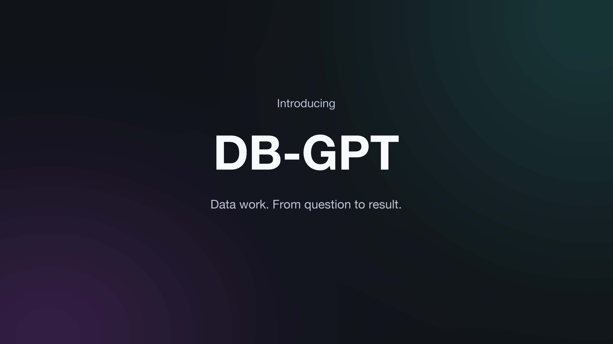
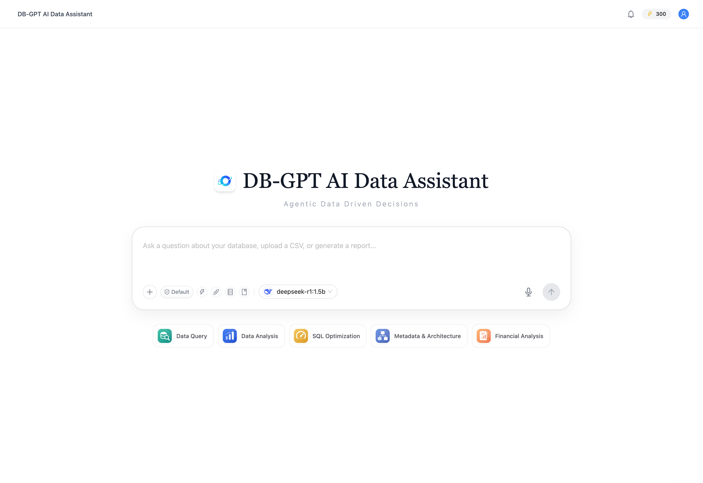
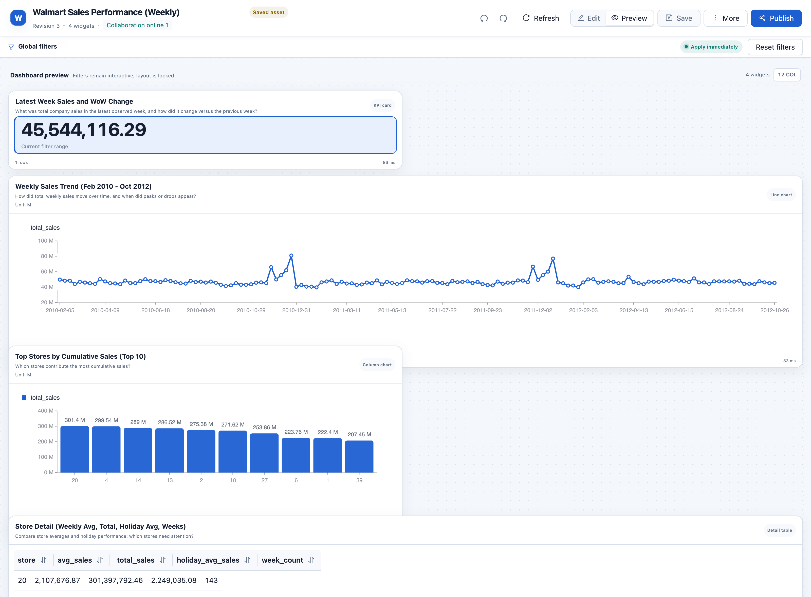
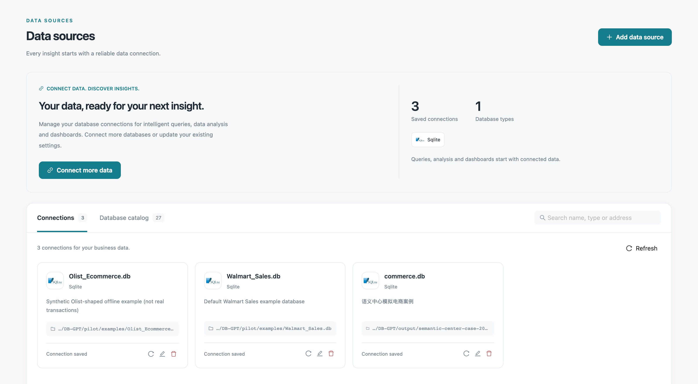
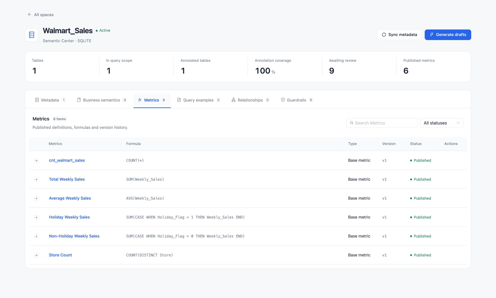
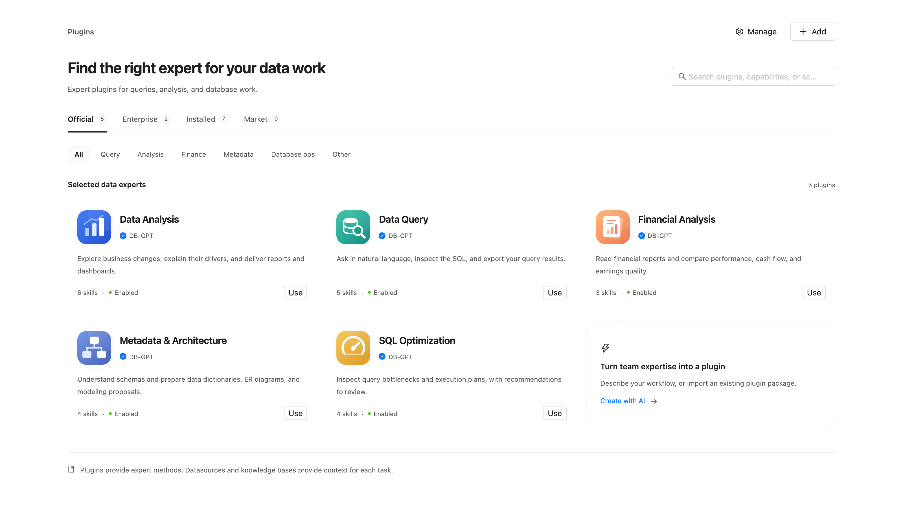

#  DB-GPT: Open-Source Platform for Controlled Data Agents

<p align="left">
  
</p>

<div align="center">
  <p>
    <a href="https://github.com/eosphoros-ai/DB-GPT">
        
    </a>
    <a href="https://github.com/eosphoros-ai/DB-GPT">
        
    </a>
    <a href="http://dbgpt.cn/">
        
    </a>
    <a href="https://opensource.org/licenses/MIT">
      
    </a>
     <a href="https://github.com/eosphoros-ai/DB-GPT/releases">
      
    </a>
    <a href="https://github.com/eosphoros-ai/DB-GPT/issues">
      
    </a>
    <a href="https://x.com/DBGPT_AI">
      
    </a>
    <a href="https://medium.com/@dbgpt0506">
      
    </a>
    <a href="https://space.bilibili.com/3537113070963392">
      
    </a>
    <a href="https://join.slack.com/t/slack-inu2564/shared_invite/zt-29rcnyw2b-N~ubOD9kFc7b7MDOAM1otA">
      
    </a>
    <a href="https://codespaces.new/eosphoros-ai/DB-GPT">
      
    </a>
  </p>


[English](README.md) · [简体中文](README.zh.md) · [日本語](README.ja.md) · [हिन्दी](README.hi.md) · [മലയാളം](README.ma.md) · [தமிழ்](README.ta.md)

[**Documents**](http://docs.dbgpt.cn/docs/overview/) | [**Contact Us**](https://github.com/eosphoros-ai/DB-GPT/blob/main/README.zh.md#%E8%81%94%E7%B3%BB%E6%88%91%E4%BB%AC) | [**Community**](https://github.com/eosphoros-ai/community) | [**Paper**](https://arxiv.org/pdf/2312.17449.pdf)

</div>

> **Connect your data, ground questions in business context, execute SQL and code within explicit tool and runtime boundaries, and deliver reusable reports and dashboards.**

## Watch DB-GPT in action

[](docs/static/video/db-gpt-product-film-4k.mp4)

[**▶ Watch the 4K product film**](docs/static/video/db-gpt-product-film-4k.mp4) · 3840 × 2160 · 30 fps

A 97-second English product tour: data sources, semantics, experts and skills, workflow, dashboard templates, and a real /dashboard case ending in Preview board view.

<sub>Waiting intervals are accelerated. Template illustrations and the live case are shown separately; some built-in covers retain Chinese labels. Module overviews are not claims that every feature was executed.</sub>

[Why DB-GPT?](#why-db-gpt) · [Quick start](#quick-start) · [Core capabilities](#core-capabilities) · [Vision and roadmap](#vision)

<details>
<summary>Explore the interface screenshots</summary>

## Showcases

<table>
<tr>
<td width="100%">

<br>
<sub><b>One place to start.</b> Ask in natural language, drop in a CSV, or pick an analysis agent—Data Query, Data Analysis, SQL Optimization, Metadata &amp; Architecture, Financial Analysis—and run on the model you choose.</sub>
</td>
</tr>
<tr>
<td width="100%">

<br>
<sub><b>Dashboards are artifacts, not screenshots.</b> A generated board keeps its KPI, trend, ranking and detail table live and filterable; layout is locked in preview and query-backed widgets refresh on demand.</sub>
</td>
</tr>
<tr>
<td width="100%">

<br>
<sub><b>Start from a trusted connection.</b> Connections, discovery scope and the database catalog live in one place; queries, analysis and dashboards all draw from the same source inventory.</sub>
</td>
</tr>
<tr>
<td width="100%">

<br>
<sub><b>Definitions before SQL.</b> Metric formulas, published versions and review state are read as authoritative context instead of being re-guessed per question.</sub>
</td>
</tr>
<tr>
<td width="100%">

<br>
<sub><b>Expertise you can install.</b> Five official expert plugins ship their own skills and methods—6 for analysis, 5 for query, plus finance, metadata and SQL tuning—each enabled per task with its datasource and knowledge context.</sub>
</td>
</tr>
</table>


</details>

## What is DB-GPT?

**DB-GPT is an open-source platform for controlled data agents: connect data, establish business context, execute SQL and code within explicit tool and runtime boundaries, and deliver reusable analytical outputs.**

It combines a ready-to-use assistant with the infrastructure developers need to build AI-native data applications: agents, AWEL workflows, reusable Skills, RAG, model management, and configurable execution environments.

**Go beyond answers. Get data work done—with business context, reusable expertise, and traceable results.**

### Why a data agent, not just Text-to-SQL?

A useful answer requires more than a valid query. It requires the right source, an agreed metric definition, an appropriate analytical method, and evidence that explains the result. DB-GPT brings these concerns into one workflow instead of leaving users to connect separate tools manually.

## Why DB-GPT?

### 1. Business context before SQL

The **Semantic Center** organizes metadata, business definitions, metric definitions, examples, relationships, and rules around each database connection. Published metric snapshots let agents resolve a specific definition and version instead of treating a mutable draft as authoritative.

### 2. SQL, code, and retrieval in one workflow

Agents can plan steps, query databases, run code-based analysis, and retrieve knowledge. AWEL provides explicit orchestration when a repeatable workflow is preferable to open-ended planning.


### 3. Reusable expertise through Skills and suites

Package domain instructions, scripts, and workflows as Skills; use suites to organize capabilities and permitted tools for a task. Reuse analytical methods rather than rebuilding every assistant from scratch.


### 4. Results that live beyond the conversation

Produce analytical summaries, charts, HTML reports, and editable dashboards. Dedicated financial-analysis workflows support report analysis and multi-report comparison, subject to configuration and schema prerequisites.


### 5. Model choice and configurable execution

Choose model providers and local or container-backed execution environments. Isolation depends on the selected runtime and deployment configuration; local execution is not equivalent to container isolation.


## What you can build

- **Database assistants** that use published business definitions and metrics before generating SQL.
- **File-analysis assistants** that combine data inspection, code, charts, and narrative reports.
- **Reusable analytical applications** built with Skills, suites, agents, and AWEL.
- **Editable dashboards** with drafts, published snapshots, sharing, and refresh workflows.
- **Financial-report workflows** for single-report analysis and configured multi-report comparison.
- **Recurring data tasks** using scheduled conversation replay or dashboard refresh.

These capabilities are implemented in this branch. Availability depends on the model, connectors, runtime, feature configuration, and required database migrations—not merely on the presence of a UI entry.

## Product Workflow

**Connect → Ground → Plan → Execute → Review → Reuse**

1. **Connect** databases, files, and knowledge bases.
2. **Ground** the question in metadata, published business definitions, and metric versions.
3. **Plan** with agents or an explicit AWEL workflow; select relevant Skills and tools.
4. **Execute** queries, code, and retrieval in the configured environment.
5. **Review** results, supporting artifacts, and semantic provenance.
6. **Reuse** the workflow as an application, dashboard, or scheduled task.

## Quick Start

> **Working from a feature branch?** Use the existing checkout and a configuration matching that branch. A fresh `main` clone or PyPI release may not include the capabilities described here.
>
> With dependencies already installed, run the backend from the repository root:
> ```bash
> .venv/bin/python packages/dbgpt-app/src/dbgpt_app/dbgpt_server.py -c configs/dbgpt-proxy-openai.toml
> ```
> For frontend development, run `npm run dev -- --hostname 127.0.0.1 --port 3000` from `web/`. The frontend proxies API requests to `127.0.0.1:5670` by default. Configure the model provider before using agent analysis; serving the UI does not prove inference is available.

Get DB-GPT running in minutes with the one-line installer (macOS & Linux):

```bash
curl -fsSL https://raw.githubusercontent.com/eosphoros-ai/DB-GPT/main/scripts/install/install.sh | bash
```

Or specify a profile and API key directly:

```bash
curl -fsSL https://raw.githubusercontent.com/eosphoros-ai/DB-GPT/main/scripts/install/install.sh \
  | OPENAI_API_KEY=sk-xxx bash -s -- --profile openai
```

For Kimi 2.5 via Moonshot API:

```bash
curl -fsSL https://raw.githubusercontent.com/eosphoros-ai/DB-GPT/main/scripts/install/install.sh \
  | MOONSHOT_API_KEY=sk-xxx bash -s -- --profile kimi
```

For MiniMax via the OpenAI-compatible API:

```bash
curl -fsSL https://raw.githubusercontent.com/eosphoros-ai/DB-GPT/main/scripts/install/install.sh \
  | MINIMAX_API_KEY=sk-xxx bash -s -- --profile minimax
```

Already have a local DB-GPT checkout? Reuse it instead of cloning `~/.dbgpt/DB-GPT`:

```bash
OPENAI_API_KEY=sk-xxx \
  bash scripts/install/install.sh --profile openai --repo-dir "$(pwd)" --yes
```

Or reuse your local repo with Kimi 2.5:

```bash
MOONSHOT_API_KEY=sk-xxx \
  bash scripts/install/install.sh --profile kimi --repo-dir "$(pwd)" --yes
```

Or reuse your local repo with MiniMax:

```bash
MINIMAX_API_KEY=sk-xxx \
  bash scripts/install/install.sh --profile minimax --repo-dir "$(pwd)" --yes
```

After installation, start the server with the generated profile config:

```bash
cd ~/.dbgpt/DB-GPT && uv run dbgpt start webserver --profile <profile>
```

Then open [http://localhost:5670](http://localhost:5670).

> **Prefer to review the script first?**
> ```bash
> curl -fsSL https://raw.githubusercontent.com/eosphoros-ai/DB-GPT/main/scripts/install/install.sh -o install.sh
> less install.sh
> bash install.sh --profile openai
> ```

### Install via PyPI

Install DB-GPT from PyPI and start it with a single command — no source checkout required.

> **Prerequisites:** Python **3.10+** and [uv](https://docs.astral.sh/uv/getting-started/installation/) (recommended) or pip.

**1. Install**

```bash
# Recommended: use uv
uv pip install dbgpt-app

# Or with pip
pip install dbgpt-app
```

The default installation includes the core framework (CLI, FastAPI, Agent), OpenAI-compatible LLM support, DashScope / Tongyi support, RAG document parsing, and ChromaDB vector store.

**2. Start**

```bash
dbgpt start
```

On first run, an interactive setup wizard will guide you through choosing an LLM provider and entering your API key. Once complete, the web server starts automatically.

**3. Open the Web UI**

Visit [http://localhost:5670](http://localhost:5670) — you're all set! 🎉

### Advanced Installation


For Docker, local GPU models (vLLM, llama.cpp), or manual source-code setup, see the full docs:

- [**Install**](http://docs.dbgpt.cn/docs/installation)
  - [Docker](http://docs.dbgpt.cn/docs/installation/docker)
  - [Source Code](http://docs.dbgpt.cn/docs/getting-started/deploy/source-code)
- [**Quickstart**](http://docs.dbgpt.cn/docs/overview)
- [**Application**](http://docs.dbgpt.cn/docs/use_cases)
  - [Development Guide](http://docs.dbgpt.cn/docs/cookbook/app/data_analysis_app_develop)
  - [AWEL Flow Usage](http://docs.dbgpt.cn/docs/application/awel_flow_usage)
- [**Debugging**](http://docs.dbgpt.cn/docs/operation_manual/advanced_tutorial/debugging)
- [**Advanced Usage**](http://docs.dbgpt.cn/docs/application/advanced_tutorial/cli)
  - [SMMF](http://docs.dbgpt.cn/docs/application/advanced_tutorial/smmf)
  - [Finetune](http://docs.dbgpt.cn/docs/application/fine_tuning_manual/dbgpt_hub)
  - [AWEL](http://docs.dbgpt.cn/docs/awel/tutorial)


## Core Capabilities

### Semantic Center: business meaning as a maintained asset

- **Metadata catalog**: synchronize table/column snapshots, types, comments, key flags, and enumerated values.
- **Business definitions**: generate candidate annotations, maintain synonyms and definitions, and review entries before publication.
- **Metric lifecycle**: maintain formulas, dimensions, and dependencies; publishing records a version snapshot and change note.
- **Agent-facing reads**: connection-bound tools read metadata, published business definitions, and published metric versions. Missing definitions do not silently fall back to drafts.
- **Provenance**: metric results carry a version reference; the UI can resolve the cited published version.
- **Context management**: manage query examples, relations, rules, and coverage from the Semantic Center.

**Current boundary:** the authoritative read path uses structured records and keyword matching. The managed vector-index adapter is not yet wired and falls back to an in-memory sink. Catalog whitelist/sensitivity flags are descriptive metadata, not row/column-level authorization enforcement.

Implementation: [Semantic Center](packages/dbgpt-serve/src/dbgpt_serve/semantic) · [Agent tools](packages/dbgpt-app/src/dbgpt_app/openapi/api_v1/tools/semantic_tools.py).

### Agents, Skills, and AWEL

Use agent planning and tool calls for exploratory tasks, or explicit AWEL workflows for repeatable applications. Skills load instructions and run associated scripts; suites organize task-specific capabilities and tool allowlists. Execution behavior depends on the selected harness and runtime.

### Data access and knowledge retrieval

Combine relational databases, CSV/Excel files, documents, and knowledge bases. Use RAG and GraphRAG for knowledge-grounded applications; structured semantic reads are distinct from ordinary knowledge-base retrieval.

### SQL, code, and execution environments

Generate SQL and code for querying, transformation, metric calculation, and visualization. The sandbox package includes local and container runtime implementations. Configure runtime dependencies, file access, resource boundaries, and credentials for your deployment.

### Reports, dashboards, and financial analysis

Generate reports and visual artifacts. Dashboard implementations include an agent-plan-to-draft bridge, editable drafts, published snapshots, sharing, and refresh tasks. Financial analysis includes single-report workflows and multi-report comparison with extraction state and resume support; comparison requires the explicit schema migration documented by its implementation.

### Scheduled tasks

Run recurring conversation replays and dashboard refreshes, with task management and execution history. Automatic runs require the scheduler to be running and the task's model, files, and data sources to remain available. This is not a guarantee of an always-on managed service.

### Model ecosystem

Use multi-model management and private deployment options. Supported providers and fine-tuning targets vary by release; see the documentation and DB-GPT-Hub rather than treating a historical model list as a compatibility guarantee.

<details>
<summary>Model and fine-tuning reference lists</summary>

#### Text2SQL Finetune

  |     LLM     |  Supported  | 
  |:-----------:|:-----------:|
  |    LLaMA    |      ✅     |
  |   LLaMA-2   |      ✅     | 
  |    BLOOM    |      ✅     | 
  |   BLOOMZ    |      ✅     | 
  |   Falcon    |      ✅     | 
  |  Baichuan   |      ✅     | 
  |  Baichuan2  |      ✅     | 
  |  InternLM   |      ✅     |
  |    Qwen     |      ✅     | 
  |   XVERSE    |      ✅     | 
  |  ChatGLM2   |      ✅     |

[More Information about Text2SQL finetune](https://github.com/eosphoros-ai/DB-GPT-Hub)

### Supported Models

<table>
      <thead>
        <tr>
          <th>Provider</th>
          <th>Supported</th>
          <th>Models</th>
        </tr>
      </thead>
      <tbody>
        <tr>
          <td align="center" valign="middle">DeepSeek</td>
          <td align="center" valign="middle">✅</td>
          <td>
            🔥🔥🔥  <a href="https://huggingface.co/deepseek-ai/DeepSeek-R1-0528">DeepSeek-R1-0528</a><br/>
            🔥🔥🔥  <a href="https://huggingface.co/deepseek-ai/DeepSeek-V3-0324">DeepSeek-V3-0324</a><br/>
            🔥🔥🔥  <a href="https://huggingface.co/deepseek-ai/DeepSeek-R1">DeepSeek-R1</a><br/>
            🔥🔥🔥  <a href="https://huggingface.co/deepseek-ai/DeepSeek-V3">DeepSeek-V3</a><br/>
            🔥🔥🔥  <a href="https://huggingface.co/deepseek-ai/DeepSeek-R1-Distill-Llama-70B">DeepSeek-R1-Distill-Llama-70B</a><br/>
            🔥🔥🔥  <a href="https://huggingface.co/deepseek-ai/DeepSeek-R1-Distill-Qwen-32B">DeepSeek-R1-Distill-Qwen-32B</a><br/>
            🔥🔥🔥  <a href="https://huggingface.co/deepseek-ai/DeepSeek-Coder-V2-Instruct">DeepSeek-Coder-V2-Instruct</a><br/>
          </td>
        </tr>
        <tr>
          <td align="center" valign="middle">Qwen</td>
          <td align="center" valign="middle">✅</td>
          <td>
            🔥🔥🔥  <a href="https://huggingface.co/Qwen/Qwen3-235B-A22B">Qwen3-235B-A22B</a><br/>
            🔥🔥🔥  <a href="https://huggingface.co/Qwen/Qwen3-30B-A3B">Qwen3-30B-A3B</a><br/>
            🔥🔥🔥  <a href="https://huggingface.co/Qwen/Qwen3-32B">Qwen3-32B</a><br/>
            🔥🔥🔥  <a href="https://huggingface.co/Qwen/QwQ-32B">QwQ-32B</a><br/>
            🔥🔥🔥  <a href="https://huggingface.co/Qwen/Qwen2.5-Coder-32B-Instruct">Qwen2.5-Coder-32B-Instruct</a><br/>
            🔥🔥🔥  <a href="https://huggingface.co/Qwen/Qwen2.5-Coder-14B-Instruct">Qwen2.5-Coder-14B-Instruct</a><br/>
            🔥🔥🔥  <a href="https://huggingface.co/Qwen/Qwen2.5-72B-Instruct">Qwen2.5-72B-Instruct</a><br/>
            🔥🔥🔥  <a href="https://huggingface.co/Qwen/Qwen2.5-32B-Instruct">Qwen2.5-32B-Instruct</a><br/>
          </td>
        </tr>
        <tr>
          <td align="center" valign="middle">GLM</td>
          <td align="center" valign="middle">✅</td>
          <td>
            🔥🔥🔥  <a href="https://huggingface.co/THUDM/GLM-Z1-32B-0414">GLM-Z1-32B-0414</a><br/>
            🔥🔥🔥  <a href="https://huggingface.co/THUDM/GLM-4-32B-0414">GLM-4-32B-0414</a><br/>
            🔥🔥🔥  <a href="https://huggingface.co/THUDM/glm-4-9b-chat">Glm-4-9b-chat</a>
          </td>
        </tr>
        <tr>
          <td align="center" valign="middle">Llama</td>
          <td align="center" valign="middle">✅</td>
          <td>
            🔥🔥🔥  <a href="https://huggingface.co/meta-llama/Meta-Llama-3.1-405B-Instruct">Meta-Llama-3.1-405B-Instruct</a><br/>
            🔥🔥🔥  <a href="https://huggingface.co/meta-llama/Meta-Llama-3.1-70B-Instruct">Meta-Llama-3.1-70B-Instruct</a><br/>
            🔥🔥🔥  <a href="https://huggingface.co/meta-llama/Meta-Llama-3.1-8B-Instruct">Meta-Llama-3.1-8B-Instruct</a><br/>
            🔥🔥🔥  <a href="https://huggingface.co/meta-llama/Meta-Llama-3-70B-Instruct">Meta-Llama-3-70B-Instruct</a><br/>
            🔥🔥🔥  <a href="https://huggingface.co/meta-llama/Meta-Llama-3-8B-Instruct">Meta-Llama-3-8B-Instruct</a>
          </td>
        </tr>
        <tr>
          <td align="center" valign="middle">Gemma</td>
          <td align="center" valign="middle">✅</td>
          <td>
            🔥🔥🔥  <a href="https://huggingface.co/google/gemma-2-27b-it">gemma-2-27b-it</a><br>
            🔥🔥🔥  <a href="https://huggingface.co/google/gemma-2-9b-it">gemma-2-9b-it</a><br>
            🔥🔥🔥  <a href="https://huggingface.co/google/gemma-7b-it">gemma-7b-it</a><br>
            🔥🔥🔥  <a href="https://huggingface.co/google/gemma-2b-it">gemma-2b-it</a>
          </td>
        </tr>
        <tr>
          <td align="center" valign="middle">Yi</td>
          <td align="center" valign="middle">✅</td>
          <td>
            🔥🔥🔥  <a href="https://huggingface.co/01-ai/Yi-1.5-34B-Chat">Yi-1.5-34B-Chat</a><br/>
            🔥🔥🔥  <a href="https://huggingface.co/01-ai/Yi-1.5-9B-Chat">Yi-1.5-9B-Chat</a><br/>
            🔥🔥🔥  <a href="https://huggingface.co/01-ai/Yi-1.5-6B-Chat">Yi-1.5-6B-Chat</a><br/>
            🔥🔥🔥  <a href="https://huggingface.co/01-ai/Yi-34B-Chat">Yi-34B-Chat</a>
          </td>
        </tr>
        <tr>
          <td align="center" valign="middle">Starling</td>
          <td align="center" valign="middle">✅</td>
          <td>
            🔥🔥🔥  <a href="https://huggingface.co/Nexusflow/Starling-LM-7B-beta">Starling-LM-7B-beta</a>
          </td>
        </tr>
        <tr>
          <td align="center" valign="middle">SOLAR</td>
          <td align="center" valign="middle">✅</td>
          <td>
            🔥🔥🔥  <a href="https://huggingface.co/upstage/SOLAR-10.7B-Instruct-v1.0">SOLAR-10.7B</a>
          </td>
        </tr>
        <tr>
          <td align="center" valign="middle">Mixtral</td>
          <td align="center" valign="middle">✅</td>
          <td>
            🔥🔥🔥  <a href="https://huggingface.co/mistralai/Mixtral-8x7B-Instruct-v0.1">Mixtral-8x7B</a>
          </td>
        </tr>
        <tr>
          <td align="center" valign="middle">Phi</td>
          <td align="center" valign="middle">✅</td>
          <td>
            🔥🔥🔥  <a href="https://huggingface.co/collections/microsoft/phi-3-6626e15e9585a200d2d761e3">Phi-3</a>
          </td>
        </tr>
      </tbody>
    </table>

  - [More Supported LLMs](http://docs.dbgpt.cn/docs/modules/smmf)

</details>

### Privacy and Security

Private model deployment, desensitization, and configurable execution runtimes can help reduce risk; they do not constitute a comprehensive security guarantee. Use least-privilege database credentials, choose an appropriate isolation runtime, protect secrets, and independently review high-impact results. Semantic publication is a content lifecycle—not a substitute for deployment-level authorization.

### Data Sources
- [Datasources](http://docs.dbgpt.cn/docs/modules/connections)

## Vision

**Make trustworthy data work an open capability.**

We believe the next generation of data products will go beyond dashboards and isolated answers. They will combine business context, reusable expertise, and controlled execution to help people complete data work—not merely generate queries.

DB-GPT aims to provide an open, composable foundation for that future: a practical assistant for users and an extensible platform for developers, on their own data and with their choice of models.

Our principles are **context before generation**, **published definitions before assumptions**, **evidence before conclusions**, and **human control over consequential actions**.

## Roadmap

> Proposed development directions for community discussion, not approved delivery dates or claims of shipped features. Existing Semantic Center, Skills, scheduling, and dashboard capabilities are described above; the roadmap focuses on deepening them.

### Near term — strengthen the existing foundation

- Complete the Semantic Center's persistent vector-index integration and improve semantic discovery without weakening published-only metric reads.
- Expand task-level evaluation for SQL, code analysis, semantic consistency, and report evidence.
- Improve connector onboarding, execution diagnostics, and configuration checks.

### Next — make expertise portable and maintainable

- Improve versioned Skills, workflow templates, and business-context import/export.
- Extend metric provenance across analytical outputs and strengthen schema-change handling.
- Explore standard tool interoperability, including MCP, with explicit permission boundaries.

### Longer term — sustained, supervised data work

- Build on existing scheduling with richer event triggers, recovery, and operational visibility.
- Explore parallel specialized-agent execution with explicit resource and authorization boundaries.
- Expand reusable applications and connectors around real, reproducible use cases.

Priorities should be tracked through [Issues](https://github.com/eosphoros-ai/DB-GPT/issues) and [Discussions](https://github.com/orgs/eosphoros-ai/discussions).

## Contribution

- To check detailed guidelines for new contributions, please refer [how to contribute](https://github.com/eosphoros-ai/DB-GPT/blob/main/CONTRIBUTING.md)

### Contributors Wall
<a href="https://github.com/eosphoros-ai/DB-GPT/graphs/contributors">
  
</a>


## Licence
The MIT License (MIT)

## Disclaimer
- [Disclaimer](./DISCKAIMER.md)

## Citation
If you want to understand the overall architecture of DB-GPT, please cite <a href="https://arxiv.org/abs/2312.17449" target="_blank">Paper</a> and <a href="https://arxiv.org/abs/2404.10209" target="_blank">Paper</a>

If you want to learn about using DB-GPT for Agent development, please cite the <a href="https://arxiv.org/abs/2412.13520" target="_blank">Paper</a>
```bibtex
@article{xue2023dbgpt,
      title={DB-GPT: Empowering Database Interactions with Private Large Language Models}, 
      author={Siqiao Xue and Caigao Jiang and Wenhui Shi and Fangyin Cheng and Keting Chen and Hongjun Yang and Zhiping Zhang and Jianshan He and Hongyang Zhang and Ganglin Wei and Wang Zhao and Fan Zhou and Danrui Qi and Hong Yi and Shaodong Liu and Faqiang Chen},
      year={2023},
      journal={arXiv preprint arXiv:2312.17449},
      url={https://arxiv.org/abs/2312.17449}
}
@misc{huang2024romasrolebasedmultiagentdatabase,
      title={ROMAS: A Role-Based Multi-Agent System for Database monitoring and Planning}, 
      author={Yi Huang and Fangyin Cheng and Fan Zhou and Jiahui Li and Jian Gong and Hongjun Yang and Zhidong Fan and Caigao Jiang and Siqiao Xue and Faqiang Chen},
      year={2024},
      eprint={2412.13520},
      archivePrefix={arXiv},
      primaryClass={cs.AI},
      url={https://arxiv.org/abs/2412.13520}, 
}
@inproceedings{xue2024demonstration,
      title={Demonstration of DB-GPT: Next Generation Data Interaction System Empowered by Large Language Models}, 
      author={Siqiao Xue and Danrui Qi and Caigao Jiang and Wenhui Shi and Fangyin Cheng and Keting Chen and Hongjun Yang and Zhiping Zhang and Jianshan He and Hongyang Zhang and Ganglin Wei and Wang Zhao and Fan Zhou and Hong Yi and Shaodong Liu and Hongjun Yang and Faqiang Chen},
      year={2024},
      booktitle = "Proceedings of the VLDB Endowment",
      url={https://arxiv.org/abs/2404.10209}
}
```


## Contact Information
Thanks to everyone who has contributed to DB-GPT! Your ideas, code, comments, and even sharing them at events and on social platforms can make DB-GPT better.
We are working on building a community, if you have any ideas for building the community, feel free to contact us.  

- [Github Issues](https://github.com/eosphoros-ai/DB-GPT/issues): For questions about using DB-GPT, see CONTRIBUTING.
- [Github Discussions](https://github.com/orgs/eosphoros-ai/discussions) ⭐️：Share your experience or unique apps.  
- [Twitter](https://x.com/DBGPT_AI) ⭐️：Please feel free to talk to us.  


[](https://star-history.com/#csunny/DB-GPT)
