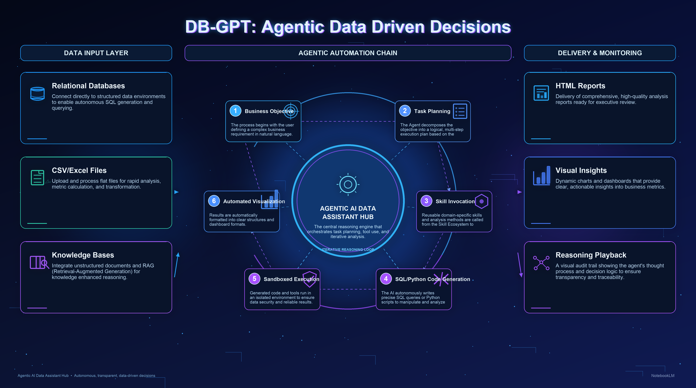
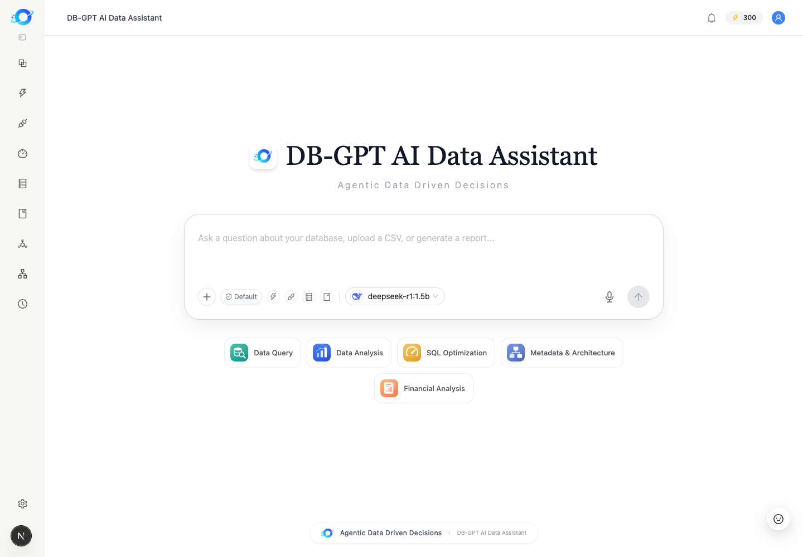

#  DB-GPT: Data Agents for Trusted, Controlled Data Work

<p align="left">
  
</p>

<div align="center">
  <p>
    <a href="https://github.com/eosphoros-ai/DB-GPT">
        
    </a>
    <a href="https://github.com/eosphoros-ai/DB-GPT">
        
    </a>
    <a href="http://dbgpt.cn/">
        
    </a>
    <a href="https://opensource.org/licenses/MIT">
      
    </a>
     <a href="https://github.com/eosphoros-ai/DB-GPT/releases">
      
    </a>
    <a href="https://github.com/eosphoros-ai/DB-GPT/issues">
      
    </a>
    <a href="https://x.com/DBGPT_AI">
      
    </a>
    <a href="https://medium.com/@dbgpt0506">
      
    </a>
    <a href="https://space.bilibili.com/3537113070963392">
      
    </a>
    <a href="https://join.slack.com/t/slack-inu2564/shared_invite/zt-29rcnyw2b-N~ubOD9kFc7b7MDOAM1otA">
      
    </a>
    <a href="https://codespaces.new/eosphoros-ai/DB-GPT">
      
    </a>
  </p>


[](README.md)
[](README.zh.md)
[](README.ja.md) 

[**Documents**](http://docs.dbgpt.cn/docs/overview/) | [**Contact Us**](https://github.com/eosphoros-ai/DB-GPT/blob/main/README.zh.md#%E8%81%94%E7%B3%BB%E6%88%91%E4%BB%AC) | [**Community**](https://github.com/eosphoros-ai/community) | [**Paper**](https://arxiv.org/pdf/2312.17449.pdf)

</div>

> **An open-source Data Agent platform that turns business questions into traceable queries, analysis, reports, and dashboards—with governed semantics, reusable plugins, agentic workflows, and controlled tool execution.**



## What is DB-GPT?

DB-GPT helps teams delegate data work within explicit business and execution boundaries, inspect the evidence behind the result, and reuse effective methods.

A schema alone cannot explain a business metric. A valid SQL query can still multiply amounts through joins. Long multi-agent tasks need visible stages and review points. DB-GPT brings these concerns into the product workflow.

## Why DB-GPT?

| Foundation | Purpose | Guide |
| --- | --- | --- |
| Governed semantics | Review business meanings and publish metric versions agents can read and cite. | [Semantic Center](./docs/docs/semantic-center/overview.md) |
| Scenario plugins | Reuse task methods, skills, and tool configuration. | [Plugins](./docs/docs/plugins/overview.md) |
| Agentic Workflow | Organize agents by stages, responsibilities, deliverables, and gates. | [Flow](./docs/docs/workflow/introduction.md) |
| Controlled execution | Configure resources, tools, approvals, and environments; inspect execution evidence. | [Execution controls](./docs/docs/data-agent/controlled-execution.md) |

Trust is built through checkable definitions and execution evidence. Controls depend on the effective deployment and tool configuration; they do not guarantee every generated calculation is correct.


## What you can do with DB-GPT

- **Smart Data Query** — bounded questions, executed SQL, results, and available metric references.
- **Smart Data Analysis** — investigations, reports, and business dashboards.
- **SQL Optimization Expert** — evidence-based diagnoses, rewrite/index candidates, and validation plans.
- **Metadata and Architecture Expert** — dictionaries, physical ER diagrams, and schema documentation.
- **Financial Report Analysis** — source-based analysis of supplied financial reports.

See [Showcases](./docs/docs/use_cases.mdx) for inputs, steps, and evidence boundaries.

## Product Workflow

Connect data → prepare published definitions → select a plugin → organize complex work with Flow → review confirmations and execution → inspect delivered results.

Agents choose methods inside their assigned stages. Flow makes dependencies and handoffs explicit, helping reduce drift, omissions, and unverifiable outputs in complex tasks. A prompt contract is not automatic validation, and visible failure is not checkpoint recovery.

After installation, follow [Your first data task](./docs/docs/data-agent/quickstart.md).


## Quick Start

Get DB-GPT running in minutes with the one-line installer (macOS & Linux):

```bash
curl -fsSL https://raw.githubusercontent.com/eosphoros-ai/DB-GPT/main/scripts/install/install.sh | bash
```

Or specify a profile and API key directly:

```bash
curl -fsSL https://raw.githubusercontent.com/eosphoros-ai/DB-GPT/main/scripts/install/install.sh \
  | OPENAI_API_KEY=sk-xxx bash -s -- --profile openai
```

For Kimi 2.5 via Moonshot API:

```bash
curl -fsSL https://raw.githubusercontent.com/eosphoros-ai/DB-GPT/main/scripts/install/install.sh \
  | MOONSHOT_API_KEY=sk-xxx bash -s -- --profile kimi
```

For MiniMax via the OpenAI-compatible API:

```bash
curl -fsSL https://raw.githubusercontent.com/eosphoros-ai/DB-GPT/main/scripts/install/install.sh \
  | MINIMAX_API_KEY=sk-xxx bash -s -- --profile minimax
```

Already have a local DB-GPT checkout? Reuse it instead of cloning `~/.dbgpt/DB-GPT`:

```bash
OPENAI_API_KEY=sk-xxx \
  bash scripts/install/install.sh --profile openai --repo-dir "$(pwd)" --yes
```

Or reuse your local repo with Kimi 2.5:

```bash
MOONSHOT_API_KEY=sk-xxx \
  bash scripts/install/install.sh --profile kimi --repo-dir "$(pwd)" --yes
```

Or reuse your local repo with MiniMax:

```bash
MINIMAX_API_KEY=sk-xxx \
  bash scripts/install/install.sh --profile minimax --repo-dir "$(pwd)" --yes
```

After installation, start the server with the generated profile config:

```bash
cd ~/.dbgpt/DB-GPT && uv run dbgpt start webserver --profile <profile>
```

Then open [http://localhost:5670](http://localhost:5670).

> **Prefer to review the script first?**
> ```bash
> curl -fsSL https://raw.githubusercontent.com/eosphoros-ai/DB-GPT/main/scripts/install/install.sh -o install.sh
> less install.sh
> bash install.sh --profile openai
> ```

### Install via PyPI

Install DB-GPT from PyPI and start it with a single command — no source checkout required.

> **Prerequisites:** Python **3.10+** and [uv](https://docs.astral.sh/uv/getting-started/installation/) (recommended) or pip.

**1. Install**

```bash
# Recommended: use uv
uv pip install dbgpt-app

# Or with pip
pip install dbgpt-app
```

The default installation includes the core framework (CLI, FastAPI, Agent), OpenAI-compatible LLM support, DashScope / Tongyi support, RAG document parsing, and ChromaDB vector store.

**2. Start**

```bash
dbgpt start
```

On first run, an interactive setup wizard will guide you through choosing an LLM provider and entering your API key. Once complete, the web server starts automatically.

**3. Open the Web UI**

Visit [http://localhost:5670](http://localhost:5670) — you're all set! 🎉

### Advanced Installation


For Docker, local GPU models (vLLM, llama.cpp), or manual source-code setup, see the full docs:

- [**Install**](http://docs.dbgpt.cn/docs/installation)
  - [Docker](http://docs.dbgpt.cn/docs/installation/docker)
  - [Source Code](http://docs.dbgpt.cn/docs/getting-started/deploy/source-code)
- [**Quickstart**](http://docs.dbgpt.cn/docs/overview)
- [**Application**](http://docs.dbgpt.cn/docs/use_cases)
  - [Development Guide](http://docs.dbgpt.cn/docs/cookbook/app/data_analysis_app_develop)
  - [AWEL Flow Usage](http://docs.dbgpt.cn/docs/application/awel_flow_usage)
- [**Debugging**](http://docs.dbgpt.cn/docs/operation_manual/advanced_tutorial/debugging)
- [**Advanced Usage**](http://docs.dbgpt.cn/docs/application/advanced_tutorial/cli)
  - [SMMF](http://docs.dbgpt.cn/docs/application/advanced_tutorial/smmf)
  - [Finetune](http://docs.dbgpt.cn/docs/application/fine_tuning_manual/dbgpt_hub)
  - [AWEL](http://docs.dbgpt.cn/docs/awel/tutorial)


## Core Capabilities

### Agentic Analysis
- task planning
- step-by-step execution
- tool use
- iterative reasoning

### SQL + Code Execution
- natural language to SQL
- Python-based analysis and transformation
- metric calculation
- chart generation

### Multi-Source Data Access
- relational databases
- CSV / Excel
- documents
- knowledge bases
- mixed-source workflows

### Skills and Agents
- reusable skills
- domain workflows
- agent orchestration
- customizable execution flows

### Reporting and Decision Support
- database profiling reports
- financial analysis reports
- visual reports and dashboards
- summaries and business insights

### Safe Execution
- sandboxed code execution
- controlled tool use
- reproducible outputs and artifacts

#### Text2SQL Finetune

  |     LLM     |  Supported  | 
  |:-----------:|:-----------:|
  |    LLaMA    |      ✅     |
  |   LLaMA-2   |      ✅     | 
  |    BLOOM    |      ✅     | 
  |   BLOOMZ    |      ✅     | 
  |   Falcon    |      ✅     | 
  |  Baichuan   |      ✅     | 
  |  Baichuan2  |      ✅     | 
  |  InternLM   |      ✅     |
  |    Qwen     |      ✅     | 
  |   XVERSE    |      ✅     | 
  |  ChatGLM2   |      ✅     |

[More Information about Text2SQL finetune](https://github.com/eosphoros-ai/DB-GPT-Hub)

### Supported Models

<table>
      <thead>
        <tr>
          <th>Provider</th>
          <th>Supported</th>
          <th>Models</th>
        </tr>
      </thead>
      <tbody>
        <tr>
          <td align="center" valign="middle">DeepSeek</td>
          <td align="center" valign="middle">✅</td>
          <td>
            🔥🔥🔥  <a href="https://huggingface.co/deepseek-ai/DeepSeek-R1-0528">DeepSeek-R1-0528</a><br/>
            🔥🔥🔥  <a href="https://huggingface.co/deepseek-ai/DeepSeek-V3-0324">DeepSeek-V3-0324</a><br/>
            🔥🔥🔥  <a href="https://huggingface.co/deepseek-ai/DeepSeek-R1">DeepSeek-R1</a><br/>
            🔥🔥🔥  <a href="https://huggingface.co/deepseek-ai/DeepSeek-V3">DeepSeek-V3</a><br/>
            🔥🔥🔥  <a href="https://huggingface.co/deepseek-ai/DeepSeek-R1-Distill-Llama-70B">DeepSeek-R1-Distill-Llama-70B</a><br/>
            🔥🔥🔥  <a href="https://huggingface.co/deepseek-ai/DeepSeek-R1-Distill-Qwen-32B">DeepSeek-R1-Distill-Qwen-32B</a><br/>
            🔥🔥🔥  <a href="https://huggingface.co/deepseek-ai/DeepSeek-Coder-V2-Instruct">DeepSeek-Coder-V2-Instruct</a><br/>
          </td>
        </tr>
        <tr>
          <td align="center" valign="middle">Qwen</td>
          <td align="center" valign="middle">✅</td>
          <td>
            🔥🔥🔥  <a href="https://huggingface.co/Qwen/Qwen3-235B-A22B">Qwen3-235B-A22B</a><br/>
            🔥🔥🔥  <a href="https://huggingface.co/Qwen/Qwen3-30B-A3B">Qwen3-30B-A3B</a><br/>
            🔥🔥🔥  <a href="https://huggingface.co/Qwen/Qwen3-32B">Qwen3-32B</a><br/>
            🔥🔥🔥  <a href="https://huggingface.co/Qwen/QwQ-32B">QwQ-32B</a><br/>
            🔥🔥🔥  <a href="https://huggingface.co/Qwen/Qwen2.5-Coder-32B-Instruct">Qwen2.5-Coder-32B-Instruct</a><br/>
            🔥🔥🔥  <a href="https://huggingface.co/Qwen/Qwen2.5-Coder-14B-Instruct">Qwen2.5-Coder-14B-Instruct</a><br/>
            🔥🔥🔥  <a href="https://huggingface.co/Qwen/Qwen2.5-72B-Instruct">Qwen2.5-72B-Instruct</a><br/>
            🔥🔥🔥  <a href="https://huggingface.co/Qwen/Qwen2.5-32B-Instruct">Qwen2.5-32B-Instruct</a><br/>
          </td>
        </tr>
        <tr>
          <td align="center" valign="middle">GLM</td>
          <td align="center" valign="middle">✅</td>
          <td>
            🔥🔥🔥  <a href="https://huggingface.co/THUDM/GLM-Z1-32B-0414">GLM-Z1-32B-0414</a><br/>
            🔥🔥🔥  <a href="https://huggingface.co/THUDM/GLM-4-32B-0414">GLM-4-32B-0414</a><br/>
            🔥🔥🔥  <a href="https://huggingface.co/THUDM/glm-4-9b-chat">Glm-4-9b-chat</a>
          </td>
        </tr>
        <tr>
          <td align="center" valign="middle">Llama</td>
          <td align="center" valign="middle">✅</td>
          <td>
            🔥🔥🔥  <a href="https://huggingface.co/meta-llama/Meta-Llama-3.1-405B-Instruct">Meta-Llama-3.1-405B-Instruct</a><br/>
            🔥🔥🔥  <a href="https://huggingface.co/meta-llama/Meta-Llama-3.1-70B-Instruct">Meta-Llama-3.1-70B-Instruct</a><br/>
            🔥🔥🔥  <a href="https://huggingface.co/meta-llama/Meta-Llama-3.1-8B-Instruct">Meta-Llama-3.1-8B-Instruct</a><br/>
            🔥🔥🔥  <a href="https://huggingface.co/meta-llama/Meta-Llama-3-70B-Instruct">Meta-Llama-3-70B-Instruct</a><br/>
            🔥🔥🔥  <a href="https://huggingface.co/meta-llama/Meta-Llama-3-8B-Instruct">Meta-Llama-3-8B-Instruct</a>
          </td>
        </tr>
        <tr>
          <td align="center" valign="middle">Gemma</td>
          <td align="center" valign="middle">✅</td>
          <td>
            🔥🔥🔥  <a href="https://huggingface.co/google/gemma-2-27b-it">gemma-2-27b-it</a><br>
            🔥🔥🔥  <a href="https://huggingface.co/google/gemma-2-9b-it">gemma-2-9b-it</a><br>
            🔥🔥🔥  <a href="https://huggingface.co/google/gemma-7b-it">gemma-7b-it</a><br>
            🔥🔥🔥  <a href="https://huggingface.co/google/gemma-2b-it">gemma-2b-it</a>
          </td>
        </tr>
        <tr>
          <td align="center" valign="middle">Yi</td>
          <td align="center" valign="middle">✅</td>
          <td>
            🔥🔥🔥  <a href="https://huggingface.co/01-ai/Yi-1.5-34B-Chat">Yi-1.5-34B-Chat</a><br/>
            🔥🔥🔥  <a href="https://huggingface.co/01-ai/Yi-1.5-9B-Chat">Yi-1.5-9B-Chat</a><br/>
            🔥🔥🔥  <a href="https://huggingface.co/01-ai/Yi-1.5-6B-Chat">Yi-1.5-6B-Chat</a><br/>
            🔥🔥🔥  <a href="https://huggingface.co/01-ai/Yi-34B-Chat">Yi-34B-Chat</a>
          </td>
        </tr>
        <tr>
          <td align="center" valign="middle">Starling</td>
          <td align="center" valign="middle">✅</td>
          <td>
            🔥🔥🔥  <a href="https://huggingface.co/Nexusflow/Starling-LM-7B-beta">Starling-LM-7B-beta</a>
          </td>
        </tr>
        <tr>
          <td align="center" valign="middle">SOLAR</td>
          <td align="center" valign="middle">✅</td>
          <td>
            🔥🔥🔥  <a href="https://huggingface.co/upstage/SOLAR-10.7B-Instruct-v1.0">SOLAR-10.7B</a>
          </td>
        </tr>
        <tr>
          <td align="center" valign="middle">Mixtral</td>
          <td align="center" valign="middle">✅</td>
          <td>
            🔥🔥🔥  <a href="https://huggingface.co/mistralai/Mixtral-8x7B-Instruct-v0.1">Mixtral-8x7B</a>
          </td>
        </tr>
        <tr>
          <td align="center" valign="middle">Phi</td>
          <td align="center" valign="middle">✅</td>
          <td>
            🔥🔥🔥  <a href="https://huggingface.co/collections/microsoft/phi-3-6626e15e9585a200d2d761e3">Phi-3</a>
          </td>
        </tr>
      </tbody>
    </table>

  - [More Supported LLMs](http://docs.dbgpt.cn/docs/modules/smmf)

### Privacy and Security

Private deployment and configured execution environments can help teams control data access. Review the effective database privileges, tool policies, and environment boundaries in your deployment.

### Data Sources
- [Datasources](http://docs.dbgpt.cn/docs/modules/connections)

## Vision

Our vision is to make data work delegable, checkable, and reusable. Teams should be able to ask a business question, know which definitions and resources an agent used, inspect its execution, and intervene at meaningful decision points.

DB-GPT pursues that vision through governed semantics, scenario plugins, agentic workflows, and controlled execution, with open building blocks for developers to extend.


## Contribution

- To check detailed guidelines for new contributions, please refer [how to contribute](https://github.com/eosphoros-ai/DB-GPT/blob/main/CONTRIBUTING.md)

### Contributors Wall
<a href="https://github.com/eosphoros-ai/DB-GPT/graphs/contributors">
  
</a>


## Licence
The MIT License (MIT)

## DISCKAIMER
- [disckaimer](./DISCKAIMER.md)

## Citation
If you want to understand the overall architecture of DB-GPT, please cite <a href="https://arxiv.org/abs/2312.17449" target="_blank">Paper</a> and <a href="https://arxiv.org/abs/2404.10209" target="_blank">Paper</a>

If you want to learn about using DB-GPT for Agent development, please cite the <a href="https://arxiv.org/abs/2412.13520" target="_blank">Paper</a>
```bibtex
@article{xue2023dbgpt,
      title={DB-GPT: Empowering Database Interactions with Private Large Language Models}, 
      author={Siqiao Xue and Caigao Jiang and Wenhui Shi and Fangyin Cheng and Keting Chen and Hongjun Yang and Zhiping Zhang and Jianshan He and Hongyang Zhang and Ganglin Wei and Wang Zhao and Fan Zhou and Danrui Qi and Hong Yi and Shaodong Liu and Faqiang Chen},
      year={2023},
      journal={arXiv preprint arXiv:2312.17449},
      url={https://arxiv.org/abs/2312.17449}
}
@misc{huang2024romasrolebasedmultiagentdatabase,
      title={ROMAS: A Role-Based Multi-Agent System for Database monitoring and Planning}, 
      author={Yi Huang and Fangyin Cheng and Fan Zhou and Jiahui Li and Jian Gong and Hongjun Yang and Zhidong Fan and Caigao Jiang and Siqiao Xue and Faqiang Chen},
      year={2024},
      eprint={2412.13520},
      archivePrefix={arXiv},
      primaryClass={cs.AI},
      url={https://arxiv.org/abs/2412.13520}, 
}
@inproceedings{xue2024demonstration,
      title={Demonstration of DB-GPT: Next Generation Data Interaction System Empowered by Large Language Models}, 
      author={Siqiao Xue and Danrui Qi and Caigao Jiang and Wenhui Shi and Fangyin Cheng and Keting Chen and Hongjun Yang and Zhiping Zhang and Jianshan He and Hongyang Zhang and Ganglin Wei and Wang Zhao and Fan Zhou and Hong Yi and Shaodong Liu and Hongjun Yang and Faqiang Chen},
      year={2024},
      booktitle = "Proceedings of the VLDB Endowment",
      url={https://arxiv.org/abs/2404.10209}
}
```


## Contact Information
Thanks to everyone who has contributed to DB-GPT! Your ideas, code, comments, and even sharing them at events and on social platforms can make DB-GPT better.
We are working on building a community, if you have any ideas for building the community, feel free to contact us.  

- [Github Issues](https://github.com/eosphoros-ai/DB-GPT/issues) ⭐️：For questions about using GB-DPT, see the CONTRIBUTING.  
- [Github Discussions](https://github.com/orgs/eosphoros-ai/discussions) ⭐️：Share your experience or unique apps.  
- [Twitter](https://x.com/DBGPT_AI) ⭐️：Please feel free to talk to us.  


[](https://star-history.com/#csunny/DB-GPT)
