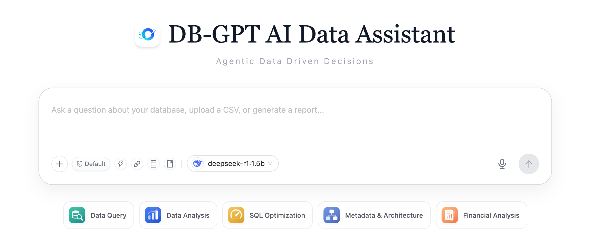
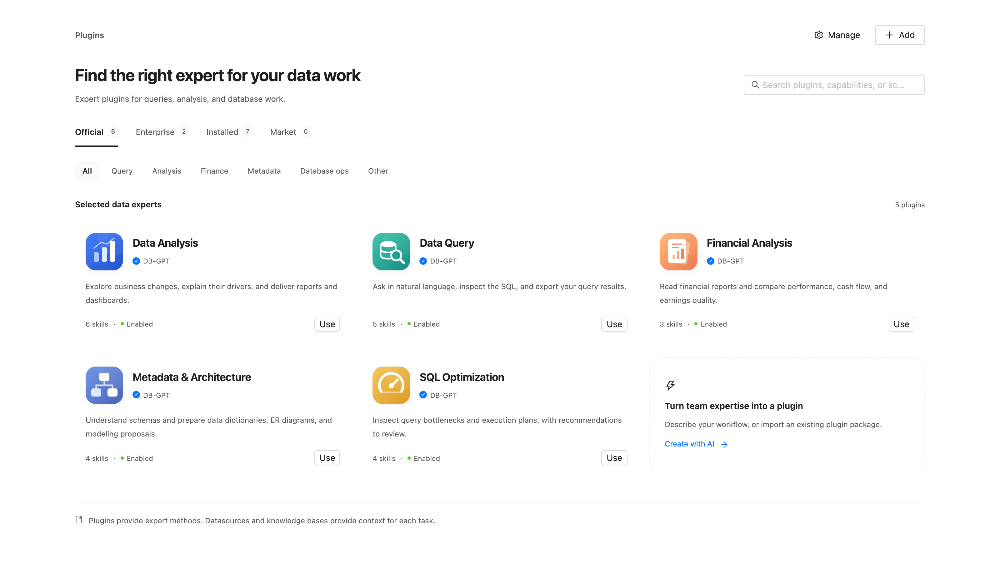
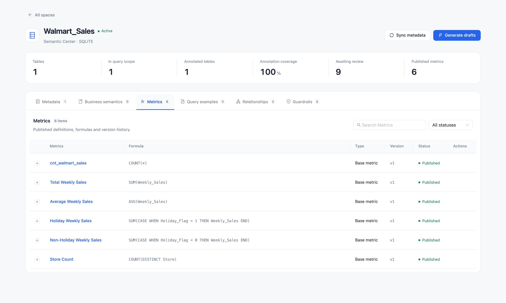
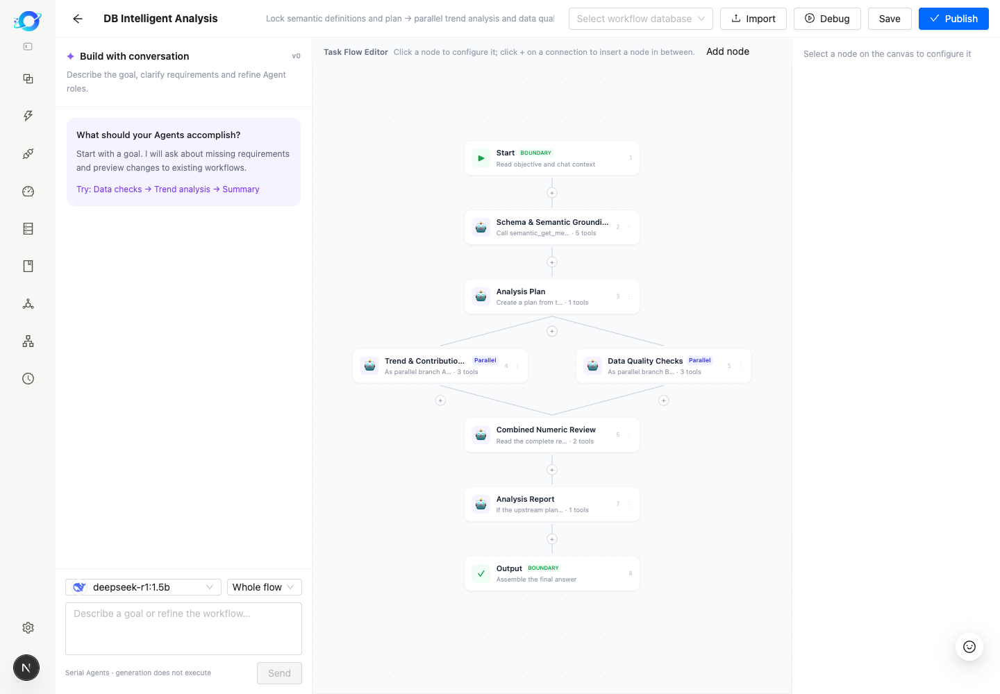

<p align="center">
  
</p>

<h1 align="center">DB-GPT: கட்டுப்படுத்தப்பட்ட தரவு முகவர்களுக்கான திறந்த மூலத் தயாரிப்பு</h1>

<p align="center">
  தரவு குறித்த கேள்வியிலிருந்து சரிபார்க்கக்கூடிய வினவல்கள், பகுப்பாய்வு அறிக்கைகள் மற்றும் மீண்டும் பயன்படுத்தக்கூடிய டாஷ்போர்டுகள் வரை.
</p>

<p align="center">
  <a href="https://github.com/eosphoros-ai/DB-GPT/stargazers"></a>
  <a href="https://github.com/eosphoros-ai/DB-GPT/releases"></a>
  <a href="LICENSE"></a>
  <a href="https://x.com/DBGPT_AI"></a>
  <a href="https://discord.gg/7uQnPuveTY"></a>
</p>

<p align="center">
  <a href="README.md">English</a> · <a href="README.zh.md">简体中文</a> · <a href="README.ja.md">日本語</a> · <a href="README.hi.md">हिन्दी</a> · <a href="README.ma.md">മലയാളം</a> · <a href="README.ta.md">தமிழ்</a>
</p>

<p align="center">
  <a href="http://docs.dbgpt.cn/docs/overview/">ஆவணங்கள்</a> · <a href="https://github.com/eosphoros-ai/DB-GPT/releases">வெளியீடுகள்</a> · <a href="https://github.com/orgs/eosphoros-ai/discussions">சமூகம்</a> · <a href="#quick-start">விரைவான தொடக்கம்</a>
</p>

> **உங்கள் தரவை இணைக்கவும், வணிக வரையறைகளை அமைக்கவும், நிபுணத்துவ முறைகளைத் தேர்ந்தெடுக்கவும், கட்டமைக்கப்பட்ட கருவிகள் மற்றும் இயக்கச்சூழல் எல்லைகளுக்குள் செயல்படவும். முடிவுகளைச் சரிபார்த்து, திருத்தி, மீண்டும் பயன்படுத்தலாம்.**

DB-GPT இயல்பான மொழியை SQL ஆக மாற்றுவதோடு நிற்கவில்லை. **தரவு இணைப்புகள், வணிகப் பொருள், நிபுணத்துவத் திறன்கள், பணி ஒருங்கிணைப்பு மற்றும் பகுப்பாய்வு விளைவுகள்** ஆகியவற்றை ஒரே பணிப்பாய்வில் இணைக்கிறது. பயனர்களுக்கு நடைமுறை உதவியாளராகவும், AI சார்ந்த தரவுப் பயன்பாடுகளை உருவாக்கும் மேம்பாட்டாளர்களுக்கு விரிவாக்கக்கூடிய அடித்தளமாகவும் செயல்படுகிறது.

[தயாரிப்பு செயல்விளக்கம்](#product-demo) · [DB-GPT ஏன்](#why-db-gpt) · [தயாரிப்பு தொகுதிகள்](#product-modules) · [பாதுகாப்பு மற்றும் செயலாக்க எல்லைகள்](#safety-and-execution-boundaries) · [விரைவான தொடக்கம்](#quick-start) · [சமூகம்](#community)

<a id="product-demo"></a>

## தயாரிப்பு செயல்விளக்கம்

https://github.com/user-attachments/assets/36ddad2c-1021-4181-b31a-8fb216c93f81

<a id="why-db-gpt"></a>

## DB-GPT ஏன்

### வினவலுக்கு முன் வணிகச் சூழல்

‘வருவாய்’ என்பதன் பொருள் தேதி ஒதுக்கீடு, பணத்திருப்பத்தின் கையாளுதல் மற்றும் கணக்கீட்டு எல்லையைப் பொறுத்து மாறலாம். செமான்டிக் மையம் தரவுக்கட்டமைப்பு மெட்டாடேட்டா, வணிக அர்த்தங்கள், அளவீட்டுச் சூத்திரங்கள் மற்றும் வெளியிடப்பட்ட பதிப்புகளை ஒழுங்குபடுத்துகிறது. இதனால் முகவர் ஒவ்வொரு கேள்விக்கும் ஊகிப்பதற்குப் பதிலாக தெளிவான வரையறைகளின் அடிப்படையில் செயல்பட முடியும்.

### பதில்கள் மட்டுமல்ல, நிபுணத்துவ முறைகளும்

வினவல், பகுப்பாய்வு, SQL மேம்படுத்தல், மெட்டாடேட்டா மற்றும் கட்டமைப்பு, நிதிப் பகுப்பாய்வு ஆகியவற்றிற்கான சிறப்பு செருகுநிரல்களைப் பயன்படுத்தவும். Skills மீண்டும் பயன்படுத்தக்கூடிய வழிமுறைகளையும் ஸ்கிரிப்ட்களையும் தொகுக்கின்றன; பணிப்பாய்வுகள் படிகள், சார்புகள் மற்றும் கருவிக் கட்டமைப்பைத் தெளிவாக்குகின்றன.

### மீண்டும் பயன்படுத்தக்கூடிய முடிவுகள்

அரட்டைச் செய்திகளை மட்டும் அல்லாமல் வினவல் அட்டவணைகள், வரைபடங்கள், பகுப்பாய்வு அறிக்கைகள் மற்றும் திருத்தக்கூடிய டாஷ்போர்டுகளை உருவாக்கவும். செயலாக்கத்தையும் முடிவையும் ஆய்வு செய்து, மாற்றங்களைக் கோரி, அடுத்த பணிக்காக விளைவுகளைச் சேமிக்கலாம்.

### முக்கிய செயல்களில் மனிதக் கட்டுப்பாடு

மாதிரிகள், கருவிகள், தரவு மூலங்கள் மற்றும் இயக்கச்சூழல் அணுகல் ஆகியவை நிறுவல் மற்றும் பணிக் கட்டமைப்பைப் பொறுத்தவை. டாஷ்போர்டு திட்டங்களையும் முன்மொழியப்பட்ட மாற்றங்களையும் செயல்படுத்தும் முன் ஆய்வு செய்யலாம். **கட்டுப்படுத்தப்பட்ட செயலாக்கம் முழுமையான பாதுகாப்பை உறுதி செய்யாது**: குறைந்தபட்ச அனுமதியுள்ள சான்றுகள், பொருத்தமான தனிமைப்படுத்தல் மற்றும் சுயாதீனச் சரிபார்ப்பைப் பயன்படுத்தவும்.

<a id="product-modules"></a>

## தயாரிப்பு தொகுதிகள்

### பணிகளுக்கான பொதுவான தொடக்க இடம்



கேள்வி, கோப்பு அல்லது தரவுத்தளத்திலிருந்து தொடங்கவும். மாதிரியையும் பொருத்தமான நிபுணரையும் தேர்ந்தெடுத்து, இலக்கைத் தெளிவாக்கி, வினவல், பகுப்பாய்வு அல்லது டாஷ்போர்டு பணிக்குச் செல்லவும்.

### 1. டாஷ்போர்டுகள்: திட்டத்திலிருந்து முழுப் பலகைக் காட்சிக்கு

திட்டம் அல்லது வார்ப்புருவிலிருந்து வரைவை உருவாக்கி, விட்ஜெட்டுகளையும் வினவல்களையும் திருத்தவும். முழுப் பலகையைக் காட்ட Preview திறக்கவும்.


*இது தயாரிப்பு செயல்விளக்கத்தின் போது உண்மையில் உருவாக்கிச் சேமிக்கப்பட்ட Walmart டாஷ்போர்டின் Preview காட்சி. நான்கு விட்ஜெட்டுகள் விற்பனை மற்றும் கடை எண்ணிக்கைக்கான KPI-கள், வாராந்திரப் போக்கு மற்றும் முதல் 10 தரவரிசையை வழங்குகின்றன. இது சேமிக்கப்பட்ட வரைவு; பொதுவாக வெளியிடப்பட்ட பலகை அல்ல.*

- உருவாக்கும் முன் அளவீடுகள், வரைபடங்கள் மற்றும் வடிப்பான்களை வரையறுக்கவும்.
- விட்ஜெட்டுகள், அமைப்பு, வினவல் கட்டமைப்பு மற்றும் வடிப்பான்களை மாற்றவும்.
- AI உதவியாளருடன் மாற்றங்களை விவாதித்து, செயல்படுத்தும் முன் முன்மொழிவுகளை ஆய்வு செய்யவும்.
- வரைவுகளைச் சேமிக்கவும்; முடிவும் அணுகல் எல்லையும் தயாரான பிறகே வெளியிடவும் அல்லது பகிரவும்.

இந்த Walmart பலகை எடுத்துக்காட்டு தரவுத்தொகுப்பைப் பயன்படுத்துகிறது. எண்கள் இந்த நிகழ்வை விளக்குகின்றன; நிறுவனத்தின் தற்போதைய செயல்திறனைக் குறிக்கவில்லை.

### 2. செருகுநிரல்கள் மற்றும் Skills: நிபுணத்துவத்தை மீண்டும் பயன்படுத்துதல்

பணிக்கான நிபுணர் செருகுநிரலைத் தேர்ந்தெடுத்து, அதன் தரவு, அறிவுச் சூழல் மற்றும் அனுமதிக்கப்பட்ட கருவிகளை இணைக்கவும். Skills துறைசார் வழிமுறைகள், முறைகள் மற்றும் ஸ்கிரிப்ட்களைத் தொகுக்கின்றன.



| நிபுணத்துவம் | வழக்கமான பணி |
| --- | --- |
| தரவு வினவல் | கேள்வியையும் அளவீட்டையும் தெளிவாக்குதல், SQL சரிபார்த்து இயக்குதல், முடிவுகளை ஏற்றுமதி செய்தல் |
| தரவுப் பகுப்பாய்வு | தரவை ஆய்வு செய்தல், போக்குகளையும் அமைப்பையும் பகுப்பாய்வு செய்தல், அறிக்கைகள் மற்றும் டாஷ்போர்டுகள் தயாரித்தல் |
| SQL மேம்படுத்தல் | SQL மற்றும் செயலாக்கத் திட்டத்தை ஆய்வு செய்து மாற்றங்களை மதிப்பாய்விற்கு முன்மொழிதல் |
| மெட்டாடேட்டா மற்றும் கட்டமைப்பு | தரவு அகராதி, தொடர்புகள் மற்றும் மாதிரியாக்கப் பரிந்துரைகளை ஒழுங்குபடுத்துதல் |
| நிதிப் பகுப்பாய்வு | தேவையான கட்டமைப்பும் தரவும் கிடைக்கும்போது நிதி ஆவணங்களைப் படித்து ஒப்பீடுகளை அமைத்தல் |

செருகுநிரல்கள் முறைகளை வழங்குகின்றன; தரவு அனுமதிகளை வழங்குவதில்லை. நிறுவும் முன் மூன்றாம் தரப்பு வழிமுறைகள், ஸ்கிரிப்ட்கள், சார்புகள் மற்றும் கருவி அணுகலை ஆய்வு செய்யவும்.

### 3. தரவு மூலங்கள்: நம்பகமான இணைப்புகள்

தரவுத்தள இணைப்புகளை நிர்வகித்து ஒவ்வொரு பணிக்கும் மூலத்தைத் தேர்ந்தெடுக்கவும். வினவல்கள், பகுப்பாய்வு மற்றும் டாஷ்போர்டுகள் ஒரே இணைப்புப் பட்டியலையும் மெட்டாடேட்டா சூழலையும் பயன்படுத்தலாம்.


MySQL, PostgreSQL, SQLite, DuckDB, ClickHouse, Apache Doris, StarRocks, Oracle, MSSQL, Neo4j, TuGraph போன்ற தரவு மூலங்கள் ஆதரிக்கப்படுகின்றன.

- தரவுத்தள இணைப்புகளை அமைத்துச் சரிபார்க்கவும்.
- பணியைப் பொருத்தமான மூலத்துடன் இணைத்து அதன் எல்லையை உறுதிப்படுத்தவும்.
- பட்டியல் பதிவு அல்லது இணைப்பு வார்ப்புரு செயல்படும் இணைப்புக்கான சான்றல்ல. இயக்கிகள், பிணைய அணுகல் மற்றும் சான்றுகள் கிடைக்க வேண்டும்.

### 4. செமான்டிக் மையம்: அளவீட்டு வரையறைகளின் பராமரிப்பு

ஒரு மூலத்தின் மெட்டாடேட்டா, வணிக வரையறைகள், அளவீடுகள், வினவல் எடுத்துக்காட்டுகள், தொடர்புகள் மற்றும் விதிகளை ஒழுங்குபடுத்தவும். வெளியிடப்பட்ட வரையறைகள் பதிப்புகளைச் சேமிக்கின்றன; அவற்றை வினவல் முடிவுடன் இணைக்கலாம்.



- அட்டவணை மற்றும் நெடுவரிசை அர்த்தங்கள், குறிப்புகள் மற்றும் இணைச்சொற்களைப் பராமரிக்கவும்.
- அடிப்படை மற்றும் பெறப்பட்ட அளவீடுகள், சூத்திரங்கள் மற்றும் சார்புகளை வரையறுக்கவும்.
- வரையறைகளை ஆய்வு செய்து வெளியிடவும்; வெளியிடப்பட்டவற்றை மட்டும் படிக்கும் போது வெளியிடப்படாத வரைவை அதிகாரப்பூர்வமாகக் கருத வேண்டாம்.

### 5. பணிப்பாய்வு: தெளிவான படிகளும் ஒத்துழைப்பும்

காட்சி எடிட்டரில் Agent முனைகள், உள்ளீடுகள், வெளியீடுகள், தொடர் படிகள் மற்றும் இணையான கிளைகளை அமைக்கவும். மீண்டும் செயல்படுத்த வேண்டிய பணிகளுக்கு தெளிவான பணிப்பாய்வைப் பயன்படுத்தவும்.



இது வார்ப்புரு திருத்தும் காட்சி; பணிப்பாய்வு பிழைதிருத்தப்பட்டதற்கோ வெளியிடப்பட்டதற்கோ சான்றல்ல. இயக்கும் முன் தரவு மூலம், மாதிரி மற்றும் கருவிகளை அமைக்கவும்.

### 6. அறிவு, இணைப்பிகள் மற்றும் இயக்கச்சூழல் நிர்வாகம்

- **அறிவுக் களஞ்சியங்கள்** மீட்டெடுப்பிற்கான ஆவணச் சூழலை வழங்குகின்றன. பாகுபடுத்தல், பிரித்தல், குறியீட்டாக்கம் மற்றும் மீட்டெடுப்பு அமைப்பு கிடைக்கும் நிலையையும் தரத்தையும் பாதிக்கும்.
- **இணைப்பிகள்** கட்டமைக்கப்பட்ட MCP சேவைகள் மூலம் வெளிப்புறக் கருவிகளை இணைக்கின்றன. வார்ப்புருக்களைப் பயன்படுத்தும் முன் செயல்படுத்தலும் அனுமதியும் தேவை.
- **மாதிரிகளும் இயக்கச்சூழல்களும்** சார்புகள் மற்றும் கருவி அணுகலை அமைத்து வழங்குநர்கள், உள்ளூர் அல்லது கண்டெய்னர் செயலாக்கத்தைத் தேர்ந்தெடுக்க அனுமதிக்கின்றன.
- **திட்டமிடப்பட்ட பணிகள்** வேலையை மீண்டும் இயக்குகின்றன அல்லது விளைவுகளைப் புதுப்பிக்கின்றன. திட்டமிடுபவர், மாதிரிகள், கோப்புகள் மற்றும் மூலங்கள் தொடர்ந்து கிடைக்க வேண்டும்.

## கேள்வியிலிருந்து முடிவுக்கு

**இணைத்தல் → சூழலை உறுதிப்படுத்துதல் → திட்டமிடல் → செயலாக்கம் → ஆய்வு → மறுபயன்பாடு**

1. மூலத்தைத் தேர்ந்தெடுத்து இலக்கு, காலவரம்பு மற்றும் அளவீட்டு எல்லையைத் தெளிவாக்கவும்.
2. புலங்கள், தரவுத் தரம், வணிக வரையறைகள் மற்றும் அளவீட்டு பதிப்புகளை ஆய்வு செய்யவும்.
3. நிபுணரையும் Skills-ஐயும் தேர்ந்தெடுத்து, மீண்டும் செய்யும் பணிகளுக்குப் பணிப்பாய்வை அமைக்கவும்.
4. அனுமதிக்கப்பட்ட கருவிகள் மற்றும் இயக்கச்சூழலில் SQL, குறியீடு அல்லது மீட்டெடுப்பை இயக்கவும்.
5. திட்டம், கணக்கீடுகள், மூலங்கள், விளைவுகள் மற்றும் முன்மொழியப்பட்ட மாற்றங்களை ஆய்வு செய்யவும்.
6. அறிக்கை அல்லது டாஷ்போர்டைச் சேமிக்கவும்; தேவையான இயக்க ஆதரவு இருந்தால் மட்டுமே கால அட்டவணையை அமைக்கவும்.

<a id="safety-and-execution-boundaries"></a>

## பாதுகாப்பு மற்றும் செயலாக்க எல்லைகள்

DB-GPT அமைத்துக்கொள்ளக்கூடிய செயலாக்க மற்றும் ஆய்வு முறைகளை வழங்குகிறது. பயனுள்ள பாதுகாப்பு நிறுவலைப் பொறுத்தது:

- **தரவு அணுகல்:** படிக்க மட்டும் மற்றும் குறைந்தபட்ச அனுமதியுள்ள சான்றுகளைப் பயன்படுத்தவும். பட்டியலின் விளக்கக் குறிகள் வரிசை அல்லது நெடுவரிசை அளவிலான அணுகல் கட்டுப்பாடு அல்ல.
- **தனிமைப்படுத்தல்:** உள்ளூர் செயலாக்கம் கண்டெய்னர் தனிமைப்படுத்தல் அல்ல. கோப்பு அணுகல், வள வரம்புகள் மற்றும் பிணைய எல்லைகளை அமைக்கவும்.
- **ரகசியங்கள்:** API விசைகள், தரவுத்தளக் கடவுச்சொற்கள் மற்றும் உணர்திறன் மிக்க தரவை கமிட்டுகள், திரைப்பிடிப்புகள் அல்லது பகிரப்பட்ட விளைவுகளில் சேர்க்க வேண்டாம்.
- **ஆய்வு:** முக்கிய அளவீடுகள், கணக்கீடுகள், SQL மற்றும் வெளிப்புற முடிவுகளைச் சுயாதீனமாகச் சரிபார்க்கவும். மாதிரி முடிவுகள் தொழில்முறை ஆய்வுக்கு மாற்றாகாது.
- **வெளியீடும் திட்டமிடலும்:** வரைவுகள், வெளியிடப்பட்ட நிலைப்படங்கள், பகிர்வு மற்றும் தொடர்ச்சியான செயல்பாடு வெவ்வேறு நிலைகள். நிறுவும் முன் அணுகலையும் கிடைக்கும் நிலையையும் உறுதிப்படுத்தவும்.

> திறன்கள் வெளியீடு, கட்டமைப்பு, தரவுக்கட்டமைப்பு மாற்றங்கள் மற்றும் மாதிரியின் நடத்தையைப் பொறுத்தவை. உங்கள் பதிப்பின் குறியீடு மற்றும் ஆவணங்களைப் பயன்படுத்தவும்; UI அணுகல் அல்லது பழைய செயல்விளக்கம் தயாரிப்பு பயன்பாட்டிற்கான உறுதி அல்ல.

<a id="quick-start"></a>

## விரைவான தொடக்கம்

### முறை 1: macOS மற்றும் Linux நிறுவி

இயக்கும் முன் ஸ்கிரிப்டைப் பதிவிறக்கி ஆய்வு செய்யவும்:

```bash
curl -fsSL https://raw.githubusercontent.com/eosphoros-ai/DB-GPT/main/scripts/install/install.sh -o install.sh
less install.sh
bash install.sh
```

வழிகாட்டியில் சுயவிவரத்தைத் தேர்ந்தெடுத்து மாதிரி வழங்குநரை அமைக்கவும். பின்னர் நிறுவி காட்டும் அடைவையும் தொடக்கக் கட்டளையையும் பயன்படுத்தவும்:

```bash
cd ~/.dbgpt/DB-GPT
uv run dbgpt start webserver --profile <profile>
```

`<profile>`-ஐ அமைக்கப்பட்ட சுயவிவரத்தால் மாற்றி [http://localhost:5670](http://localhost:5670) திறக்கவும்.

<details>
<summary>ஏற்கனவே உள்ள மூலக் குறியீடு: தற்போதைய கிளையை வைத்திருக்கவும்</summary>

ரிப்போசிட்டரியின் மூல அடைவிலிருந்து:

```bash
bash scripts/install/install.sh --profile openai --repo-dir "$(pwd)"
uv run dbgpt start webserver --profile openai
```

`--repo-dir` நகலெடுக்கவோ கிளையை மாற்றவோ செய்யாமல் தற்போதைய மூலத்தை மீண்டும் பயன்படுத்துகிறது. வழங்குநர் சான்றுகளும் தேவையான சேவைகளும் இன்னும் அமைக்கப்பட வேண்டும்.

சார்புகளை நிறுவி பொருத்தமான TOML கட்டமைப்பைத் தயாரித்தால் பின்புறச் சேவையை நேரடியாகவும் தொடங்கலாம்:

```bash
.venv/bin/python packages/dbgpt-app/src/dbgpt_app/dbgpt_server.py -c configs/dbgpt-proxy-openai.toml
```

முன்புற மேம்பாட்டிற்கு `web/`-இல் `npm run dev -- --hostname 127.0.0.1 --port 3000` இயக்கவும். UI இயங்குவது மாதிரி கணிப்போ தரவு அணுகலோ தயாராக இருப்பதற்கான சான்றல்ல.

</details>

### முறை 2: PyPI

Python 3.10 அல்லது புதிய பதிப்பைப் பயன்படுத்தவும்:

```bash
pip install dbgpt-app
dbgpt start
```

திரையைப் பயன்படுத்தும் முன் வழங்குநர் அமைப்பை முடிக்கவும். PyPI வெளியீடுகள், `main` மற்றும் அம்சக் கிளைகள் வேறுபடலாம்; கிளைக்குரிய திறன்களைச் சோதிக்க தொடர்புடைய மூலக் குறியீட்டைப் பயன்படுத்தவும்.

மேலும் நிறுவல் மற்றும் கட்டமைப்பு வழிகளுக்கு [ஆவணங்களை](http://docs.dbgpt.cn/docs/overview/) பார்க்கவும்.

## மேம்பாட்டாளர் சூழல்

- **DB-GPT:** தரவு முகவர்கள், கருவிகள், செயலாக்கம் மற்றும் பகுப்பாய்வு பயன்பாடுகளுக்கான அடித்தளம்.
- **[DB-GPT-Hub](https://github.com/eosphoros-ai/DB-GPT-Hub):** Text-to-SQL பயிற்சி மற்றும் மதிப்பீட்டு வளங்கள்.
- **[dbgpts](https://github.com/eosphoros-ai/dbgpts):** பயன்பாடுகள், முகவர்கள் மற்றும் பணிப்பாய்வுகளின் சூழல்.
- **[பங்களிப்பு வழிகாட்டி](CONTRIBUTING.md):** மேம்பாடு, சோதனை மற்றும் பங்களிப்பு வழிமுறைகள்.

வழங்குநர் ஆதரவு, இயக்கிகள் மற்றும் சார்புகளுக்கு தற்போதைய ஆவணங்களைப் பார்க்கவும்; பழைய மாதிரிப் பட்டியல்களைத் தொடர்ந்த இணக்கத்திற்கான உறுதியாகக் கருத வேண்டாம்.

## நோக்கமும் வளர்ச்சியும்

நம்பகமான தரவுப் பணியைத் திறந்ததாகவும் இணைத்துப் பயன்படுத்தக்கூடியதாகவும் ஆக்குதல்: பயனர்கள் பகுப்பாய்வை முடிக்கவும், குழுக்கள் வணிகச் சூழல், மறுபயன்பாட்டு முறைகள் மற்றும் பகுப்பாய்வு விளைவுகளைச் சேமிக்கவும் உதவுதல்.

அர்த்த ஒருமைப்பாடு, பணி மதிப்பீடு, செயலாக்கக் கண்டறிதல், இடமாற்றக்கூடிய Skills மற்றும் பணிப்பாய்வுகள், கண்காணிக்கப்படும் தொடர்ச்சியான பணிகள் ஆகியவை வளர்ச்சித் திசைகள். [Issues](https://github.com/eosphoros-ai/DB-GPT/issues) மற்றும் [Discussions](https://github.com/orgs/eosphoros-ai/discussions) மூலம் முன்மொழிவுகளையும் முன்னுரிமைகளையும் பின்தொடரவும்; உறுதிப்படுத்தப்படாத வெளியீட்டு தேதிகளை முன்கூட்டியே கருத வேண்டாம்.

<a id="community"></a>

## சமூகம்

- [பிரச்சினையைப் புகாரளிக்கவும் அல்லது அம்சம் பரிந்துரைக்கவும்](https://github.com/eosphoros-ai/DB-GPT/issues)
- [பயன்பாடு மற்றும் வடிவமைப்பு பற்றி விவாதிக்கவும்](https://github.com/orgs/eosphoros-ai/discussions)
- [சமூகத் திட்டங்களைப் பார்க்கவும்](https://github.com/eosphoros-ai/community)
- [X (Twitter)-இல் DB-GPT-ஐப் பின்தொடரவும்](https://x.com/DBGPT_AI)
- [Discord-இல் இணையவும்](https://discord.gg/7uQnPuveTY)
- [Slack-இல் இணையவும்](https://join.slack.com/t/slack-inu2564/shared_invite/zt-29rcnyw2b-N~ubOD9kFc7b7MDOAM1otA)
- [பங்களிப்பாளர்களைப் பார்க்கவும்](https://github.com/eosphoros-ai/DB-GPT/graphs/contributors)

மீண்டும் உருவாக்கக்கூடிய நிகழ்வுகள், திருத்தங்கள், ஆவணங்கள், Skills மற்றும் பணிப்பாய்வுகளில் பங்களிக்கவும். பிரச்சினையைப் புகாரளிக்கும் போது பதிப்பு, கட்டமைப்பு முறை மற்றும் குறைந்தபட்ச மறுஉருவாக்கப் படிகளைத் தரவும்; பதிவுகளில் இருந்து ரகசியங்களையும் உணர்திறன் மிக்க தரவையும் நீக்கவும்.

## பங்களிப்பு

விரிவான வழிமுறைகளுக்கு [எவ்வாறு பங்களிப்பது](https://github.com/eosphoros-ai/DB-GPT/blob/main/CONTRIBUTING.md) பார்க்கவும். குறியீடு, ஆவணங்கள், Skills, பணிப்பாய்வுகள் மற்றும் மீண்டும் உருவாக்கக்கூடிய எடுத்துக்காட்டுகளில் பங்களிப்புகள் வரவேற்கப்படுகின்றன.

### பங்களிப்பாளர் பட்டியல்

<a href="https://github.com/eosphoros-ai/DB-GPT/graphs/contributors">
  
</a>

## உரிமம் மற்றும் பொறுப்புத் துறப்பு

DB-GPT [MIT உரிமத்தின்](LICENSE) கீழ் வழங்கப்படுகிறது. [பொறுப்புத் துறப்பையும்](DISCKAIMER.md) படிக்கவும்.

## கல்வியியல் மேற்கோள்கள்

பின்வரும் ஆய்வுக் கட்டுரைகள் திட்டத்தையும் தொடர்புடைய ஆய்வையும் அறிமுகப்படுத்துகின்றன. தற்போதைய ஒவ்வொரு UI அம்சத்தின் இணக்கத்தையும் அவை விளக்குவதில்லை.

<details>
<summary>BibTeX மேற்கோள்கள்</summary>

```bibtex
@article{xue2023dbgpt,
      title={DB-GPT: Empowering Database Interactions with Private Large Language Models},
      author={Siqiao Xue and Caigao Jiang and Wenhui Shi and Fangyin Cheng and Keting Chen and Hongjun Yang and Zhiping Zhang and Jianshan He and Hongyang Zhang and Ganglin Wei and Wang Zhao and Fan Zhou and Danrui Qi and Hong Yi and Shaodong Liu and Faqiang Chen},
      year={2023},
      journal={arXiv preprint arXiv:2312.17449},
      url={https://arxiv.org/abs/2312.17449}
}
@misc{huang2024romasrolebasedmultiagentdatabase,
      title={ROMAS: A Role-Based Multi-Agent System for Database monitoring and Planning},
      author={Yi Huang and Fangyin Cheng and Fan Zhou and Jiahui Li and Jian Gong and Hongjun Yang and Zhidong Fan and Caigao Jiang and Siqiao Xue and Faqiang Chen},
      year={2024},
      eprint={2412.13520},
      archivePrefix={arXiv},
      primaryClass={cs.AI},
      url={https://arxiv.org/abs/2412.13520}
}
@inproceedings{xue2024demonstration,
      title={Demonstration of DB-GPT: Next Generation Data Interaction System Empowered by Large Language Models},
      author={Siqiao Xue and Danrui Qi and Caigao Jiang and Wenhui Shi and Fangyin Cheng and Keting Chen and Hongjun Yang and Zhiping Zhang and Jianshan He and Hongyang Zhang and Ganglin Wei and Wang Zhao and Fan Zhou and Hong Yi and Shaodong Liu and Hongjun Yang and Faqiang Chen},
      year={2024},
      booktitle={Proceedings of the VLDB Endowment},
      url={https://arxiv.org/abs/2404.10209}
}
```

</details>

## Star வளர்ச்சி வரலாறு

[](https://star-history.com/#csunny/DB-GPT)
