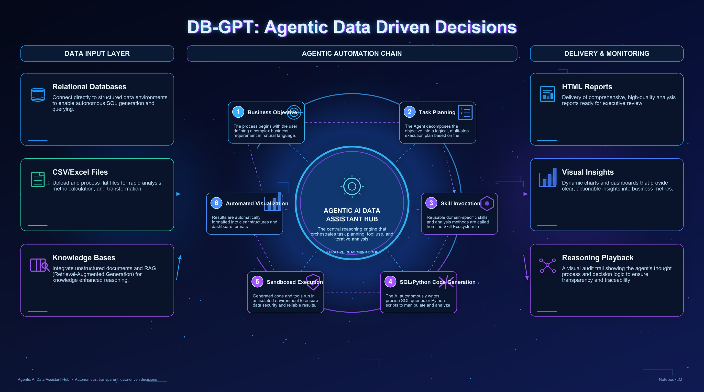

#  DB-GPT: Trợ lý dữ liệu Agentic AI mã nguồn mở

<p align="left">
  
</p>

<div align="center">
  <p>
    <a href="https://github.com/eosphoros-ai/DB-GPT">
        
    </a>
    <a href="https://github.com/eosphoros-ai/DB-GPT">
        
    </a>
    <a href="http://dbgpt.cn/">
        
    </a>
    <a href="https://opensource.org/licenses/MIT">
      
    </a>
     <a href="https://github.com/eosphoros-ai/DB-GPT/releases">
      
    </a>
    <a href="https://github.com/eosphoros-ai/DB-GPT/issues">
      
    </a>
    <a href="https://x.com/DBGPT_AI">
      
    </a>
    <a href="https://medium.com/@dbgpt0506">
      
    </a>
    <a href="https://space.bilibili.com/3537113070963392">
      
    </a>
    <a href="https://join.slack.com/t/slack-inu2564/shared_invite/zt-29rcnyw2b-N~ubOD9kFc7b7MDOAM1otA">
      
    </a>
    <a href="https://codespaces.new/eosphoros-ai/DB-GPT">
      
    </a>
  </p>


[](README.md)
[](README.zh.md)
[](README.ja.md)
[](README.vi.md)

[**Tài liệu**](http://docs.dbgpt.cn/docs/overview/) | [**Liên hệ**](#thông-tin-liên-hệ) | [**Cộng đồng**](https://github.com/eosphoros-ai/community) | [**Bài báo**](https://arxiv.org/pdf/2312.17449.pdf)

</div>

> **Trợ lý dữ liệu AI mã nguồn mở: kết nối với dữ liệu của bạn, tự động viết SQL và code, chạy các skills trong môi trường sandbox, và biến phân tích thành báo cáo, insight và hành động.**


## DB-GPT là gì?

DB-GPT là một **trợ lý dữ liệu Agentic AI** mã nguồn mở cho thế hệ sản phẩm **AI + Data** tiếp theo.

Dự án giúp người dùng và đội ngũ:
- kết nối với **cơ sở dữ liệu, tệp CSV / Excel, kho dữ liệu (data warehouse) và cơ sở tri thức (knowledge base)**
- đặt câu hỏi bằng ngôn ngữ tự nhiên và để AI **tự động viết SQL**
- chạy các quy trình **phân tích dựa trên Python và code**
- nạp và thực thi các **skills** tái sử dụng cho các tác vụ chuyên biệt theo miền nghiệp vụ
- tạo **biểu đồ, dashboard, báo cáo HTML và bản tóm tắt phân tích**
- thực thi tác vụ an toàn trong **môi trường sandbox**

DB-GPT đồng thời là nền tảng để xây dựng **data agent, workflow và ứng dụng AI-native** với các agent, AWEL, RAG và hỗ trợ đa mô hình.

## Tại sao chọn DB-GPT?

### 1. Phân tích dữ liệu theo hướng Agentic
Lập kế hoạch tác vụ, chia nhỏ công việc thành từng bước, gọi công cụ và hoàn tất quy trình phân tích từ đầu đến cuối.


### 2. Tự động sinh SQL và thực thi code
Sinh câu lệnh SQL và code để truy vấn dữ liệu, làm sạch tập dữ liệu, tính toán chỉ số và xuất kết quả.


### 3. Truy cập dữ liệu đa nguồn
Làm việc xuyên suốt trên dữ liệu có cấu trúc và phi cấu trúc, bao gồm cơ sở dữ liệu, bảng tính, tài liệu và cơ sở tri thức.


### 4. Mở rộng linh hoạt dựa trên Skills
Đóng gói tri thức miền nghiệp vụ, phương pháp phân tích và quy trình thực thi thành các skills có thể tái sử dụng.


### 5. Thực thi trong môi trường Sandbox
Chạy code và công cụ trong môi trường cô lập để phân tích an toàn và đáng tin cậy hơn.


## Bạn có thể làm gì với DB-GPT

- **Phân tích tệp CSV / Excel** và tạo báo cáo trực quan
- **Kết nối cơ sở dữ liệu** và xuất báo cáo phân tích tổng quan dữ liệu (profiling)
- Đặt câu hỏi nghiệp vụ bằng ngôn ngữ tự nhiên và để AI **tự động viết SQL**
- Thực hiện **phân tích báo cáo tài chính** với code, biểu đồ và bản tóm tắt diễn giải
- Tạo và tái sử dụng các **skills phân tích SQL** cùng quy trình theo miền nghiệp vụ
- Kết hợp **code, SQL, truy xuất (retrieval) và công cụ** trong một quy trình agentic duy nhất
- Xây dựng **trợ lý AI + Data** thế hệ mới cho đội ngũ hoặc sản phẩm của bạn

## Quy trình sản phẩm

### Khám phá dữ liệu
Kết nối tệp, cơ sở dữ liệu và cơ sở tri thức trong cùng một không gian làm việc.

### Lập kế hoạch và thực thi
Để AI suy luận qua từng tác vụ, viết SQL và code, rồi thực thi từng bước.

### Sử dụng skills
Nạp các skills tái sử dụng cho những quy trình phân tích nghiệp vụ lặp lại.

### Tạo báo cáo
Xuất biểu đồ, dashboard, báo cáo HTML và đầu ra sẵn sàng cho việc ra quyết định.


## Bắt đầu nhanh

Khởi chạy DB-GPT chỉ trong vài phút với trình cài đặt một dòng lệnh (macOS & Linux):

```bash
curl -fsSL https://raw.githubusercontent.com/eosphoros-ai/DB-GPT/main/scripts/install/install.sh | bash
```

Hoặc chỉ định trực tiếp profile và API key:

```bash
curl -fsSL https://raw.githubusercontent.com/eosphoros-ai/DB-GPT/main/scripts/install/install.sh \
  | OPENAI_API_KEY=sk-xxx bash -s -- --profile openai
```

Dành cho Kimi 2.5 qua Moonshot API:

```bash
curl -fsSL https://raw.githubusercontent.com/eosphoros-ai/DB-GPT/main/scripts/install/install.sh \
  | MOONSHOT_API_KEY=sk-xxx bash -s -- --profile kimi
```

Dành cho MiniMax qua API tương thích OpenAI:

```bash
curl -fsSL https://raw.githubusercontent.com/eosphoros-ai/DB-GPT/main/scripts/install/install.sh \
  | MINIMAX_API_KEY=sk-xxx bash -s -- --profile minimax
```

Đã clone sẵn mã nguồn DB-GPT trên máy? Hãy dùng lại thư mục đó thay vì clone `~/.dbgpt/DB-GPT`:

```bash
OPENAI_API_KEY=sk-xxx \
  bash scripts/install/install.sh --profile openai --repo-dir "$(pwd)" --yes
```

Hoặc dùng lại repo cục bộ với Kimi 2.5:

```bash
MOONSHOT_API_KEY=sk-xxx \
  bash scripts/install/install.sh --profile kimi --repo-dir "$(pwd)" --yes
```

Hoặc dùng lại repo cục bộ với MiniMax:

```bash
MINIMAX_API_KEY=sk-xxx \
  bash scripts/install/install.sh --profile minimax --repo-dir "$(pwd)" --yes
```

Sau khi cài đặt, khởi động server với cấu hình profile đã tạo:

```bash
cd ~/.dbgpt/DB-GPT && uv run dbgpt start webserver --profile <profile>
```

Sau đó mở [http://localhost:5670](http://localhost:5670).

> **Muốn xem trước nội dung script?**
> ```bash
> curl -fsSL https://raw.githubusercontent.com/eosphoros-ai/DB-GPT/main/scripts/install/install.sh -o install.sh
> less install.sh
> bash install.sh --profile openai
> ```

### Cài đặt qua PyPI

Cài đặt DB-GPT từ PyPI và khởi chạy chỉ với một lệnh — không cần tải toàn bộ mã nguồn.

> **Yêu cầu:** Python **3.10+** và [uv](https://docs.astral.sh/uv/getting-started/installation/) (khuyến nghị) hoặc pip.

**1. Cài đặt**

```bash
# Khuyến nghị: dùng uv
uv pip install dbgpt-app

# Hoặc dùng pip
pip install dbgpt-app
```

Bản cài đặt mặc định bao gồm framework cốt lõi (CLI, FastAPI, Agent), hỗ trợ LLM tương thích OpenAI, hỗ trợ DashScope / Tongyi, phân tích tài liệu RAG và vector store ChromaDB.

**2. Khởi chạy**

```bash
dbgpt start
```

Ở lần chạy đầu tiên, trình hướng dẫn thiết lập tương tác sẽ dẫn bạn qua bước chọn nhà cung cấp LLM và nhập API key. Sau khi hoàn tất, web server sẽ tự động khởi động.

**3. Mở Giao diện Web**

Truy cập [http://localhost:5670](http://localhost:5670) — mọi thứ đã sẵn sàng! 🎉

### Cài đặt nâng cao


Đối với Docker, mô hình GPU cục bộ (vLLM, llama.cpp), hoặc cài đặt thủ công từ mã nguồn, hãy xem tài liệu đầy đủ:

- [**Cài đặt**](http://docs.dbgpt.cn/docs/installation)
  - [Docker](http://docs.dbgpt.cn/docs/installation/docker)
  - [Mã nguồn](http://docs.dbgpt.cn/docs/getting-started/deploy/source-code)
- [**Bắt đầu nhanh**](http://docs.dbgpt.cn/docs/overview)
- [**Ứng dụng**](http://docs.dbgpt.cn/docs/use_cases)
  - [Hướng dẫn phát triển](http://docs.dbgpt.cn/docs/cookbook/app/data_analysis_app_develop)
  - [Sử dụng AWEL Flow](http://docs.dbgpt.cn/docs/application/awel_flow_usage)
- [**Gỡ lỗi (Debugging)**](http://docs.dbgpt.cn/docs/operation_manual/advanced_tutorial/debugging)
- [**Sử dụng nâng cao**](http://docs.dbgpt.cn/docs/application/advanced_tutorial/cli)
  - [SMMF](http://docs.dbgpt.cn/docs/application/advanced_tutorial/smmf)
  - [Finetune](http://docs.dbgpt.cn/docs/application/fine_tuning_manual/dbgpt_hub)
  - [AWEL](http://docs.dbgpt.cn/docs/awel/tutorial)


## Năng lực cốt lõi

### Phân tích Agentic
- lập kế hoạch tác vụ
- thực thi từng bước
- sử dụng công cụ
- suy luận lặp

### SQL + Thực thi Code
- ngôn ngữ tự nhiên sang SQL
- phân tích và biến đổi dữ liệu bằng Python
- tính toán chỉ số
- tạo biểu đồ

### Truy cập dữ liệu đa nguồn
- cơ sở dữ liệu quan hệ
- CSV / Excel
- tài liệu
- cơ sở tri thức
- quy trình kết hợp nhiều nguồn

### Skills và Agents
- các skills tái sử dụng
- quy trình theo miền nghiệp vụ
- điều phối agent
- luồng thực thi tùy biến

### Báo cáo và Hỗ trợ ra quyết định
- báo cáo profiling cơ sở dữ liệu
- báo cáo phân tích tài chính
- báo cáo trực quan và dashboard
- tóm tắt và insight nghiệp vụ

### Thực thi an toàn
- thực thi code trong sandbox
- kiểm soát việc sử dụng công cụ
- đầu ra và artifact có thể tái lập

#### Fine-tuning Text2SQL

  |     LLM     |   Hỗ trợ    |
  |:-----------:|:-----------:|
  |    LLaMA    |      ✅     |
  |   LLaMA-2   |      ✅     |
  |    BLOOM    |      ✅     |
  |   BLOOMZ    |      ✅     |
  |   Falcon    |      ✅     |
  |  Baichuan   |      ✅     |
  |  Baichuan2  |      ✅     |
  |  InternLM   |      ✅     |
  |    Qwen     |      ✅     |
  |   XVERSE    |      ✅     |
  |  ChatGLM2   |      ✅     |

[Thông tin thêm về fine-tuning Text2SQL](https://github.com/eosphoros-ai/DB-GPT-Hub)

### Các mô hình được hỗ trợ

<table>
      <thead>
        <tr>
          <th>Nhà cung cấp</th>
          <th>Hỗ trợ</th>
          <th>Mô hình</th>
        </tr>
      </thead>
      <tbody>
        <tr>
          <td align="center" valign="middle">DeepSeek</td>
          <td align="center" valign="middle">✅</td>
          <td>
            🔥🔥🔥  <a href="https://huggingface.co/deepseek-ai/DeepSeek-R1-0528">DeepSeek-R1-0528</a><br/>
            🔥🔥🔥  <a href="https://huggingface.co/deepseek-ai/DeepSeek-V3-0324">DeepSeek-V3-0324</a><br/>
            🔥🔥🔥  <a href="https://huggingface.co/deepseek-ai/DeepSeek-R1">DeepSeek-R1</a><br/>
            🔥🔥🔥  <a href="https://huggingface.co/deepseek-ai/DeepSeek-V3">DeepSeek-V3</a><br/>
            🔥🔥🔥  <a href="https://huggingface.co/deepseek-ai/DeepSeek-R1-Distill-Llama-70B">DeepSeek-R1-Distill-Llama-70B</a><br/>
            🔥🔥🔥  <a href="https://huggingface.co/deepseek-ai/DeepSeek-R1-Distill-Qwen-32B">DeepSeek-R1-Distill-Qwen-32B</a><br/>
            🔥🔥🔥  <a href="https://huggingface.co/deepseek-ai/DeepSeek-Coder-V2-Instruct">DeepSeek-Coder-V2-Instruct</a><br/>
          </td>
        </tr>
        <tr>
          <td align="center" valign="middle">Qwen</td>
          <td align="center" valign="middle">✅</td>
          <td>
            🔥🔥🔥  <a href="https://huggingface.co/Qwen/Qwen3-235B-A22B">Qwen3-235B-A22B</a><br/>
            🔥🔥🔥  <a href="https://huggingface.co/Qwen/Qwen3-30B-A3B">Qwen3-30B-A3B</a><br/>
            🔥🔥🔥  <a href="https://huggingface.co/Qwen/Qwen3-32B">Qwen3-32B</a><br/>
            🔥🔥🔥  <a href="https://huggingface.co/Qwen/QwQ-32B">QwQ-32B</a><br/>
            🔥🔥🔥  <a href="https://huggingface.co/Qwen/Qwen2.5-Coder-32B-Instruct">Qwen2.5-Coder-32B-Instruct</a><br/>
            🔥🔥🔥  <a href="https://huggingface.co/Qwen/Qwen2.5-Coder-14B-Instruct">Qwen2.5-Coder-14B-Instruct</a><br/>
            🔥🔥🔥  <a href="https://huggingface.co/Qwen/Qwen2.5-72B-Instruct">Qwen2.5-72B-Instruct</a><br/>
            🔥🔥🔥  <a href="https://huggingface.co/Qwen/Qwen2.5-32B-Instruct">Qwen2.5-32B-Instruct</a><br/>
          </td>
        </tr>
        <tr>
          <td align="center" valign="middle">GLM</td>
          <td align="center" valign="middle">✅</td>
          <td>
            🔥🔥🔥  <a href="https://huggingface.co/THUDM/GLM-Z1-32B-0414">GLM-Z1-32B-0414</a><br/>
            🔥🔥🔥  <a href="https://huggingface.co/THUDM/GLM-4-32B-0414">GLM-4-32B-0414</a><br/>
            🔥🔥🔥  <a href="https://huggingface.co/THUDM/glm-4-9b-chat">Glm-4-9b-chat</a>
          </td>
        </tr>
        <tr>
          <td align="center" valign="middle">Llama</td>
          <td align="center" valign="middle">✅</td>
          <td>
            🔥🔥🔥  <a href="https://huggingface.co/meta-llama/Meta-Llama-3.1-405B-Instruct">Meta-Llama-3.1-405B-Instruct</a><br/>
            🔥🔥🔥  <a href="https://huggingface.co/meta-llama/Meta-Llama-3.1-70B-Instruct">Meta-Llama-3.1-70B-Instruct</a><br/>
            🔥🔥🔥  <a href="https://huggingface.co/meta-llama/Meta-Llama-3.1-8B-Instruct">Meta-Llama-3.1-8B-Instruct</a><br/>
            🔥🔥🔥  <a href="https://huggingface.co/meta-llama/Meta-Llama-3-70B-Instruct">Meta-Llama-3-70B-Instruct</a><br/>
            🔥🔥🔥  <a href="https://huggingface.co/meta-llama/Meta-Llama-3-8B-Instruct">Meta-Llama-3-8B-Instruct</a>
          </td>
        </tr>
        <tr>
          <td align="center" valign="middle">Gemma</td>
          <td align="center" valign="middle">✅</td>
          <td>
            🔥🔥🔥  <a href="https://huggingface.co/google/gemma-2-27b-it">gemma-2-27b-it</a><br>
            🔥🔥🔥  <a href="https://huggingface.co/google/gemma-2-9b-it">gemma-2-9b-it</a><br>
            🔥🔥🔥  <a href="https://huggingface.co/google/gemma-7b-it">gemma-7b-it</a><br>
            🔥🔥🔥  <a href="https://huggingface.co/google/gemma-2b-it">gemma-2b-it</a>
          </td>
        </tr>
        <tr>
          <td align="center" valign="middle">Yi</td>
          <td align="center" valign="middle">✅</td>
          <td>
            🔥🔥🔥  <a href="https://huggingface.co/01-ai/Yi-1.5-34B-Chat">Yi-1.5-34B-Chat</a><br/>
            🔥🔥🔥  <a href="https://huggingface.co/01-ai/Yi-1.5-9B-Chat">Yi-1.5-9B-Chat</a><br/>
            🔥🔥🔥  <a href="https://huggingface.co/01-ai/Yi-1.5-6B-Chat">Yi-1.5-6B-Chat</a><br/>
            🔥🔥🔥  <a href="https://huggingface.co/01-ai/Yi-34B-Chat">Yi-34B-Chat</a>
          </td>
        </tr>
        <tr>
          <td align="center" valign="middle">Starling</td>
          <td align="center" valign="middle">✅</td>
          <td>
            🔥🔥🔥  <a href="https://huggingface.co/Nexusflow/Starling-LM-7B-beta">Starling-LM-7B-beta</a>
          </td>
        </tr>
        <tr>
          <td align="center" valign="middle">SOLAR</td>
          <td align="center" valign="middle">✅</td>
          <td>
            🔥🔥🔥  <a href="https://huggingface.co/upstage/SOLAR-10.7B-Instruct-v1.0">SOLAR-10.7B</a>
          </td>
        </tr>
        <tr>
          <td align="center" valign="middle">Mixtral</td>
          <td align="center" valign="middle">✅</td>
          <td>
            🔥🔥🔥  <a href="https://huggingface.co/mistralai/Mixtral-8x7B-Instruct-v0.1">Mixtral-8x7B</a>
          </td>
        </tr>
        <tr>
          <td align="center" valign="middle">Phi</td>
          <td align="center" valign="middle">✅</td>
          <td>
            🔥🔥🔥  <a href="https://huggingface.co/collections/microsoft/phi-3-6626e15e9585a200d2d761e3">Phi-3</a>
          </td>
        </tr>
      </tbody>
    </table>

  - [Xem thêm các LLM được hỗ trợ](http://docs.dbgpt.cn/docs/modules/smmf)

### Quyền riêng tư và Bảo mật

Chúng tôi bảo vệ quyền riêng tư dữ liệu và an toàn thực thi thông qua triển khai mô hình riêng tư, khử nhạy cảm qua proxy (proxy desensitization) và cơ chế thực thi trong sandbox.

### Nguồn dữ liệu
- [Datasources](http://docs.dbgpt.cn/docs/modules/connections)

## Tầm nhìn

Chúng tôi tin rằng tương lai của các sản phẩm dữ liệu không chỉ dừng lại ở dashboard.

Thế hệ sản phẩm **AI + Data** tiếp theo sẽ:
- **agentic** (chủ động thực hiện tác vụ)
- **đa nguồn dữ liệu**
- **dựa trên skills**
- **chạy trong sandbox**
- có khả năng viết **SQL và code**
- biết biến phân tích thành **báo cáo, quyết định và hành động**

DB-GPT hướng tới việc giúp các nhà phát triển và doanh nghiệp xây dựng tương lai đó.


## Đóng góp

- Để xem hướng dẫn chi tiết cho các đóng góp mới, vui lòng tham khảo [hướng dẫn đóng góp](https://github.com/eosphoros-ai/DB-GPT/blob/main/CONTRIBUTING.md)

### Danh sách người đóng góp
<a href="https://github.com/eosphoros-ai/DB-GPT/graphs/contributors">
  
</a>


## Giấy phép
The MIT License (MIT)

## Tuyên bố miễn trừ trách nhiệm
- [Tuyên bố miễn trừ trách nhiệm](./DISCKAIMER.md)

## Trích dẫn
Nếu bạn muốn tìm hiểu kiến trúc tổng thể của DB-GPT, vui lòng trích dẫn <a href="https://arxiv.org/abs/2312.17449" target="_blank">Bài báo 1</a> và <a href="https://arxiv.org/abs/2404.10209" target="_blank">Bài báo 2</a>

Nếu bạn muốn tìm hiểu việc sử dụng DB-GPT cho phát triển Agent, vui lòng trích dẫn <a href="https://arxiv.org/abs/2412.13520" target="_blank">Bài báo</a>
```bibtex
@article{xue2023dbgpt,
      title={DB-GPT: Empowering Database Interactions with Private Large Language Models}, 
      author={Siqiao Xue and Caigao Jiang and Wenhui Shi and Fangyin Cheng and Keting Chen and Hongjun Yang and Zhiping Zhang and Jianshan He and Hongyang Zhang and Ganglin Wei and Wang Zhao and Fan Zhou and Danrui Qi and Hong Yi and Shaodong Liu and Faqiang Chen},
      year={2023},
      journal={arXiv preprint arXiv:2312.17449},
      url={https://arxiv.org/abs/2312.17449}
}
@misc{huang2024romasrolebasedmultiagentdatabase,
      title={ROMAS: A Role-Based Multi-Agent System for Database monitoring and Planning}, 
      author={Yi Huang and Fangyin Cheng and Fan Zhou and Jiahui Li and Jian Gong and Hongjun Yang and Zhidong Fan and Caigao Jiang and Siqiao Xue and Faqiang Chen},
      year={2024},
      eprint={2412.13520},
      archivePrefix={arXiv},
      primaryClass={cs.AI},
      url={https://arxiv.org/abs/2412.13520}, 
}
@inproceedings{xue2024demonstration,
      title={Demonstration of DB-GPT: Next Generation Data Interaction System Empowered by Large Language Models}, 
      author={Siqiao Xue and Danrui Qi and Caigao Jiang and Wenhui Shi and Fangyin Cheng and Keting Chen and Hongjun Yang and Zhiping Zhang and Jianshan He and Hongyang Zhang and Ganglin Wei and Wang Zhao and Fan Zhou and Hong Yi and Shaodong Liu and Hongjun Yang and Faqiang Chen},
      year={2024},
      booktitle = "Proceedings of the VLDB Endowment",
      url={https://arxiv.org/abs/2404.10209}
}
```


## Thông tin liên hệ
Cảm ơn tất cả mọi người đã đóng góp cho DB-GPT! Ý tưởng, code, bình luận và thậm chí việc chia sẻ tại các sự kiện hay trên mạng xã hội của bạn đều giúp DB-GPT tốt hơn mỗi ngày.
Chúng tôi đang nỗ lực xây dựng cộng đồng; nếu bạn có bất kỳ ý tưởng nào để phát triển cộng đồng, đừng ngần ngại liên hệ với chúng tôi.  

- [Github Issues](https://github.com/eosphoros-ai/DB-GPT/issues) ⭐️：Với các câu hỏi về cách sử dụng DB-GPT, hãy xem mục CONTRIBUTING.  
- [Github Discussions](https://github.com/orgs/eosphoros-ai/discussions) ⭐️：Chia sẻ trải nghiệm hoặc các ứng dụng độc đáo của bạn.  
- [Twitter](https://x.com/DBGPT_AI) ⭐️：Hãy thoải mái trò chuyện cùng chúng tôi.  


[](https://star-history.com/#csunny/DB-GPT)
