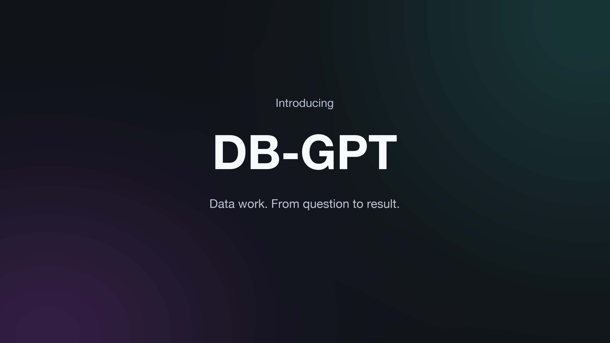
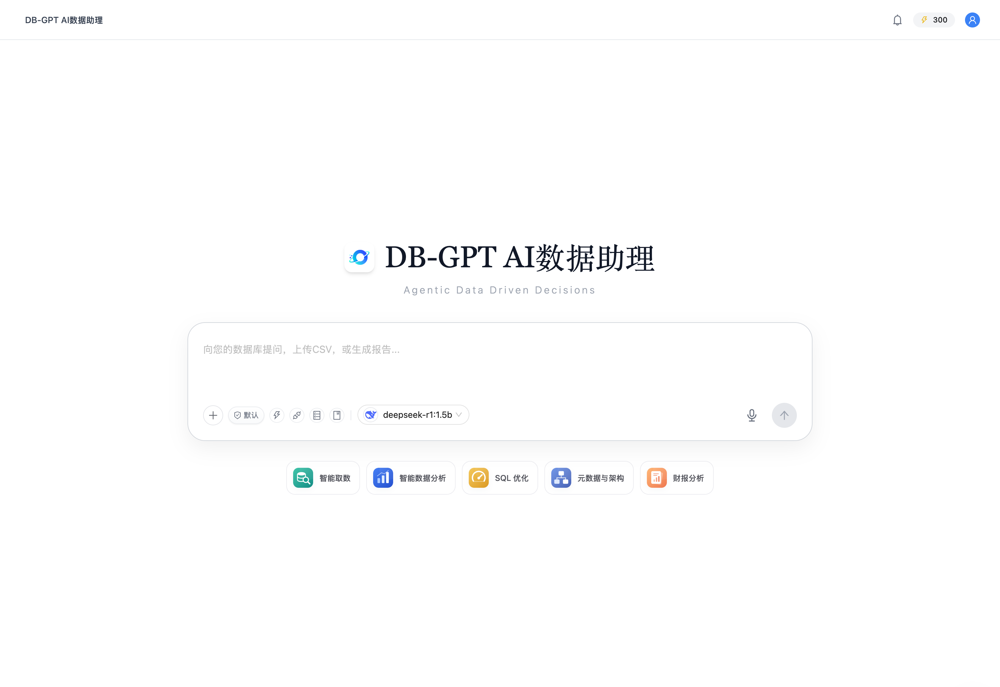
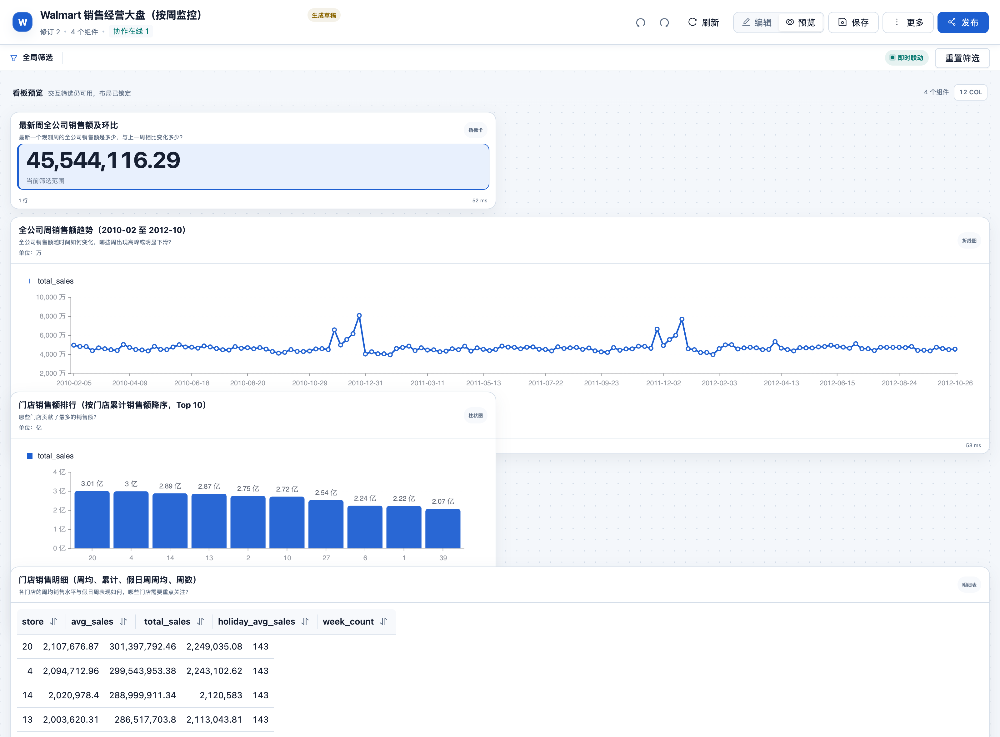
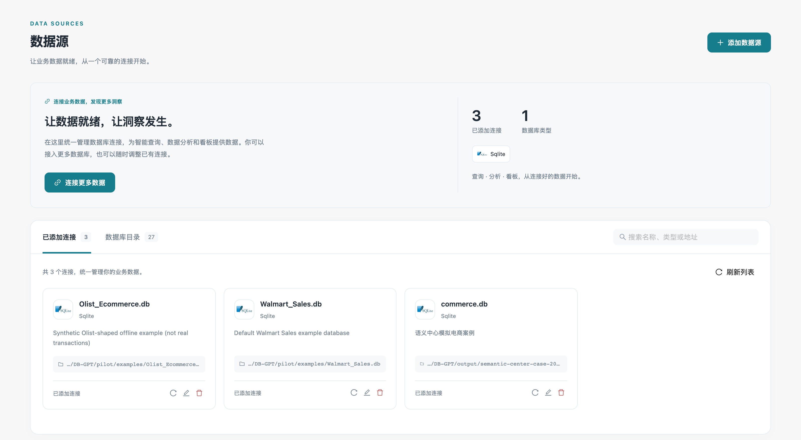
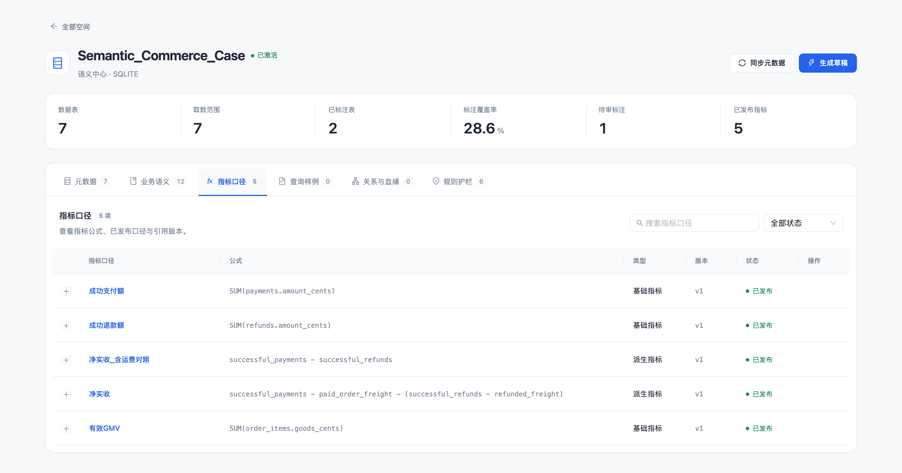
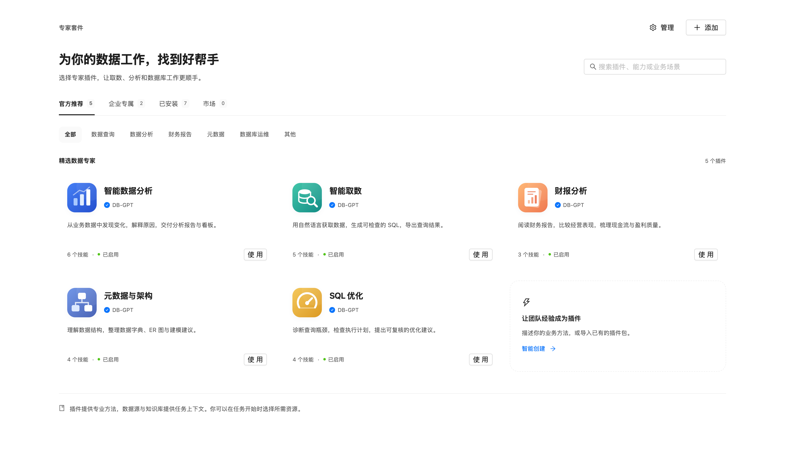

#  DB-GPT: 安全受控的开源数据智能体平台

<p align="left">
  
</p>


<div align="center">
  <p>
    <a href="https://github.com/eosphoros-ai/DB-GPT">
        
    </a>
    <a href="https://github.com/eosphoros-ai/DB-GPT">
        
    </a>
    <a href="http://dbgpt.cn/">
        
    </a>
    <a href="https://opensource.org/licenses/MIT">
      
    </a>
     <a href="https://github.com/eosphoros-ai/DB-GPT/releases">
      
    </a>
    <a href="https://github.com/eosphoros-ai/DB-GPT/issues">
      
    </a>
    <a href="https://x.com/DBGPT_AI">
      
    </a>
    <a href="https://medium.com/@dbgpt0506">
      
    </a>
    <a href="https://space.bilibili.com/3537113070963392">
      
    </a>
    <a href="https://join.slack.com/t/slack-inu2564/shared_invite/zt-29rcnyw2b-N~ubOD9kFc7b7MDOAM1otA">
      
    </a>
    <a href="https://codespaces.new/eosphoros-ai/DB-GPT">
      
    </a>
  </p>

[English](README.md) · [简体中文](README.zh.md) · [日本語](README.ja.md) · [हिन्दी](README.hi.md) · [മലയാളം](README.ma.md) · [தமிழ்](README.ta.md)

[**文档**](http://docs.dbgpt.cn/docs/overview/) | [**联系团队**](https://github.com/eosphoros-ai/DB-GPT/blob/main/README.zh.md#%E8%81%94%E7%B3%BB%E6%88%91%E4%BB%AC) | [**社区**](https://github.com/eosphoros-ai/community) | [**Paper**](https://arxiv.org/pdf/2312.17449.pdf)

</div>

> **连接数据、建立业务上下文，在明确的工具与运行边界内执行 SQL 和代码，交付可复用的分析报告与看板。**

## 看 DB-GPT 真正跑起来

[](docs/static/video/db-gpt-product-film-4k.mp4)

[**▶ 观看 4K 产品演示**](docs/static/video/db-gpt-product-film-4k.mp4) · 3840 × 2160 · 30 fps

约 97 秒英文产品演示：数据源、语义中心、专家与技能、工作流、看板模板，以及实际进入 Preview 完整看板视角的 /dashboard 案例。

<sub>等待区间经过加速剪辑。模板示例与真实数据案例分别展示，部分内置封面仍保留中文；模块概览不代表所有功能均已执行。</sub>

[为什么选择 DB-GPT？](#为什么选择-db-gpt) · [快速开始](#快速开始) · [核心能力](#核心能力) · [愿景与路线](#愿景)

<details>
<summary>展开查看界面截图</summary>

## 场景一览

<table>
<tr>
<td width="100%">

<br>
<sub><b>一切从这里开始。</b>自然语言提问、上传 CSV，或直接选择智能取数、智能数据分析、SQL 优化、元数据与架构、财报分析等智能体，用你自己选的模型跑。</sub>
</td>
</tr>
<tr>
<td width="100%">

<br>
<sub><b>看板是产物，不是截图。</b>生成后的看板保留 KPI、趋势、排行与明细表，预览态布局锁定、筛选联动，每个组件按需重新查询。</sub>
</td>
</tr>
<tr>
<td width="100%">

<br>
<sub><b>从可信连接开始。</b>连接、取数范围与 数据库目录集中管理，查询、分析与看板都基于同一份数据源目录。</sub>
</td>
</tr>
<tr>
<td width="100%">

<br>
<sub><b>先定口径，再写 SQL。</b>指标公式、已发布版本与审核状态作为权威上下文被读取，而不是每个问题重新猜测。</sub>
</td>
</tr>
<tr>
<td width="100%">

<br>
<sub><b>专业能力可安装、可复用。</b>5 个官方专家插件各自带技能与方法：数据分析 6 个、智能取数 5 个，另有财报分析、元数据与架构、SQL 优化，按任务启用并绑定数据源与知识库上下文。</sub>
</td>
</tr>
</table>


</details>

## DB-GPT 是什么？

**DB-GPT 是一个安全受控的开源数据智能体平台：连接数据、建立业务上下文，在明确的工具与执行边界内运行 SQL 与代码，并交付可复用的分析结果。**

它既提供可直接使用的智能助手，也提供构建 AI 原生数据应用的基础设施：Agents、AWEL 工作流、可复用 Skills、RAG、多模型管理与可配置的执行环境。

**让数据不止于回答，让智能体基于业务上下文、可复用的方法和可追溯的结果完成数据工作。**

### 为什么是 Data Agent，而不只是 Text-to-SQL？

一个有用的答案，需要的不只是正确的 SQL，还包括正确的数据源、经过确认的指标口径、适合的分析方法，以及能够解释结果的证据。DB-GPT 将这些能力组织进同一工作流，而不是让用户手动衔接多个工具。

## 为什么选择 DB-GPT？

### 1. 先理解业务，再生成 SQL

**语义中心（Semantic Center）**围绕数据库连接管理元数据、业务定义、指标口径、查询样例、关联关系与规则。已发布的指标快照允许智能体读取明确的定义与版本，而不是将可变的草稿当成权威口径。

### 2. SQL、代码与检索协同执行

智能体可以规划步骤、查询数据库、执行代码分析并检索知识。对于需要重复执行的确定性流程，可以使用 AWEL 显式编排，而不必全部依赖开放式规划。


### 3. 用 Skills 与套件沉淀分析经验

将领域指令、脚本和流程封装为 Skills，通过套件组织任务能力与允许使用的工具，复用分析方法，而不是为每个助手从零搭建。


### 4. 让结果走出对话框

生成分析摘要、图表、HTML 报告和可编辑 Dashboard。独立财报分析流程支持单财报分析与多财报对比，具体可用范围取决于配置和数据库结构前置条件。


### 5. 自由选择模型与执行方式

选择不同模型服务，以及本地或容器执行环境。隔离程度取决于所选运行时与部署配置；本地执行不等同于容器隔离。


## 你可以构建什么？

- **数据库分析助手**：先读取已发布的业务定义与指标，再生成 SQL。
- **文件分析助手**：组合数据检查、代码分析、图表和叙事报告。
- **可复用分析应用**：基于 Skills、套件、Agents 和 AWEL 构建业务流程。
- **可编辑 Dashboard**：管理草稿、发布快照、分享与刷新流程。
- **财报分析工作流**：单财报分析，以及配置完成后的多财报对比。
- **周期性数据任务**：定时重放分析对话，或刷新 Dashboard。

这些能力已有当前分支实现。实际可用性取决于模型、连接器、运行时、功能配置和所需数据库迁移，不能仅凭界面入口判断。

## 产品工作流

**连接 → 理解 → 规划 → 执行 → 复核 → 复用**

1. **连接**数据库、文件与知识库。
2. **理解**元数据、已发布业务定义与指标版本。
3. **规划**智能体或 AWEL 流程，选择相关 Skills 和工具。
4. **执行**查询、代码分析与检索，使用已配置的运行环境。
5. **复核**结果、分析产物与语义来源。
6. **复用**为应用、Dashboard 或定时任务。

## 快速开始

> **测试功能分支时**，请复用当前仓库和对应配置。重新克隆 `main` 或安装 PyPI 发布版，不保证包含本分支能力。
>
> 已安装依赖时，在仓库根目录启动后端：
> ```bash
> .venv/bin/python packages/dbgpt-app/src/dbgpt_app/dbgpt_server.py -c configs/dbgpt-proxy-openai.toml
> ```
> 前端开发在 `web/` 执行 `npm run dev -- --hostname 127.0.0.1 --port 3000`，默认将 API 请求代理到 `127.0.0.1:5670`。使用智能体分析前需配置模型服务；界面启动不等于推理服务可用。

你可以通过一键安装脚本在几分钟内启动 DB-GPT（macOS / Linux）：

```bash
curl -fsSL https://raw.githubusercontent.com/eosphoros-ai/DB-GPT/main/scripts/install/install.sh | bash
```

也可以直接指定 profile 和 API Key：

```bash
curl -fsSL https://raw.githubusercontent.com/eosphoros-ai/DB-GPT/main/scripts/install/install.sh \
  | OPENAI_API_KEY=sk-xxx bash -s -- --profile openai
```

如果你想使用 Kimi 2.5（Moonshot API）：

```bash
curl -fsSL https://raw.githubusercontent.com/eosphoros-ai/DB-GPT/main/scripts/install/install.sh \
  | MOONSHOT_API_KEY=sk-xxx bash -s -- --profile kimi
```

如果你想使用 MiniMax（OpenAI 兼容接口）：

```bash
curl -fsSL https://raw.githubusercontent.com/eosphoros-ai/DB-GPT/main/scripts/install/install.sh \
  | MINIMAX_API_KEY=sk-xxx bash -s -- --profile minimax
```

如果你已经有本地 DB-GPT 仓库，也可以直接复用当前仓库，跳过 `~/.dbgpt/DB-GPT` 的重复 clone：

```bash
OPENAI_API_KEY=sk-xxx \
  bash scripts/install/install.sh --profile openai --repo-dir "$(pwd)" --yes
```

如果你想在当前仓库里直接测试 Kimi 2.5：

```bash
MOONSHOT_API_KEY=sk-xxx \
  bash scripts/install/install.sh --profile kimi --repo-dir "$(pwd)" --yes
```

如果你想在当前仓库里直接测试 MiniMax：

```bash
MINIMAX_API_KEY=sk-xxx \
  bash scripts/install/install.sh --profile minimax --repo-dir "$(pwd)" --yes
```

安装完成后，使用生成的 profile 配置启动服务：

```bash
cd ~/.dbgpt/DB-GPT && uv run dbgpt start webserver --profile <profile>
```

然后打开 [http://localhost:5670](http://localhost:5670)。

> **想先审阅安装脚本再执行？**
> ```bash
> curl -fsSL https://raw.githubusercontent.com/eosphoros-ai/DB-GPT/main/scripts/install/install.sh -o install.sh
> less install.sh
> bash install.sh --profile openai
> ```

### 通过 PyPI 安装

从 PyPI 安装 DB-GPT，一条命令即可启动，无需克隆源码仓库。

> **前置条件：** Python **3.10+**，推荐使用 [uv](https://docs.astral.sh/uv/getting-started/installation/) 包管理器，也支持 pip。

**1. 安装**

```bash
# 推荐使用 uv
uv pip install dbgpt-app

# 或使用 pip
pip install dbgpt-app
```

默认安装包含核心框架（CLI、FastAPI、Agent）、OpenAI 兼容 LLM 支持、DashScope / 通义支持、RAG 文档解析和 ChromaDB 向量存储。

**2. 启动**

```bash
dbgpt start
```

首次运行时，交互式向导会引导你选择 LLM 提供商并输入 API Key，配置完成后服务自动启动。

**3. 打开 Web 界面**

访问 [http://localhost:5670](http://localhost:5670) — 开始使用！🎉


[**教程**](https://www.yuque.com/eosphoros/dbgpt-docs/bex30nsv60ru0fmx)
- [**快速开始**](http://docs.dbgpt.cn/zh-CN/docs/next/overview/)
  - [源码安装](https://www.yuque.com/eosphoros/dbgpt-docs/nh6zd314859l38qa)
  - [Docker安装](https://www.yuque.com/eosphoros/dbgpt-docs/glf87qg4xxcyrp89)
  - [Docker Compose安装](https://www.yuque.com/eosphoros/dbgpt-docs/wwdu11e0v5nkfzin)
- [**使用手册**](https://www.yuque.com/eosphoros/dbgpt-docs/tkspdd0tcy2vlnu4)
  - [知识库](https://www.yuque.com/eosphoros/dbgpt-docs/ycyz3d9b62fccqxh)
  - [数据对话](https://www.yuque.com/eosphoros/dbgpt-docs/gd9hbhi1dextqgbz)
  - [Excel对话](https://www.yuque.com/eosphoros/dbgpt-docs/prugoype0xd2g4bb)
  - [数据库对话](https://www.yuque.com/eosphoros/dbgpt-docs/wswpv3zcm2c9snmg)
  - [报表分析](https://www.yuque.com/eosphoros/dbgpt-docs/vsv49p33eg4p5xc1)
  - [Agents](https://www.yuque.com/eosphoros/dbgpt-docs/pom41m7oqtdd57hm)
- [**进阶教程**](https://www.yuque.com/eosphoros/dbgpt-docs/dxalqb8wsv2xkm5f)
  - [数智应用开发](https://www.yuque.com/eosphoros/dbgpt-docs/ancwnrsk9agc6e4w)
  - [智能体工作流使用](https://www.yuque.com/eosphoros/dbgpt-docs/hcomfb3yrleg7gmq)
  - [智能应用使用](https://www.yuque.com/eosphoros/dbgpt-docs/aiagvxeb86iarq6r)
  - [多模型管理](https://www.yuque.com/eosphoros/dbgpt-docs/huzgcf2abzvqy8uv)
  - [命令行使用](https://www.yuque.com/eosphoros/dbgpt-docs/gd4kgumgd004aly8)
- [**模型服务部署**](https://www.yuque.com/eosphoros/dbgpt-docs/vubxiv9cqed5mc6o)
  - [单机部署](https://www.yuque.com/eosphoros/dbgpt-docs/kwg1ed88lu5fgawb)
  - [集群部署](https://www.yuque.com/eosphoros/dbgpt-docs/gmbp9619ytyn2v1s)
  - [vLLM](https://www.yuque.com/eosphoros/dbgpt-docs/bhy9igdvanx1uluf)
- [**如何Debug**](https://www.yuque.com/eosphoros/dbgpt-docs/eyg0ocbc2ce3q95r)
- [**AWEL**](https://www.yuque.com/eosphoros/dbgpt-docs/zozbzslbfk0m0op5)
- [**FAQ**](https://www.yuque.com/eosphoros/dbgpt-docs/gomtc46qonmyt44l)

## 核心能力

### 语义中心：让业务含义成为可维护的资产

- **元数据目录**：同步表与字段快照、类型、注释、键标记和枚举值。
- **业务定义**：生成候选注释，维护同义词和业务含义，审核后发布。
- **指标生命周期**：管理公式、维度与依赖，发布时保存版本快照和变更说明。
- **智能体读取**：工具绑定当前数据库连接，读取元数据、已发布业务定义与指标版本；缺失定义时不会自动回退到草稿。
- **来源追溯**：指标返回版本引用，界面支持定位被引用的已发布版本。
- **上下文管理**：统一查看查询样例、关联关系、规则与覆盖率。

**当前边界**：权威读取路径基于结构化记录与关键词匹配；托管向量索引适配器尚未接线，目前回退为内存 sink。目录中的白名单与敏感性标记属于描述性元数据，不等同于行列级权限强制执行。

实现入口：[语义中心](packages/dbgpt-serve/src/dbgpt_serve/semantic) · [智能体工具](packages/dbgpt-app/src/dbgpt_app/openapi/api_v1/tools/semantic_tools.py)。

### Agents、Skills 与 AWEL

探索性任务使用智能体规划与工具调用，可重复应用使用显式 AWEL 流程。Skills 支持加载指令与执行关联脚本，套件组织任务能力与工具白名单。执行行为取决于选择的智能体运行框架和运行时。

### 数据访问与知识检索

组合关系型数据库、CSV/Excel、文档与知识库，使用 RAG 和 GraphRAG 构建知识增强应用。结构化语义读取与普通知识库检索是不同的能力路径。

### SQL、代码与执行环境

生成 SQL 与代码用于查询、转换、指标计算和可视化。沙箱包包含本地及容器运行时实现；部署时需配置运行依赖、文件访问、资源边界与凭证。

### 报告、Dashboard 与财报分析

生成报告与可视化产物。Dashboard 实现包括智能体计划到草稿的转换、草稿编辑、发布快照、分享和刷新任务。财报分析包含单财报流程，以及支持抽取状态保存与恢复的多财报对比；对比功能需要按实现要求显式迁移数据库结构。

### 定时任务

周期性重放分析对话或刷新 Dashboard，并管理任务与执行历史。自动运行要求调度器处于运行状态，且任务所需模型、文件与数据源持续可用；不等同于托管服务的常驻可用性保证。

### 模型生态

提供多模型管理与私有化部署选项。模型服务和微调目标以具体版本为准，请查阅文档与 DB-GPT-Hub，不将历史模型清单视为兼容性保证。

<details>
<summary>模型与微调参考清单</summary>

#### DeepWiki
- [DB-GPT](https://deepwiki.com/eosphoros-ai/DB-GPT)
- [DB-GPT-HUB](https://deepwiki.com/eosphoros-ai/DB-GPT-Hub)
- [dbgpts](https://deepwiki.com/eosphoros-ai/dbgpts)

#### Text2SQL 微调模型

  |     LLM     |  Supported  | 
  |:-----------:|:-----------:|
  |    LLaMA    |      ✅     |
  |   LLaMA-2   |      ✅     | 
  |    BLOOM    |      ✅     | 
  |   BLOOMZ    |      ✅     | 
  |   Falcon    |      ✅     | 
  |  Baichuan   |      ✅     | 
  |  Baichuan2  |      ✅     | 
  |  InternLM   |      ✅     |
  |    Qwen     |      ✅     | 
  |   XVERSE    |      ✅     | 
  |  ChatGLM2   |      ✅     |

### 支持模型
    
<table>
      <thead>
        <tr>
          <th>Provider</th>
          <th>Supported</th>
          <th>Models</th>
        </tr>
      </thead>
      <tbody>
        <tr>
          <td align="center" valign="middle">DeepSeek</td>
          <td align="center" valign="middle">✅</td>
          <td>
            🔥🔥🔥  <a href="https://huggingface.co/deepseek-ai/DeepSeek-R1-0528">DeepSeek-R1-0528</a><br/>
            🔥🔥🔥  <a href="https://huggingface.co/deepseek-ai/DeepSeek-V3-0324">DeepSeek-V3-0324</a><br/>
            🔥🔥🔥  <a href="https://huggingface.co/deepseek-ai/DeepSeek-R1">DeepSeek-R1</a><br/>
            🔥🔥🔥  <a href="https://huggingface.co/deepseek-ai/DeepSeek-V3">DeepSeek-V3</a><br/>
            🔥🔥🔥  <a href="https://huggingface.co/deepseek-ai/DeepSeek-R1-Distill-Llama-70B">DeepSeek-R1-Distill-Llama-70B</a><br/>
            🔥🔥🔥  <a href="https://huggingface.co/deepseek-ai/DeepSeek-R1-Distill-Qwen-32B">DeepSeek-R1-Distill-Qwen-32B</a><br/>
            🔥🔥🔥  <a href="https://huggingface.co/deepseek-ai/DeepSeek-Coder-V2-Instruct">DeepSeek-Coder-V2-Instruct</a><br/>
          </td>
        </tr>
        <tr>
          <td align="center" valign="middle">Qwen</td>
          <td align="center" valign="middle">✅</td>
          <td>
            🔥🔥🔥  <a href="https://huggingface.co/Qwen/Qwen3-235B-A22B">Qwen3-235B-A22B</a><br/>
            🔥🔥🔥  <a href="https://huggingface.co/Qwen/Qwen3-30B-A3B">Qwen3-30B-A3B</a><br/>
            🔥🔥🔥  <a href="https://huggingface.co/Qwen/Qwen3-32B">Qwen3-32B</a><br/>
            🔥🔥🔥  <a href="https://huggingface.co/Qwen/QwQ-32B">QwQ-32B</a><br/>
            🔥🔥🔥  <a href="https://huggingface.co/Qwen/Qwen2.5-Coder-32B-Instruct">Qwen2.5-Coder-32B-Instruct</a><br/>
            🔥🔥🔥  <a href="https://huggingface.co/Qwen/Qwen2.5-Coder-14B-Instruct">Qwen2.5-Coder-14B-Instruct</a><br/>
            🔥🔥🔥  <a href="https://huggingface.co/Qwen/Qwen2.5-72B-Instruct">Qwen2.5-72B-Instruct</a><br/>
            🔥🔥🔥  <a href="https://huggingface.co/Qwen/Qwen2.5-32B-Instruct">Qwen2.5-32B-Instruct</a><br/>
          </td>
        </tr>
        <tr>
          <td align="center" valign="middle">GLM</td>
          <td align="center" valign="middle">✅</td>
          <td>
            🔥🔥🔥  <a href="https://huggingface.co/THUDM/GLM-Z1-32B-0414">GLM-Z1-32B-0414</a><br/>
            🔥🔥🔥  <a href="https://huggingface.co/THUDM/GLM-4-32B-0414">GLM-4-32B-0414</a><br/>
            🔥🔥🔥  <a href="https://huggingface.co/THUDM/glm-4-9b-chat">Glm-4-9b-chat</a>
          </td>
        </tr>
        <tr>
          <td align="center" valign="middle">Llama</td>
          <td align="center" valign="middle">✅</td>
          <td>
            🔥🔥🔥  <a href="https://huggingface.co/meta-llama/Meta-Llama-3.1-405B-Instruct">Meta-Llama-3.1-405B-Instruct</a><br/>
            🔥🔥🔥  <a href="https://huggingface.co/meta-llama/Meta-Llama-3.1-70B-Instruct">Meta-Llama-3.1-70B-Instruct</a><br/>
            🔥🔥🔥  <a href="https://huggingface.co/meta-llama/Meta-Llama-3.1-8B-Instruct">Meta-Llama-3.1-8B-Instruct</a><br/>
            🔥🔥🔥  <a href="https://huggingface.co/meta-llama/Meta-Llama-3-70B-Instruct">Meta-Llama-3-70B-Instruct</a><br/>
            🔥🔥🔥  <a href="https://huggingface.co/meta-llama/Meta-Llama-3-8B-Instruct">Meta-Llama-3-8B-Instruct</a>
          </td>
        </tr>
        <tr>
          <td align="center" valign="middle">Gemma</td>
          <td align="center" valign="middle">✅</td>
          <td>
            🔥🔥🔥  <a href="https://huggingface.co/google/gemma-2-27b-it">gemma-2-27b-it</a><br>
            🔥🔥🔥  <a href="https://huggingface.co/google/gemma-2-9b-it">gemma-2-9b-it</a><br>
            🔥🔥🔥  <a href="https://huggingface.co/google/gemma-7b-it">gemma-7b-it</a><br>
            🔥🔥🔥  <a href="https://huggingface.co/google/gemma-2b-it">gemma-2b-it</a>
          </td>
        </tr>
        <tr>
          <td align="center" valign="middle">Yi</td>
          <td align="center" valign="middle">✅</td>
          <td>
            🔥🔥🔥  <a href="https://huggingface.co/01-ai/Yi-1.5-34B-Chat">Yi-1.5-34B-Chat</a><br/>
            🔥🔥🔥  <a href="https://huggingface.co/01-ai/Yi-1.5-9B-Chat">Yi-1.5-9B-Chat</a><br/>
            🔥🔥🔥  <a href="https://huggingface.co/01-ai/Yi-1.5-6B-Chat">Yi-1.5-6B-Chat</a><br/>
            🔥🔥🔥  <a href="https://huggingface.co/01-ai/Yi-34B-Chat">Yi-34B-Chat</a>
          </td>
        </tr>
        <tr>
          <td align="center" valign="middle">Starling</td>
          <td align="center" valign="middle">✅</td>
          <td>
            🔥🔥🔥  <a href="https://huggingface.co/Nexusflow/Starling-LM-7B-beta">Starling-LM-7B-beta</a>
          </td>
        </tr>
        <tr>
          <td align="center" valign="middle">SOLAR</td>
          <td align="center" valign="middle">✅</td>
          <td>
            🔥🔥🔥  <a href="https://huggingface.co/upstage/SOLAR-10.7B-Instruct-v1.0">SOLAR-10.7B</a>
          </td>
        </tr>
        <tr>
          <td align="center" valign="middle">Mixtral</td>
          <td align="center" valign="middle">✅</td>
          <td>
            🔥🔥🔥  <a href="https://huggingface.co/mistralai/Mixtral-8x7B-Instruct-v0.1">Mixtral-8x7B</a>
          </td>
        </tr>
        <tr>
          <td align="center" valign="middle">Phi</td>
          <td align="center" valign="middle">✅</td>
          <td>
            🔥🔥🔥  <a href="https://huggingface.co/collections/microsoft/phi-3-6626e15e9585a200d2d761e3">Phi-3</a>
          </td>
        </tr>
      </tbody>
    </table>

  - [更多开源模型](https://www.yuque.com/eosphoros/dbgpt-docs/iqaaqwriwhp6zslc#qQktR)

  - 支持在线代理模型
    - [x] [DeepSeek.deepseek-chat](https://platform.deepseek.com/api-docs/)
    - [x] [Ollama.API](https://github.com/ollama/ollama/blob/main/docs/api.md)
    - [x] [月之暗面.Moonshot](https://platform.moonshot.cn/docs/)
    - [x] [零一万物.Yi](https://platform.lingyiwanwu.com/docs)
    - [x] [OpenAI·ChatGPT](https://api.openai.com/)
    - [x] [百川·Baichuan](https://platform.baichuan-ai.com/)
    - [x] [阿里·通义](https://www.aliyun.com/product/dashscope)
    - [x] [百度·文心](https://cloud.baidu.com/product/wenxinworkshop?track=dingbutonglan)
    - [x] [智谱·ChatGLM](http://open.bigmodel.cn/)
    - [x] [讯飞·星火](https://xinghuo.xfyun.cn/)
    - [x] [Google·Bard](https://bard.google.com/)
    - [x] [Google·Gemini](https://makersuite.google.com/app/apikey)

</details>

### 隐私安全

私有模型部署、脱敏与可配置执行环境有助于降低风险，但不构成完整安全保证。应配置最小权限数据库凭证、合适的隔离运行时与密钥保护，并独立复核高影响结果。语义发布属于内容生命周期管理，不能替代部署层面的身份与访问控制。

### 数据源
- [支持数据源](https://www.yuque.com/eosphoros/dbgpt-docs/rc4r27ybmdwg9472)

## 愿景

**让可信的数据工作成为开放能力。**

我们相信，下一代数据产品将超越 Dashboard 与一次性的问答，通过业务上下文、可复用的分析经验和可控执行，帮助人与智能体共同完成数据任务，而不只是生成查询。

DB-GPT 希望成为这一未来的开放、可组合基础：为用户提供实用助手，为开发者提供可扩展平台，让团队基于自己的数据和自主选择的模型构建应用。

我们坚持：**先理解上下文，再生成内容；先读取已发布定义，再作假设；先有证据，再得结论；有实际影响的动作，保留人的控制。**

## Roadmap

> 以下为面向社区讨论的路线建议，不是已批准的交付日期或已上线功能声明。语义中心、Skills、定时与 Dashboard 的已有能力见上文；路线重点是深化这些能力。

### 近期：夯实已有基础

- 完成语义中心的持久化向量索引接线，在保留已发布指标读取边界的前提下改进语义发现。
- 扩展任务级评测，覆盖 SQL、代码分析、语义一致性与报告证据。
- 改善连接器配置、执行诊断与环境检查。

### 下一阶段：让分析经验可迁移、可维护

- 深化版本化 Skills、工作流模板与业务上下文导入导出。
- 扩展分析产物中的指标来源追溯，强化结构变更处理。
- 探索包含 MCP 在内的标准工具互操作，并明确权限边界。

### 长期：持续、可监督的数据工作

- 在已有定时能力上扩展事件触发、任务恢复与运行可见性。
- 探索专业智能体的并行执行，明确资源与授权边界。
- 围绕真实、可复现的场景扩展应用与连接器生态。

具体优先级应通过 [Issues](https://github.com/eosphoros-ai/DB-GPT/issues) 与 [Discussions](https://github.com/orgs/eosphoros-ai/discussions) 跟踪。

## Image

🌐 [小程序云部署](https://www.yuque.com/eosphoros/dbgpt-docs/ek12ly8k661tbyn8)

## 使用说明

### 多模型使用

- [使用指南](https://www.yuque.com/eosphoros/dbgpt-docs/huzgcf2abzvqy8uv)

### 数据Agents使用

- [数据Agents](https://www.yuque.com/eosphoros/dbgpt-docs/gwz4rayfuwz78fbq)

## 贡献

更加详细的贡献指南请参考[如何贡献](https://github.com/eosphoros-ai/DB-GPT/blob/main/CONTRIBUTING.md)。

这是一个用于数据库的复杂且创新的工具, 我们的项目也在紧急的开发当中, 会陆续发布一些新的feature。如在使用当中有任何具体问题, 优先在项目下提issue, 如有需要, 请联系如下微信，我会尽力提供帮助，同时也非常欢迎大家参与到项目建设中。

### 贡献者榜单 
<a href="https://github.com/eosphoros-ai/DB-GPT/graphs/contributors">
  
</a>


## Licence

The MIT License (MIT)

### 免责声明

- [免责声明](./DISCKAIMER.md)

## 引用
如果您发现`DB-GPT`对您的研究或开发有用，请引用以下论文，其中：

如果您想了解DB-GPT整体架构，请引用<a href="https://arxiv.org/abs/2312.17449" target="_blank">论文</a>和<a href="https://arxiv.org/abs/2404.10209" target="_blank">论文</a>

如果您想了解使用DB-GPT进行Agent开发相关的内容，请引用<a href="https://arxiv.org/abs/2412.13520" target="_blank">论文</a>

```bibtex
@article{xue2023dbgpt,
      title={DB-GPT: Empowering Database Interactions with Private Large Language Models}, 
      author={Siqiao Xue and Caigao Jiang and Wenhui Shi and Fangyin Cheng and Keting Chen and Hongjun Yang and Zhiping Zhang and Jianshan He and Hongyang Zhang and Ganglin Wei and Wang Zhao and Fan Zhou and Danrui Qi and Hong Yi and Shaodong Liu and Faqiang Chen},
      year={2023},
      journal={arXiv preprint arXiv:2312.17449},
      url={https://arxiv.org/abs/2312.17449}
}
@misc{huang2024romasrolebasedmultiagentdatabase,
      title={ROMAS: A Role-Based Multi-Agent System for Database monitoring and Planning}, 
      author={Yi Huang and Fangyin Cheng and Fan Zhou and Jiahui Li and Jian Gong and Hongjun Yang and Zhidong Fan and Caigao Jiang and Siqiao Xue and Faqiang Chen},
      year={2024},
      eprint={2412.13520},
      archivePrefix={arXiv},
      primaryClass={cs.AI},
      url={https://arxiv.org/abs/2412.13520}, 
}
@inproceedings{xue2024demonstration,
      title={Demonstration of DB-GPT: Next Generation Data Interaction System Empowered by Large Language Models}, 
      author={Siqiao Xue and Danrui Qi and Caigao Jiang and Wenhui Shi and Fangyin Cheng and Keting Chen and Hongjun Yang and Zhiping Zhang and Jianshan He and Hongyang Zhang and Ganglin Wei and Wang Zhao and Fan Zhou and Hong Yi and Shaodong Liu and Hongjun Yang and Faqiang Chen},
      year={2024},
      booktitle = "Proceedings of the VLDB Endowment",
      url={https://arxiv.org/abs/2404.10209}
}
```

## 联系我们

  **说明: 由于微信群人数上限的限制, 我们的答疑与问题支持优先会在钉钉大群进行。**
<div style="display: flex; justify-content: space-around;">
    <figure style="display: flex; flex-direction: column;">
        
        <p style="text-align: center;">
          钉钉
        </p>
    </figure>
</div>

[](https://star-history.com/#csunny/DB-GPT)
