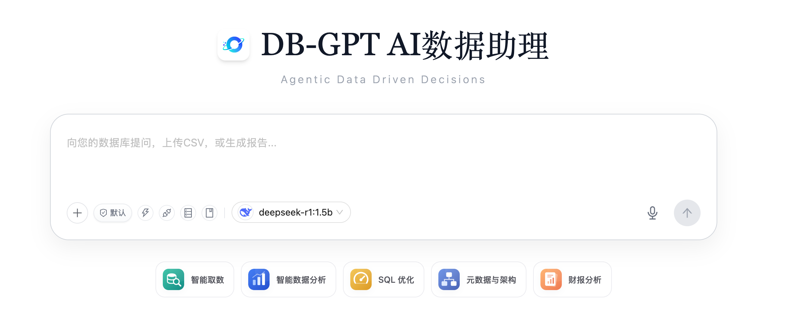
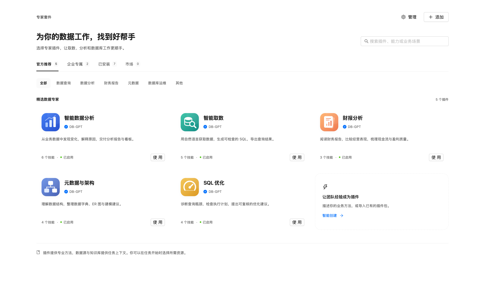
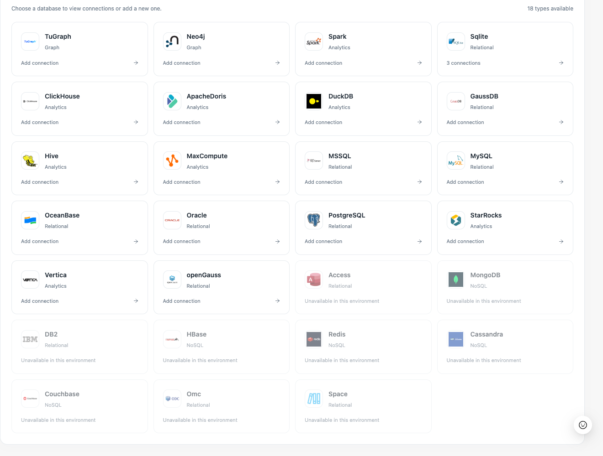
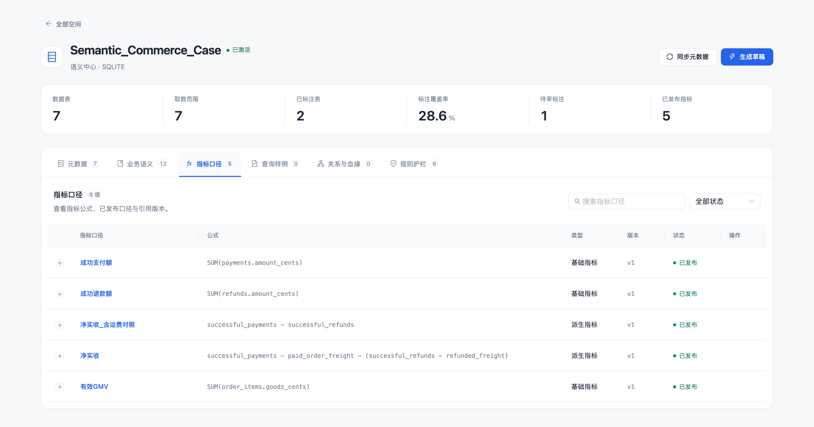
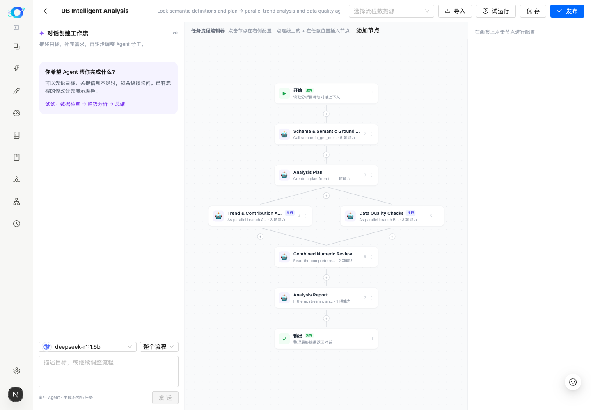

<p align="center">
  
</p>

<h1 align="center">DB-GPT：安全受控的开源数据智能体产品</h1>

<p align="center">
  从一个数据问题，到可复核的 SQL、分析报告和可复用看板。
</p>

<p align="center">
  <a href="https://github.com/eosphoros-ai/DB-GPT/stargazers"></a>
  <a href="https://github.com/eosphoros-ai/DB-GPT/releases"></a>
  <a href="LICENSE"></a>
  <a href="https://x.com/DBGPT_AI"></a>
  <a href="https://discord.gg/7uQnPuveTY"></a>
  <a href="#dingtalk-community"></a>
</p>

<p align="center">
  <a href="README.md">English</a> · <a href="README.zh.md">简体中文</a> · <a href="README.ja.md">日本語</a> · <a href="README.hi.md">हिन्दी</a> · <a href="README.ma.md">മലയാളം</a> · <a href="README.ta.md">தமிழ்</a>
</p>

<p align="center">
  <a href="http://docs.dbgpt.cn/zh-CN/docs/overview/">中文文档</a> · <a href="https://github.com/eosphoros-ai/DB-GPT/releases">版本发布</a> · <a href="https://github.com/orgs/eosphoros-ai/discussions">社区讨论</a> · <a href="#快速开始">快速开始</a>
</p>

> **连接自己的数据，明确业务定义，选择专业方法，在已配置的工具与运行边界内执行任务，并交付可复核、可编辑、可复用的结果。**

DB-GPT 不只是将一句话翻译成 SQL。它把**数据连接、业务语义、专家技能、任务编排与分析产物**组织到同一套工作流中，既为业务人员提供可用的数据助手，也为开发者提供构建 AI 原生数据应用的基础设施。

[产品演示](#产品演示) · [为什么选择 DB-GPT？](#为什么选择-db-gpt) · [主要模块](#主要模块) · [安全与执行边界](#安全与执行边界) · [快速开始](#快速开始) · [参与社区](#参与社区)

## 产品演示

https://github.com/user-attachments/assets/36ddad2c-1021-4181-b31a-8fb216c93f81

## 为什么选择 DB-GPT？

### 先理解业务，再查询数据

同一个“收入”可能有不同的日期归属、退款处理和统计范围。语义中心把表结构、字段含义、指标公式与发布版本组织为可维护的上下文，让智能体有据可查，而不是每次重新猜测口径。

### 用专业方法完成任务，而不只是给出答案

数据查询、数据分析、SQL 优化、元数据与架构、财报分析由不同专家插件承接。Skills 沉淀指令、脚本和分析方法，工作流则明确步骤、依赖与工具配置，减少重复搭建。

### 让结果成为可复用的资产

除了对话答案，DB-GPT 可以交付查询结果、图表、HTML 分析报告和可编辑看板。用户可以检查执行步骤，继续提出修改，或把经过复核的结果用于后续工作。

### 把控制留在人的手中

可用工具、模型、数据源与运行环境由部署和任务配置决定；看板计划与修改方案可以先审阅再应用。**“受控”不是“绝对安全”**，生产使用仍需要最小权限凭证、适当隔离和关键结果复核。

## 主要模块

### 统一任务入口



从自然语言问题、文件或数据源开始，选择模型和相关专家；先明确目标，再进入查询、分析或看板任务。

### 1. Dashboard：从计划到完整看板视角

先明确指标、图表与筛选要求，再生成草稿；在 Preview 中呈现完整看板，继续审阅布局和数据。


*这是视频中实际生成并保存的 Walmart 看板，已经进入 Preview 视角。它包含销售额与门店数指标卡、每周趋势和 Top 10 门店排行；当前为已保存草稿，不是已公开发布的看板。*

- 从任务计划或模板开始构建看板。
- 编辑组件、布局、查询与筛选配置。
- 通过 AI 助手讨论修改，审阅方案后再应用。
- 保存草稿、进入预览，并根据需要发布或分享。

看板使用示例数据，数值用于展示这个案例，不代表企业当前经营数据。

### 2. 专家插件与 Skills：复用专业经验

按任务选择专家插件，并为其绑定数据源、知识上下文与相关工具。Skills 将领域方法和执行脚本封装为可复用能力。



| 专家方向 | 主要工作 |
| --- | --- |
| 智能取数 | 理解问题、核对口径、生成与执行查询、导出结果 |
| 智能数据分析 | 检查数据、分析趋势与结构、解释变化、生成报告与看板 |
| SQL 优化 | 检查 SQL 和执行计划，提出可复核的优化建议 |
| 元数据与架构 | 整理数据字典、表关系与建模建议 |
| 财报分析 | 阅读财务材料，组织指标和比较分析；具体流程需满足配置与数据前提 |

插件提供方法，不会自动赋予数据权限。安装外部插件或 Skills 前，应检查其指令、脚本、依赖与工具访问范围。

### 3. 数据源：从可靠的连接开始

统一管理数据库连接、已添加的数据源与数据库目录，供查询、分析和看板选择同一份数据上下文。



支持 MySQL、PostgreSQL、SQLite、DuckDB、ClickHouse、Apache Doris、StarRocks、Oracle、MSSQL、Neo4j、TuGraph 等数据源。

- 查看和配置数据库连接。
- 选择任务使用的数据源，结合元数据确定查询范围。
- 数据库目录中的类型和模板不等于已经连接成功；实际可用性取决于驱动、网络与凭证。

### 4. 语义中心：让指标口径可维护、可追溯

围绕数据源整理元数据、业务语义、指标口径、查询样例、关系与规则。已发布指标保留版本，让查询结果能够关联到明确的定义。



- 管理表与字段注释、业务含义和同义词。
- 维护基础指标、派生指标及其公式、依赖和版本。
- 审核、发布业务定义与指标；读取已发布定义时，不将未发布草稿当作权威口径。

### 5. 工作流：把步骤和协作关系写清楚

通过可视化编排组织 Agent 节点与数据输入、输出，配置串行步骤和并行分支，让重复性任务采用更明确的流程。



图中展示的是模板编辑视图，包含语义准备、分析计划、趋势分析、数据质量检查和合并复核。**模板可见不等于已试运行或发布**；运行前需要配置数据源、模型和工具。

### 6. 知识库、连接器与运行管理

- **知识库**：导入文档与材料，为检索增强任务提供上下文；效果取决于解析、分块、索引与检索配置。
- **连接器**：通过已配置的 MCP 服务接入外部工具；界面中的模板需要实际激活与授权后才可使用。
- **模型与运行环境**：选择模型服务及本地或容器运行时，管理执行依赖和工具访问。
- **定时任务**：按计划重放任务或刷新产物；调度器、模型、文件和数据源需要持续可用。

## 从问题到结果

**连接 → 理解 → 规划 → 执行 → 复核 → 复用**

1. 选择数据库、文件或知识材料，明确目标与统计范围。
2. 核对字段、数据质量、业务定义与指标版本。
3. 选择专家和 Skills；需要重复执行时配置工作流。
4. 在允许的工具与运行环境中执行 SQL、代码或检索。
5. 检查计划、关键计算、来源和产物，审阅有影响的修改。
6. 将结果保存为报告或看板；需要持续运行时，再配置调度与运行保障。

## 安全与执行边界

DB-GPT 提供可配置的执行与复核机制，但安全效果取决于实际部署。建议按以下原则使用：

- **数据权限**：优先使用只读、最小权限数据库账号，不把目录中的描述性标记当作行列级权限控制。
- **执行隔离**：本地执行和容器隔离不是同一回事。按任务设置文件访问、资源限制与网络边界。
- **密钥保护**：不要把 API Key、数据库密码或个人敏感信息提交到仓库、截图或分享内容。
- **人工复核**：关键口径、计算、SQL 和对外产物需要复核；模型输出不代替专业审查。
- **发布与调度**：保存草稿、发布、分享和持续运行是不同状态。上线前检查访问范围与服务可用性。

> 部分能力受版本、配置、数据库迁移与模型行为影响。请以所用版本的代码和文档为准，不将界面入口或历史演示当作生产可用性承诺。

## 快速开始

### 方式一：一键安装（macOS / Linux）

先下载并审阅安装脚本，再执行：

```bash
curl -fsSL https://raw.githubusercontent.com/eosphoros-ai/DB-GPT/main/scripts/install/install.sh -o install.sh
less install.sh
bash install.sh
```

安装向导会引导你选择 profile 并配置模型服务。完成后，按脚本输出进入安装目录并启动：

```bash
cd ~/.dbgpt/DB-GPT
uv run dbgpt start webserver --profile <profile>
```

访问 [http://localhost:5670](http://localhost:5670)。请将 `<profile>` 替换为已配置的 profile。

<details>
<summary>已有源码仓库：复用当前分支，不重复克隆</summary>

在仓库根目录执行：

```bash
bash scripts/install/install.sh --profile openai --repo-dir "$(pwd)"
uv run dbgpt start webserver --profile openai
```

`--repo-dir` 复用当前 checkout，不会替你切换分支。模型凭证和相关服务仍需配置。

如已安装依赖并准备好自己的 TOML 配置，也可以直接启动后端：

```bash
.venv/bin/python packages/dbgpt-app/src/dbgpt_app/dbgpt_server.py -c configs/dbgpt-proxy-openai.toml
```

前端开发在 `web/` 中运行 `npm run dev -- --hostname 127.0.0.1 --port 3000`。界面启动成功不代表模型推理、数据库连接和分析任务已可运行。

</details>

### 方式二：PyPI 安装

需要 Python 3.10 或更新版本：

```bash
pip install dbgpt-app
dbgpt start
```

按向导完成模型配置后打开 Web 界面。PyPI 发布版、`main` 和功能分支可能不同；测试分支能力时请使用相应源码版本。

更多安装与配置说明见[中文文档](http://docs.dbgpt.cn/zh-CN/docs/overview/)。

## 开发者生态

- **DB-GPT**：数据智能体、工具、运行环境与分析应用的基础平台。
- **[DB-GPT-Hub](https://github.com/eosphoros-ai/DB-GPT-Hub)**：Text-to-SQL 相关训练与评测资源。
- **[dbgpts](https://github.com/eosphoros-ai/dbgpts)**：应用、Agent 与工作流生态。
- **[贡献指南](CONTRIBUTING.md)**：开发、测试与提交规范。

具体模型支持、数据源驱动与依赖请查阅当前版本文档，不将历史模型清单视为持续兼容保证。

## 愿景与演进

让可信的数据工作成为开放、可组合的能力：既帮助用户完成一次分析，也让团队沉淀业务上下文、专业方法和可复用产物。

后续演进关注语义一致性、任务评测、执行诊断、可迁移的 Skills 与工作流，以及持续任务的可监督性。具体需求与优先级通过 [Issues](https://github.com/eosphoros-ai/DB-GPT/issues) 和 [Discussions](https://github.com/orgs/eosphoros-ai/discussions) 讨论，不在 README 中承诺未确认的上线日期。

## 参与社区

- [提交问题或功能建议](https://github.com/eosphoros-ai/DB-GPT/issues)
- [交流使用方法与设计](https://github.com/orgs/eosphoros-ai/discussions)
- [查看社区项目](https://github.com/eosphoros-ai/community)
- [关注 DB-GPT 的 X（Twitter）](https://x.com/DBGPT_AI)
- [加入 Discord](https://discord.gg/7uQnPuveTY)
- [加入 Slack](https://join.slack.com/t/slack-inu2564/shared_invite/zt-29rcnyw2b-N~ubOD9kFc7b7MDOAM1otA)
- [查看贡献者](https://github.com/eosphoros-ai/DB-GPT/graphs/contributors)

欢迎提交可复现的案例、问题修复、文档、Skills 与工作流。报告问题时请附版本、配置方式与最小复现步骤，并移除日志中的密钥和敏感数据。

<a id="dingtalk-community"></a>

### 钉钉社区群

**说明：由于微信群人数上限的限制，我们的答疑与问题支持优先在钉钉大群进行。**

<p>
  
</p>

使用钉钉扫描上方二维码加入社区群。

## 贡献

更加详细的贡献指南请参考[如何贡献](https://github.com/eosphoros-ai/DB-GPT/blob/main/CONTRIBUTING.md)。欢迎参与代码、文档、Skills、工作流与可复现案例的建设。

### 贡献者榜单

<a href="https://github.com/eosphoros-ai/DB-GPT/graphs/contributors">
  
</a>

## 许可证与免责声明

项目采用 [MIT 许可证](LICENSE)。请同时阅读[免责声明](DISCKAIMER.md)。

## 学术引用

如果 DB-GPT 对你的研究或开发有帮助，可以引用以下论文。它们介绍项目架构和相关研究，不是所有当前界面功能的兼容性说明。

<details>
<summary>展开 BibTeX 引用</summary>

```bibtex
@article{xue2023dbgpt,
      title={DB-GPT: Empowering Database Interactions with Private Large Language Models},
      author={Siqiao Xue and Caigao Jiang and Wenhui Shi and Fangyin Cheng and Keting Chen and Hongjun Yang and Zhiping Zhang and Jianshan He and Hongyang Zhang and Ganglin Wei and Wang Zhao and Fan Zhou and Danrui Qi and Hong Yi and Shaodong Liu and Faqiang Chen},
      year={2023},
      journal={arXiv preprint arXiv:2312.17449},
      url={https://arxiv.org/abs/2312.17449}
}
@misc{huang2024romasrolebasedmultiagentdatabase,
      title={ROMAS: A Role-Based Multi-Agent System for Database monitoring and Planning},
      author={Yi Huang and Fangyin Cheng and Fan Zhou and Jiahui Li and Jian Gong and Hongjun Yang and Zhidong Fan and Caigao Jiang and Siqiao Xue and Faqiang Chen},
      year={2024},
      eprint={2412.13520},
      archivePrefix={arXiv},
      primaryClass={cs.AI},
      url={https://arxiv.org/abs/2412.13520}
}
@inproceedings{xue2024demonstration,
      title={Demonstration of DB-GPT: Next Generation Data Interaction System Empowered by Large Language Models},
      author={Siqiao Xue and Danrui Qi and Caigao Jiang and Wenhui Shi and Fangyin Cheng and Keting Chen and Hongjun Yang and Zhiping Zhang and Jianshan He and Hongyang Zhang and Ganglin Wei and Wang Zhao and Fan Zhou and Hong Yi and Shaodong Liu and Hongjun Yang and Faqiang Chen},
      year={2024},
      booktitle={Proceedings of the VLDB Endowment},
      url={https://arxiv.org/abs/2404.10209}
}
```

</details>

## Star 增长趋势

[](https://star-history.com/#csunny/DB-GPT)
