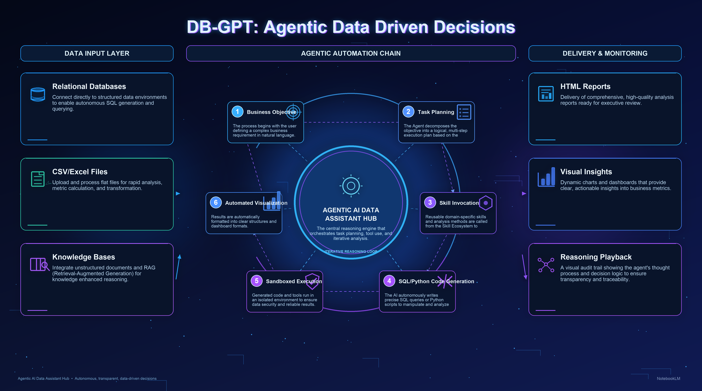
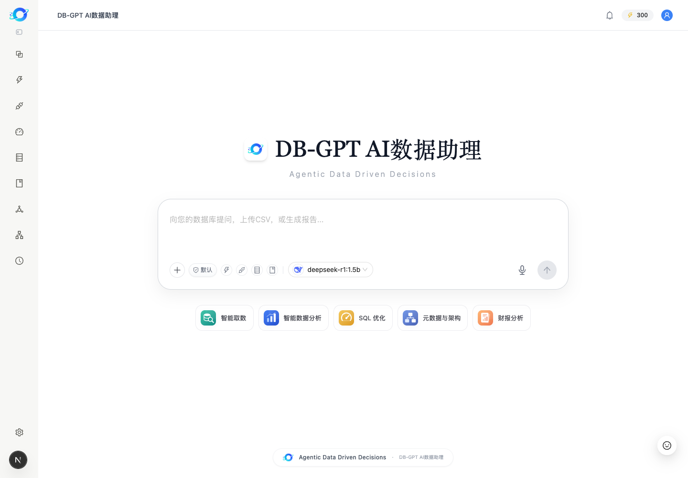

#  DB-GPT：打造可信、受控的 Data Agent

<p align="left">
  
</p>


<div align="center">
  <p>
    <a href="https://github.com/eosphoros-ai/DB-GPT">
        
    </a>
    <a href="https://github.com/eosphoros-ai/DB-GPT">
        
    </a>
    <a href="http://dbgpt.cn/">
        
    </a>
    <a href="https://opensource.org/licenses/MIT">
      
    </a>
     <a href="https://github.com/eosphoros-ai/DB-GPT/releases">
      
    </a>
    <a href="https://github.com/eosphoros-ai/DB-GPT/issues">
      
    </a>
    <a href="https://x.com/DBGPT_AI">
      
    </a>
    <a href="https://medium.com/@dbgpt0506">
      
    </a>
    <a href="https://space.bilibili.com/3537113070963392">
      
    </a>
    <a href="https://join.slack.com/t/slack-inu2564/shared_invite/zt-29rcnyw2b-N~ubOD9kFc7b7MDOAM1otA">
      
    </a>
    <a href="https://codespaces.new/eosphoros-ai/DB-GPT">
      
    </a>
  </p>

[](README.md)
[](README.zh.md)
[](README.ja.md) 

[**文档**](http://docs.dbgpt.cn/zh-CN/docs/overview/) | [**联系团队**](https://github.com/eosphoros-ai/DB-GPT/blob/main/README.zh.md#%E8%81%94%E7%B3%BB%E6%88%91%E4%BB%AC) | [**社区**](https://github.com/eosphoros-ai/community) | [**Paper**](https://arxiv.org/pdf/2312.17449.pdf)

</div>

> **面向业务数据工作的开源 Data Agent 平台，通过可治理的语义、可复用的场景插件、Agentic Workflow 和受控执行，将业务问题转化为可追溯的查询、分析、报告与看板。**



## DB-GPT 是什么？

DB-GPT 让团队在明确的业务与执行边界内委托 Agent 完成数据工作，核验结果依据，并复用有效的方法。

数据库结构不能完整解释指标；可执行的 SQL 仍可能因 JOIN 放大金额；长程多 Agent 任务需要明确阶段和复核点。DB-GPT 将这些问题纳入产品主线。

## 为什么选择 DB-GPT？

| 支柱 | 用途 | 指南 |
| --- | --- | --- |
| 可治理的语义 | 审核业务定义，发布 Agent 可读取和引用的指标版本 | [语义中心](./docs/i18n/zh-CN/docusaurus-plugin-content-docs/current/semantic-center/overview.md) |
| 场景插件 | 复用任务方法、Skills 与工具配置 | [插件中心](./docs/i18n/zh-CN/docusaurus-plugin-content-docs/current/plugins/overview.md) |
| Agentic Workflow | 明确阶段、Agent 责任、产物与 Gate | [Flow](./docs/i18n/zh-CN/docusaurus-plugin-content-docs/current/workflow/introduction.md) |
| 受控执行 | 配置资源、工具、审批和环境，检查执行证据 | [执行控制](./docs/i18n/zh-CN/docusaurus-plugin-content-docs/current/data-agent/controlled-execution.md) |

可信来自可核验定义与执行依据；控制取决于实际部署与工具配置，不保证每个生成计算自动正确。

## 你可以用 DB-GPT 做什么？

- **智能取数**：范围明确的问题、已执行 SQL、结果和可用指标引用。
- **智能分析**：业务调查、分析报告和经营看板。
- **SQL 优化专家**：带依据的诊断、改写和索引候选。
- **元数据与架构专家**：数据字典、物理 ER 和结构文档。
- **财报分析**：基于提供文件的财务分析与来源引用。

详见[场景案例](./docs/i18n/zh-CN/docusaurus-plugin-content-docs/current/use_cases.mdx)的输入、步骤与证据边界。

## 产品工作流

连接数据 → 准备已发布定义 → 选择插件 → 用 Flow 组织复杂阶段 → 检查确认与执行 → 核验成果。

Agent 在阶段内自主完成任务，Flow 显式组织依赖和交接，减少流程偏离、遗漏与不可校验结果。提示契约不是自动验证，异常可定位不等于断点恢复。

安装后完成[第一次数据任务](./docs/i18n/zh-CN/docusaurus-plugin-content-docs/current/data-agent/quickstart.md)。


## 快速开始

你可以通过一键安装脚本在几分钟内启动 DB-GPT（macOS / Linux）：

```bash
curl -fsSL https://raw.githubusercontent.com/eosphoros-ai/DB-GPT/main/scripts/install/install.sh | bash
```

也可以直接指定 profile 和 API Key：

```bash
curl -fsSL https://raw.githubusercontent.com/eosphoros-ai/DB-GPT/main/scripts/install/install.sh \
  | OPENAI_API_KEY=sk-xxx bash -s -- --profile openai
```

如果你想使用 Kimi 2.5（Moonshot API）：

```bash
curl -fsSL https://raw.githubusercontent.com/eosphoros-ai/DB-GPT/main/scripts/install/install.sh \
  | MOONSHOT_API_KEY=sk-xxx bash -s -- --profile kimi
```

如果你想使用 MiniMax（OpenAI 兼容接口）：

```bash
curl -fsSL https://raw.githubusercontent.com/eosphoros-ai/DB-GPT/main/scripts/install/install.sh \
  | MINIMAX_API_KEY=sk-xxx bash -s -- --profile minimax
```

如果你已经有本地 DB-GPT 仓库，也可以直接复用当前仓库，跳过 `~/.dbgpt/DB-GPT` 的重复 clone：

```bash
OPENAI_API_KEY=sk-xxx \
  bash scripts/install/install.sh --profile openai --repo-dir "$(pwd)" --yes
```

如果你想在当前仓库里直接测试 Kimi 2.5：

```bash
MOONSHOT_API_KEY=sk-xxx \
  bash scripts/install/install.sh --profile kimi --repo-dir "$(pwd)" --yes
```

如果你想在当前仓库里直接测试 MiniMax：

```bash
MINIMAX_API_KEY=sk-xxx \
  bash scripts/install/install.sh --profile minimax --repo-dir "$(pwd)" --yes
```

安装完成后，使用生成的 profile 配置启动服务：

```bash
cd ~/.dbgpt/DB-GPT && uv run dbgpt start webserver --profile <profile>
```

然后打开 [http://localhost:5670](http://localhost:5670)。

> **想先审阅安装脚本再执行？**
> ```bash
> curl -fsSL https://raw.githubusercontent.com/eosphoros-ai/DB-GPT/main/scripts/install/install.sh -o install.sh
> less install.sh
> bash install.sh --profile openai
> ```

### 通过 PyPI 安装

从 PyPI 安装 DB-GPT，一条命令即可启动，无需克隆源码仓库。

> **前置条件：** Python **3.10+**，推荐使用 [uv](https://docs.astral.sh/uv/getting-started/installation/) 包管理器，也支持 pip。

**1. 安装**

```bash
# 推荐使用 uv
uv pip install dbgpt-app

# 或使用 pip
pip install dbgpt-app
```

默认安装包含核心框架（CLI、FastAPI、Agent）、OpenAI 兼容 LLM 支持、DashScope / 通义支持、RAG 文档解析和 ChromaDB 向量存储。

**2. 启动**

```bash
dbgpt start
```

首次运行时，交互式向导会引导你选择 LLM 提供商并输入 API Key，配置完成后服务自动启动。

**3. 打开 Web 界面**

访问 [http://localhost:5670](http://localhost:5670) — 开始使用！🎉


[**教程**](https://www.yuque.com/eosphoros/dbgpt-docs/bex30nsv60ru0fmx)
- [**快速开始**](http://docs.dbgpt.cn/zh-CN/docs/next/overview/)
  - [源码安装](https://www.yuque.com/eosphoros/dbgpt-docs/nh6zd314859l38qa)
  - [Docker安装](https://www.yuque.com/eosphoros/dbgpt-docs/glf87qg4xxcyrp89)
  - [Docker Compose安装](https://www.yuque.com/eosphoros/dbgpt-docs/wwdu11e0v5nkfzin)
- [**使用手册**](https://www.yuque.com/eosphoros/dbgpt-docs/tkspdd0tcy2vlnu4)
  - [知识库](https://www.yuque.com/eosphoros/dbgpt-docs/ycyz3d9b62fccqxh)
  - [数据对话](https://www.yuque.com/eosphoros/dbgpt-docs/gd9hbhi1dextqgbz)
  - [Excel对话](https://www.yuque.com/eosphoros/dbgpt-docs/prugoype0xd2g4bb)
  - [数据库对话](https://www.yuque.com/eosphoros/dbgpt-docs/wswpv3zcm2c9snmg)
  - [报表分析](https://www.yuque.com/eosphoros/dbgpt-docs/vsv49p33eg4p5xc1)
  - [Agents](https://www.yuque.com/eosphoros/dbgpt-docs/pom41m7oqtdd57hm)
- [**进阶教程**](https://www.yuque.com/eosphoros/dbgpt-docs/dxalqb8wsv2xkm5f)
  - [数智应用开发](https://www.yuque.com/eosphoros/dbgpt-docs/ancwnrsk9agc6e4w)
  - [智能体工作流使用](https://www.yuque.com/eosphoros/dbgpt-docs/hcomfb3yrleg7gmq)
  - [智能应用使用](https://www.yuque.com/eosphoros/dbgpt-docs/aiagvxeb86iarq6r)
  - [多模型管理](https://www.yuque.com/eosphoros/dbgpt-docs/huzgcf2abzvqy8uv)
  - [命令行使用](https://www.yuque.com/eosphoros/dbgpt-docs/gd4kgumgd004aly8)
- [**模型服务部署**](https://www.yuque.com/eosphoros/dbgpt-docs/vubxiv9cqed5mc6o)
  - [单机部署](https://www.yuque.com/eosphoros/dbgpt-docs/kwg1ed88lu5fgawb)
  - [集群部署](https://www.yuque.com/eosphoros/dbgpt-docs/gmbp9619ytyn2v1s)
  - [vLLM](https://www.yuque.com/eosphoros/dbgpt-docs/bhy9igdvanx1uluf)
- [**如何Debug**](https://www.yuque.com/eosphoros/dbgpt-docs/eyg0ocbc2ce3q95r)
- [**AWEL**](https://www.yuque.com/eosphoros/dbgpt-docs/zozbzslbfk0m0op5)
- [**FAQ**](https://www.yuque.com/eosphoros/dbgpt-docs/gomtc46qonmyt44l)

## 核心能力

### Agentic 数据分析
- 任务规划
- 分步执行
- 工具调用
- 迭代式推理

### SQL + 代码执行
- 自然语言转 SQL
- Python 数据分析与处理
- 指标计算
- 图表生成

### 多数据源访问
- 关系型数据库
- CSV / Excel
- 文档
- 知识库
- 多源混合分析

### Skills 与 Agents
- 可复用 skills
- 领域分析工作流
- agent 编排
- 可定制执行流程

### 报告与决策支持
- 数据库画像报告
- 财报分析报告
- 可视化报告与 dashboard
- 分析总结与业务洞察

### 安全执行环境
- 沙箱代码执行
- 可控工具调用
- 可复现的分析产物与 artifacts


#### DeepWiki
- [DB-GPT](https://deepwiki.com/eosphoros-ai/DB-GPT)
- [DB-GPT-HUB](https://deepwiki.com/eosphoros-ai/DB-GPT-Hub)
- [dbgpts](https://deepwiki.com/eosphoros-ai/dbgpts)

#### Text2SQL 微调模型

  |     LLM     |  Supported  | 
  |:-----------:|:-----------:|
  |    LLaMA    |      ✅     |
  |   LLaMA-2   |      ✅     | 
  |    BLOOM    |      ✅     | 
  |   BLOOMZ    |      ✅     | 
  |   Falcon    |      ✅     | 
  |  Baichuan   |      ✅     | 
  |  Baichuan2  |      ✅     | 
  |  InternLM   |      ✅     |
  |    Qwen     |      ✅     | 
  |   XVERSE    |      ✅     | 
  |  ChatGLM2   |      ✅     |

### 支持模型
    
<table>
      <thead>
        <tr>
          <th>Provider</th>
          <th>Supported</th>
          <th>Models</th>
        </tr>
      </thead>
      <tbody>
        <tr>
          <td align="center" valign="middle">DeepSeek</td>
          <td align="center" valign="middle">✅</td>
          <td>
            🔥🔥🔥  <a href="https://huggingface.co/deepseek-ai/DeepSeek-R1-0528">DeepSeek-R1-0528</a><br/>
            🔥🔥🔥  <a href="https://huggingface.co/deepseek-ai/DeepSeek-V3-0324">DeepSeek-V3-0324</a><br/>
            🔥🔥🔥  <a href="https://huggingface.co/deepseek-ai/DeepSeek-R1">DeepSeek-R1</a><br/>
            🔥🔥🔥  <a href="https://huggingface.co/deepseek-ai/DeepSeek-V3">DeepSeek-V3</a><br/>
            🔥🔥🔥  <a href="https://huggingface.co/deepseek-ai/DeepSeek-R1-Distill-Llama-70B">DeepSeek-R1-Distill-Llama-70B</a><br/>
            🔥🔥🔥  <a href="https://huggingface.co/deepseek-ai/DeepSeek-R1-Distill-Qwen-32B">DeepSeek-R1-Distill-Qwen-32B</a><br/>
            🔥🔥🔥  <a href="https://huggingface.co/deepseek-ai/DeepSeek-Coder-V2-Instruct">DeepSeek-Coder-V2-Instruct</a><br/>
          </td>
        </tr>
        <tr>
          <td align="center" valign="middle">Qwen</td>
          <td align="center" valign="middle">✅</td>
          <td>
            🔥🔥🔥  <a href="https://huggingface.co/Qwen/Qwen3-235B-A22B">Qwen3-235B-A22B</a><br/>
            🔥🔥🔥  <a href="https://huggingface.co/Qwen/Qwen3-30B-A3B">Qwen3-30B-A3B</a><br/>
            🔥🔥🔥  <a href="https://huggingface.co/Qwen/Qwen3-32B">Qwen3-32B</a><br/>
            🔥🔥🔥  <a href="https://huggingface.co/Qwen/QwQ-32B">QwQ-32B</a><br/>
            🔥🔥🔥  <a href="https://huggingface.co/Qwen/Qwen2.5-Coder-32B-Instruct">Qwen2.5-Coder-32B-Instruct</a><br/>
            🔥🔥🔥  <a href="https://huggingface.co/Qwen/Qwen2.5-Coder-14B-Instruct">Qwen2.5-Coder-14B-Instruct</a><br/>
            🔥🔥🔥  <a href="https://huggingface.co/Qwen/Qwen2.5-72B-Instruct">Qwen2.5-72B-Instruct</a><br/>
            🔥🔥🔥  <a href="https://huggingface.co/Qwen/Qwen2.5-32B-Instruct">Qwen2.5-32B-Instruct</a><br/>
          </td>
        </tr>
        <tr>
          <td align="center" valign="middle">GLM</td>
          <td align="center" valign="middle">✅</td>
          <td>
            🔥🔥🔥  <a href="https://huggingface.co/THUDM/GLM-Z1-32B-0414">GLM-Z1-32B-0414</a><br/>
            🔥🔥🔥  <a href="https://huggingface.co/THUDM/GLM-4-32B-0414">GLM-4-32B-0414</a><br/>
            🔥🔥🔥  <a href="https://huggingface.co/THUDM/glm-4-9b-chat">Glm-4-9b-chat</a>
          </td>
        </tr>
        <tr>
          <td align="center" valign="middle">Llama</td>
          <td align="center" valign="middle">✅</td>
          <td>
            🔥🔥🔥  <a href="https://huggingface.co/meta-llama/Meta-Llama-3.1-405B-Instruct">Meta-Llama-3.1-405B-Instruct</a><br/>
            🔥🔥🔥  <a href="https://huggingface.co/meta-llama/Meta-Llama-3.1-70B-Instruct">Meta-Llama-3.1-70B-Instruct</a><br/>
            🔥🔥🔥  <a href="https://huggingface.co/meta-llama/Meta-Llama-3.1-8B-Instruct">Meta-Llama-3.1-8B-Instruct</a><br/>
            🔥🔥🔥  <a href="https://huggingface.co/meta-llama/Meta-Llama-3-70B-Instruct">Meta-Llama-3-70B-Instruct</a><br/>
            🔥🔥🔥  <a href="https://huggingface.co/meta-llama/Meta-Llama-3-8B-Instruct">Meta-Llama-3-8B-Instruct</a>
          </td>
        </tr>
        <tr>
          <td align="center" valign="middle">Gemma</td>
          <td align="center" valign="middle">✅</td>
          <td>
            🔥🔥🔥  <a href="https://huggingface.co/google/gemma-2-27b-it">gemma-2-27b-it</a><br>
            🔥🔥🔥  <a href="https://huggingface.co/google/gemma-2-9b-it">gemma-2-9b-it</a><br>
            🔥🔥🔥  <a href="https://huggingface.co/google/gemma-7b-it">gemma-7b-it</a><br>
            🔥🔥🔥  <a href="https://huggingface.co/google/gemma-2b-it">gemma-2b-it</a>
          </td>
        </tr>
        <tr>
          <td align="center" valign="middle">Yi</td>
          <td align="center" valign="middle">✅</td>
          <td>
            🔥🔥🔥  <a href="https://huggingface.co/01-ai/Yi-1.5-34B-Chat">Yi-1.5-34B-Chat</a><br/>
            🔥🔥🔥  <a href="https://huggingface.co/01-ai/Yi-1.5-9B-Chat">Yi-1.5-9B-Chat</a><br/>
            🔥🔥🔥  <a href="https://huggingface.co/01-ai/Yi-1.5-6B-Chat">Yi-1.5-6B-Chat</a><br/>
            🔥🔥🔥  <a href="https://huggingface.co/01-ai/Yi-34B-Chat">Yi-34B-Chat</a>
          </td>
        </tr>
        <tr>
          <td align="center" valign="middle">Starling</td>
          <td align="center" valign="middle">✅</td>
          <td>
            🔥🔥🔥  <a href="https://huggingface.co/Nexusflow/Starling-LM-7B-beta">Starling-LM-7B-beta</a>
          </td>
        </tr>
        <tr>
          <td align="center" valign="middle">SOLAR</td>
          <td align="center" valign="middle">✅</td>
          <td>
            🔥🔥🔥  <a href="https://huggingface.co/upstage/SOLAR-10.7B-Instruct-v1.0">SOLAR-10.7B</a>
          </td>
        </tr>
        <tr>
          <td align="center" valign="middle">Mixtral</td>
          <td align="center" valign="middle">✅</td>
          <td>
            🔥🔥🔥  <a href="https://huggingface.co/mistralai/Mixtral-8x7B-Instruct-v0.1">Mixtral-8x7B</a>
          </td>
        </tr>
        <tr>
          <td align="center" valign="middle">Phi</td>
          <td align="center" valign="middle">✅</td>
          <td>
            🔥🔥🔥  <a href="https://huggingface.co/collections/microsoft/phi-3-6626e15e9585a200d2d761e3">Phi-3</a>
          </td>
        </tr>
      </tbody>
    </table>

  - [更多开源模型](https://www.yuque.com/eosphoros/dbgpt-docs/iqaaqwriwhp6zslc#qQktR)

  - 支持在线代理模型
    - [x] [DeepSeek.deepseek-chat](https://platform.deepseek.com/api-docs/)
    - [x] [Ollama.API](https://github.com/ollama/ollama/blob/main/docs/api.md)
    - [x] [月之暗面.Moonshot](https://platform.moonshot.cn/docs/)
    - [x] [零一万物.Yi](https://platform.lingyiwanwu.com/docs)
    - [x] [OpenAI·ChatGPT](https://api.openai.com/)
    - [x] [百川·Baichuan](https://platform.baichuan-ai.com/)
    - [x] [阿里·通义](https://www.aliyun.com/product/dashscope)
    - [x] [百度·文心](https://cloud.baidu.com/product/wenxinworkshop?track=dingbutonglan)
    - [x] [智谱·ChatGLM](http://open.bigmodel.cn/)
    - [x] [讯飞·星火](https://xinghuo.xfyun.cn/)
    - [x] [Google·Bard](https://bard.google.com/)
    - [x] [Google·Gemini](https://makersuite.google.com/app/apikey)

### 隐私安全

私有部署和配置的执行环境帮助团队控制数据访问。实际边界取决于数据库权限、工具策略与执行环境，应在部署中逐项检查。

### 数据源
- [支持数据源](https://www.yuque.com/eosphoros/dbgpt-docs/rc4r27ybmdwg9472)

## 愿景

我们的愿景是让数据工作可委托、可核验、可复用。团队提出业务问题后，能够知道 Agent 使用了哪些定义与资源，检查执行依据，并在关键决策处介入。

DB-GPT 通过可治理语义、场景插件、Agentic Workflow 和受控执行推进这一愿景，同时提供开放的开发能力供团队扩展。


## Image

🌐 [小程序云部署](https://www.yuque.com/eosphoros/dbgpt-docs/ek12ly8k661tbyn8)

## 使用说明

### 多模型使用

- [使用指南](https://www.yuque.com/eosphoros/dbgpt-docs/huzgcf2abzvqy8uv)

### 数据Agents使用

- [数据Agents](https://www.yuque.com/eosphoros/dbgpt-docs/gwz4rayfuwz78fbq)

## 贡献

更加详细的贡献指南请参考[如何贡献](https://github.com/eosphoros-ai/DB-GPT/blob/main/CONTRIBUTING.md)。

这是一个用于数据库的复杂且创新的工具, 我们的项目也在紧急的开发当中, 会陆续发布一些新的feature。如在使用当中有任何具体问题, 优先在项目下提issue, 如有需要, 请联系如下微信，我会尽力提供帮助，同时也非常欢迎大家参与到项目建设中。

### 贡献者榜单 
<a href="https://github.com/eosphoros-ai/DB-GPT/graphs/contributors">
  
</a>


## Licence

The MIT License (MIT)

### 免责声明

- [免责声明](./DISCKAIMER.md)

## 引用
如果您发现`DB-GPT`对您的研究或开发有用，请引用以下论文，其中：

如果您想了解DB-GPT整体架构，请引用<a href="https://arxiv.org/abs/2312.17449" target="_blank">论文</a>和<a href="https://arxiv.org/abs/2404.10209" target="_blank">论文</a>

如果您想了解使用DB-GPT进行Agent开发相关的内容，请引用<a href="https://arxiv.org/abs/2412.13520" target="_blank">论文</a>

```bibtex
@article{xue2023dbgpt,
      title={DB-GPT: Empowering Database Interactions with Private Large Language Models}, 
      author={Siqiao Xue and Caigao Jiang and Wenhui Shi and Fangyin Cheng and Keting Chen and Hongjun Yang and Zhiping Zhang and Jianshan He and Hongyang Zhang and Ganglin Wei and Wang Zhao and Fan Zhou and Danrui Qi and Hong Yi and Shaodong Liu and Faqiang Chen},
      year={2023},
      journal={arXiv preprint arXiv:2312.17449},
      url={https://arxiv.org/abs/2312.17449}
}
@misc{huang2024romasrolebasedmultiagentdatabase,
      title={ROMAS: A Role-Based Multi-Agent System for Database monitoring and Planning}, 
      author={Yi Huang and Fangyin Cheng and Fan Zhou and Jiahui Li and Jian Gong and Hongjun Yang and Zhidong Fan and Caigao Jiang and Siqiao Xue and Faqiang Chen},
      year={2024},
      eprint={2412.13520},
      archivePrefix={arXiv},
      primaryClass={cs.AI},
      url={https://arxiv.org/abs/2412.13520}, 
}
@inproceedings{xue2024demonstration,
      title={Demonstration of DB-GPT: Next Generation Data Interaction System Empowered by Large Language Models}, 
      author={Siqiao Xue and Danrui Qi and Caigao Jiang and Wenhui Shi and Fangyin Cheng and Keting Chen and Hongjun Yang and Zhiping Zhang and Jianshan He and Hongyang Zhang and Ganglin Wei and Wang Zhao and Fan Zhou and Hong Yi and Shaodong Liu and Hongjun Yang and Faqiang Chen},
      year={2024},
      booktitle = "Proceedings of the VLDB Endowment",
      url={https://arxiv.org/abs/2404.10209}
}
```

## 联系我们

  **说明: 由于微信群人数上限的限制, 我们的答疑与问题支持优先会在钉钉大群进行。**
<div style="display: flex; justify-content: space-around;">
    <figure style="display: flex; flex-direction: column;">
        
        <p style="text-align: center;">
          钉钉
        </p>
    </figure>
</div>

[](https://star-history.com/#csunny/DB-GPT)
