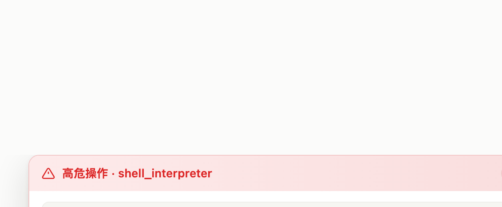
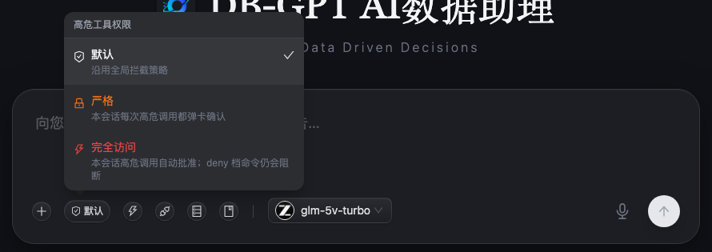

# High-risk Tool Approval — Usage Guide

High-risk tool calls made by the DB-GPT agent (shell, code execution, SQL writes,
network fetches, …) go through a human-in-the-loop gate by default: a confirmation
card appears above the composer and the call only executes after the user allows it.
This guide explains **when interception happens**, **how the confirmation card
behaves**, and **how to configure the rules**. The gate applies identically to both
the dbgpt and pi execution engines.

## 1. When a call is intercepted

The decision chain runs in order; the first match wins:

1. **Conversation badge "Full access"** → passes inside that conversation (the deny
   tier still blocks, see §3);
2. **Global mode `off`** → everything passes (troubleshooting only);
3. **deny tier match** → blocked outright, no card; the block reason is fed back to
   the model so it reroutes;
4. **whitelist memory match** (session/always "class-of-call" key; skipped while the
   conversation badge is "Strict") → passes;
5. **confirm tier match** or **fail-safe for gated tools** → confirmation card
   (always a card while the conversation badge is "Strict");
6. **auto tier match** → passes.

Tier examples (builtin table L0, overridable by setting-page L2 rules):

| Tier | Behavior | Examples |
| --- | --- | --- |
| deny | block + feedback | `rm -rf /\|~\|*`, `curl/wget \| sh`, fork bomb, `mkfs`, `dd of=/dev/`, `chmod 777 /`, UPDATE/DELETE without WHERE, DROP/TRUNCATE |
| confirm | card | `pkill/kill/killall`, `sudo`, `nohup` backgrounding, `rm -rf`, `git push --force`, `git reset --hard`, `eval/bash -c` indirect execution, DML with WHERE, internal URLs, **composed commands** (split on `\| ; & && $( backtick`; any non-read-only segment confirms) |
| auto | pass | shell read-only pipelines (`ls/cat/grep/ps/df/tail/head/wc/echo/pytest/git status\|log\|diff|find/which/env/date/jq/tree/stat` …; **every** segment must be read-only, e.g. `ls \| grep x`), read-only SQL, public web reads |

Fail-safe: side-effect-capable tools (`bash`, `code`,
`sql_query`, `web_fetch`, …) fall to confirm when no rule matches (relaxable to auto
via the "fail-safe tier" parameter on the setting page).
**code static analysis**: Python payloads are parsed with the stdlib AST
before classification:

- **provably read-only** — imports inside the analysis allowlist (pandas / numpy /
  matplotlib / sqlite3 / math / …) and no side-effect sink (`exec/eval`,
  `subprocess`, network calls, file write/delete, DB writes, write-mode `open()`,
  `df.to_csv(path)`, literal `execute("DELETE …")`, …) → auto, no card; pure
  analysis code — including read-only sqlite3 discovery scans — stops popping;
- **sink detected** → confirm, even when the fail-safe parameter is relaxed to auto;
- **unknown imports, statically opaque constructs (e.g.
  `execute(variable_sql)`) or unparsable snippets** → the fail-safe tier, as before.

**Shell read-only guards**: output redirection (`>`, `>>`) is never read-only
(`ls > out.txt` confirms); flag-aware checks reject writer flags on read-only verbs
(`find -delete/-exec`, `sort -o`, `sed -i`, `awk system(`, `tar` extract — `tar -tf`
stays auto); env prefixes (`LC_ALL=C …`) are stripped before matching; the read-only
verb set also covers cut/tr/uniq/dcomm-family text tools, checksums and `sort`.

## 2. The confirmation card

- **Intent bullets**: after the card appears, an async intent analysis runs (10s
  timeout, fallback bullets on failure). **Allow stays disabled until the bullets
  arrive**; Reject is always available. Risk phrases render red-bold
  (**force-kill**, **immediately interrupted**, **unrecoverable**, …);
- **Two-step reject**: the first Reject click opens a reason input; the reason is
  fed back to the model so it reroutes;
- **Scope & memory**: `once` / `session` / `always`. session/always write a
  **class-of-call key** to the whitelist: shell → command head
  (`bash: pkill*`), SQL → verb (`sql_query: UPDATE …`), web → host
  (`web_fetch: api.internal/*`), code → **exact script** (the first
  token of code carries no safety meaning, so no grouping). The card states exactly
  what will be remembered;
- **deny is never exempted by whitelist memory** (remembering `rm tmp/x` will not
  allow `rm -rf /`);
- **ttl** defaults to 300s; timeouts auto-reject. Every decision (including timeout)
  is audited;
- **Refresh-safe**: pending approvals are recovered on page load per conversation.

The question tool's card and the post-answer Q&A recap card belong to the same
floating-dock family (stack order approval > question).

## 3. In-chat permission badge (per conversation)

The composer toolbar (left of the model selector, next to the add-context button)
carries a permission badge for the **current conversation**. Clicking it opens a
popover with three modes:

| Mode | Behavior |
| --- | --- |
| Default | follow the global policy (setting page rules + whitelist memory) |
| Strict | every confirm-tier call in this conversation pops a card; whitelist memory is ignored |
| Full access | confirm-tier calls in this conversation are auto-approved; **the deny tier still blocks** |

- **Scope**: per conversation; a brand-new chat starts at Default, and switching
  conversations re-reads that conversation's mode;
- **Storage**: persisted in the policy table (`approval_policy_setting`, key
  `conv_mode:<conv>`), so a conversation keeps its mode across backend restarts;
  brand-new conversations always start at Default;
- **Both engines** honor it (dbgpt and pi);
- **Audited**: every change lands in `approval_policy_log` with source
  `session-mode`;
- **Not the same as global mode off**: `off` disables the gate entirely (deny
  included); conversation Full access keeps the deny floor, so forbidden commands
  (`rm -rf /`, fork bombs, …) stay blocked even then.

## 4. Setting page: configuring the rules

Entry: sidebar bottom-left **Setting → Tool Approval** (route `/approval-settings`).

Six blocks:

1. **Global mode**: off / tiered / always, with impact warnings for off and always;
2. **Per-tool tier**: "follow rules / auto / confirm / deny" per tool; managed-locked
   rows cannot be changed;
3. **Rule editor**: L2 rules win over the builtin table. Flow = enter an arg regex +
   tier → "Add rule" stages an **unsaved draft** (button disabled with a hint while
   the pattern is empty; Enter submits) → the bottom save bar "Save & apply" commits
   the batch to the DB and writes an audit diff. Deletions are staged the same way;
4. **Playground**: enter a command / SQL / URL and Evaluate → verdict + per-rule hit
   trace (hits bold), no persistence. Shareable deep links: `?tool=<tool>&try=<text>`;
5. **Whitelist memory**: view / revoke session & always class-of-call keys;
6. **Parameters**: confirm timeout (s), intent-analysis switch, fail-safe tier.

Config sources and precedence: **L2 setting DB > L1 toml/env > L0 builtin rules**;
hot-applied in-process (5s cache); multi-instance propagation is a P2 item.

## 5. Audit

- `tool_approval_log`: full lifecycle per approval — a pending row at register
  (undecided approvals leave traces too), intent-bullet snapshot, then decision
  with decision/scope/actor/settle_source (`rest` user click / `ttl` timeout /
  `sweep` reconciliation);
- `approval_policy_log`: diff of every setting save, whitelist revoke and
  conversation permission-mode change (old → new, actor, timestamp);
- Query: `GET /api/v1/chat/approval/log?con_uid=<conv>&limit=&offset=`
  (conversation-ownership checked).

## 6. FAQ

- **I picked Full access — why was `rm -rf /` still blocked?** The deny tier is a
  floor: conversation Full access auto-approves confirm-tier calls only. Releasing
  deny-tier patterns means editing rules on the setting page (managed-locked rows
  excepted), which is audited.
- **Does Full access survive a backend restart?** Yes — modes are persisted per
  conversation in the policy table and re-read after a restart; only brand-new
  conversations start at Default.
- **I clicked Allow — why did the next high-risk call pop again?** Check the scope:
  `once` remembers nothing; session/always remember the **class-of-call key** shown
  on the card — a different command head / SQL verb / host pops again;
  code only remembers the identical script; deny tier is never exempted.
- **Want a whole tool released?** Set its per-tool tier to auto on the setting page
  (audited), or add an auto rule in the rule editor. Global release = mode off
  (not recommended).
- **Think it misfired?** Reproduce the decision chain in the playground first (see
  which rule hit), then decide between an auto rule, a tier change, or rewriting the
  command. Fill a reject reason to let the model reroute immediately.
- **What if nobody decides?** The ttl expires into an auto-reject; the model gets a
  timeout observation and reroutes; the audit row records it.
