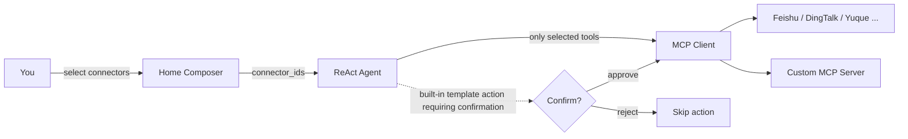

# MCP Connectors

**MCP Connectors** let your DB-GPT agents reach beyond the database — sending messages, reading and writing documents, managing issues, and searching the web — by connecting to external services through the **Model Context Protocol (MCP)**.

Activate a built-in template or plug in any custom MCP server, then pick the connectors you want in the composer. The agent only sees the tools you select. Built-in templates can request confirmation for write actions; custom MCP tools currently run without it.

:::info What is MCP?
The [Model Context Protocol](https://modelcontextprotocol.io) is an open standard that gives AI applications a uniform way to talk to external tools and services. Each connector in DB-GPT is backed by an MCP server, so adding a new capability is as simple as pointing to its endpoint.
:::

## Highlights

- **Built-in templates** — One-click activation for Feishu, DingTalk, Yuque, GitHub, Notion, Linear, Tavily, Keenable Search, and DeepWiki.
- **Custom MCP servers** — Connect any SSE or Streamable HTTP MCP endpoint with your own auth.
- **Per-conversation selection** — Choose which connectors to attach in the composer; the agent's prompt stays focused and token-efficient.
- **Human-in-the-loop confirmation** — Built-in templates can mark write actions for a confirmation dialog; custom MCP tools do not use it in this release.
- **Tool transparency** — Inspect the full tool list of any connector, with parameters and descriptions.
- **Credential storage** — Tokens are encrypted at rest. A stable encryption master key is required to recover them after a restart.

## How it works

A connector lives in one of three states:

| State | Meaning |
| --- | --- |
| **Available** | A template in the catalog, or the generic "custom MCP" entry — not yet configured. |
| **Active** | Configured with credentials and connected; its tools are ready to use. |
| **Attached** | Selected in the current conversation — the agent actually injects its tools. |

## Built-in connectors

| Connector | Category | Default transport | Typical tools |
| --- | --- | --- | --- |
| Feishu | Communication | SSE | Send messages, read / write docs, calendar |
| DingTalk | Communication | SSE | Group messages, bot notifications |
| Yuque | Document | SSE | Read / write knowledge base docs |
| GitHub | Project | Streamable HTTP | Issues, PRs, repository management |
| Notion | Document | Streamable HTTP | Pages and databases read / write |
| Linear | Project | Streamable HTTP | Issues / projects collaboration |
| Tavily | Search | Streamable HTTP | LLM-optimized web search, returns Markdown |
| Keenable Search | Search | Streamable HTTP | Web search and page fetch; works without an account or API key |
| DeepWiki | Dev Tools | Streamable HTTP | AI reading & Q&A over any GitHub repo |

## Managing connectors

Open the **Connectors** page to see every template and custom server as a card. Each card shows the icon, name, a `Template` / `Custom` badge, its category, the `MCP / SSE` (or Streamable HTTP) transport, and a short description. Use the search box and the **All / Active / Inactive / Needs attention** tabs to filter.

  

- **Template cards** show an `Activate` button — click it to fill in credentials and connect.
- **Active cards** show an `● Active` badge and quick actions to test the connection, edit, or delete.

### Add a connector

Click **Add Connector** to open the dialog:

  

| Field | Description |
| --- | --- |
| **Connector name** | A display name for this connector. |
| **Connector type** | Pick a built-in template or **Custom MCP Server**. |
| **Transport protocol** | **Streamable HTTP** (default) or **SSE**. |
| **Auth type** | `none`, `bearer`, or `token` — show the token / header fields as needed. |
| **Connector description** | Optional. Shown in the agent's tool description. |

For a custom server, just provide the endpoint URL, transport, and authentication. Credentials are encrypted before they are stored.

### Example: activate Keenable Search

Keenable Search is a hosted MCP server for web search and page fetching. It does not require an account or an API key: the public tier is rate-limited, and an optional `KEENABLE_API_KEY` raises those limits. Queries and URLs are sent to Keenable.

1. On the **Keenable Search** card, click **Activate**.
2. Set **Streamable HTTP Endpoint URL** to `https://api.keenable.ai/mcp`.
3. Leave **Auth type** as `none`. To use an API key instead, choose `bearer` and paste the key into the token field (it is sent as `Authorization: Bearer <key>`).
4. Save. The connector exposes two read-only tools, `search_web_pages` and `fetch_page_content`, so no confirmation dialog is involved.

### Inspect the tools

Open a connector's detail to browse every tool it exposes. The panel lists each tool name with its description and an **Input parameters** table (name, type, required, description) — useful for understanding exactly what the agent can call.

  

## Using connectors in a conversation

1. On the home page, open the connector picker in the composer toolbar (**Select MCP**).
2. Tick one or more connectors. The composer shows the selected count, and the agent will only be given those connectors' tools.
3. Ask your question. When the agent needs a tool, it calls it automatically.
4. If a built-in template marks an action for confirmation, a dialog appears. Approve to run it, or reject to skip. Custom MCP tools do not have this automatic confirmation in this release.

:::tip Why selection matters
Attaching only the connectors you need keeps the agent's prompt focused, reduces token usage, and prevents the model from picking the wrong tool.
:::

### Example: connect Baizhi Cloud Browser as a custom server

[Baizhi Cloud Browser](https://baizhibrowser.cloud/) (also known as CapyBrowser) hosts browser runs and persistent browser profiles. Its MCP endpoint checks credentials and prices, and manages runs, profiles, and control handover. Page navigation and clicking additionally require a compatible CDP client; adding this connector alone does not provide them.

Use a personal, single-user DB-GPT instance for this example. Connector credentials are stored on the backend; encryption at rest does not by itself establish isolation between users of a shared deployment. The administrator needs a stable encryption master key (for example, `ENCRYPT_KEY`) for credentials to remain recoverable after a restart.

**Custom MCP tools run without automatic write-action confirmation in this release.** The following prompt requests one read-only check; it does not restrict the connector's permissions or turn the other advertised tools into read-only tools. Keep this connection out of unattended workflows until their resource and spending controls have been reviewed.

1. Click **Add Connector**, choose **Custom MCP Server**, and name it `Baizhi Cloud Browser`.
2. Set **Streamable HTTP Endpoint URL** to `https://capybrowser.app.baizhi.cloud/mcp` and select **Streamable HTTP** (`streamable_http`).
3. Choose **Bearer Token** (`bearer`) and enter your authorized Baizhi Cloud Browser API key from the [service console](https://capybrowser.app.baizhi.cloud/) in the token field. Enter the raw key without `Bearer `; DB-GPT supplies that prefix. A DB-GPT API key is not a substitute.
4. Save, test the connection, and inspect the discovered tools. Do not place the key in the URL, a conversation, or a shared screenshot. Calls use the connected Baizhi account's authority. For a shared deployment, have its administrator confirm connector access controls before adding a service key.
5. For a supervised first check, select this connector in **Select MCP** and ask:

   > Call this connector's `browser_auth_check` once. Report whether authentication succeeded. Do not create a browser run or profile, request control, or print credentials or account identifiers.

Inspect the actual call and returned authentication result, including any reported error. DB-GPT may prefix the displayed tool name with the connector's routing name. Discovery alone is not evidence that the agent invoked the tool. This check does not create a browser run or incur browser runtime charges. Missing account/team metadata is an unknown ownership result, not proof that the key belongs to a particular account.

Before enabling other tools, review the [current service guide](https://capybrowser.app.baizhi.cloud/docs/installation.md) and pricing. Runs can incur charges. Removing the connector from the composer, disconnecting it, or deleting it does not stop an existing run: stop the original run explicitly and check its terminal state and billing separately. A released run does not by itself prove settled billing. If authentication fails, verify the endpoint, transport and key before retrying; do not create a run as a connection test.

To remove this integration, finish any existing runs, deselect the connector in conversations, and delete it in connector management. Revoke its service key separately if no longer needed. Calls and supplied task context are sent to Baizhi Cloud Browser. Public integration references are in the [Chaitin integration repository](https://github.com/chaitin/baizhi-cloud-browser). `ctcbyzx` maintains this connection example and has contributed to that repository; the [personal integration repository](https://github.com/ctcbyzx/baizhi-cloud-browser) and its [Issues](https://github.com/ctcbyzx/baizhi-cloud-browser/issues) provide maintenance and support for this connection.

## Notes & limitations

- Built-in templates ship with sensible `confirm` actions (write operations require confirmation); custom MCP tools run without confirmation in this release.
- Connection records can carry a user name; that alone is not an access-control guarantee. Administrators must verify isolation in shared deployments. Credential recovery after a restart requires a stable encryption master key.
- If a server is offline at startup, its connector is marked so you can re-test it from the card.
