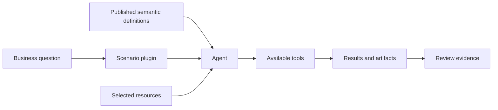

# Data Agent concepts

A Data Agent combines a business question, available resources, task instructions, and tools. Understanding these roles makes it easier to explain an unexpected result.

| Concept | Responsibility | Example |
| --- | --- | --- |
| Datasource | Physical records and database access | Orders, payments, refunds |
| Semantic Center | Governed business meanings and versioned definitions | Whether net receipts includes freight |
| Knowledge base | Documents and retrieval context | Accounting policy or product manual |
| Plugin | Reusable scenario method and capability configuration | Smart Data Query |
| Skill | Focused instructions and optional supporting resources | Preventing join fanout |
| Tool | A concrete operation and its returned evidence | Read metadata, execute SQL, render a report |
| Agent node | One responsibility inside a Flow | Independently verify computed totals |
| Gate | A decision point before further work | Confirm the analysis period |
| Artifact | A delivered output that can be opened or inspected | Query result, HTML report, ER diagram |

## How the pieces fit

For a complex task, a Flow applies this pattern across several agent nodes. Upstream outputs become input to downstream stages; a review agent or human gate can check whether to continue.

## Keep three kinds of evidence separate

**A definition** explains what should be calculated. **An execution record** shows what a tool actually did. **A deliverable** presents the result. A metric citation does not prove that SQL implemented its formula; a successful SQL call does not prove that a chart has a valid time axis; a report link does not prove that the report was opened and checked.

Search results are useful discovery aids. Read the published source definition and its version before using it as the authority for a metric.
