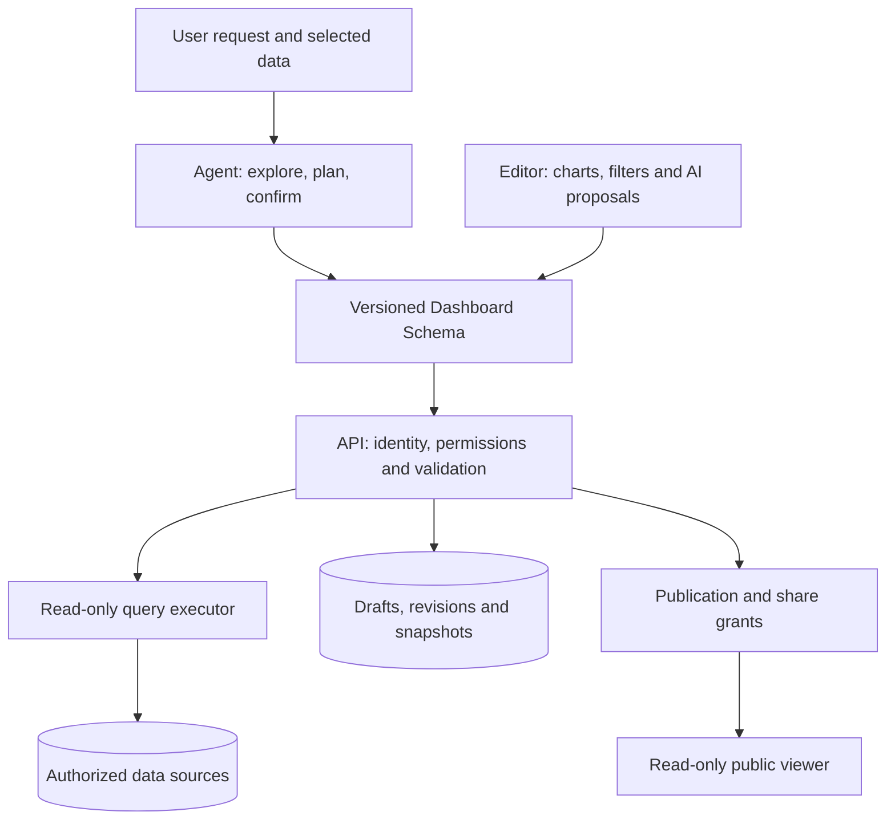
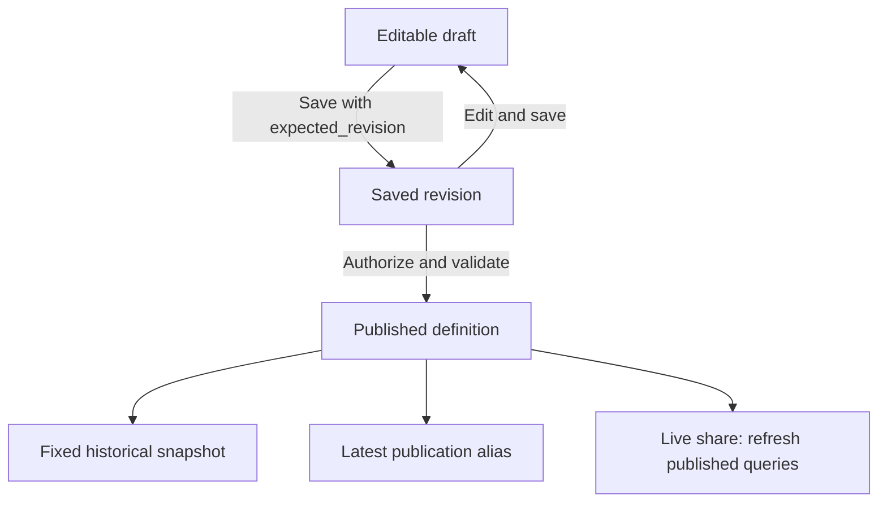

# Dashboard Workspace Design

Dashboard turns a data-analysis request into a saved, editable and publishable workspace. This document describes its architecture, data contract, workflows and deployment requirements. It covers the workspace under `/dashboards`; the existing [Chat Dashboard](../application/apps/chat_dashboard.md) guide describes the older chat application.

The design separates **Schema** (what to query and display) from **Snapshot** (the result of an execution). An agent proposes a plan or a change; the server authorizes, validates, executes and persists it. The browser provides review and interaction, but does not authorize database access.

<a id="architecture"></a>

## Architecture



| Component | Responsibility | Main implementation |
| --- | --- | --- |
| Agent and tools | Explore data, plan without SQL, obtain confirmation and propose changes | `tools/dashboard.py`, `planner.py`, `confirmation.py` |
| Contract | Validate structure, cross-field references and version compatibility | `schemas.py`, `schema/dashboard.schema.json`, `web/types/dashboard.ts` |
| Queries | Validate SQL ASTs, table/column allowlists and parameters; enforce execution limits | `sql_security.py`, `query_executor.py`, `lineage.py` |
| Assets | Save drafts, record revisions, detect conflicts, refresh and publish | `service.py`, `models.py`, `api.py` |
| Access and sharing | Resolve identity, check source permissions and manage public grants | `identity.py`, `access.py`, `publication.py`, `live_share.py`, `share_vault.py` |
| UI | Edit components, review AI changes, render results and publish | `DashboardEditor.tsx`, `DashboardRenderer.tsx`, `DashboardPublishDialog.tsx` |

Backend filenames are relative to the [Dashboard backend](https://github.com/eosphoros-ai/DB-GPT/tree/main/packages/dbgpt-app/src/dbgpt_app/openapi/api_v1/dashboard); the tools directory is its sibling. UI filenames are relative to the [Dashboard components](https://github.com/eosphoros-ai/DB-GPT/tree/main/web/new-components/dashboard).

<a id="data-contract"></a>

## Data contract

The Pydantic model and server-side cross-field checks define the accepted contract. The checked-in JSON Schema is exposed by `GET /api/v1/dashboards/schema` for client validation; TypeScript describes the browser types. Passing client validation does not bypass server validation.

| Schema field | Meaning |
| --- | --- |
| `schema_version` | Versions 1.0–1.4; later versions add federation, metric context, publication presentation and theme capabilities. |
| `dashboard` | Identity, title, description, source, state, theme and refresh policy. |
| `metric_context` | Grain, time coverage, freshness, provenance and metric definitions. |
| `filters` | Filter type, field, options, defaults and query-parameter bindings. |
| `widgets` | Component queries, output fields, visual encodings and public-filter aggregation. |
| `layouts` | Grid position, size and mobile presentation. |
| `metadata` | Conversation, generation, template and compatibility information. |

The five base widget types are `kpi`, `line`, `bar`, `pie` and `table`; visualization settings express additional presentations. Filters support dates, single/multiple selections, text and numeric ranges. Their actual effect depends on query parameters and publication bindings. See the [Schema definition](https://github.com/eosphoros-ai/DB-GPT/blob/main/packages/dbgpt-app/src/dbgpt_app/openapi/api_v1/dashboard/schemas.py) for field-level rules.

<a id="workflow"></a>

## Creation and AI changes

1. Select an authorized data source or attach files. The agent explores tables, fields, samples and time columns.
2. Review a plan describing metrics, dimensions, filters and widgets without SQL, then confirm it.
3. Generate the Schema and queries. The server checks permissions, structure, SQL and actual query results before accepting the result.
4. Open the draft, inspect values and queries, adjust titles/layouts/filters, and save. Planning, query-preview and saved-asset events are separate states.
5. To change an existing dashboard, describe the requested edit or add an AI annotation. The assistant reads the current object and returns a proposal for review before application. Explanation and anomaly analysis do not silently edit the draft.

A proposal that changes related widgets and filters must keep references, parameters and public aggregation consistent. Applying a proposal is not the same as publishing it.

Data templates offer preset, manual-mapping and AI-adaptation paths. For a built-in source with the default requirements, adaptation can reuse verified preset queries without calling a model; the resulting preview uses the preset creation path. Custom requirements retain model adaptation and validation. A successful preset preview is therefore not evidence of model-generation success.

<a id="publishing"></a>

## Saving, revisions and publication



Saving carries `expected_revision`; a stale revision returns a conflict instead of silently overwriting changes. Publishing also performs a conditional database update against the expected revision and checks the affected row count. This avoids relying on a row lock that SQLite does not provide. If a save commits after another session publishes the previously read revision, the save explicitly writes `draft`; the older publication remains attached to its own revision.

| Object | What changes | Reader behavior |
| --- | --- | --- |
| Draft | Explicit saves create revisions | Editing does not automatically replace published content. |
| Fixed historical publication | Schema and data are frozen for that publication | Filters recompute only over materialized dimensions; later source changes do not alter it. |
| Latest publication alias | Follows a later explicit publication | Its target can change; it is distinct from a fixed historical URL. |
| Live share | Re-materializes data using the published definition | Expiry, revocation and source authorization apply; polling does not guarantee real-time updates. |

Publication validates access, Schema, queries and filter bindings. Public readers can view and use permitted filters, but cannot submit arbitrary SQL, replace the source or modify the draft. Project ZIP export contains Schema, Plan and SQL for inspection; it is not a standalone offline application.

<a id="security"></a>

## Identity, authorization and execution

Dashboard uses the upstream request identity, preferring a stable user ID rather than a display nickname. Object roles are `viewer`, `editor` and `owner`; having edit access to a dashboard does not itself grant access to its data sources. Source checks cover the primary source and all sources referenced by federated queries before connectors read metadata, including static validation.

SQL is parsed with the connector's supported dialect and restricted to allowed read-only ASTs. Table and column allowlists are checked within query scope. Qualified names require authorization for the full name; a same-named CTE or a table in another catalog does not grant access. If a connector supplies only unqualified names, queries should use those names. Filter values use bound parameters, with multi-value expansion handled by the executor.

Queries have row, timeout and total-wait limits. A refresh timeout prevents subsequent publication, with another check before the publication transaction commits. A running driver call cannot always be interrupted by Python: the scheduler keeps renewing its lease while waiting for the worker to exit, and lease loss cancels execution. Configure driver/database query timeouts as well.

Public-token lookup uses hashes. The encrypted token needed by an authorized publisher to recover a link is stored separately. Audit records redact sensitive details. Historical shares without a creator require a verifiable conversation owner; legacy files under `pilot/data/<conv_uid>` still require an ownership check. Display names are not used to infer ownership.

<a id="deployment"></a>

## Deployment and upgrades

### Metadata database

Entities are registered through the existing `db_model_initialization.py`. SQLite uses DB-GPT's startup table creation and migration entry point; there is no separate Dashboard Alembic revision chain. Do not depend on a request creating missing tables.

MySQL follows the existing versioned full/incremental SQL convention:

| Deployment | Script under `assets/schema/upgrade/v0_8_3/` | Procedure |
| --- | --- | --- |
| New empty database | [v0.8.3.sql](https://github.com/eosphoros-ai/DB-GPT/blob/main/assets/schema/upgrade/v0_8_3/v0.8.3.sql) | Initialize the full schema, equivalent to `assets/schema/dbgpt.sql`. Do not also run the incremental script. |
| Existing v0.8.2 database | [upgrade_to_v0.8.3.sql](https://github.com/eosphoros-ai/DB-GPT/blob/main/assets/schema/upgrade/v0_8_3/upgrade_to_v0.8.3.sql) | Stop the service, back up the database, run the script once, then start the new version. Upgrade older databases to v0.8.2 through the historical scripts first. |

The incremental script uses `ALTER TABLE ... ADD COLUMN`, `ADD INDEX` / `ADD UNIQUE INDEX` for existing chat and scheduled-task tables, and `CREATE TABLE IF NOT EXISTS` for new tables. It does not delete business data or backfill owner IDs from display names.

**Existing MySQL deployments must upgrade before starting the new version.** Skipping the script leaves scheduled-task `owner_id`, `resource_*`, `lease_*` fields and run-idempotency indexes missing. This can cause `Unknown column` errors and break existing scheduled tasks as well as Dashboard features. Adjust the database name in the scripts if it is not `dbgpt`. The incremental script is not a repeatable initializer: if an older Dashboard script or manual DDL was already applied, compare existing columns/indexes and execute only missing changes.

### Production services

- Use trusted authentication and enable `DBGPT_DASHBOARD_PRODUCTION_MODE`. The development fallback identity is rejected in this mode. A deployment-specific identity adapter can be provided through `DBGPT_DASHBOARD_IDENTITY_PROVIDER`.
- Connect the deployment's data-source authorization policy through `DBGPT_DASHBOARD_DATA_SOURCE_POLICY` or the application integration hook. Production mode requires a policy; an object role alone is insufficient. Verify cross-user and external-connector access in the target environment.
- Production collaboration requires Redis. Missing collaboration configuration makes that API unavailable without preventing ordinary chat and dashboard services from starting.
- Preserve the share-encryption key. Automatic atomic key creation requires hard-link support; unsupported filesystems report an error. A deployment can instead supply `DBGPT_SHARE_ENCRYPTION_KEY`.
- File analysis uses the configured `SANDBOX_RUNTIME`; Dashboard does not independently switch it to Lyric. Validate driver cancellation behavior and sustained load in the actual deployment.

<a id="validation"></a>

## Development and validation

From `web/`, use `yarn test:dashboard` and `yarn test` for frontend tests, `yarn build --webpack` for a production build, and `yarn compile` for static export. Browser regressions use `yarn test:e2e:dashboard` with the environment expected by `playwright.dashboard.config.ts`. A build is not a substitute for browser interaction or strict type checking.

After installing backend test dependencies, run the following from the repository root in Bash. It keeps package paths and external-service markers explicit without adding another pytest configuration:

```sh
python -m pytest -c pyproject.toml --rootdir=. --import-mode=importlib -p no:cacheprovider \
  -o addopts= \
  -o "pythonpath=packages/dbgpt-app/src packages/dbgpt-client/src packages/dbgpt-core/src packages/dbgpt-ext/src packages/dbgpt-sandbox/src packages/dbgpt-serve/src" \
  -o "markers=mysql_integration: requires DASHBOARD_TEST_MYSQL_URL and a disposable MySQL database
redis_integration: requires DASHBOARD_TEST_REDIS_URL and a disposable Redis database" \
  packages/dbgpt-app/src/dbgpt_app/openapi/api_v1/dashboard/tests \
  packages/dbgpt-app/src/dbgpt_app/openapi/api_v1/tests/test_question_contract.py \
  packages/dbgpt-app/src/dbgpt_app/openapi/api_v1/tests/test_share_privacy.py \
  packages/dbgpt-serve/src/dbgpt_serve/scheduled_task/tests \
  packages/dbgpt-app/src/dbgpt_app/tests/test_multi_file_tools.py \
  packages/dbgpt-app/src/dbgpt_app/tests/test_olist_dashboard_case.py \
  packages/dbgpt-app/src/dbgpt_app/tests/test_uploaded_dataset.py \
  packages/dbgpt-app/src/dbgpt_app/tests/test_uploaded_dataset_registry.py \
  packages/dbgpt-app/src/dbgpt_app/tests/test_python_upload_api.py \
  packages/dbgpt-app/src/dbgpt_app/tests/test_workspace_provisioning.py \
  packages/dbgpt-app/src/dbgpt_app/tests/test_dashboard_skill_orchestration.py \
  examples/dashboard/tests
```

Set `DASHBOARD_TEST_MYSQL_URL` (database name must contain `test`) and `DASHBOARD_TEST_REDIS_URL` to run external-service integration tests. Without them, those tests explicitly skip. MySQL tests recreate tables: connect only to disposable test databases.

Validate the behavior being changed: manual dates must reach the query, save/publish interleavings must retain the right revision/state, revoked source permissions must prevent metadata reads, and template creation must be tested beyond its preview. Model generation, preset creation and frozen-publication filtering need separate checks. Record the tested commit and environment with results; historical screenshots are illustrations, not evidence for a newer commit.

<a id="implementation"></a>

## Implementation and examples

- [Schema contract](https://github.com/eosphoros-ai/DB-GPT/tree/main/packages/dbgpt-app/src/dbgpt_app/openapi/api_v1/dashboard/schema) and [REST implementation](https://github.com/eosphoros-ai/DB-GPT/blob/main/packages/dbgpt-app/src/dbgpt_app/openapi/api_v1/dashboard/api.py).
- [Agent tools](https://github.com/eosphoros-ai/DB-GPT/blob/main/packages/dbgpt-app/src/dbgpt_app/openapi/api_v1/tools/dashboard.py) and [frontend components](https://github.com/eosphoros-ai/DB-GPT/tree/main/web/new-components/dashboard).
- [Reproducible example data and Schemas](https://github.com/eosphoros-ai/DB-GPT/tree/main/examples/dashboard) and [browser fixtures](https://github.com/eosphoros-ai/DB-GPT/blob/main/web/tests/dashboard-e2e/fixtures/README.md).
- Business walkthroughs: [Walmart](../application/dashboard/walmart.md) and [Apple](../application/dashboard/apple.md). Both are available in English and Chinese and document data provenance, operating steps and historical checks separately from this design.

<a id="capability-boundaries"></a>

## Capability boundaries

| Area | Current boundary |
| --- | --- |
| SQL dialects | With SQLGlot 26.13.2, Vertica, MaxCompute, GaussDB, openGauss and OceanBase are rejected as `unsupported_data_source` before execution, without a generic-dialect fallback. Parser support alone does not certify a connector on a target database. |
| DuckDB | Queries may use registered tables, not file paths or table functions that read arbitrary external files. |
| Unsaved inputs | Reloading the new-dashboard page loses inputs/options kept only in page memory. Saved assets remain accessible from the dashboard list. |
| AI semantics | A structurally valid result can still use the wrong business definition. Review metrics, grain, units and source values. Fixed prompts or preset runs do not establish a general generation success rate. |
| Layout presets | `layout_templates` is disabled in the checked-in release feature contract. It is not a deployment environment switch and is separate from the data-template gallery. |
| Style cards | The style skills are bundled, but the home-page parameter handoff from the gallery is not connected. Treat these cards as presentation references, not a completed creation flow. Use the data-template setup or the dedicated creation page. |
| Filters and refresh | Fixed publications can only filter materialized dimensions. Live sharing needs an authorized source and offers periodic refresh, not a real-time guarantee. |
| Local preferences | Template favorites persist in the browser; account-wide, cross-device synchronization is not provided. |
| Demo data | Synthetic retail data and historical Walmart data are different sources. Synthetic totals are not real business totals; matching source files does not establish redistribution rights. |
