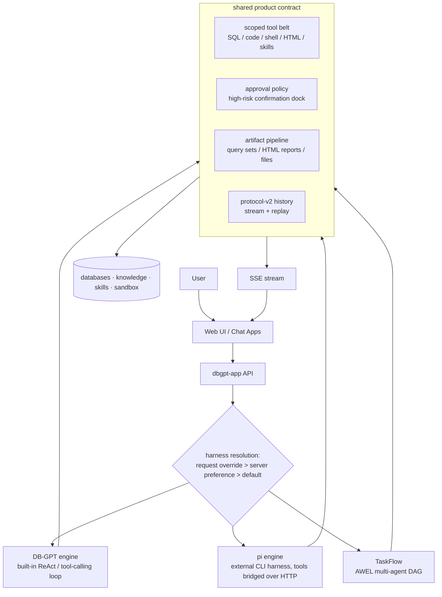

# Architecture

DB-GPT is organized as a Python monorepo around a **harness layer**: the product
surface (chat UI, artifacts, approvals, history) is engine-agnostic, while pluggable
**harness engines** own the agent loop. Two engines ship today — the built-in DB-GPT
ReAct runtime and the external `pi` CLI harness — and declared **TaskFlow workflows**
compose multi-agent DAGs on top of the same contract.

## Repository layout

```text
DB-GPT/
├── packages/
│   ├── dbgpt-core/        # Core agent, memory, planning, RAG, model abstractions
│   ├── dbgpt-app/         # Application server, API routes, harness adapters, UI asset hosting
│   ├── dbgpt-serve/       # Service layer: knowledge, flow, datasource, app services
│   ├── dbgpt-ext/         # Extensions: datasources, storage backends, RAG connectors
│   ├── dbgpt-client/      # Python client SDK
│   ├── dbgpt-sandbox/     # Sandbox execution runtime for safe code/tool execution
│   └── dbgpt-accelerator/ # Acceleration packages
├── web/                   # Next.js Web UI
├── skills/                # Built-in skills and reusable workflows
├── configs/               # TOML configuration files
└── docs/                  # Docusaurus documentation
```

## Package roles

| Package | Role |
|---|---|
| `dbgpt-core` | Core agent framework, ReAct parser/action flow, memory, planning, RAG, model interfaces |
| `dbgpt-app` | FastAPI application server, chat APIs, harness engine adapters, static UI hosting |
| `dbgpt-serve` | Resource services for knowledge, datasource, flow, app, and agent support |
| `dbgpt-ext` | External connectors such as database/storage/RAG integrations |
| `dbgpt-client` | Client SDK for DB-GPT APIs |
| `dbgpt-sandbox` | Isolated execution runtimes for code and tool execution |
| `skills/` | Packaged domain workflows, scripts, templates, and references |

## High-level architecture



## How it works

1. The user interacts with the Web UI or another client.
2. `dbgpt-app` receives the request and resolves the **harness engine**: an explicit
   per-request override wins, then the server preference (Setting popover), then the
   availability-gated project default.
3. The chosen engine drives the turn: the built-in ReAct loop, the `pi` subprocess with
   DB-GPT tools bridged in, or a TaskFlow DAG of focused agent nodes.
4. Every tool call passes the same containment: scoped tool belt, read-only SQL rules,
   sandboxed code/shell, and the approval policy for high-risk calls.
5. Engines emit one shared SSE contract (steps, thoughts, tool rows, approvals,
   questions) plus typed artifact payloads (query result sets, HTML reports, files).
6. The turn persists as a protocol-v2 history payload, so reloading a conversation
   rebuilds the timeline, the trace and the artifact cards identically.
7. Results stream back to the UI: timeline while running, artifacts and the final
   answer when done.

## Harness engine layer

The harness layer is what keeps the product surface stable across runtimes:

| Engine | Loop owner | Notes |
|---|---|---|
| DB-GPT | built-in ReAct / tool-calling agent | always available |
| pi | external CLI (`pi --mode rpc`) per conversation | tools, models and approvals bridged from DB-GPT |
| DSH | reserved | coming soon |

All engines share the tool containment, the approval gate, the artifact pipeline and
the history protocol. See the [Harness guide](../../harness/introduction.md) for
selection semantics and the [extension guide](../../harness/extending.md) for adding
engines.

## Workflows (TaskFlow)

A workflow is a declared DAG compiled to AWEL: each node is an agent with its own goal,
tool boundary and output contract, and nodes exchange clean upstream outputs over a
data channel. Workflows reuse the same harness contract, so node runs produce the same
trace, artifacts and approvals as single-agent turns. See the
[Workflow guide](../../workflow/introduction.md).

## Resources used by the agent

### Structured data

Databases and queryable tabular sources are used for SQL-style analysis, schema
linking, and report generation. Query result sets surface as first-class artifacts
with CSV / Excel export.

### Unstructured data

Knowledge spaces and document collections provide retrieval support for
unstructured content.

### Skills

Built-in skills package repeatable workflows into reusable task units. The agent
can load and execute them within a session.

### Built-in tools

Tools include SQL execution, shell/code execution, HTML rendering, search, and
other task-specific operations registered through the resource manager.

## Result delivery

The output path is designed to be user-facing:

`engine turn` → `shared contract (SSE + artifacts)` → `timeline / artifact cards / rail` → `Web UI`

This makes the architecture suitable for interactive data analysis, report
generation, and tool-assisted reasoning — regardless of which engine runs the turn.
