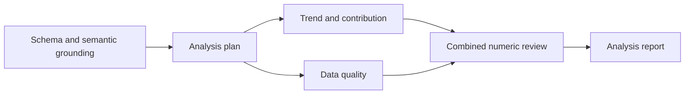

# Agentic Workflow examples

These are design recipes. Only the sales-analysis stages described as built-in correspond to the shipped template; other chains require a custom Flow and the relevant resources.

## Sales analysis: parallel work, combined review

The built-in **DB Intelligent Analysis** template uses this shape:

Bind the database and inspect each node before running. Grounding should identify the period, fields, and available published metrics. The two analysis branches serve different responsibilities; review should reconcile the results and carry unresolved issues into the final report.

## Financial-report comparison

A custom chain can assign agents to source/period alignment, metric extraction, comparison, citation review, and reporting. Add a gate after source alignment when reports use different currencies or fiscal years. Configure file or knowledge access explicitly; this recipe does not imply an out-of-box financial Flow template.

## SQL diagnosis

A custom chain can separate schema/plan collection, bottleneck hypotheses, rewrite/index proposals, and change review. Deliver original SQL, evidence, assumptions, and validation steps. Keep change execution outside the diagnosis unless separately configured and authorized.

## What makes these designs reusable

Name the business stages, assign narrow responsibilities, specify evidence-bearing outputs, and decide where to stop for a person. A Flow should make an omission or failed stage easier to locate; it should not disguise missing evidence with a final polished report.
