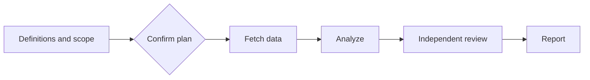

# Agentic Workflow

Agentic Workflow organizes agents around explicit **stages, tasks, deliverables, and gates**. An agent decides how to complete its assigned work within its resources and tool boundary. The Flow coordinates dependencies, exposes progress, and provides points for review and intervention.

TaskFlow is the product's Flow implementation; it compiles to an AWEL graph. The business task node is an agent with one responsibility. The graph also includes auxiliary start, output, data-entry, and human-confirmation nodes.

## The problem Flow addresses

Prompt- or Skill-based multi-agent coordination can be weak in long, complex tasks. Agents may drift from the intended process, omit work, hand off results that cannot be verified, or leave the user unsure how to proceed after an exception.

Flow makes the stages and handoffs visible. Resource boundaries, review stages, status monitoring, and failure interception help the team see what happened and decide what to do next.

| Approach | What you model | Where coordination lives |
| --- | --- | --- |
| Preset operation workflow | API calls, parameters, and branches | Predefined operations and engine rules |
| Prompt/Skill coordination | Roles and written instructions | Agent context and instruction following |
| Agentic Workflow | Agent responsibilities, deliverables, dependencies, and gates | Flow structure between stages; agent autonomy within stages |

Start from a template and name stages in business terms. This reduces the need to design every technical operation in advance, while still requiring deliberate resource and output configuration.

## An example responsibility chain

This is a suggested custom design, not the exact built-in template. The current **DB Intelligent Analysis** template includes grounding and planning, parallel trend/contribution and data-quality agents, combined numeric review, and reporting.

## What is explicit—and what still needs checking

An agent goal describes its responsibility and output requirements. An `Output:` line is a prompt contract, not a deterministic schema validator. An independent review agent adds a second check, but its conclusion also requires evidence. A `human_confirm` node pauses for a stage decision; tool approval governs an individual operation.

Failure visibility and downstream interception do not imply automatic checkpoint recovery. See [Runs and artifacts](./runs-and-artifacts.md) for replay boundaries and [Troubleshooting](./troubleshooting.md) for available recovery actions.

Next: [Quickstart](./quickstart.md) · [Contracts and gates](./contracts-and-gates.md) · [Examples](./examples.md).
