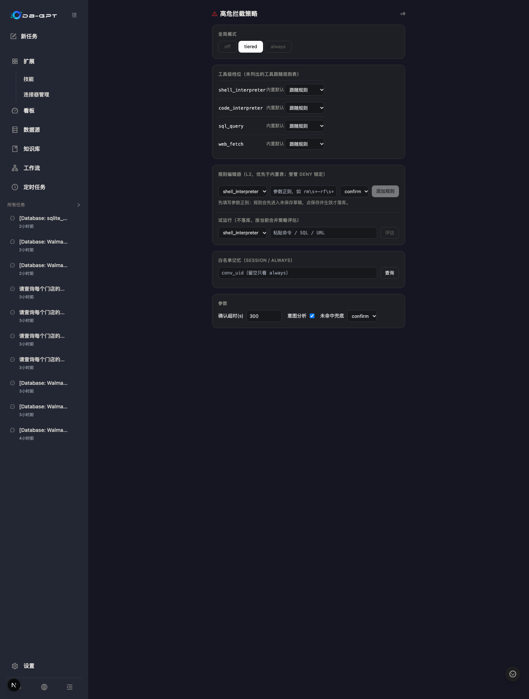
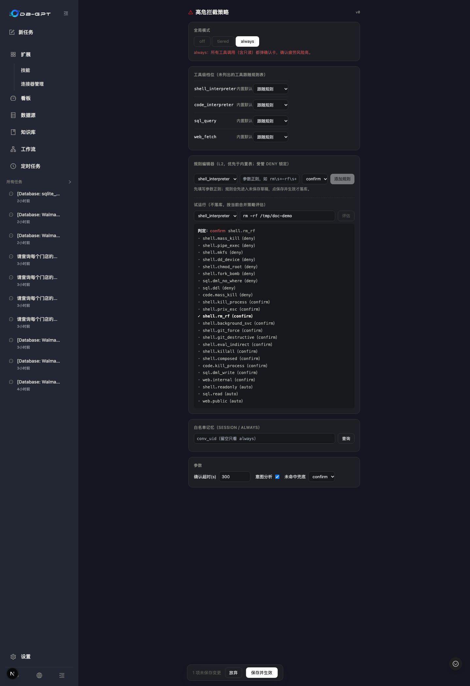

# 高危工具拦截与审批使用说明

DB-GPT Agent 的高危工具调用（shell、代码执行、SQL 写操作、外联等）默认经过
human-in-the-loop 拦截：命中策略时在输入框上方弹出确认卡，用户允许后才真正执行。
本文说明**什么时候会拦截**、**确认卡怎么交互**、以及**如何配置拦截规则**。
拦截对 dbgpt 与 pi 两个执行引擎一致生效。

## 一、什么时候会拦截

判定链按顺序执行，先命中先决：

1. **会话徽章「完全访问」** → 本会话直通（deny 档仍阻断，见第三节）；
2. **全局模式 `off`** → 全部直通（仅建议排障时短暂使用）；
3. **deny 档命中** → 直接阻断、不弹卡，阻断原因回灌给模型改道；
4. **白名单记忆命中**（session / always 的「类调用键」；会话徽章为「严格」时跳过）→ 直通；
5. **confirm 档命中**或** gated 工具 fail-safe** → 弹确认卡（会话徽章为「严格」时必弹）；
6. **auto 档命中** → 直通。

各档示例（内置规则表 L0，可被设置页 L2 规则覆盖）：

| 档 | 行为 | 示例 |
| --- | --- | --- |
| deny | 阻断 + 回灌 | `rm -rf /\|~\|*`、`curl/wget \| sh`、fork bomb、`mkfs`、`dd of=/dev/`、`chmod 777 /`、SQL 无 WHERE 的 UPDATE/DELETE、DROP/TRUNCATE |
| confirm | 弹卡 | `pkill/kill/killall`、`sudo`、`nohup` 后台化、`rm -rf`、`git push --force`、`git reset --hard`、`eval/bash -c` 间接执行、SQL 带 WHERE 的 DML、内网 URL、**组合命令**（按 `| ; & && $( 反引号` 切段后任一段非只读） |
| auto | 直通 | shell 只读管线（`ls/cat/grep/ps/df/tail/head/wc/echo/pytest/git status|log|diff|show|branch/find/which/env/date/jq/tree/stat` 等，**每段都只读**才放行，如 `ls \| grep x`）、SQL 只读、公网只读 |

fail-safe：`bash / code / sql_query / web_fetch` 等具备副作用能力
的工具，未命中任何规则时默认落 confirm（可在设置页「未命中兜底」放宽为 auto）。
**code 静态分析**：Python 代码在判定前先用标准库 AST 解析：

- **可证明只读**——import 均在分析白名单内（pandas / numpy / matplotlib / sqlite3 /
  math 等），且无任何副作用 sink（`exec/eval`、`subprocess`、网络调用、文件写删、写库、
  写模式 `open()`、`df.to_csv(path)`、字面量 `execute("DELETE …")` 等）→ auto 直通，
  纯分析代码（含 sqlite3 只读探查扫描）不再弹卡；
- **检出 sink** → confirm，即使「未命中兜底」放宽为 auto 也照弹；
- **未知 import、静态不透明构造（如 `execute(变量SQL)`）或解析失败的片段** →
  回落 fail-safe 档，与之前一致。

**shell 只读护栏**：输出重定向（`>`、`>>`）一律不算只读（`ls > out.txt` 会弹卡）；
只读动词带写旗标时拒绝放行（`find -delete/-exec`、`sort -o`、`sed -i`、`awk system(`、
`tar` 解包——`tar -tf` 仍只读）；环境变量前缀（`LC_ALL=C …`）匹配前剥离；只读动词表
另覆盖 cut/tr/uniq/diff 等文本工具、校验和与 `sort`。

## 二、确认卡长什么样、怎么点

- **意图要点**：弹卡后异步做命令意图分析（10s 超时或失败推兜底要点）；要点到达前
  **允许按钮禁用**、拒绝始终可用；风险词红粗高亮（如**强制终止**/**立即中断**/**不可恢复**）；
- **拒绝两步**：第一次点拒绝进入原因输入态，原因会回灌给模型改道；
- **scope 与记忆**：`仅本次 once` / `本会话 session` / `始终 always`。session/always 按
  **类调用键**写白名单：shell 取命令首词（`bash: pkill*`）、SQL 取动词
  （`sql_query: UPDATE …`）、web 取 host（`web_fetch: api.internal/*`）、
  code 取**精确脚本**（代码首词不携带安全语义，不做分组）；
  卡上会明示「将记住 … 类调用」；
- **deny 档永不被白名单记忆豁免**（记住 `rm tmp/x` 不会放行 `rm -rf /`）；
- **ttl** 默认 300s，超时自动拒绝；决议（含超时）全部写审计；
- 刷新页面不丢卡：pending 批准在页面加载时按会话恢复。

question 工具的提问卡与确认卡同属悬浮 dock 族（叠放顺序 approval > question），
用户答复后对话流中会留下「问 + 答」回顾卡。

## 三、对话框权限徽章（按会话）

输入框工具栏（模型选择器左侧、加号按钮旁）有一枚**当前会话**的权限徽章，点击弹出
三档选择：

| 档位 | 行为 |
| --- | --- |
| 默认 | 沿用全局策略（设置页规则 + 白名单记忆） |
| 严格 | 本会话每次 confirm 档调用都弹卡，忽略白名单记忆 |
| 完全访问 | 本会话 confirm 档调用自动批准；**deny 档命令仍会阻断** |

- **作用域**：按会话；新会话从「默认」开始，切换会话会读回该会话已存的档位；
- **存储**：落策略表（`approval_policy_setting`，键 `conv_mode:<conv>`），后端重启后
  会话档位不丢；新会话始终从「默认」开始；
- **双引擎一致**：dbgpt 与 pi 都认该档位；
- **有审计**：每次切换写 `approval_policy_log`，source=`session-mode`；
- **与全局 off 的区别**：off 是整体关停拦截（含 deny）；会话「完全访问」保留 deny
  底线，`rm -rf /`、fork bomb 之类依旧阻断。

## 四、设置页：配置拦截规则

入口：侧栏左下 **设置 → 高危拦截策略**（路由 `/approval-settings`）。

六个区块：

1. **全局模式**：off / tiered / always；off 与 always 显示影响警示；
2. **工具级档位**：每工具「跟随规则 / auto / confirm / deny」；受管锁定行不可改；
3. **规则编辑器**：L2 规则优先于内置表。流程＝填参数正则 + 选档 → 「添加规则」进入
   **未保存草稿**（空输入时按钮禁用并给提示，输入框支持 Enter 快捷添加）→ 底部保存条
   「保存并生效」批量落库并写审计 diff；删除规则同样进草稿、保存才生效；
4. **试运行**：填命令 / SQL / URL 点「评估」，输出判定 + 逐规则命中 trace（命中加粗），
   不落库；支持深链 `?tool=<tool>&try=<text>` 生成可分享的试运行链接；
5. **白名单记忆**：按 conv 查看 session/always 类调用键并撤销；
6. **参数**：确认超时(s)、意图分析开关、未命中兜底档。

配置源与优先级：**L2 设置页 DB > L1 toml/env > L0 内置规则**；同进程热生效（5s 缓存），
多实例收敛为 P2 计划项。

## 五、审计

- `tool_approval_log`：每次批准的全生命周期——register 即写 pending 行（未决议也有痕迹）、
  意图要点快照、决议 decision/scope/actor/settle_source（`rest` 用户点按钮 /
  `ttl` 超时 / `sweep` 对账兜底）；
- `approval_policy_log`：每次设置保存、白名单撤销与会话权限档位切换的 diff
  （旧值→新值、修改人、时间）；
- 查询：`GET /api/v1/chat/approval/log?con_uid=<conv>&limit=&offset=`（带会话所有权校验）。

## 六、FAQ

- **选了「完全访问」为什么 `rm -rf /` 还是被拦？** deny 档是底线：会话「完全访问」只自动
  批准 confirm 档调用。要放开 deny 模式需到设置页改规则（受管锁定行除外），且留有审计。
- **后端重启后「完全访问」会丢吗？** 不丢：档位按会话落策略表，重启后读回；只有新会话
  从「默认」开始。
- **点了允许为什么下次还弹？** 先看 scope：once 不记忆；session/always 记的是卡上明示的
  「类调用键」——换命令首词 / 换 SQL 动词 / 换 host 会再弹；code 只记完全相同
  的脚本；deny 档任何记忆都不豁免。
- **想整个工具放行？** 设置页工具级档位设 auto（有审计），或规则编辑器加 auto 规则；
  全局放行用 mode=off（不建议）。
- **认为误拦截？** 先用试运行复现判定链（看命中了哪条规则），再决定加 auto 规则、调工具
  档位还是改命令写法；拒绝时填写原因可让模型当场改道。
- **卡住不决策会怎样？** ttl 到期自动拒绝，模型收到超时 observation 自行改道，审计留痕。
