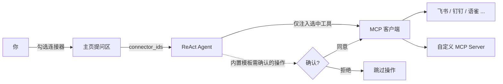

# MCP 连接器

**MCP 连接器**让 DB-GPT 的 Agent 突破数据库的边界——发消息、读写文档、管理 Issue、搜索网页——通过 **Model Context Protocol(MCP)** 协议连接各类外部服务。

激活一个内置模板,或接入任意自定义 MCP Server,然后在提问区按需勾选要用的连接器。Agent 只会看到你选中的工具。内置模板可为写操作请求确认;本期自定义 MCP 工具不会自动走确认。

:::info 什么是 MCP?
[Model Context Protocol](https://modelcontextprotocol.io) 是一个开放标准,为 AI 应用提供了统一的方式去对接外部工具与服务。DB-GPT 中每个连接器背后都是一个 MCP Server,因此新增一项能力只需指向它的接入地址即可。
:::

## 功能亮点

- **内置模板**——飞书、钉钉、语雀、GitHub、Notion、Linear、Tavily、Keenable Search、DeepWiki 一键激活。
- **自定义 MCP Server**——接入任意 SSE 或 Streamable HTTP 的 MCP 端点,自带鉴权。
- **按对话选择**——在提问区勾选本轮要挂载的连接器,Agent 的 prompt 保持聚焦、节省 token。
- **人工确认(HITL)**——内置模板可将写操作设为需确认;本期自定义 MCP 工具不走自动确认。
- **工具透明**——可查看任意连接器暴露的完整工具列表,含参数与说明。
- **凭据存储**——Token 加密存储;跨重启恢复需要稳定的加密主密钥。

## 工作原理

连接器有三种状态:

| 状态 | 含义 |
| --- | --- |
| **可用(Available)** | 目录中的模板,或"自定义 MCP"通用入口——尚未配置。 |
| **已激活(Active)** | 已填写凭据并连接成功,工具随时可用。 |
| **已挂载(Attached)** | 在当前对话中被勾选——Agent 实际注入它的工具。 |

## 内置连接器

| 连接器 | 分类 | 默认传输 | 典型工具 |
| --- | --- | --- | --- |
| 飞书 | 协作沟通 | SSE | 发消息、读写文档、日历 |
| 钉钉 | 协作沟通 | SSE | 群消息、机器人通知 |
| 语雀 | 知识管理 | SSE | 读写知识库文档 |
| GitHub | 项目 | Streamable HTTP | Issue、PR、仓库管理 |
| Notion | 知识管理 | Streamable HTTP | 页面 / 数据库读写 |
| Linear | 项目 | Streamable HTTP | Issue / Project 协作 |
| Tavily | 搜索增强 | Streamable HTTP | 为 LLM 优化的 Web 搜索,返回 Markdown |
| Keenable Search | 搜索增强 | Streamable HTTP | 网页搜索与网页正文抓取,无需账号或 API Key |
| DeepWiki | 研发工具 | Streamable HTTP | 对任意 GitHub 仓库的 AI 解读与问答 |

## 管理连接器

打开**连接器管理**页,每个模板和自定义 Server 都以卡片呈现。卡片展示图标、名称、`模板` / `自定义` 徽章、所属分类、`MCP / SSE`(或 Streamable HTTP)传输标识,以及简短描述。可用搜索框和 **全部 / 已激活 / 未激活 / 需要关注** 标签筛选。

  

- **模板卡片**带「激活」按钮——点击后填写凭据并连接。
- **已激活卡片**显示 `● 已激活` 徽章,以及测试连接、编辑、删除的快捷操作。

### 添加连接器

点击**添加连接器**打开弹窗:

  

| 字段 | 说明 |
| --- | --- |
| **连接器名称** | 该连接器的显示名。 |
| **连接器类型** | 选择内置模板,或**自定义 MCP Server**。 |
| **传输协议** | **Streamable HTTP**(默认)或 **SSE**。 |
| **认证方式** | `none`、`bearer` 或 `token`——按需展示 Token / Header 字段。 |
| **连接器描述** | 可选,会展示在 Agent 的工具描述中。 |

对于自定义 Server,只需提供接入地址、传输协议和鉴权信息即可。凭据会在存储前加密。

### 示例:激活 Keenable Search

Keenable Search 是一个托管的 MCP Server,提供网页搜索与网页正文抓取。无需注册账号或申请 API Key 即可使用:公共通道有速率限制,可选的 `KEENABLE_API_KEY` 可提升限额。搜索词和 URL 会发送给 Keenable。

1. 在 **Keenable Search** 卡片上点击**激活**。
2. 将 **Streamable HTTP Endpoint URL** 填为 `https://api.keenable.ai/mcp`。
3. **认证方式**保持 `none`。若要使用 API Key,改选 `bearer` 并把 Key 填入 Token 字段(将以 `Authorization: Bearer <key>` 发送)。
4. 保存。该连接器暴露两个只读工具 `search_web_pages` 和 `fetch_page_content`,不会触发确认框。

### 查看工具

打开连接器详情可浏览它暴露的每个工具。面板列出每个工具名、描述,以及 **输入参数** 表格(名称、类型、是否必填、描述)——便于了解 Agent 究竟能调用什么。

  

## 在对话中使用连接器

1. 在主页提问区工具栏打开连接器选择器(**选择 MCP**)。
2. 勾选一个或多个连接器。提问区会显示已选数量,Agent 也只会拿到这些连接器的工具。
3. 正常提问。当 Agent 需要某个工具时会自动调用。
4. 若内置模板将某操作设为需确认,会弹出确认框。点同意则执行,点拒绝则跳过。本期自定义 MCP 工具没有此自动确认。

:::tip 为什么"选择"很重要
只挂载需要的连接器,能让 Agent 的 prompt 更聚焦、减少 token 消耗,并避免模型选错工具。
:::

### 示例：连接百智云浏览器自定义 MCP

[百智云浏览器](https://baizhibrowser.cloud/)（Baizhi Cloud Browser，也即 CapyBrowser）提供云端浏览器运行和持久化浏览器 Profile。MCP 负责凭据校验、价格查询、运行、Profile 及控制交接管理；网页导航和点击还需要兼容的 CDP 客户端，仅添加连接器不会提供这些页面操作。

本例使用本人控制的单用户 DB-GPT 实例。连接凭据保存在后端；加密存储本身不证明共享部署中的用户隔离。管理员需配置稳定的加密主密钥（例如 `ENCRYPT_KEY`），凭据才能在重启后恢复。

**当前版本的自定义 MCP 工具不会自动弹出写操作确认。** 下方提示词只请求一次只读检查，不能限制连接器权限，也不会把它提供的其他工具变成只读工具。在核对资源和费用控制前，不要将此连接用于无人值守工作流。

1. 点击**添加连接器**，选择**自定义 MCP Server**，命名为 `百智云浏览器`。
2. 将 **Streamable HTTP Endpoint URL** 填为 `https://capybrowser.app.baizhi.cloud/mcp`，传输协议选 **Streamable HTTP**（`streamable_http`）。
3. 认证方式选 **Bearer Token**（`bearer`），在 Token 字段填写从[服务控制台](https://capybrowser.app.baizhi.cloud/)获取且获准使用的百智云浏览器 API Key。只填原始 Key，不带 `Bearer `；DB-GPT 会补此前缀。不能使用 DB-GPT 自身的 API Key 代替。
4. 保存、测试连接并查看实际发现的工具。不要把 Key 放进 URL、对话或共享截图。调用使用所连接百智账户的权限。共享部署需先由管理员确认连接器访问控制，再配置服务 Key。
5. 首次由你监督检查，在**选择 MCP**中勾选此连接器，发送：

   > 仅调用此连接器的 `browser_auth_check` 一次，报告鉴权是否成功。不要创建浏览器运行或 Profile，不要申请控制，不要输出凭据或账户标识。

查看实际调用、返回的鉴权结果及错误提示；DB-GPT 可能在显示的工具名前加连接器路由前缀。发现工具不等于 Agent 已调用工具。本检查不创建浏览器运行、不产生浏览器运行费。账户/团队元数据缺失时，归属仍是未知，不能据此证明 Key 属于某一账户。

启用其他工具前，请阅读[当前接入指南](https://capybrowser.app.baizhi.cloud/docs/installation.md)并核对价格。运行可能收费。取消对话勾选、断开或删除连接器都不会结束已有运行：需要显式结束原运行，分别检查终态和计费状态。运行已释放不单独证明账单已结算。鉴权失败先核对地址、传输和 Key，不要通过创建运行来测试连接。

移除时，先结束已有运行，再取消各对话勾选并在连接器管理中删除；不再使用时另行撤销服务 Key。调用及传入的任务上下文会发送到百智云浏览器。公共接入材料见 [Chaitin 公共接入仓库](https://github.com/chaitin/baizhi-cloud-browser)。`ctcbyzx` 维护本接入并参与该仓库贡献；本接入的维护和反馈由[个人维护仓库](https://github.com/ctcbyzx/baizhi-cloud-browser)及其 [Issues](https://github.com/ctcbyzx/baizhi-cloud-browser/issues)承接。

## 说明与限制

- 内置模板自带合理的 `confirm` 动作(写操作需确认);本期自定义 MCP 的工具暂不走确认。
- 连接记录可带用户名,仅此不能证明访问隔离。共享部署需管理员核对隔离措施;跨重启恢复依赖稳定的加密主密钥。
- 若某个 Server 在启动时离线,其连接器会被标记,可在卡片上重新测试连接。
