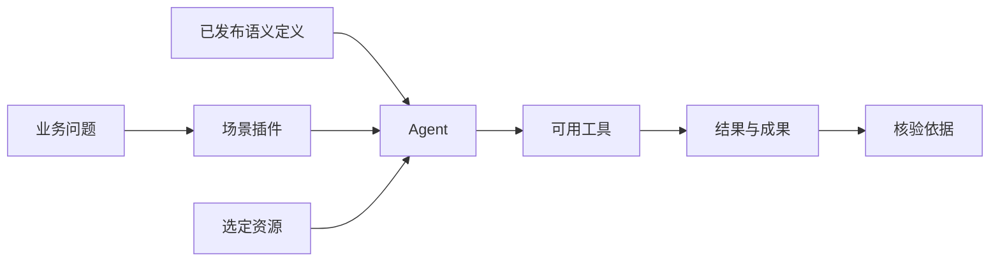

# Data Agent 核心概念

Data Agent 将业务问题、可用资源、任务方法和工具组合起来。理解各部分职责，有助于定位结果异常。

| 概念 | 职责 | 示例 |
| --- | --- | --- |
| 数据源 | 提供物理记录和数据库访问 | 订单、支付、退款 |
| 语义中心 | 管理业务含义和已发布指标版本 | 净实收是否含运费 |
| 知识库 | 保存资料并提供检索上下文 | 会计政策 |
| 插件 | 封装场景方法与能力配置 | 智能取数 |
| Skill | 聚焦一种任务方法及配套资源 | 防止关联汇总放大 |
| 工具 | 执行具体操作并返回证据 | 读取元数据、执行 SQL、生成报告 |
| Agent 节点 | 承担 Flow 中的一项责任 | 独立复核合计 |
| Gate | 决定是否继续的检查点 | 确认分析范围 |
| 成果 | 可以打开、检查的交付物 | 查询结果、HTML 报告、ER 图 |

复杂任务通过 Flow 将这一过程组织为多个 Agent 阶段。上游产物传给下游，复核 Agent 或人工 Gate 检查是否可以继续。

## 区分三种证据

**业务定义**说明应该计算什么；**执行记录**说明工具实际做了什么；**成果**呈现交付结果。指标引用不能证明 SQL 完整实现公式；SQL 成功不能证明图表时间轴正确；报告链接不能证明内容已经打开并核验。

检索结果用于发现候选定义，计算前应回源读取已发布版本。
