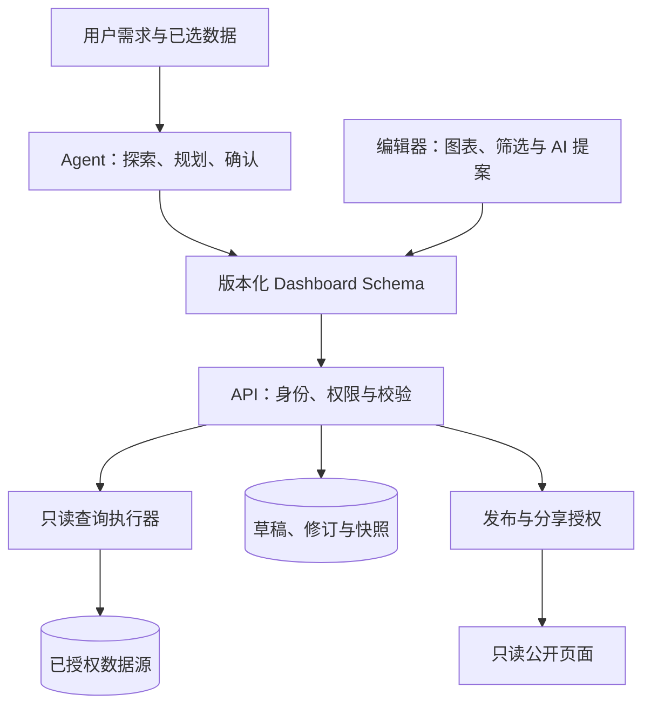
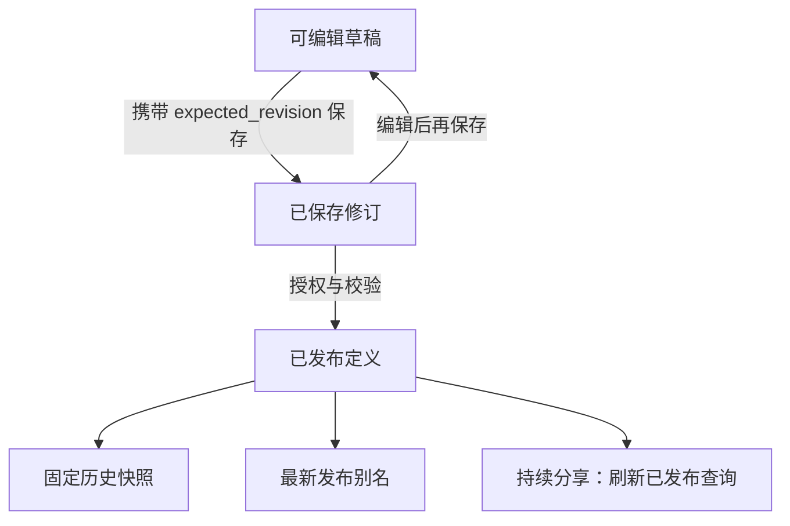

# 数据看板工作区设计

Dashboard 将数据分析需求转化为可保存、可编辑、可发布的看板工作区。本文说明其架构、数据合同、操作流程与部署要求，适用于 `/dashboards` 工作区；已有的 [Chat Dashboard](../application/apps/chat_dashboard.md) 文档介绍的是此前的聊天应用。

设计上区分 **Schema**（查询与展示定义）和 **Snapshot**（某次执行结果）。Agent 提出规划或变更，服务端负责授权、校验、执行和持久化；浏览器负责审阅与交互，不能代替服务端的数据访问授权。

<a id="architecture"></a>

## 总体架构



| 模块 | 职责 | 主要实现 |
| --- | --- | --- |
| Agent 与工具 | 探索数据、生成无 SQL 规划、获取确认、提出修改 | `tools/dashboard.py`、`planner.py`、`confirmation.py` |
| 数据合同 | 结构、跨字段引用和版本兼容校验 | `schemas.py`、`schema/dashboard.schema.json`、`web/types/dashboard.ts` |
| 查询 | SQL AST、表字段允许列表、参数和执行限制 | `sql_security.py`、`query_executor.py`、`lineage.py` |
| 资产 | 草稿保存、修订记录、冲突检测、刷新和发布 | `service.py`、`models.py`、`api.py` |
| 访问与分享 | 身份解析、数据源授权、公开访问凭据管理 | `identity.py`、`access.py`、`publication.py`、`live_share.py`、`share_vault.py` |
| 界面 | 组件编辑、AI 变更审阅、结果渲染和发布 | `DashboardEditor.tsx`、`DashboardRenderer.tsx`、`DashboardPublishDialog.tsx` |

后端文件名相对于 [Dashboard 后端目录](https://github.com/eosphoros-ai/DB-GPT/tree/main/packages/dbgpt-app/src/dbgpt_app/openapi/api_v1/dashboard)，工具位于相邻的 tools 目录；界面文件名相对于 [Dashboard 组件目录](https://github.com/eosphoros-ai/DB-GPT/tree/main/web/new-components/dashboard)。

<a id="data-contract"></a>

## 数据合同

Pydantic 模型和服务端跨字段校验决定实际接受的合同。仓库中的 JSON Schema 通过 `GET /api/v1/dashboards/schema` 提供给浏览器校验，TypeScript 描述前端类型。浏览器检查通过后，服务端仍会重新校验。

| Schema 字段 | 含义 |
| --- | --- |
| `schema_version` | 支持 1.0—1.4；后续版本增加联邦查询、指标口径、发布展示和主题能力。 |
| `dashboard` | 标识、标题、说明、来源、状态、主题和刷新策略。 |
| `metric_context` | 数据粒度、时间范围、新鲜度、来源和指标定义。 |
| `filters` | 筛选类型、字段、选项、默认值和查询参数绑定。 |
| `widgets` | 组件查询、输出字段、图表编码和公开筛选聚合。 |
| `layouts` | 网格位置、尺寸和移动端展示。 |
| `metadata` | 会话、生成、模板和兼容信息。 |

五类基础组件为 `kpi`、`line`、`bar`、`pie`、`table`，扩展展示通过可视化配置表达。筛选支持日期、单选、多选、文本和数字范围，实际作用由查询参数与发布绑定共同决定。字段规则见 [Schema 定义](https://github.com/eosphoros-ai/DB-GPT/blob/main/packages/dbgpt-app/src/dbgpt_app/openapi/api_v1/dashboard/schemas.py)。

<a id="workflow"></a>

## 创建与 AI 修改

1. 选择有权限的数据源或关联文件，由 Agent 探索表、字段、样本和时间列。
2. 审阅不包含 SQL 的规划，确认指标、维度、筛选和组件。
3. 生成 Schema 和查询。服务端检查权限、结构、SQL 与真实查询结果后，才接受生成结果。
4. 打开草稿，核对数值与查询，调整标题、布局、筛选并保存。规划、查询预览和资产保存是不同状态。
5. 修改已有看板时，可以描述需求或输入 AI 批注。助手读取当前对象，返回提案，经用户审阅后应用。解释和异常分析不会静默修改草稿。

同时修改组件与筛选器时，提案必须保持引用、参数和公开聚合的一致性。应用提案不等于发布。

数据模板提供预设匹配、手动字段映射和 AI 适配路径。内置数据源使用默认要求时，可以复用已验证的预置查询而不调用模型，这类预览沿用预置创建分支；自定义要求仍保留模型适配与校验。因此，预置预览成功不能作为模型生成成功的证据。

<a id="publishing"></a>

## 保存、修订与发布



保存携带 `expected_revision`，过期修订返回冲突，不静默覆盖变更。发布也通过包含预期修订号的条件 UPDATE 检查影响行数，避免依赖 SQLite 不提供的行锁。如果另一个会话先发布了已读取的旧修订，随后提交的保存仍显式写入 `draft`；旧发布继续关联自己的修订。

| 对象 | 变化方式 | 阅读行为 |
| --- | --- | --- |
| 草稿 | 显式保存形成修订 | 编辑不会自动替换已发布内容。 |
| 固定历史发布 | 冻结该次发布的 Schema 与数据 | 只能按已物化维度筛选；后续源数据变化不影响该快照。 |
| 最新发布别名 | 跟随后续显式发布 | 链接目标可能更新，与固定历史链接不同。 |
| 持续分享 | 按已发布定义重新物化数据 | 受有效期、撤销和数据源权限约束；轮询不保证实时更新。 |

发布前检查权限、Schema、查询和筛选绑定。公开访客可以查看和使用允许的筛选，不能提交任意 SQL、替换数据源或修改草稿。工程 ZIP 包含用于复核的 Schema、Plan 和 SQL，不是独立离线应用。

<a id="security"></a>

## 身份、授权与执行

Dashboard 沿用上游请求身份，优先使用稳定用户 ID，不把显示昵称当作身份。对象角色为 `viewer`、`editor`、`owner`；有看板编辑权限不代表有底层数据源权限。读取连接器元数据前，需要检查主数据源及联邦查询引用的全部数据源，静态校验也遵守该规则。

SQL 使用连接器对应的受支持方言解析，只接受允许的只读 AST。表字段允许列表按查询作用域检查；带 schema/catalog 的表名必须授权完整名称，不能借同名 CTE 或另一库的同名表获得访问权限。连接器只提供未限定名称时，查询也应使用这些名称。筛选值使用参数绑定，多选参数由执行器展开。

查询受行数、超时和总等待预算约束。刷新超时会阻止后续发布，并在发布事务提交前再次检查。Python 不一定能中断已经运行的驱动调用：调度器等待工作线程退出期间持续续租，丢失租约会取消执行。部署时还应配置驱动或数据库自身的查询超时。

公开令牌使用散列查找；授权发布者恢复链接所需的密文独立保存，审计记录会遮蔽敏感内容。历史分享没有创建者时，需要可核验的会话所有者；旧文件 `pilot/data/<conv_uid>` 也需核验会话归属，不从显示名推断所有权。

<a id="deployment"></a>

## 部署与升级

### 元数据库

实体通过原有 `db_model_initialization.py` 注册。SQLite 沿用 DB-GPT 启动时的建表和迁移入口，没有独立的 Dashboard Alembic 版本链。不要依赖请求路径补建缺失表。

MySQL 沿用历史版本目录下的全量、增量 SQL 约定：

| 部署场景 | `assets/schema/upgrade/v0_8_3/` 下的脚本 | 操作步骤 |
| --- | --- | --- |
| 全新空数据库 | [v0.8.3.sql](https://github.com/eosphoros-ai/DB-GPT/blob/main/assets/schema/upgrade/v0_8_3/v0.8.3.sql) | 执行全量初始化，与 `assets/schema/dbgpt.sql` 一致；不再执行增量脚本。 |
| 已有 v0.8.2 数据库 | [upgrade_to_v0.8.3.sql](https://github.com/eosphoros-ai/DB-GPT/blob/main/assets/schema/upgrade/v0_8_3/upgrade_to_v0.8.3.sql) | 停止服务、备份数据库、执行一次增量脚本，再启动新版。更早版本先按历史脚本升级到 v0.8.2。 |

增量脚本对聊天记录和定时任务旧表直接使用 `ALTER TABLE ... ADD COLUMN`、`ADD INDEX` / `ADD UNIQUE INDEX`，新表使用 `CREATE TABLE IF NOT EXISTS`。不会删除业务数据，也不会用显示名回填所有者 ID。

**已有 MySQL 部署必须在启动新版前完成升级。** 漏跑会缺少定时任务的 `owner_id`、`resource_*`、`lease_*` 等列和执行记录的幂等索引，可能出现 `Unknown column` 错误，影响存量定时任务和看板功能。数据库名不是 `dbgpt` 时，先调整脚本中的数据库名。增量脚本不是可重复执行的初始化器：执行过旧版 Dashboard 脚本或手工 DDL 的库，应比较已有列、索引，只执行缺失项。

### 生产依赖

- 接入可信认证并启用 `DBGPT_DASHBOARD_PRODUCTION_MODE`，该模式拒绝开发用的默认身份。部署专用身份适配器可通过 `DBGPT_DASHBOARD_IDENTITY_PROVIDER` 提供。
- 通过 `DBGPT_DASHBOARD_DATA_SOURCE_POLICY` 或应用集成入口接入部署方的数据源授权策略。生产模式要求配置策略，对象角色不能代替数据源授权。跨用户和外部连接器访问需在目标环境核验。
- 生产协作需要 Redis。缺少协作配置时，该接口返回不可用，但普通聊天和看板服务仍可启动。
- 妥善保存分享加密密钥。自动原子创建密钥依赖硬链接；文件系统不支持时明确报错，也可由部署环境提供 `DBGPT_SHARE_ENCRYPTION_KEY`。
- 文件分析沿用配置的 `SANDBOX_RUNTIME`，Dashboard 不会单独切换到 Lyric。驱动取消行为和持续负载表现需在实际部署中验证。

<a id="capability-boundaries"></a>

## 能力边界

| 范围 | 当前边界 |
| --- | --- |
| SQL 方言 | 使用 SQLGlot 26.13.2 时，Vertica、MaxCompute、GaussDB、openGauss、OceanBase 在执行前返回 `unsupported_data_source`，不回退到通用方言。解析器支持不等于连接器已在目标数据库验证。 |
| DuckDB | 只允许查询已注册表，不允许通过文件路径或表函数读取任意外部文件。 |
| 未保存输入 | 刷新新建页会丢失仅保存在页面内存的输入与选项；已保存资产可从看板列表打开。 |
| AI 语义 | 结构合法的结果仍可能采用错误的业务口径，需要核对指标、粒度、单位和源数据。固定题目或预置路径不能证明通用生成成功率。 |
| 布局预设 | 仓库内的版本功能合同关闭了 `layout_templates`。它不是部署环境变量开关，与数据模板库是不同能力。 |
| 风格卡片 | 图库保留风格示意，但已撤回的风格 skill 和首页参数接入尚未接通。卡片用于展示参考，不代表完整创建链路；创建请使用数据模板配置或专用新建页。 |
| 筛选与刷新 | 固定发布只能筛选已物化维度；持续分享需要有权限的数据源，按周期刷新，不保证实时性。 |
| 本地偏好 | 模板收藏保存在浏览器，不提供账户跨设备同步。 |
| 演示数据 | 合成零售数据与历史 Walmart 数据是不同来源。合成总额不代表真实业务，来源文件一致也不等于获得再分发授权。 |

<a id="validation"></a>

## 开发与验证

在 `web/` 下执行 `yarn test:dashboard`、`yarn test` 运行前端测试，`yarn build --webpack` 进行生产构建，`yarn compile` 进行静态导出。浏览器回归使用 `yarn test:e2e:dashboard`，并准备 `playwright.dashboard.config.ts` 所要求的环境。构建通过不能代替浏览器交互和严格类型检查。

安装后端测试依赖后，在仓库根目录使用 Bash 执行以下命令。包导入路径和外部服务标记直接给出，不需要另加 pytest 配置：

```sh
python -m pytest -c pyproject.toml --rootdir=. --import-mode=importlib -p no:cacheprovider \
  -o addopts= \
  -o "pythonpath=packages/dbgpt-app/src packages/dbgpt-client/src packages/dbgpt-core/src packages/dbgpt-ext/src packages/dbgpt-sandbox/src packages/dbgpt-serve/src" \
  -o "markers=mysql_integration: requires DASHBOARD_TEST_MYSQL_URL and a disposable MySQL database
redis_integration: requires DASHBOARD_TEST_REDIS_URL and a disposable Redis database" \
  packages/dbgpt-app/src/dbgpt_app/openapi/api_v1/dashboard/tests \
  packages/dbgpt-app/src/dbgpt_app/openapi/api_v1/tests/test_question_contract.py \
  packages/dbgpt-app/src/dbgpt_app/openapi/api_v1/tests/test_share_privacy.py \
  packages/dbgpt-serve/src/dbgpt_serve/scheduled_task/tests \
  packages/dbgpt-app/src/dbgpt_app/tests/test_multi_file_tools.py \
  packages/dbgpt-app/src/dbgpt_app/tests/test_olist_dashboard_case.py \
  packages/dbgpt-app/src/dbgpt_app/tests/test_uploaded_dataset.py \
  packages/dbgpt-app/src/dbgpt_app/tests/test_uploaded_dataset_registry.py \
  packages/dbgpt-app/src/dbgpt_app/tests/test_python_upload_api.py \
  packages/dbgpt-app/src/dbgpt_app/tests/test_workspace_provisioning.py \
  packages/dbgpt-app/src/dbgpt_app/tests/test_dashboard_skill_orchestration.py \
  examples/dashboard/tests
```

设置 `DASHBOARD_TEST_MYSQL_URL`（数据库名必须包含 `test`）和 `DASHBOARD_TEST_REDIS_URL` 可执行外部服务集成测试；未设置时，对应用例明确跳过。MySQL 测试会重建表，只能连接可丢弃的测试库。

按变更对应的行为验证：手选日期应进入实际查询，保存/发布交错应保留正确修订与状态，撤销数据源权限后不能再读取元数据，模板不能只测预览而漏测创建。模型生成、预置创建和冻结发布的筛选需分别检查。记录测试提交和环境；历史截图用于说明，不是新提交的验证证据。

<a id="implementation"></a>

## 实现与示例

- [Schema 合同](https://github.com/eosphoros-ai/DB-GPT/tree/main/packages/dbgpt-app/src/dbgpt_app/openapi/api_v1/dashboard/schema)与 [REST 实现](https://github.com/eosphoros-ai/DB-GPT/blob/main/packages/dbgpt-app/src/dbgpt_app/openapi/api_v1/dashboard/api.py)。
- [Agent 工具](https://github.com/eosphoros-ai/DB-GPT/blob/main/packages/dbgpt-app/src/dbgpt_app/openapi/api_v1/tools/dashboard.py)与[前端组件](https://github.com/eosphoros-ai/DB-GPT/tree/main/web/new-components/dashboard)。
- [可复现示例数据与 Schema](https://github.com/eosphoros-ai/DB-GPT/tree/main/examples/dashboard)及[浏览器固定输入](https://github.com/eosphoros-ai/DB-GPT/blob/main/web/tests/dashboard-e2e/fixtures/README.md)。
- 中文业务操作案例：[Walmart](https://github.com/eosphoros-ai/DB-GPT/blob/main/docs/dashboard/demos/walmart.md)、[Apple](https://github.com/eosphoros-ai/DB-GPT/blob/main/docs/dashboard/demos/apple.md)。案例分别记录数据来源、操作步骤和历史检查，与本文的设计说明分开。
