本方案说明数据分析报告的实现设计：如何把真实执行结果保存为产物，如何将报告中的数值和图表绑定到来源，以及如何在失败后复用已有结果继续生成报告。设计以当前 DB-GPT 分支的协议、执行工具、报告服务和前端实现为依据。

## 一、总体架构与职责划分

系统以“先捕获执行产物，再按引用生成报告”为组织原则。任务代理负责分析规划和工具调用；捕获层负责保存真实执行结果；专职报告代理负责选择证据和编排内容；模板引擎负责实际取值与校验；报告服务保存文档和索引，前端据此展示和回查。模块之间传递产物标识及选择器，协作关系如图1所示。

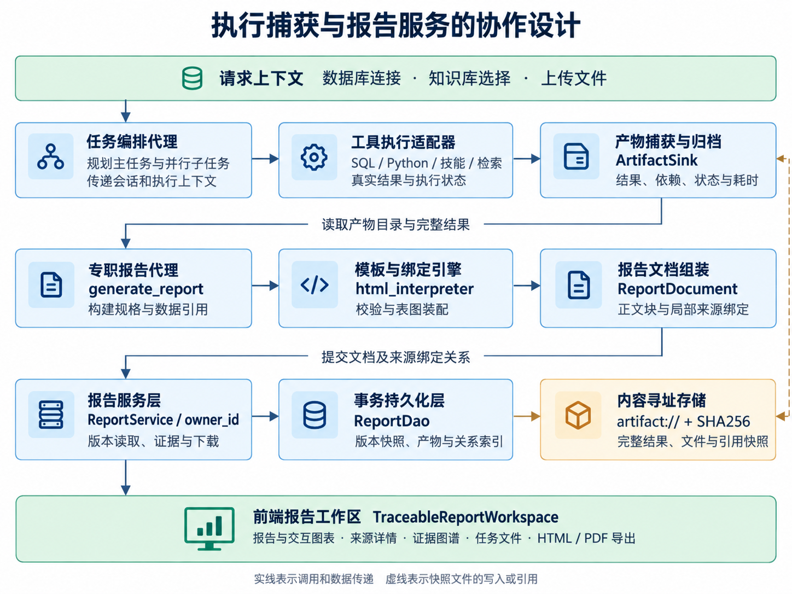

*图1  执行捕获与报告服务的协作设计*

主任务与并行子任务将结果写入同一会话的 ArtifactSink。公共层 report_capture 保存执行证据，应用层报告代理与 html_interpreter 负责内容编排及绑定，dbgpt_serve.report 负责持久化与查询。大结果和文件进入内容存储，元数据与关系进入报告数据库。

## 二、产物与证据的数据模型

模型同时保留两类关系：生产依赖回答“这个结果由哪些输入计算得到”，正文引用回答“报告中的这处内容使用了哪个结果”。前者由 input_artifact_ids 连接产物，后者由 EvidenceReference 连接正文目标和来源位置。报告版本固定这两类关系及其内容快照，数据模型如图2所示。

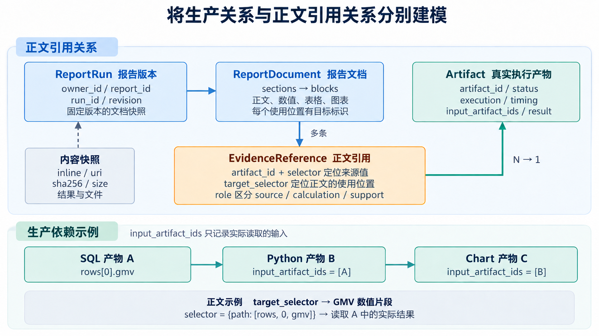

*图2  生产依赖与正文引用的独立建模*

| 数据对象 | 关键字段 | 关联含义 |
| --- | --- | --- |
| Artifact | artifact_id、execution、status、input_artifact_ids | 一次真实执行及其输入依赖 |
| ArtifactContent | inline、uri、sha256、size | 执行结果、引用或文件的内容快照 |
| ReportDocument | sections、blocks、artifacts | 可持久化的报告结构与产物集合 |
| EvidenceReference | artifact_id、selector、target_selector、role | 来源取值位置与正文使用位置 |
| ReportRun | owner_id、report_id、run_id、revision | 按用户隔离的不可变报告版本 |
| RenderObservation | artifact_id、renderer、status、timing | 浏览器实际绘制的独立观测 |

例如，GMV 数值引用可声明为 artifact_id = sql_A、path = ["rows", 0, "gmv"]。引擎读取实际结果并按格式生成显示值，同时给该数值片段分配目标标识。一个 SQL 产物可以支撑多处正文；Python 计算或图表继续使用它时，则另外记录输入依赖。

## 三、执行捕获与报告恢复

报告构建从已完成的产物出发，按“构建规格—解析引用—校验绑定—渲染—保存”推进。错误通过检查点回到对应阶段，而不是重新开始整项分析；正式报告与未完成任务分别返回状态，处理路径如图3所示。

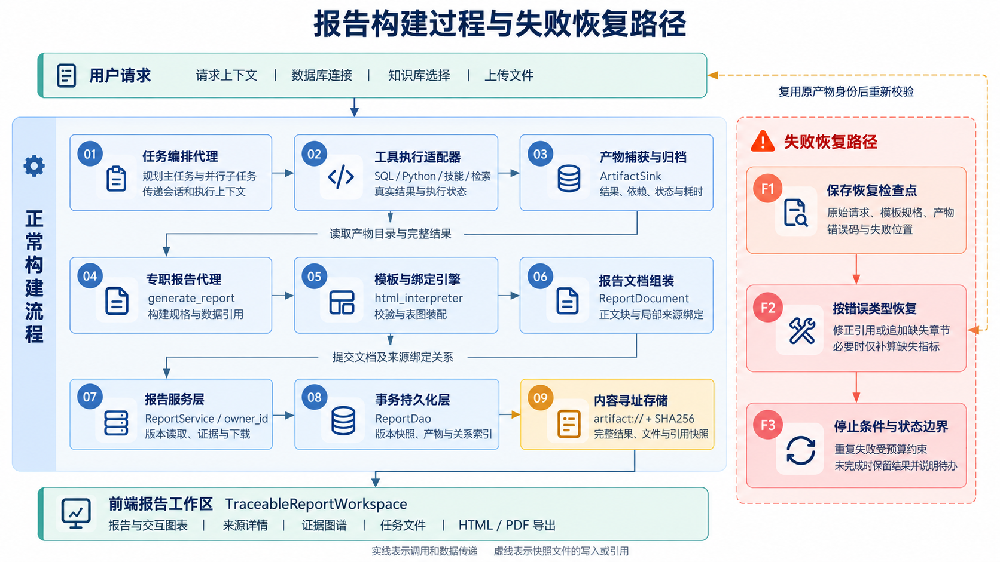

*图3  报告生成校验和失败恢复流程*

捕获发生在工具执行边界：SQL 保存查询、列与结果行；Python 保存代码、退出状态及 REPORT_RESULT；技能保存脚本与参数；知识读取保存原文及位置。结果先形成快照，再生成界面预览。Python 通过 SQL_RESULTS 读取 SQL 结果并跟踪实际输入；本地子进程沿用后台模块路径，避免多工作树下读取错误目录。

报告代理使用 REPORT_SPEC 声明章节与数据引用。引擎检查产物状态、字段路径与展示值，展开表格，并为图表生成独立产物和局部绑定。结构化段落按文字与引用分别渲染，避免把内部对象直接显示为正文。

失败检查点保存原始请求、模板参数、产物、进度与错误位置。继续时先按原参数重渲染，再修正引用、追加章节或仅补算缺失指标。恢复层按错误码与目标位置生成错误指纹，分别统计调用、规范与渲染失败；重复失败或总预算耗尽即停止并保留待办。允许降级的文字数值可显示 -- 并记录诊断，不作为已核验数值发布。

## 四、版本保存与来源回查

报告渲染完成后，组装器把章节、正文片段、产物和绑定关系合成为 ReportDocument。ReportDao 在同一事务中追加 ReportRun、产物快照、产物依赖和证据索引，并更新报告的最新版本指针。已保存版本不原地改写；重新分析或修复后形成新的版本，因此用户回查时可得到该版实际使用的证据。

存储层由 dbgpt_report、dbgpt_report_run、dbgpt_report_artifact、dbgpt_report_artifact_dependency 和dbgpt_report_evidence 分别承载报告入口、版本、产物、依赖及正文证据。大结果与文件使用 artifact://内容地址和 SHA256 快照，读取时检查内容完整性，界面预览截断不会改变底层引用值。

前端以 `/api/v1/reports/{report_id}/runs/{run_id}` 固定版本；点击正文目标时请求 `/blocks/{block_id}/evidence`，下载快照时请求 `/artifacts/{artifact_id}/content`。服务先按 owner_id 检查可见性，再由证据索引定位产物和选择器，返回代码、结果或原文。来源回查同时保留报告中的使用位置与实际取值位置。

## 五、图谱绘制与报告交付

证据图谱是对已保存关系的视图投影。来源按数据库、知识文件和上传文件组织；执行按会话、任务、运行和步骤标识归并状态与结果；输出仅展示实际报告或任务文件。知识切片聚合到文件节点，细节仍保留原文与位置；生产连线取自明确的输入依赖，不依靠文件名或时间先后猜测。

前端根据图表产物中的数据和 ECharts option 挂载图表，并将实际绘制结果、渲染器、耗时和错误作为 RenderObservation 单独保存。服务端生成成功与浏览器绘制成功分别观测，浏览器反馈不修改已保存的报告版本。

导出时等待字体与图表绘制，克隆当前报告、展开折叠表格，把可读取的 canvas 转为图片，并移除脚本及来源审阅控件，再生成 HTML 阅读稿或交给浏览器打印为 PDF。离线稿保留阅读内容；继续操作交互图表或点击来源时使用在线报告。

# Olist经营分析报告使用案例

## **步骤一 选择数据并发起分析**

用户在首页选择 Olist_Ecommerce 数据库和 Olist_Analytics_Governance 知识库，提出经营复盘问题，包括 GMV、订单量、客单价、品类与地区表现，以及配送和评分关系。提交后，用户在左侧跟踪任务进度，在右侧阅读报告的统计口径、核心指标和改进建议，确定下一步需要核对的问题。如图4所示。

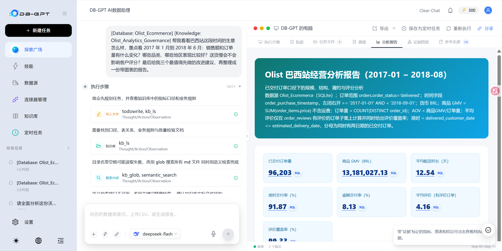

*图4  选择数据后执行分析并生成经营报告*

## **步骤二 核对核心指标的SQL结果**

用户先检查报告中的 GMV，点击数值旁的 SQL 标记打开来源详情，查看执行状态、耗时、数据库、查询语句及结果快照。通过比较报告显示值与查询返回值，用户可以确认指标使用了哪个字段，并在口径存疑时继续检查查询条件，而不必从完整对话中寻找执行记录。如图5所示。

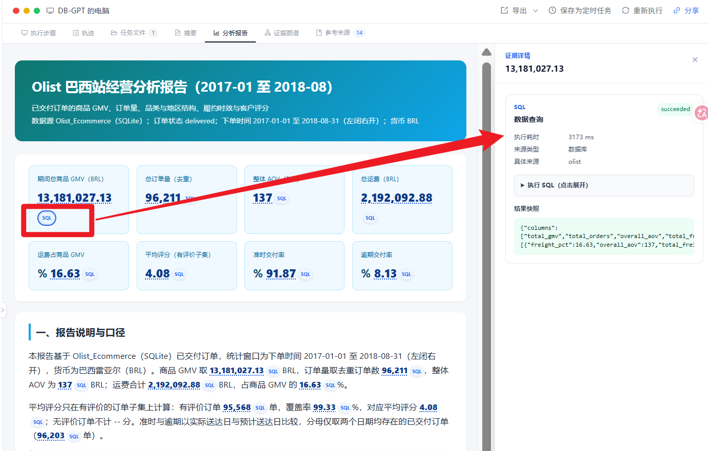

*图5  点击GMV的SQL标记查看执行依据*

## **步骤三 确认统计口径的知识依据**

随后，用户点击口径说明旁的 KB 标记，查看本次分析引用的知识文件、原文片段和读取位置，确认订单筛选、去重、金额单位及配送分组规则。遇到同名指标含义不清时，用户可以把这段规则与查询条件对照，判断报告是否回答了最初提出的业务问题。如图6所示。

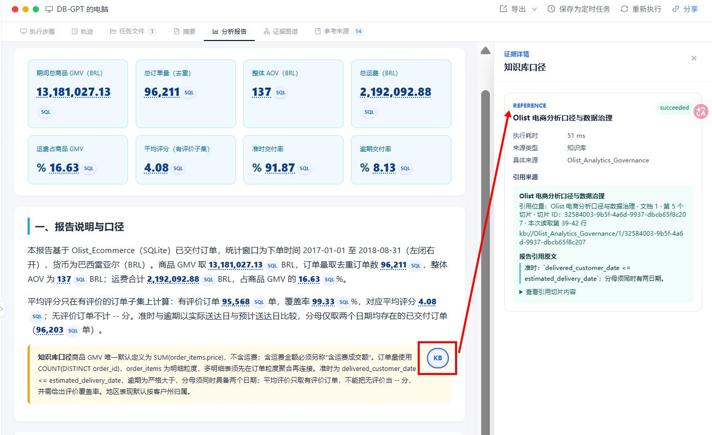

*图6  从口径说明进入知识库原文*

## **步骤四 比较品类并回查图表数据**

用户继续阅读品类分析，先从条形图识别主要销售品类，再查看图下明细。需要核实图形时，点击图表角标，来源面板会展示支撑图表的 SQL 结果与图表产物。用户据此检查类别、数值、排序和单位是否一致，再决定哪些品类值得进一步分析或优先运营。如图7所示。

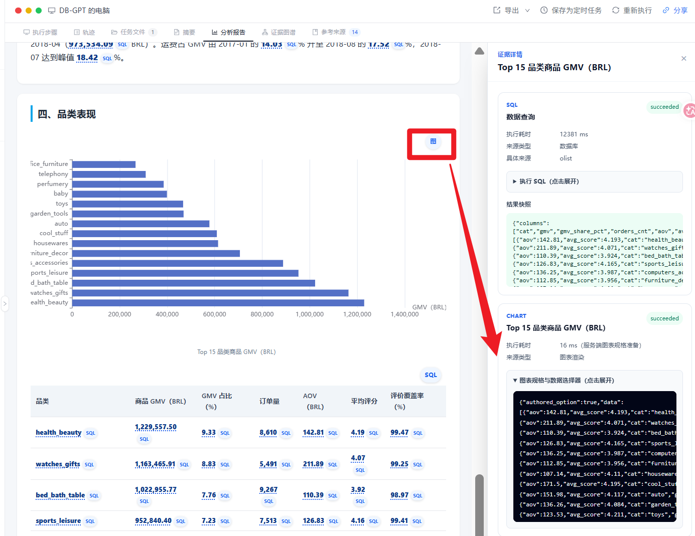

*图7  从品类图表查看查询结果和图表产物*

## **步骤五 复核Python计算得到的指标**

对于由 Python 计算的统计量，用户点击正文数值旁的 PY 标记，查看执行代码、结果快照与输入文件。复核时先确认引用字段，再检查分组、分位数或其他计算过程，必要时打开输入文件核对数据来源。这样，用户可以沿着报告中的具体数值回查计算依据。如图8所示。

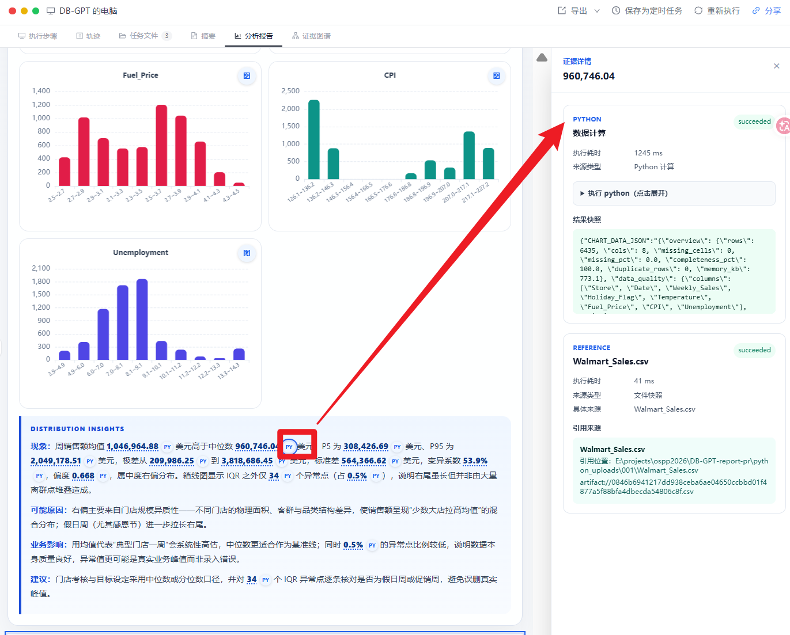

*图8  从正文数值回查Python计算和输入文件*

## **步骤六 对照数值结果与业务规则**

对重要指标，用户进一步展开 SQL 结果和知识原文，将“算出的数值”与“应采用的规则”放在一起复核。例如检查 GMV 对应的结果字段、订单是否去重，以及多表连接前是否按正确粒度汇总。当数值不符合预期时，这些细节能帮助用户确定应调整查询、统计口径还是报告表述。如图9所示。

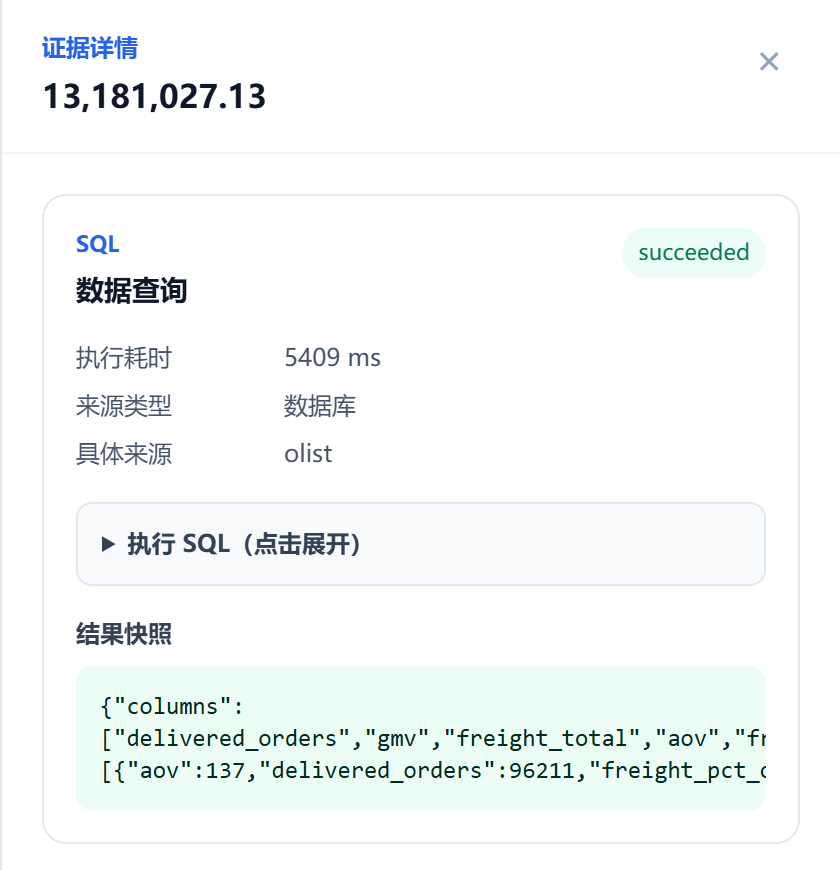

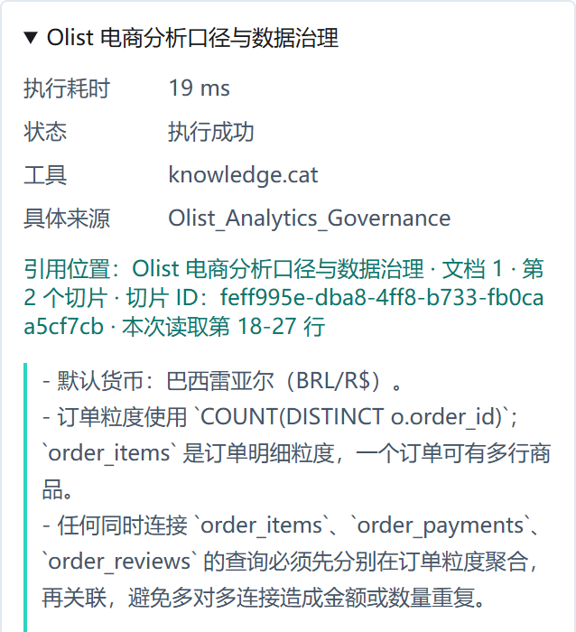

*图9  对照SQL结果快照与知识库原文*

## **步骤七 查看完整来源与执行链路**

完成局部核对后，用户切换到“证据图谱”，从左侧来源查看数据库与知识文件，沿中间执行步骤了解分析过程，再到右侧检查报告和图表文件。点击节点可打开详情，并查看执行状态、结果或文件信息。用户由此判断报告依赖了哪些材料，也能定位失败或需要进一步复核的步骤。如图10所示。

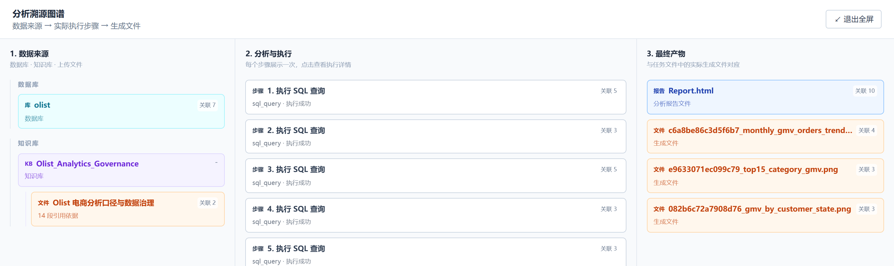

*图10  查看来源执行与输出文件的完整链路*

## **步骤八 选择报告的交付方式**

报告核对完成后，用户返回“分析报告”，点击右上角“导出”菜单，根据交付对象选择 HTML 或 PDF。需要发送可离线阅读的网页时选择 HTML；需要打印或归档时选择 PDF。仍需继续查看交互图表和来源详情的工作，则保留在线报告入口。如图11所示。

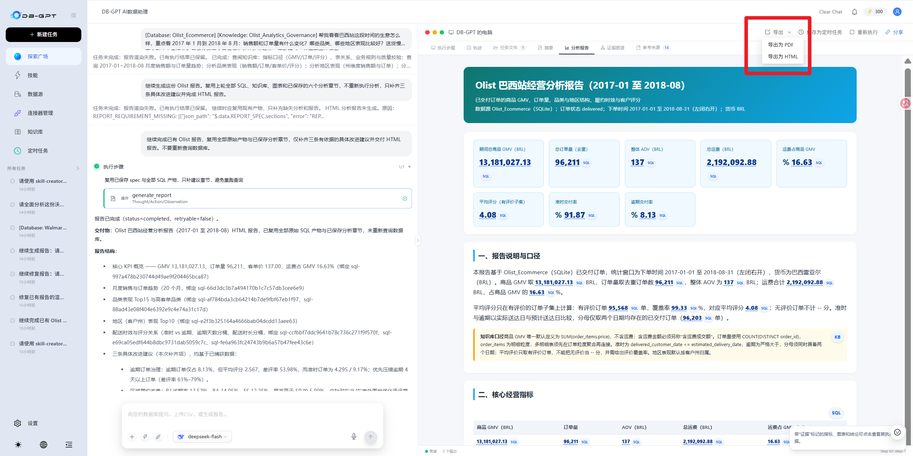

*图11  从报告导出菜单选择HTML或PDF*

## **步骤九 检查打印效果并保存PDF**

选择导出 PDF 后，用户进入浏览器打印预览，检查报告分页、表格宽度、图表和字体显示，再根据需要调整方向、缩放及背景图形设置。确认关键内容没有被裁切后，选择保存为 PDF 并完成交付。预览步骤让用户在发送文件前核对最终阅读效果。如图12所示。

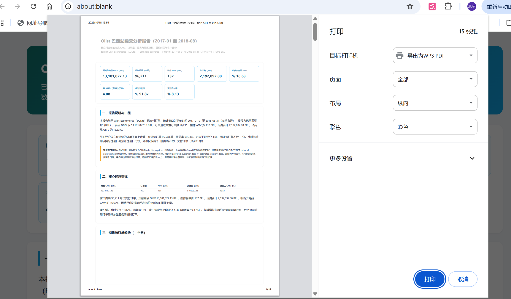

*图12  在打印预览中检查分页并保存PDF*
