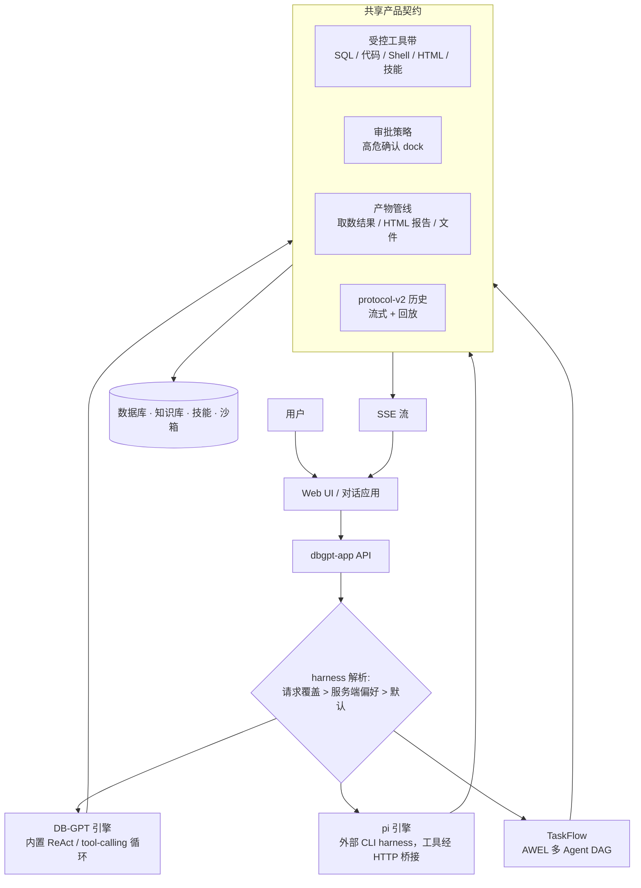

# 架构

DB-GPT 是一个 Python monorepo，围绕 **harness（执行引擎层）** 组织：产品表面
（对话 UI、产物、审批、历史）与引擎无关，可插拔的 **harness 引擎** 持有 Agent 循环。
当前内置两个引擎——DB-GPT 内置 ReAct 运行时与外部 `pi` CLI harness；声明式的
**TaskFlow 工作流** 在同一契约之上编排多 Agent DAG。

## 仓库布局

```text
DB-GPT/
├── packages/
│   ├── dbgpt-core/        # 核心 agent、记忆、规划、RAG、模型抽象
│   ├── dbgpt-app/         # 应用服务器、API 路由、harness 适配器、UI 静态托管
│   ├── dbgpt-serve/       # 服务层：知识库、flow、数据源、应用服务
│   ├── dbgpt-ext/         # 扩展：数据源、存储后端、RAG 连接器
│   ├── dbgpt-client/      # Python 客户端 SDK
│   ├── dbgpt-sandbox/     # 沙箱执行运行时（安全代码/工具执行）
│   └── dbgpt-accelerator/ # 加速包
├── web/                   # Next.js Web UI
├── skills/                # 内置技能与可复用工作流
├── configs/               # TOML 配置文件
└── docs/                  # Docusaurus 文档
```

## 包职责

| 包 | 职责 |
|---|---|
| `dbgpt-core` | 核心 agent 框架、ReAct 解析/动作流、记忆、规划、RAG、模型接口 |
| `dbgpt-app` | FastAPI 应用服务器、chat API、harness 引擎适配器、UI 静态托管 |
| `dbgpt-serve` | 知识库、数据源、flow、应用等资源服务 |
| `dbgpt-ext` | 数据库/存储/RAG 等外部连接器 |
| `dbgpt-client` | DB-GPT API 客户端 SDK |
| `dbgpt-sandbox` | 代码与工具执行的隔离运行时 |
| `skills/` | 打包的领域工作流、脚本、模板与参考 |

## 高层架构



## 工作流程

1. 用户通过 Web UI 或其他客户端发起请求。
2. `dbgpt-app` 接收请求并解析 **harness 引擎**：请求级覆盖优先，其次服务端偏好
   （设置弹层），最后是带可用性门控的项目默认。
3. 选中引擎驱动回合：内置 ReAct 循环、桥接了 DB-GPT 工具的 `pi` 子进程、或
   TaskFlow 的专注节点 DAG。
4. 每次工具调用过同一 containment：受控工具带、只读 SQL 规则、沙箱化代码/Shell、
   以及高危调用的审批策略。
5. 引擎发射同一套 SSE 契约（步骤、思考、工具行、审批、提问）与类型化产物 payload
   （取数结果集、HTML 报告、文件）。
6. 回合以 protocol-v2 历史 payload 持久化，刷新会话可一致地重建时间线、轨迹与产物卡。
7. 结果流式回 UI：运行中看时间线，结束看产物与最终回答。

## Harness 引擎层

harness 层是产品表面跨运行时保持稳定的关键：

| 引擎 | 循环持有者 | 说明 |
|---|---|---|
| DB-GPT | 内置 ReAct / tool-calling agent | 始终可用 |
| pi | 外部 CLI（`pi --mode rpc`）按会话拉起 | 工具、模型与审批由 DB-GPT 桥接 |
| DSH | 预留 | coming soon |

所有引擎共享工具 containment、审批门、产物管线与历史协议。选择语义见
[Harness 指南](../../harness/introduction.md)，新增引擎见
[扩展指南](../../harness/extending.md)。

## 工作流（TaskFlow）

工作流是编译为 AWEL 的声明式 DAG：每个节点是一个带自身目标、工具边界与输出契约的
agent，节点间经数据通道交换干净的上游产出。工作流复用同一 harness 契约，因此节点
运行产出与单 agent 回合相同的轨迹、产物与审批。见
[工作流指南](../../workflow/introduction.md)。

## Agent 使用的资源

### 结构化数据

数据库与可查询表源用于 SQL 式分析、schema 链接与报告生成；取数结果集以一等产物
呈现，支持 CSV / Excel 导出。

### 非结构化数据

知识空间与文档集合为非结构化内容提供检索支持。

### 技能

内置技能把可重复工作流打包为可复用任务单元，agent 可在会话内加载执行。

### 内置工具

工具包括 SQL 执行、shell/代码执行、HTML 渲染、搜索等经资源管理器注册的任务操作。

## 结果交付

输出路径面向用户设计：

`引擎回合` → `共享契约（SSE + 产物）` → `时间线 / 产物卡 / rail` → `Web UI`

无论哪个引擎执行回合，该架构都适合交互式数据分析、报告生成与工具辅助推理。
