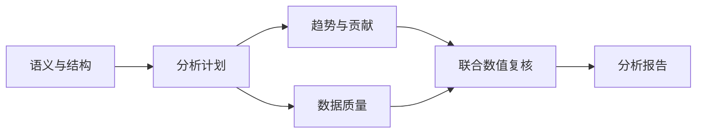

# Agentic Workflow 案例设计

以下是设计配方。只有标注为内置的销售分析结构对应当前模板，其他链需要自建 Flow 和配置资源。

## 销售分析：并行执行，联合复核

数据库智能分析内置模板：

运行前配置数据库，核对节点。语义阶段明确期间、字段和可用已发布指标；两个分支分别承担分析与质量责任；复核对账结果，并把未解决项带入报告。

## 财报比较

自定义链可分为来源与期间对齐、指标提取、比较、引用复核和报告。财年或货币不同，在来源对齐后加入 Gate。显式配置文件或知识访问；这里不表示已有开箱即用财报 Flow 模板。

## SQL 诊断

自定义链可分为结构与计划采集、瓶颈假设、改写/索引候选和变更复核。交付原 SQL、依据、假设与验证步骤。除非另行配置授权，诊断不执行变更。

## 如何沉淀为可复用方法

用业务阶段命名、分配窄责任、要求带依据的产物，并确定需要人介入的位置。Flow 应让遗漏和失败更容易定位，不能用最终报告掩盖缺失证据。
