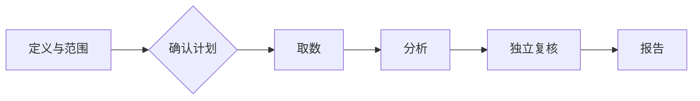

# Agentic Workflow

Agentic Workflow 用明确的**阶段、任务、产物和 Gate**组织 Agent 协作。Agent 在节点内部自主选择方法、调用允许的工具；Flow 在节点之间管理依赖、展示进度并提供复核与介入点。

TaskFlow 是产品中的 Flow 实现，发布时编译为 AWEL 图。业务任务节点代表承担一项明确责任的 Agent；图中也包含开始、输出、数据入口和人工确认等辅助节点。

## 解决什么问题

基于 Prompt 或 Skill 的多 Agent 协作约束较弱，在长程、复杂任务中容易出现流程偏离、任务遗漏、结果不可校验和异常后难以继续等问题。

Flow 将阶段和交接显式化，通过资源边界、复核阶段、状态监控与异常拦截，让团队看清已经完成什么、哪里失败，以及下一步如何介入。

| 方式 | 建模对象 | 协作约束在哪里 |
| --- | --- | --- |
| 预设操作工作流 | 接口、参数、操作和分支 | 预定义操作与引擎规则 |
| Prompt/Skill 协作 | 角色与文字指令 | Agent 上下文和指令遵循 |
| Agentic Workflow | Agent 责任、产物、依赖与 Gate | 阶段之间由 Flow 组织，阶段内部保留 Agent 自主性 |

从模板和业务阶段命名开始，可以减少提前拆解所有技术步骤的成本；资源与产物要求仍需要明确配置。

## 责任链示例

这是建议的自定义设计，不是内置模板原样。当前**数据库智能分析**模板包含语义与结构、计划、并行趋势/贡献分析与数据质量检查、联合数值复核、报告。

## 哪些显式化，哪些仍需验证

Agent 的目标描述责任和交付要求，`Output:` 是提示契约，不是确定性格式验证器。复核 Agent 增加独立检查，但仍需要查看证据。`human_confirm` 是阶段决策，工具审批对应单次操作。

失败可见与下游拦截不等于自动断点恢复。参见[运行与成果](./runs-and-artifacts.md)和[排查](./troubleshooting.md)。

下一步：[上手](./quickstart.md) · [产物契约与 Gate](./contracts-and-gates.md) · [案例设计](./examples.md)。
