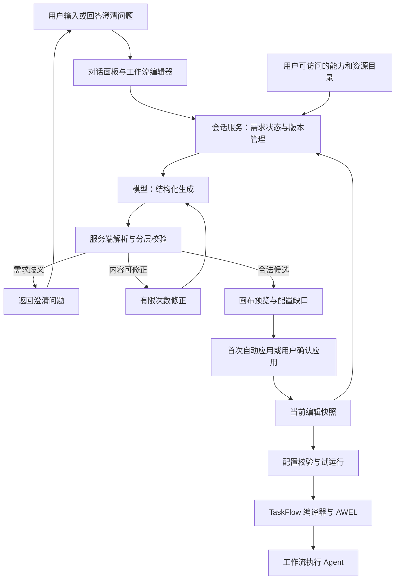
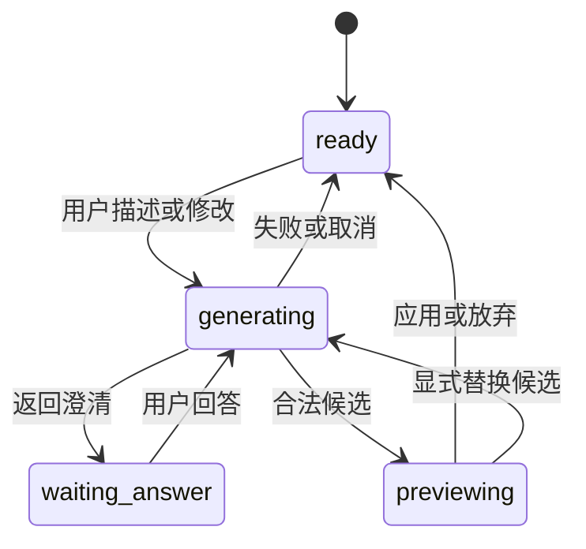

# 多轮对话创建与修改 Agent 工作流：技术方案

日期：2026-11-01  
状态：首版已接入源码；实际范围与验证见 [实现与验证记录](implementation-verification.md)  
适用入口：`http://localhost:3000/taskflow/editor`

## 1. 技术决策与范围

采用 **有状态的多轮对话 + 每轮结构化生成 + 服务端校验修正 + 候选修改预览**。

多轮能力由会话服务管理，不要求工作流生成助手采用 ReAct。模型每轮基于用户指令、已确认需求、当前工作流和实际能力目录，返回需求澄清、流程候选或无法完成三类结果；后端决定是否接受结果及更新状态。

生成结果是 `taskflow/1` JSON。前端将它渲染为画布；后端继续使用 TaskFlow 编译器生成 AWEL 执行图。生成阶段不调用流程内的业务工具、不运行工作流。

首版支持：

- 从空白画布生成串行多 Agent 工作流。
- 多轮需求澄清、需求更正及持续修改。
- 显式选择整个流程或选中节点作为修改范围。
- 服务端结构、资源、策略与编译就绪校验。
- 修改差异预览、应用、放弃和撤销最近一次应用。
- 与手动编辑同步，处理过期候选、重复请求和取消。
- 保存草稿、试运行，以及版本匹配的发布验证。

首版新增流程的业务节点统一为 `agent`，边界节点为 `start`、`output`。已有混合节点流程继续兼容；局部修改不强制迁移未受影响节点。

并行、条件分支、循环、真实人工审批和失败节点续跑不在首版范围。对不支持的请求明确说明；只有用户接受替代方案后才改为串行。

## 2. 架构与职责



| 模块 | 职责 | 不承担的职责 |
| --- | --- | --- |
| 对话面板 | 输入、回答、展示进度、候选与缺口 | 自行决定服务端校验是否成功 |
| 会话服务 | 持有会话、需求、编辑快照与版本，组织模型调用 | 执行业务查询或自动发布 |
| 结构化生成器 | 解释本轮意图，输出符合约定的需求变更与候选 | 自行授权资源、自行调用编译或执行工具 |
| 校验器 | 解析、检查结构与资源、验证策略，必要时触发有限修正 | 用格式通过代替业务效果验证 |
| 候选应用服务 | 计算差异、检查基础版本，原子应用 | 将未应用候选写成正式流程 |
| TaskFlow/AWEL | 编译与运行已验证的执行定义 | 管理编辑对话的需求状态 |
| 工作流执行 Agent | 在节点能力范围内完成任务并交接产出 | 修改编辑器中的工作流结构 |

能力目录、资源权限和校验工具由服务端确定性调用。模型只接收必要结果；没有自主工具循环。后续需要自主探索多种能力时，可以替换生成器为 ReAct，保留外部会话、校验和候选协议。

## 3. 核心对象与唯一事实来源

建议新增以下概念对象；表结构与存储实现可沿用项目现有持久化规范。

| 对象 | 核心字段 | 含义 |
| --- | --- | --- |
| `GenerationSession` | `session_id`、所有者、`flow_uid?`、会话状态、`context_revision` | 一个逻辑工作流的编辑对话 |
| `RequirementContext` | 目标、范围、约束、输出要求、假设、待回答问题 | 已确认或明确标注来源的需求 |
| `EditingSnapshot` | `draft_revision`、元信息、DSL、`dirty` | 当前实际画布，包括已应用候选和手动编辑 |
| `ConversationMessage` | `message_id`、角色、文本、问题答案引用 | 用户指令与对外说明 |
| `GenerationRequest` | `request_id`、状态、基础版本、取消标记 | 一轮生成任务 |
| `GenerationCandidate` | 候选 ID、基础版本、完整 DSL、差异、缺口、状态 | 尚待应用的建议结果 |
| `RunRecord` | 运行 ID、编辑版本与指纹、资源配置指纹、参数、最终状态 | 试运行对应哪份定义及配置 |
| `PublishedSnapshot` | 发布版本、不可变定义、资源引用、发布人 | 正式运行引用的工作流版本 |

约束：

1. `EditingSnapshot` 是当前画布的唯一事实来源；对话历史不能覆盖它。
2. `RequirementContext` 保存用户确认的信息；模型假设、未应用候选和生成失败不能被摘要成用户已同意。
3. DSL 是唯一执行定义。需求摘要、节点说明、候选差异属于编辑辅助数据。
4. 模型输出的差异仅供参考，最终差异由服务端比较当前快照与候选计算。
5. 能力和资源 ID 必须从服务端实际目录解析，不能接受模型臆造的资源。

### 编辑会话持久化与“保存草稿”的区别

建议会话服务持久化当前编辑检查点，以支持刷新后恢复对话、需求与画布。检查点不是已发布流程，也不注册 DAG。

用户点击“保存草稿”时，才将当前已应用的检查点保存为逻辑工作流的正式草稿记录，并清除 `dirty`。新流程此前仍显示“未保存草稿”。候选修改不能通过保存按钮隐式应用。

该检查点恢复是本技术方案的新增建议，超出此前仅承诺恢复已保存草稿的最低范围；若首版不提供检查点恢复，应明确显示未保存内容无法保证恢复。

## 4. 每轮处理流程

1. 验证会话所有者、请求幂等键及客户端提交的基础版本。
2. 获取服务端最新编辑快照、需求状态、待回答问题和能力目录。
3. 检查上一轮候选：用户必须先应用、放弃，或显式选择“替换候选”。
4. 持久化本轮用户消息及请求状态，捕获 `draft_revision` 与 `context_revision`。
5. 组装上下文，调用结构化生成器。
6. 严格解析模型响应，校验结果类型及对应字段。
7. 根据结果分流：
   - `clarification`：更新问题与需求状态，返回问题，画布不变。
   - `candidate`：校验候选；格式或结构错误进入有限修正，配置缺口进入待配置反馈。
   - `failure`：返回原因及可行替代选项，保留当前画布。
8. 完成前检查请求是否取消、版本是否改变及能力目录是否失效。
9. 返回终态；首次合法生成可经同一应用服务自动应用，后续修改只进入预览。

不能把用户未回答的业务问题作为模型修正循环的输入，要求模型“猜到通过”。用户歧义需要澄清；模型输出错误才进入自动修正。

## 5. 需求确认与反复调整

### 5.1 两类确认

| 确认类型 | 触发条件 | 保存结果 | 是否改画布 |
| --- | --- | --- | --- |
| 需求澄清 | 缺少会改变目标、行为或职责的信息 | 更新已确认需求，关闭对应问题 | 否 |
| 候选应用 | 已有工作流的结构或配置将发生变化 | 候选变为已应用，更新编辑快照 | 是 |

例如“分析销售情况”缺少分析方向，可以问趋势分析还是下降归因。“数据源尚未选择”通常属于配置缺口，可以先生成取数 Agent，再让用户选择资源。

用户在澄清阶段说“可以，继续”，只有在上一条建议具有明确、唯一指向时才能视为确认；否则继续澄清。问题应携带稳定 `question_id`；结构化回答携带对应 ID，避免错误关联旧问题。

### 5.2 需求状态的更新规则

- 显式用户回答和更正优先于旧需求及模型假设。
- 新指令如果与旧约束冲突，明确指出冲突；例如先要求“只读诊断”，后要求“直接修复数据库”。
- 信息完整后直接生成，不在每一轮重复要求用户确认已明确的内容。
- 用户撤销候选时，撤销工作流快照；用户明确表达的新需求保留。如果画布与需求不同，标记“尚未应用到流程”。
- 若用户也要撤销需求，更正 `RequirementContext`，不能只回滚画布。
- 待应用候选不进入“已实施流程”摘要；失败和放弃的候选只保留事件记录。

### 5.3 局部修改

请求携带显式 `scope`：

```json
{
  "type": "nodes",
  "node_ids": ["n3"]
}
```

`scope.type` 为 `flow` 时作用于整个流程。选择节点只提供上下文，不自动改变范围。

局部修改应保留未受影响节点 ID、配置与顺序。若局部改动需要调整下游输入或连线，必须在差异中列出；超出范围的改动返回范围扩大建议，不能隐式应用。

## 6. 上下文构建与模型输出协议

### 6.1 上下文组成

每次模型调用包括：

1. 系统约束：首版节点类型、顺序语义、能力边界、输出协议。
2. 服务端最新编辑快照及元信息。
3. 已确认目标、范围、约束和输出要求。
4. 未确认假设与待回答问题，明确区分于已确认需求。
5. 最近必要对话及压缩摘要。
6. 用户当前指令、显式作用范围和选中节点。
7. 当前用户可用能力、模型与资源的必要元信息。

当前快照与当前指令不因摘要压缩被替换。上下文预算不足时，先裁剪无关能力和旧闲聊，再压缩历史；仍无法容纳时返回明确错误，不能静默丢失关键节点。

摘要记录已确认事实、未实施需求和待回答问题，不记录模型隐藏推理。模型输入中不包含数据库密码、模型密钥等凭据；使用资源 ID 引用。

### 6.2 模型响应

定义 `generation_result/1`，采用严格的区分类型结构。支持结构化输出的模型使用 JSON Schema；不支持时使用 JSON 文本加严格解析。不能仅以提取到一段 JSON 认定成功。

模型提供：

- `type`：`clarification | candidate | failure`。
- `summary`：面向用户的说明。
- `requirement_updates`：新增或更正的需求，标记来源和确认状态。
- 与结果类型对应的专有字段。

`session_id`、请求 ID、基础版本、目录版本、校验结果和最终差异均由服务端填充，模型不能决定这些可信字段。

服务端返回澄清示例：

```json
{
  "protocol": "generation_result/1",
  "type": "clarification",
  "session_id": "gs_001",
  "request_id": "gr_001",
  "base_draft_revision": 0,
  "base_context_revision": 0,
  "context_revision": 1,
  "summary": "需要明确销售分析的方向。",
  "questions": [
    {
      "question_id": "q_direction",
      "field": "analysis_objective",
      "text": "主要看销售趋势，还是诊断下降原因？",
      "options": ["销售趋势", "下降归因"],
      "allow_free_text": true
    }
  ]
}
```

服务端返回候选的主要字段：

```text
protocol
type = candidate
session_id / request_id / candidate_id
base_draft_revision / base_context_revision
context_revision
capability_catalog_version
flow_meta
candidate_dsl
change_summary
assumptions
missing_configuration
validation = { structure, resource_readiness, compile_readiness }
```

`candidate_dsl` 是完整流程定义，不是任意可执行补丁。字段格式继续沿用：

```json
{
  "format": "taskflow/1",
  "nodes": [
    {"id": "n1", "kind": "start", "config": {}},
    {
      "id": "n2",
      "kind": "agent",
      "label": "分析 Agent",
      "config": {
        "goal": "分析用户提供的数据。交付结论、依据及无法确认的问题。",
        "tools": [],
        "skills": []
      }
    },
    {"id": "n3", "kind": "output", "config": {}}
  ],
  "edges": [["n1", "n2"], ["n2", "n3"]]
}
```

该示例只说明 DSL 结构；没有数据获取能力，不代表可完成真实销售分析。真实候选须绑定可用工具与资源，并返回缺口。

`failure` 返回稳定错误码、可展示原因及是否可重试。网络故障、取消和执行超时由服务端任务状态表达，不伪装成用户需求失败。

## 7. 校验与修正机制

| 校验层 | 内容 | 不通过的处理 |
| --- | --- | --- |
| 响应协议 | 结果类型、必需字段、字段类型、未知字段处理 | 有限修正或生成失败 |
| 图结构 | 节点类型、唯一 ID、开始与输出、合法边、无环、单链与可达性 | 有限修正，不进入画布 |
| 修改范围 | 未受影响节点稳定、改动符合 scope | 修正；确需扩大范围则向用户说明 |
| 字段与引用 | 目标非空、能力和资源 ID 实际存在 | 无效引用修正；确实缺资源则返回缺口 |
| 权限与策略 | 用户范围、角色默认工具、技能与 MCP 实际行为 | 禁止越权；要求不支持则返回无法完成 |
| 编译就绪 | 必需配置就绪后能形成合法 AWEL 图 | 配置缺口先补；结构编译错误修正 |
| 运行效果 | 真实终态与步骤交付结果 | 试运行失败，由用户发起修改与重新运行 |

“能力是否足以完成目标”可由生成器给出判断并在试运行中验证；不能包装为完全确定性的静态正确性保证。

### 允许待配置候选

结构合法但数据源尚未选择的候选可进入草稿，并标记：

- `structure = valid`
- `resource_readiness = incomplete`
- `compile_readiness = pending_configuration`

未补齐配置前不能试运行或发布。服务端不能为了编译通过而选择默认数据库、放开资源范围或删除必要约束。

### 有限修正

将机器可定位的问题传给生成器，例如：

```json
{
  "code": "INVALID_EDGE_REFERENCE",
  "path": "edges[2][1]",
  "message": "目标节点 n8 不存在",
  "retryable_by_generation": true
}
```

修正仍使用同一基础快照和已确认需求，不能顺便扩大能力范围。新增建议配置 `generation_max_repairs`；首版建议默认 2 次修正，即最多 3 次模型调用，具体值可在实现评审调整。设置整轮时间与输出预算，耗尽后返回失败并保留画布。

每次修正后重新执行全部相关校验。配置缺口和业务歧义不会消耗无意义的自动修正循环。

## 8. 会话、候选与任务状态



会话状态简化为 `ready | generating | waiting_answer | previewing`。失败原因留在请求记录，不把整个会话永久标为失败。

请求状态：`queued → running → succeeded | failed | cancelled`。  
候选状态：`pending → applied | discarded | stale`。

首次生成自动应用仍需经过候选应用服务和版本校验，只是前端无需展示应用按钮。已有工作流生成的候选必须审阅应用，不自动改变画布。

生成候选期间可以手动编辑；编辑提交成功后，旧请求结果不能自动应用，已有候选标记 `stale`。重新生成基于最新快照，不在后台自动重放旧修改。

## 9. 版本、同步与幂等

采用两个单调递增版本：

- `draft_revision`：DSL 或工作流元信息发生变化时递增。
- `context_revision`：需求、待回答问题、会话上下文发生变化时递增。

候选记录生成前的基础版本，以及本轮需求更新提交后的上下文版本。应用时必须匹配当前编辑版本和该候选对应的上下文版本；资源目录变化时重新校验权限与能力。

### 手动编辑同步

前端只有一份统一草稿状态，手动编辑和候选应用均更新它。手动编辑提交携带基础版本，服务端按比较并交换方式更新检查点。

提交可以合并连续输入，但发起生成、应用、试运行、保存前必须先完成手动编辑同步。同步失败时保留本地修改并展示冲突，不自动以服务端旧快照覆盖。

### 应用与撤销

候选应用事务检查状态、版本和授权，原子更新检查点及候选状态。网络重试采用幂等键；同一候选重复应用返回同一应用结果，不再增加版本。

撤销恢复最近一次应用前的快照，但产生新版本号；不把版本计数倒退。若应用后已有新的手动编辑，首版禁用该次直接撤销，提示可能覆盖后续改动；不静默丢失修改。

撤销画布不自动撤销用户确认需求，规则见第 5 节。

### 请求并发与取消

一个会话同一时间只接受一个活动生成请求。重复幂等键返回原任务；不同的新请求返回冲突，用户可先取消旧请求再提交。

取消首先持久化 `cancelled`；尽可能取消模型调用。即使上游无法即时取消，迟到响应也不得发布候选、更新需求或修改画布。已成功完成的请求不能被“取消”追溯撤销；用户应放弃候选或撤销应用。

## 10. 建议接口与流式事件

以下为新增候选接口，前缀应结合现有服务路由统一；不代表仓库已有接口。

| 方法与路径 | 作用 |
| --- | --- |
| `POST /taskflow/generation-sessions` | 建立会话，初始化空白或已有流程编辑快照 |
| `GET /taskflow/generation-sessions/{id}` | 恢复需求、检查点、活动任务和候选 |
| `PUT /taskflow/generation-sessions/{id}/draft` | 按版本同步手动编辑检查点 |
| `POST /taskflow/generation-sessions/{id}/messages` | 提交指令或澄清答案，返回生成请求 ID |
| `GET /taskflow/generation-requests/{id}/events` | SSE 获取进度及终态 |
| `GET /taskflow/generation-requests/{id}` | 获取任务状态，供断线恢复 |
| `POST /taskflow/generation-requests/{id}/cancel` | 取消指定请求 |
| `POST /taskflow/generation-candidates/{id}/apply` | 原子应用候选 |
| `POST /taskflow/generation-candidates/{id}/discard` | 放弃候选 |
| `POST /taskflow/generation-sessions/{id}/undo` | 撤销最近一次仍可安全撤销的应用 |

消息提交示例：

```json
{
  "client_message_id": "cm_002",
  "expected_draft_revision": 0,
  "expected_context_revision": 1,
  "text": "诊断下降原因，按地区分析。",
  "answers": [
    {
      "question_id": "q_direction",
      "value": "下降归因"
    }
  ],
  "scope": {"type": "flow"},
  "selected_node_id": null,
  "pending_candidate_action": null
}
```

客户端快照必须先经 `draft` 接口同步。消息中的期望版本仅用于并发校验，服务端读取自己的快照；不能信任任意用户上传的 DSL 或能力列表。

SSE 事件建议包括：

- `request_started`
- `progress`：理解目标、构建流程、校验中、修正中等实际阶段。
- `result`：一次且仅一次的最终三类业务结果。
- `request_failed`
- `request_cancelled`

每个事件携带递增事件 ID 和请求 ID。支持 `Last-Event-ID` 恢复或通过任务查询接口获取最终结果。前端不能因 SSE 断开重复提交生成；应查询原任务。

界面只展示阶段说明和对外结果，不展示模型隐藏推理。HTTP 层区分鉴权失败、版本冲突、格式错误和资源不可用；机器错误码与面向用户文案分开。

## 11. 试运行、保存与发布衔接

应用候选只更新编辑检查点，不注册 DAG。保存正式草稿也不得替换已发布 DAG。

试运行复用现有 `/api/v2/serve/awel/flow/debug`，增加运行记录与版本绑定。快照包括：

- 规范化 DSL 与元信息指纹。
- `draft_revision`。
- 有效模型及工具、技能、资源配置指纹。
- 本次运行参数与最终状态。

同一草稿内容或有效运行配置变化后，旧试运行记录标为不再满足发布条件。运行成功只证明本次输入得到成功结果，不能保证所有输入。

现有调试面板对“存在步骤 marker”直接标成功的逻辑需要修正：必须读取真实 `running / success / failed` 状态，并结合服务端最终状态。SSE 正常结束、出现文本或出现 marker 都不是成功依据。

发布要求当前快照配置有效、没有待应用候选，以及服务端持有匹配当前版本及配置的成功试运行证据。

### 发布版本隔离

当前 `update_flow()` 会更新同一实体、注销旧 DAG 并重新注册。需要增加独立草稿和不可变发布快照，正式运行引用发布快照，试运行引用编辑快照。

为降低第一阶段改动，也可只支持新流程及“从已发布流程另存为新草稿”。这个备选不具备同一逻辑流程下的连续版本发布，必须在界面中明确独立对象关系。

首版不依赖现有软确认节点授权写操作。其目前不具备真实暂停等待批准的能力。

## 12. 多轮交互完整示例

| 轮次 | 用户行为 | 服务端处理与输出 | 画布变化 |
| --- | --- | --- | --- |
| 1 | “分析销售情况” | 返回分析方向问题，记录待回答问题 | 无 |
| 2 | “诊断下降原因，按地区分析” | 更新已确认需求；生成取数、归因、报告候选，指出数据源缺口 | 首次合法结果自动进入草稿 |
| 3 | 选择真实数据源 | 同步手动配置，版本递增 | 取数节点解除缺口 |
| 4 | “加一个复核，报告简短一点” | 基于最新流程生成候选；新增复核，修改报告目标 | 仅预览 |
| 5 | 点击应用 | 版本与权限检查通过，原子更新快照 | 更新草稿，验证过期 |
| 6 | “复核只检查数据依据，不改分析结论” | 节点局部修改候选，保留其他节点配置 | 仅预览 |
| 7 | 在预览期间手动改报告名称 | 同步快照后使候选过期 | 手动修改保留 |
| 8 | 重新生成并应用 | 用新版本生成，保留手动名称 | 更新草稿 |
| 9 | 试运行失败，要求调整归因规则 | 错误及运行快照作为上下文，生成修正候选 | 仅预览，不自动运行 |
| 10 | 应用、再次试运行成功、发布 | 保存验证证据并发布不可变快照 | 显示已发布版本 |

无论经过多少轮，输入始终是最新快照与需求状态；模型不会根据旧聊天重新创建整份流程而覆盖手动修改。

## 13. 实现边界与改动程度

| 模块 | 复用或新增 | 改动程度 |
| --- | --- | --- |
| TaskFlow JSON 与通用 Agent 节点 | 继续复用 | 小 |
| TaskFlow → AWEL 编译链 | 复用，新增首版顺序约束 | 小 |
| 多轮会话服务与编辑检查点 | 新增 | 中 |
| 结构化生成及有限修正 | 基于现有模型调用链新增 | 中 |
| 对话面板、差异预览与统一草稿状态 | 新增，复用现有画布和配置 | 中 |
| 能力目录、权限及运行策略检查 | 复用目录并补校验 | 小至中 |
| 临时试运行与状态展示 | 复用并修正成功判定、增加版本绑定 | 小至中 |
| 草稿与发布版本生命周期 | 调整实体及 DAG 注册边界 | 中 |
| 并行、分支、循环、真实审批 | 后续扩展 | 大 |

整体是中等规模扩展，无需重写核心执行框架。该程度是结构性判断，不是工期承诺。

## 14. 验证与待决事项

应覆盖以下行为：

- 澄清答案正确关联问题，新回答能更正旧假设。
- 未回答的歧义不会被自动修正循环猜测填充。
- 反复修改保留未受影响的节点 ID、资源与手动配置。
- 无效模型输出、超限修正、取消和迟到响应保持原画布。
- 待配置结构可保存，但不能运行或发布。
- 幂等重试不重复调用生成、不重复应用、不增加重复版本。
- 手动编辑、新需求或权限变化使旧候选不可直接应用。
- 撤销不会静默覆盖应用后的手动修改。
- 流断线可恢复原任务，不产生新的生成请求。
- 刷新后恢复的需求不把候选和假设当作已确认事实。
- 运行成功判定基于真实终态，发布证据匹配当前版本。
- 编辑草稿不注销或改变现有发布 DAG。

仍需实现评审确定：

- 会话检查点和原始消息的保留期限、归属及删除规则。
- 现有模型服务是否支持 JSON Schema；不支持时选择的解析适配。
- 能力目录的版本标识与策略执行机制。
- 采用完整发布版本隔离，还是先限制为新建及另存草稿。
- 工作流发布后的可见范围沿用哪套已有权限。

## 15. 仓库依据与配套资料

以下结论来自本次对话中已核实的仓库实现，不表示本方案新增能力已落地：

- `web/pages/taskflow/editor.tsx`：当前 DSL、节点操作、自然语言占位入口、保存与发布。
- `web/types/taskflow.ts`：TaskFlow JSON 类型、Agent 选项与运行标记。
- `web/components/taskflow/editor/PropertyPanel.tsx`：节点配置入口。
- `web/components/taskflow/editor/DebugDrawer.tsx`：临时调试调用与现有步骤状态显示。
- `packages/dbgpt-serve/src/dbgpt_serve/flow/taskflow/nodes.py`：通用 Agent 可配置字段。
- `packages/dbgpt-serve/src/dbgpt_serve/flow/taskflow/dsl.py`：解析、图校验和未接通的执行策略预留键。
- `packages/dbgpt-serve/src/dbgpt_serve/flow/taskflow/compiler.py`：编译及前序数据传播语义。
- `packages/dbgpt-serve/src/dbgpt_serve/flow/service/service.py`：更新实体与 DAG 注册生命周期。
- `packages/dbgpt-app/src/dbgpt_app/operators/taskflow.py`：软确认透传实现。
- `packages/dbgpt-app/src/dbgpt_app/operators/taskflow_agent.py`：流程执行 Agent。

配套：[产品方案与可点击原型](taskflow-conversation-design.html)；[前期工程落地说明](implementation-notes.md)。

本文保留完整技术设计，实际 API、交付范围与限制以 [实现与验证记录](implementation-verification.md) 为准。
